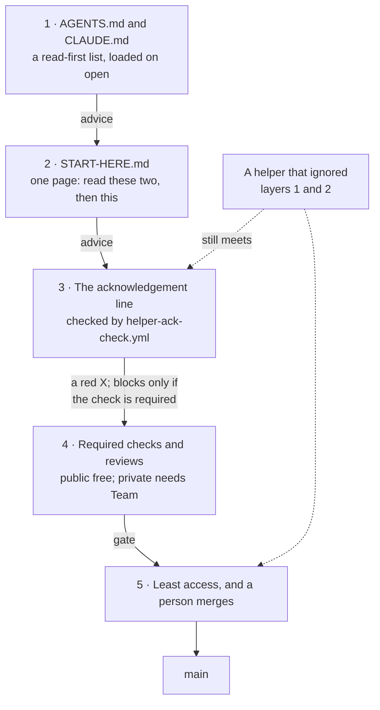

<!-- readme-standard: 2026-11-02 -->

# Agent onboarding: other people's helpers, and our procedures

*How to make it likely that someone else's AI helper reads our procedures first, and how to make it safe if it does not.*

 **You are here:** drasticstatic lab › [`my-template`](./README.md) › `AGENT-ONBOARDING.md` · public · `main` is the working branch

##  TL;DR

1.  **The honest answer: nothing can force an outside agent to read a file.** Instructions are advice. Only a gate, something that refuses the action, enforces anything.
2.  **So we use both.** Files make the good path the easy one for helpers that behave; gates hold when one does not. Five layers below, cheapest first.
3.  **The new piece** is an acknowledgement line in the pull request template, *"I read SOP-OPS-002 and SOP-IT-004"*, and a small workflow that fails any pull request without it. It proves the line was ticked, not that anything was read. It is a speed bump and a receipt.
4.  **What stays true on the free plan:** on a private repository nothing stops a person or helper with write access from merging past a red check. Least access and a human merging carry that weight until the organisation has Team.
5.  **Do this first.** Copy `AGENTS.md`, `CLAUDE.md`, `START-HERE.md`, `.github/PULL_REQUEST_TEMPLATE.md` and `.github/workflows/helper-ack-check.yml` from [`sop-template/repo/`](./sop-template/repo/). Nothing has been spread to any organisation yet.

##  The question, and why the answer is not "write a stronger instruction"

Christopher asked how to make sure other people's agents go through our SOPs before proceeding.

We do not control their agent. We do not choose its model, its settings or its instructions, and whoever runs it can tell it to ignore anything we wrote. The vendors say the same thing about their own products:

- AGENTS.md is "a simple, open format for guiding coding agents", with no required fields. Agents read the nearest one, and an explicit prompt from the user overrides it ([agents.md](https://agents.md/), read 2026-11-05). It names Codex, Jules, Cursor, Copilot's coding agent, Gemini CLI, Windsurf, Devin, Aider and others as tools that use it.
- Claude Code loads `CLAUDE.md` at the start of each session and treats it "as context, not enforced configuration"; to block an action whatever the model decides, the page points to a hook, and a hook lives on the helper's own machine, out of our reach ([Claude Code's memory page](https://code.claude.com/docs/en/memory), read 2026-11-05).

So a sentence in capital letters is not a control. Our control starts at the point where a change reaches something we own: the repository.

##  The five layers

| # | Layer | What it does | What it cannot do | Kind |
|---|---|---|---|---|
| 1 |  **`AGENTS.md` and `CLAUDE.md`** at each repository's root | names a short read-first list; helpers that honour these files load them when they open the repository | reach a helper that does not look, or one told otherwise | advice |
| 2 |  **`START-HERE.md`** for helpers | one page a person can hand over: *"Read START-HERE.md and do what it says before you change anything."* Short enough that it gets read | prove it was read | advice |
| 3 |  **The acknowledgement** in the pull request template, checked by `helper-ack-check.yml` | fails the check until the box is ticked, and leaves a dated record that someone said so | tell a true tick from a false one | a speed bump, and a gate if layer 4 requires it |
| 4 |  **Required checks and reviews** on `main` | GitHub refuses the merge until they pass | apply to private repositories on the free plan (table below) | gate |
| 5 |  **Least access, and a person merges** | an outside helper works from a fork or with the narrowest token that does the job; a person with the role reads and merges (SOP-OPS-002) | stop someone you gave admin to | gate, and the one that matters most |

**If you can only do one, do layer 5.** A helper with no write access can ignore every other layer and still change nothing.

##  What each plan allows

Read on GitHub's own pages on Nov 5, 2026. Prices move, so check on the day.

| | Public repository, Free | Private repository, Free (personal or organisation) | Private repository, Team |
|---|---|---|---|
| Layers 1 and 2: the files | yes | yes | yes |
| Layer 3: the workflow runs | yes, and Actions are free on public repositories | yes, from 2,000 minutes a month | yes, from 3,000 minutes a month |
| Layer 3: what a failure does | a red X; blocks if required | **a red X only. The merge button still works** | a red X; blocks if required |
| Layer 4: required checks and reviews | **yes** | **no** | **yes** |
| Layer 5: least access | yes | yes, with one catch below | yes |
| Cost | $0 | $0 | $4 per user per month |

Sources, all read 2026-11-05: [About protected branches](https://docs.github.com/en/repositories/configuring-branches-and-merges-in-your-repository/managing-protected-branches/about-protected-branches) ("available in public repositories with GitHub Free and GitHub Free for organizations… also available in public and private repositories with GitHub Pro, GitHub Team, GitHub Enterprise Cloud"), [About rulesets](https://docs.github.com/en/repositories/configuring-branches-and-merges-in-your-repository/managing-rulesets/about-rulesets), [Available rules for rulesets](https://docs.github.com/en/repositories/configuring-branches-and-merges-in-your-repository/managing-rulesets/available-rules-for-rulesets), and [GitHub's pricing](https://github.com/pricing), which also says eligible nonprofits can get a discounted organisation. UNVERIFIED here: the exact nonprofit terms. GitHub's page on them moved and returned a 404 when we opened it; [`SOP-GOV-002`](./sop-template/repo/GOV/SOP-GOV-002-github-collaboration.md) holds what we knew earlier.

**The catch.** A personal private repository has write collaborators or none, so there is no read-only door to one (proposal THEF-008 tells that story). An outside helper's person should get read access through an organisation repository, with the base permission set to none and a team naming what they may read (SOP-GOV-002).

##  What the pieces look like

All five files are in [`sop-template/repo/`](./sop-template/repo/):

-  [`AGENTS.md`](./sop-template/repo/AGENTS.md): the read-first list and the rules. It works for any tool that reads the format.
-  [`CLAUDE.md`](./sop-template/repo/CLAUDE.md): a one-line import of `AGENTS.md`, so there is one rulebook and Claude Code reads it directly ([the same page](https://code.claude.com/docs/en/memory), its *AGENTS.md* section).
-  [`START-HERE.md`](./sop-template/repo/START-HERE.md): the one page to hand over.
-  [`.github/PULL_REQUEST_TEMPLATE.md`](./sop-template/repo/.github/PULL_REQUEST_TEMPLATE.md): carries the line.
-  [`.github/workflows/helper-ack-check.yml`](./sop-template/repo/.github/workflows/helper-ack-check.yml): plain bash, no third-party action, no secret, read-only. Editing the description re-runs it. Dependabot and the Actions bot are excused, because they cannot read.

**Turning the check into a gate.** Where the plan allows it, an officer adds the check named `helper-ack` to the *Require status checks to pass* rule of the repository's ruleset ([`branch-protection/`](./branch-protection/README.md)). That is a settings change, so it is an officer's step, not a helper's.

 Two depths: could the line prove the page was actually read?

**Plainly:** only partly, and not yet worth building. A helper can be asked something only a reader would know, and a model can answer that having read the page, which is the point. But it can also be fed the answer.

**Technically:** the check could require a short phrase taken from the procedure, changed with each release, so that an old copied line goes stale and fails. That would catch a template pasted from memory, and nothing more. We have not built it, because the ack's value is the record and the pause, and the protection comes from layers 4 and 5.

##  Telling a person, kindly

Most outside helpers arrive with a person who means well. The thing to send them:

> Welcome. Before your helper changes anything here, please give it this sentence: *"Read START-HERE.md in this repository and do what it says before you change anything."* It will open a pull request, and someone here will read it and merge it. You cannot break anything by trying.

##  What happens next

Nothing has been spread. `mystarch_chief-of-staff/PENDING-TASKS.md` holds the task: copying the files to each organisation's procedures repository, and listing IT-004 on each public twin's allowlist so the page the line names can actually be read by a stranger. Whether to pay for Team is each organisation's decision, not this page's.

##  Suggest a change

Found a helper this does not work for, or a better gate? Open an [issue](https://github.com/drasticstatic/my-template/issues) or a pull request against `main`; Christopher reads them and a person with the role merges. Not on GitHub? Tell a steward of your organisation in your own words. Copy any of this for your own repositories, with no need to ask.

Follows the living [README standard](./README-STANDARD.md) and [`LUCID.md`](./LUCID.md). Icons: Phosphor (MIT). Not legal advice. Written Nov 5, 2026 by Alfred (Claude Code CLI) at Christopher's word.
