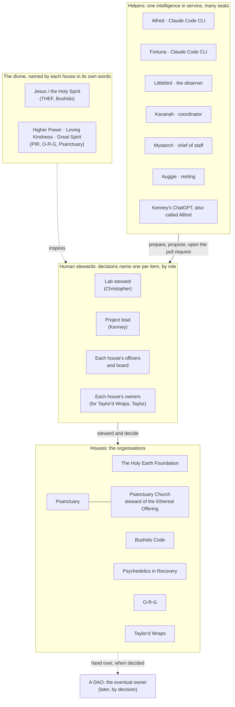

# Entities: how we speak of the divine, of people, of houses and of helpers

*One map, so every page names each one the same honourable way.*

> [!NOTE]
> **Draft, we massage this as we go.** This map is the fleet's working agreement on words, not a creed and not a legal
> document. Each organisation's officers have the last word on how their own house speaks. Change it by pull request,
> with the reason in the description.

##  TL;DR

1.  **The divine is named by each house in its own words.** The Holy Earth Foundation and Bushido may name their spiritual founder as Jesus / the Holy Spirit. Psychedelics in Recovery, O-R-G and Psanctuary speak of a Higher Power, Loving Kindness, Great Spirit.
2.  **Decisions name a human steward, per item**, by role: the lab steward, the project lead, the officers. A DAO is the eventual owner, later.
3.  **Each organisation is a house** with its own colour, its own repositories and its own officers.
4.  **Helpers serve; they do not decide.** Every agent prepares, and a person with the role says yes.
5.  **"We are all Alfred."** Many helpers, many seats, one intelligence in service.

##  The map

The arrows are the whole idea: **inspiration** comes from the source; **decisions** are made by people; the houses are
**stewarded**, not owned outright; helpers **prepare** and people **merge**.

##  The divine

| House | How it speaks of the divine | Notes |
|---|---|---|
| The Holy Earth Foundation | its spiritual founder is **Jesus / the Holy Spirit** | the foundation may say so plainly |
| Bushido Code | may name its spiritual founder as the foundation does | |
| Psychedelics in Recovery | **Higher Power**, **Loving Kindness**, **Great Spirit** | which of these each house prefers is its officers' choice, to be confirmed; no one is told whose Higher Power |
| O-R-G | **Higher Power**, **Loving Kindness**, **Great Spirit** | as above |
| Psanctuary | **Higher Power**, **Loving Kindness**, **Great Spirit** | as above; "Psanctuary · Ethereal Offering" |
| Psanctuary Church | in its own words, to be confirmed by its stewards | steward of the Ethereal Offering |
| Taylor'd Wraps | not named | a business; the fleet's courtesy, not its faith, is what it carries |

> [!NOTE]
> **Waiting on each house's officers (2026-11-02).** The names in this table are a working draft until each house's officers confirm them. O-R-G's own deck, *ORG Spirituality Centers*, says **The Universal Creator**, which this table doesn't carry yet; whether it joins or replaces the words above is for O-R-G's officers to say. Nothing changes here until they do.

- **Honour, never borrow.** A page about one house uses that house's words. A shared template uses none, or all, side by side.
- **Never put words in a person's mouth.** "The foundation names…", not "we all believe…".
- **Capitalise** the names of the divine as each tradition does.

##  People: stewards, not owners

| Role | Who, today | Decides |
|---|---|---|
| **Lab steward** | Christopher | the lab: templates, the drafting desks, the helpers' rules, what a helper may do |
| **Project lead** | Kenney | the projects he leads (for example Bushido Code's Escape Trainer) and what ships in them |
| **Officers and board** | each house's own | the house: membership, money, what is published, which procedures are approved (a tag) |
| **Owners** | each organisation's GitHub owners (for Taylor'd Wraps, Taylor) | settings, teams, who is invited |
| **A DAO** | not yet | the eventual owner, when the officers decide to hand over |

- **Decisions name the steward per item.** A decisions log or `decisions-open.md` says *which* role decides *this* item, not "the team".
- **Name people by role first**, first name where it helps ("the project lead, Kenney"), never a private address or handle that was given privately.

##  Houses

| House | Colour family | Also known as |
|---|---|---|
| The Holy Earth Foundation | amber | THEF |
| Psychedelics in Recovery | purple | PIR |
| Psanctuary | teal | Psanctuary · Ethereal Offering |
| Psanctuary Church | blue | steward of the Ethereal Offering |
| O-R-G | emerald | ORG |
| Taylor'd Wraps | magenta | Taylor's house |
| Bushido Code | its own banner | the Escape Trainer is its first build |
| the drasticstatic lab | brass on slate | the lab, where templates and drafts are made |

The colours are in [`proposals-template/TONES.md`](proposals-template/TONES.md).

##  Helpers: "we are all Alfred"

| Helper | Seat | Serves |
|---|---|---|
| **Alfred** | Claude Code CLI, in a terminal | the lab and every house: builds, writes, opens pull requests |
| **Fortuna** | Claude Code CLI, in her own workspace | her own lane; looped in where it touches the others |
| **Littlebird** | the observer app | sees what Christopher sees, captures research and meetings verbatim, writes notes |
| **Kavanah** | Augment Intent | coordination across workspaces |
| **Mystarch** | Augment Intent, app-level | chief of staff: keeps the whole set coherent |
| **Auggie** | Augment CLI | resting; may return |
| **Kenney's helper** | ChatGPT, which Kenney also calls **Alfred** | Kenney, in his own words and language |

**One intelligence, many seats.** Each helper signs its work with its own seat (`Co-Authored-By: <Agent> · <Engine> · …`,
[`AGENT-SYNC/README.md`](AGENT-SYNC/README.md)), so the record stays true about who did what. And each one is in the
same service: Kenney's ChatGPT took the name Alfred too, and that is welcome, not a clash. *We are all Alfred.* A helper
outside the fleet works the same way ([`walkthroughs/WORKING-WITH-THE-FLEET.md`](walkthroughs/WORKING-WITH-THE-FLEET.md)).

How helpers are spoken of:
- **By name and seat**, never as a person ("Alfred, Claude Code CLI", not "Alfred said he felt…").
- **Serving, never deciding.** "Alfred prepared; the steward merged."
- **No will of their own.** A bot that watches is a wakeful servant; the guardrails are the feedback loop and the people who read it.

##  Change log

| Date | Change | By |
|---|---|---|
| 2026-11-01 | Drafted from Christopher's Nov 1 brief: the divine per house, stewards per item, the future DAO, the helpers and "we are all Alfred" | Alfred |

Related: [LUCID.md](LUCID.md) (the clarity standard), [NAMES-POLICY.md](NAMES-POLICY.md) (what may be public). Icons: Lucide (ISC).
