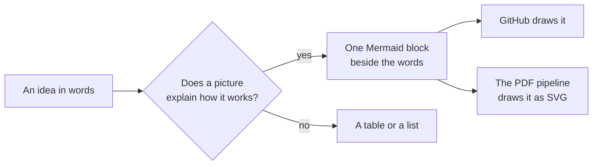
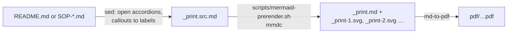

<div align="center">


# Lucid: the fleet's clarity standard

*Plain words, an icon beside every idea, a picture where a picture explains the mechanism.*


</div>

##  TL;DR

1.  **Plain words.** Write so a person new to GitHub, and their helper, can act on the page without the author in the room.
2.  **One Lucide icon beside each idea**, from the repository's own `assets/icons/`, never a hot-linked image.
3.  **One Mermaid diagram where a picture explains the mechanism**: a road, a hand-off, a who-reads-what. Not decoration.
4.  **Accurate to what exists.** Every link, path and command was opened or run before it was written down.
5.  **The PDF shows the same picture.** The PDF pipelines draw Mermaid as SVG before printing ([below](#-mermaid-in-pdfs)).

This page is the standard. The proposals template, the SOP template, the decks template and every walkthrough follow it.

##  What "lucid" means here

Christopher's word for the standard is *lucid*. These are the qualities a page is checked against, in his words:

| Quality | Ask of the page |
|---|---|
| **intelligible** · **perspicuous** | could a newcomer follow it on the first reading? |
| **cogent** · **coherent** · **sound** · **right-minded** | does each step follow from the last, and is it the right thing to do? |
| **articulate** · **crystal clear** · **unambiguous** | is there exactly one way to read each sentence? |
| **transparent** · **clearheaded** | does it say what it does not know, and where a decision is still open? |
| **luminous** · **radiant** · **lucent** · **lambent** · **effulgent** | does it shed light: on the reader's next step, and on why it matters? |

The last row is not decoration either. A page that is correct but dark (a wall of terms, no picture, no first step) fails the standard as surely as a wrong one.

##  Plain words

- **Lead with the answer.** TL;DR first, then the steps, then the detail folded away in `<details>`.
- **One action per step**, and after it, *You should see:* what confirms it worked.
- **Say who, by role.** "a steward", "the Board chair", "your helper", so the page stays true when people change.
- **Name the unknown.** "Not confirmed", "untested", "draft until tagged". A gap said plainly is clearer than a guess.
- **Short words over long ones.** *use* not *utilise*, *start* not *initiate*. A technical term is fine when it is the term the reader will meet on GitHub; explain it once.

##  Lucide icons, one per idea

The fleet uses [Lucide](https://lucide.dev) (ISC licence), `lucide-static` v0.460.0, recoloured with a violet stroke
(`#7c4dff`) so they read on GitHub's light and dark themes. Each template carries its own copy:

| Where | Set |
|---|---|
| [`proposals-template/repo/assets/icons/`](proposals-template/repo/assets/icons/) | the proposals set (34), with `retone-icons.sh` to recolour for an organisation |
| [`sop-template/repo/assets/icons/`](sop-template/repo/assets/icons/) | the same set plus 45 for procedures (`git-pull-request`, `git-merge`, `list-checks`, `square-kanban`, `workflow`, …) |

```html
##  The road          <!-- a heading: 24 -->
1.  **Merge** …    <!-- inline: 16 -->
```

- **Local files, relative paths.** The icon lives in the repository, so it renders on GitHub, in the PDF and on a public twin.
- **`alt=""`.** The icon sits beside words that already say the idea; a screen reader should not read it twice.
- **A public twin carries its icons by the allowlist** (an officer adds `assets/icons` as one line in `PUBLIC-ALLOWLIST.txt`; the template's list ships empty), so they are refreshed on every sync and never go stale. SOP-OPS-003 has the mechanics.
- Need one that is not there? Copy it from the same `lucide-static` release (`https://unpkg.com/lucide-static@0.460.0/icons/<name>.svg`), change `stroke="currentColor"` to `stroke="#7c4dff"`, and commit it beside the others.

##  Mermaid diagrams

A diagram earns its place when it shows a **mechanism**: what moves where, who hands to whom, what can read what. One per page is usually right; a page with five is usually two pages.



- **Write it in the markdown**, in a fenced block that starts with ` ```mermaid ` on its own line. GitHub draws it natively.
- **Keep labels short** and in plain words; put the detail in the text beside it.
- **Prefer** `flowchart` (roads and decisions), `sequenceDiagram` (hand-offs), `gitGraph` (branches), `timeline` (calendars).
- **Test it** in the [Mermaid Live Editor](https://mermaid.live) or GitHub's preview before committing.

### Why Mermaid, and not Lucidchart, Miro or Visio

The three drawing tools were weighed for systems and DevOps diagrams in Christopher's own research (asked of Google's AI
Mode on 2026-11-01, captured verbatim by **Littlebird**, the fleet's observer, in the THEF lab notes). That research
ranked **Lucidchart** strongest for precise technical diagrams, **Miro** for collaborative whiteboarding and **Visio**
for Microsoft-bound enterprises. The fleet chose **Mermaid** over all three, because Mermaid is:

| | Mermaid | A drawing tool |
|---|---|---|
|  **text** | the diagram is a few lines in the page itself; a helper can read and change it | a separate file in a separate app |
|  **version-controlled** | every change is a commit with an author, reviewed in the same pull request as the words | exported pictures drift from the source ("doc-rot") |
|  **free** | open source (MIT), no seat, no account | per-seat plans |
|  **renders on GitHub** | natively, in every README, issue and pull request | only as a pasted image |
|  **renders in PDFs** | through the pre-render step below | through a manual export |

A drawing tool is still the right choice for a one-off workshop board. It is never the source of truth for a procedure.

##  Mermaid in PDFs

`md-to-pdf` (the fleet's PDF engine) does **not** draw Mermaid: left alone it prints the diagram's source text. (The
research's claim that Chromium-based PDF engines compile Mermaid by themselves was checked and does not hold for
`md-to-pdf`.) So both PDF pipelines run a **pre-render step** first:



| Where | File |
|---|---|
| Proposals, on GitHub | [`proposals-template/repo/.github/workflows/pdf.yml`](proposals-template/repo/.github/workflows/pdf.yml) |
| Proposals, locally | [`proposals-template/repo/scripts/render-pdfs.sh`](proposals-template/repo/scripts/render-pdfs.sh) |
| Procedures, on GitHub | [`sop-template/repo/.github/workflows/pdf.yml`](sop-template/repo/.github/workflows/pdf.yml) |
| Procedures, locally | [`sop-template/repo/scripts/render-pdfs.sh`](sop-template/repo/scripts/render-pdfs.sh) |
| The step itself (one copy in each template) | `scripts/mermaid-prerender.sh` |

The diagrams take the organisation's four tone shades (the same `TONE_*` values as the PDF's CSS). A page with no
Mermaid block skips the step entirely, so nothing is installed for it.

<details>
<summary><b>Provenance of the tool, checked 2026-11-01</b></summary>

The step runs `npx -y -p @mermaid-js/mermaid-cli@12.0.0 -p puppeteer@25.13.0 mmdc`. Before adopting it:

| Check | Found |
|---|---|
| Owner | the `mermaid-js` GitHub organisation's own repository, [`mermaid-js/mermaid-cli`](https://github.com/mermaid-js/mermaid-cli): created 2020-05-18, about 5,100 stars and 400 forks, MIT, active (last push 2026-10-28) |
| Publisher | npm shows the release published by GitHub Actions as a **trusted publisher** (OIDC) from that repository; maintainers include the Mermaid author (`knsv`) |
| Name | `@mermaid-js/mermaid-cli` exactly (scoped; no look-alike) |
| Version | `12.0.0`, published 2026-09-24 (more than five weeks old when pinned); needs Node 22.13 or newer |
| Install scripts | **none** in `12.0.0` (no `preinstall`, `install` or `postinstall`; `prepare` runs only when building from a git checkout) |
| Peer | `puppeteer` (Google's Chrome team), pinned `25.13.0` (2026-10-08). Its one install script, `postinstall: node install.mjs`, downloads Chrome; locally `PUPPETEER_SKIP_DOWNLOAD=1` and `PUPPETEER_EXECUTABLE_PATH` use the Chrome already installed |
| Dependencies | `mermaid ^12`, `katex`, `chalk`, `commander`, `p-limit`, fonts, `@mermaid-js/mermaid-zenuml`: the Mermaid project's own and well-known libraries. The caret ranges float within their major version (npx keeps no lockfile); pin `MMDC` to an installed copy if that matters |

Tested locally on 2026-11-01: one SOP with a flowchart, through `mermaid-prerender.sh` and `md-to-pdf`, gave a PDF
with the diagram drawn and its labels legible. The GitHub Actions path is the same commands and is **untested until the
first push** to a repository that adopts it.

</details>

##  Before you call a page lucid

- [ ] TL;DR first; one action per step; *You should see* after each.
- [ ] An icon beside each idea, from `assets/icons/`, `alt=""`.
- [ ] One Mermaid diagram if a mechanism needs a picture, drawn on GitHub and in the PDF.
- [ ] Every link and path opened, every command run (or marked untested).
- [ ] People named by role; nothing private in a public page ([NAMES-POLICY.md](NAMES-POLICY.md)).
- [ ] How we speak of the divine, of people and of helpers follows [ENTITIES.md](ENTITIES.md).

<sub>Adopted 2026-11-01. Icons: Lucide (ISC). Diagrams: Mermaid (MIT). Related: [ENTITIES.md](ENTITIES.md), [NAMES-POLICY.md](NAMES-POLICY.md), [`proposals-template/`](proposals-template/), [`sop-template/`](sop-template/), [`decks-template/`](decks-template/).</sub>
