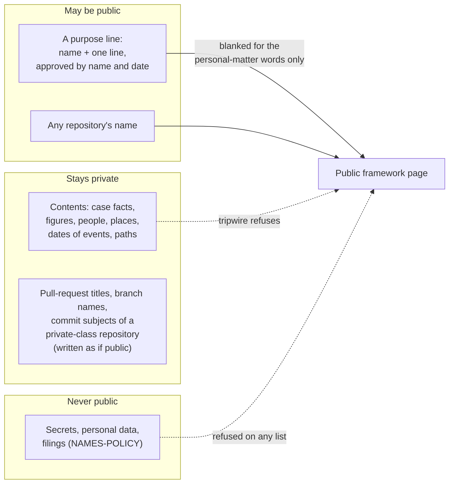

<div align="center">


# Public names, private contents: a tier for telling the fleet's story

*A private repository's name and one line of what it is for may appear in public framework material. What is inside it may not.*


 **You are here:** drasticstatic lab › [`my-template`](README.md) › `NAMES-POLICY-PROPOSED-TIER.md` · public · `main` is the working branch

</div>

**Status:** proposed, not approved. It changes nothing until the lab steward says yes. It extends [`NAMES-POLICY.md`](NAMES-POLICY.md) and, if approved, the public-lane tripwire (`scripts/scan-public-lane.sh`).

##  TL;DR

1.  **Why.** The lab steward wants to *"share my journey with the community so they have framework to build their personal assistant fleet but the private data be protected still"* (2026-11-16). A reader learns more from "the fleet has a tax assistant, walled off" than from a gap in the list.
2.  **Today the tripwire half agrees.** The names policy already says every repository's name may be public. The scanner lets a link to one of the lab's own repositories pass, with its short anchor text. But a private-class repository's name written in plain prose, or its one-line purpose, still trips when it holds a personal-matter word ([tested below](#-how-names-trip-today)).
3.  **The proposal.** A short list of **purpose lines**, approved by name and date: each private-class repository's name and one line of what it is for. The scanner blanks those exact lines for the personal-matter words only. Every other rule still reads them.
4.  **Contents stay out:** case facts, figures, people, places, dates of events, paths. Two new catches close gaps the scanner has today: a labelled case-number shape, and a private terms list the lane reads but never publishes.
5.  **Pull-request titles are not private.** Every app installed on a repository reads them, and some show them in their own pages. In a private-class repository, write titles, branch names and commit subjects to the purpose-line standard.

##  The three tiers



A **private-class repository** is one that holds legal, tax, health or family material. The list of which ones are private-class lives with the purpose lines (below).

##  How names trip today

Each line below was written to its own file and run through `scripts/scan-public-lane.sh` on 2026-11-16 (scanner v5, the master copy in this repository). The personal-matter words are not written here, so that this page passes its own tripwire.

| A line in a public page | Today | Why |
|---|---|---|
| The tax desk's repository name, in prose | passes | v4 (Nov 4) dropped that name from the personal-matter words |
| "One house is a tax assistant for a household." | passes | no rule matches |
| A private-class repository's name in prose, where the name holds two personal-matter words | **refused**: a personal-matter word | the name *is* the matter's words |
| That repository's one-line purpose in prose ("a … assistant") | **refused** | the same words |
| The same name as a Markdown link to `github.com/drasticstatic/<name>`, the name as anchor text | passes | the own-repository link rule (Nov 3, widened Nov 4) |
| That link, then a matter word later on the same line | **refused** | correct: the rule blanks the link only |
| A title-like line that adds a field named with the tax-identifier label itself | **refused**: a tax-identifier label | a fair alarm for a page; a false one for a title |
| A labelled court case number ("Case No." and digits) | passes | **a gap**: no rule reads case numbers |

So the boundary already exists for links. It is missing for plain prose, and the scanner cannot yet see two kinds of content: case numbers and the names of the people and places in a matter.

##  The proposal

### 1. A list of purpose lines

A new file, **`PUBLIC-PURPOSE-LINES.txt`**, kept in the lane's source repository like `PUBLIC-LANE-MEDIA.txt`. The lane passes it with a new flag, `--purpose <file>`. The scanner never looks for it inside the directory being published: what is published does not vouch for itself.

```text
approved by <name> | YYYY-MM-DD
<repository-name> | <what it is for, one line>
```

For example: `tax-assistant | a tax assistant, a private desk for one household's returns`.

Rules the scanner keeps, so the list stays a list of names and not a back door:

- **One line, 80 characters at most** for the purpose. No digits, no `/`, no `@`, no `:` after the first field. A line that breaks these makes the list malformed, and a malformed list refuses the run (as the media list does today).
- **Exact matches only**, case-insensitive, at word boundaries; a hyphen and a space count as the same. No wildcards.
- **A header with a person and a date** above every block, as in the media list. The steward approves each line once.
- **The private-class flag lives here too**: every repository on this list is private-class. Other tools read the same file (the commit-message hint below; SOP-IT-004's option B, a local-only secret scanner).

### 2. What the scanner does with it

1. Before the personal-matter words are searched, each listed name and each listed purpose is blanked, same length, as an own-repository link is blanked today.
2. **For that rule only.** A street address, an identifier, a credential or a labelled number on the same line still trips.
3. **The same word elsewhere on the line still trips.** "`<name>` is walled off from the rest of the fleet" passes; "`<name>` and its [matter word] schedule" is refused. A case fact with no matter word in it (a date, an event) is not caught by this rule; that is what the catches in section 3 below are for, and why the purpose line, not the page around it, is what gets approved.
4. The run's summary says how many lines were opened by a purpose line, so a reviewer can see the list at work.

### 3. Two catches for contents

| New rule | What it refuses | Who may open it |
|---|---|---|
| **A labelled case number** (v6) | a label (`case no.`, `case number`, `cause no.`, `docket`) followed within a few characters by a run of six or more letters and digits holding a digit. The same shape as the v5 policy-number rule | a person may attest a false alarm, never a real case number |
| **A private terms list** | any listed term: the names of people in a matter, the court, a school, an employer, a street. Matched as whole words, any case | nobody: a listed term in a public file is a finding |

The private terms list is never published. It lives in the private-class repository (or the steward's private desk) and the lane reads it from there, or from a repository secret in a workflow. Hashing the terms (the lane compares SHA-256 values of each one-to-four-word run) keeps the list out of logs, but a short name can be guessed from its hash. So the hashed file stays private too.

### 4. Figures beside a name

One more line for the scanner: a currency amount (`$` and digits) on the same line as a listed name or purpose line is refused. A framework page says *that* a tax assistant exists; it never says what it found.

##  What pull-request titles mean

A pull-request title, its description, a branch name and a commit message are read by **every app installed on the repository**, and some show them outside GitHub:

- **An issue tracker (Linear)** links pull requests by issue keys in the title, description, branch name and commit messages (Linear's [GitHub](https://linear.app/docs/github) page). Its Reviews page lists pull requests a person authored, through that person's own GitHub connection, *"even when Linear does not have code access to its repository"* (Linear's [Reviews](https://linear.app/docs/diffs) page). In November 2026 it listed pull-request titles from one of the lab's private-class repositories (the lab steward's report).
- **The secret scan's GitHub app** reads every pushed commit (SOP-IT-004, *What leaves the Mac*).
- **A code-review app** reads the repository's contents and posts on pull requests.

So in a private-class repository:

1. **A title says the kind of change, never a fact.** "docs: a checklist for the filing step", not who, how much, or which hearing.
2. **The same for branch names and commit subjects.** They travel further than the code: into notifications, issue trackers and their search.
3. **The description may say more** only when the steward has limited the installed apps on that repository (SOP-IT-004, option C) and turned off any personal connection that lists its pull requests.
4. **A warn-only hint** (proposed): the `commit-msg` hook of a clone on the purpose list runs the scanner's sensitive rules and the private terms list over the subject line, and prints a warning. It never stops the commit; the person decides.

##  If approved, the order of work

1. The steward approves the first purpose lines, by name and date.
2. The scanner's master copy learns `--purpose`, the case-number rule, the private terms list and the figure rule, with self-test cases for each (`scripts/scan-public-lane.selftest.sh`), including the lines in the table above.
3. Every copy listed in `scripts/TRIPWIRE-COPIES.md` is refreshed, and each lane's workflow passes the new files.
4. `NAMES-POLICY.md` gains a row: *a purpose line may be public*.
5. The commit-message hint goes into the template's hooks, warn-only.

Nothing is deleted. The own-repository link rule stays as it is.

##  Open questions

- Can a personal GitHub connection in an issue tracker be limited to some repositories? Unverified. If not, the only way to keep a private-class repository's titles out of that tracker's Reviews page is to disconnect the account or to write titles to the purpose-line standard (the rule above does the second).
- Should the purpose list be one file for the fleet, in this template, or one per lane? One file is simpler; one per lane lets an organisation decide its own.

##  Change log

| Date | Change | By |
|---|---|---|
| 2026-11-16 | Proposed: purpose lines, two content catches, the figure rule, and what pull-request titles mean | Alfred (a helper), for the lab steward |

<sub>Sources: [`NAMES-POLICY.md`](NAMES-POLICY.md); `scripts/scan-public-lane.sh` (v5, its header comment and rules, read 2026-11-16) and a test run of the lines above on the same day; Linear's [GitHub](https://linear.app/docs/github) and [Reviews](https://linear.app/docs/diffs) pages, read 2026-11-16; SOP-IT-004 in [`sop-template/repo/IT/`](sop-template/repo/IT/). Icons: Phosphor duotone (MIT).</sub>
