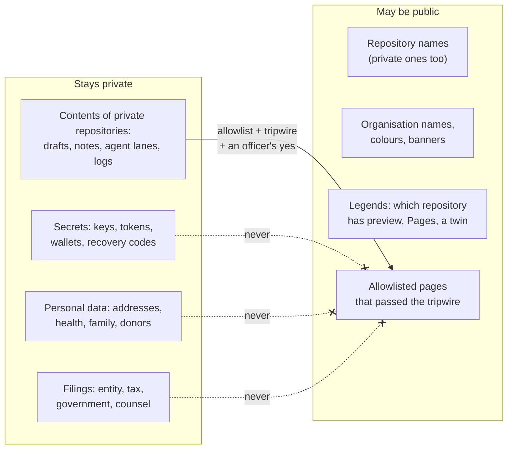

# Names policy: names may be public, contents stay private

*What a visitor may see, what never leaves the house, and how the safety checks know the difference.*

##  TL;DR

1.  **Every repository's name may appear publicly.** A private repository's name in a public page, a legend or a deck is fine. *"Nothing to hide"* (the lab steward, 2026-11-01).
2.  **Contents stay private.** What is inside a private repository reaches the public only through an allowlist, after a tripwire (SOP-OPS-003).
3.  **Some things never go public, on any list:** secrets, personal data, filings (below).
4.  **The security monitor checks against this page:** a private repository's *name* in public is not a finding; its *contents* are.

##  The line

##  May be public

| What | Example | Why it is safe |
|---|---|---|
| **Any repository's name**, private ones included | `reading-room`, `proposals`, `ops-standard-operating-procedures`, a lab desk's name | a name says *that* something exists, not what it says; the door stays locked |
| **Organisation names, colours, banners, profiles** | the families in [`TONES.md`](proposals-template/TONES.md) | they are how visitors recognise a house |
| **A legend of every repository** | `scripts/legend.sh` output, private rows included | it shows how each repository is guarded, not what it holds |
| **A link to a private page** | the reading room's link in a welcome deck | a visitor without access sees a 404; a member sees the page |
| **Pages that passed the allowlist and the tripwire** | a public reading room, a public procedures twin | an officer listed them, and a machine or a person read every file |

> Before 2026-11-01 the lab kept private repository names out of public pages by habit (for example in `legend.sh --public-only`
> and in this template's examples). That habit is no longer required. `--public-only` stays available for a page that
> should list only what a visitor can open.

##  Stays private

**Contents** of private repositories, unless an allowlist carries a page out:
- drafts, decisions not yet taken, meeting notes;
- agent coordination lanes (`AGENT-SYNC/`, `created-by-*`), handoffs, prompts, plans;
- `logs/` (session timelines; there is no public counterpart, ever);
- `CLAUDE.md`, `AGENTS.md`, `PENDING-TASKS.md` (the tripwire refuses them by name).

##  Never public, on any list

| Kind | Examples | Enforced by |
|---|---|---|
| **Secrets** | private keys, tokens (`ghp_…`, `github_pat_…`), API keys, `.env` files, wallets, keystores, seed phrases, recovery codes, deploy keys' private halves | the commit-time secret scan, the sync tripwire's credential patterns, file-name refusals |
| **Personal data** | home addresses, phone numbers, dates of birth, health or recovery details, family and custody matters, donors' identities, account numbers longer than the last four digits | the public-lane tripwire's sensitive-shape scan stops the file. An officer may attest a **false alarm** (a public office address, a policy that names the word "donor"); attesting a person's private details is never allowed, whatever the machine would accept |
| **A person's account security** | that a named person's account has no two-factor login, uses text-message codes, or is otherwise easy to break into | **no machine catches this:** it holds no password or number, only a weakness. Write it only in that person's own note (a desk proposal addressed to them), never in a procedure, a legend or a shared page; procedures say "a member" and point to the note. *Learned 2026-11-01, from the "You should know" plugin's heads-up about PIR's board procedure.* |
| **Filings** | entity papers, EIN letters, tax returns and working papers, government filings, counsel's questions and answers | the tripwire refuses `entity/`, `tax/`, `filings/` and `counsel/` **by path**, whatever an allowlist says |

If one of these is found in public: **stop**, tell the steward, rotate any secret first (a deleted commit is still in
someone's clone), then remove it. Never paste the secret into the report.

##  For the security monitor and for helpers

- A **private repository's name** in a public file: **not a finding.** Do not open a pull request to hide it.
- A private repository's **contents** in a public file without an allowlist line: **a finding.** Name the file and the line, not the content.
- Anything in *Never public*: **a finding, urgent,** whatever the allowlist says.
- **Kenney's Home base deck** is the worked example of the boundary: its *name* may be mentioned anywhere; the deck itself stays members-only in the THEF reading room. Public `.github/decks/` folders carry only welcome decks.

##  Change log

| Date | Change | By |
|---|---|---|
| 2026-11-01 | Written from the lab steward's decision ("every repository name may appear publicly; contents stay private") | Alfred |
| 2026-11-01 | *Never public*: a person's account security, the weakness no scan can see; it lives only in that person's own note | Alfred |

Related: [LUCID.md](LUCID.md), [ENTITIES.md](ENTITIES.md), SOP-OPS-003 *Private houses everything, public lanes witness* ([`sop-template/repo/OPS/`](sop-template/repo/OPS/)), [`walkthroughs/SECRET-SCAN.md`](walkthroughs/SECRET-SCAN.md). Icons: Lucide (ISC).
