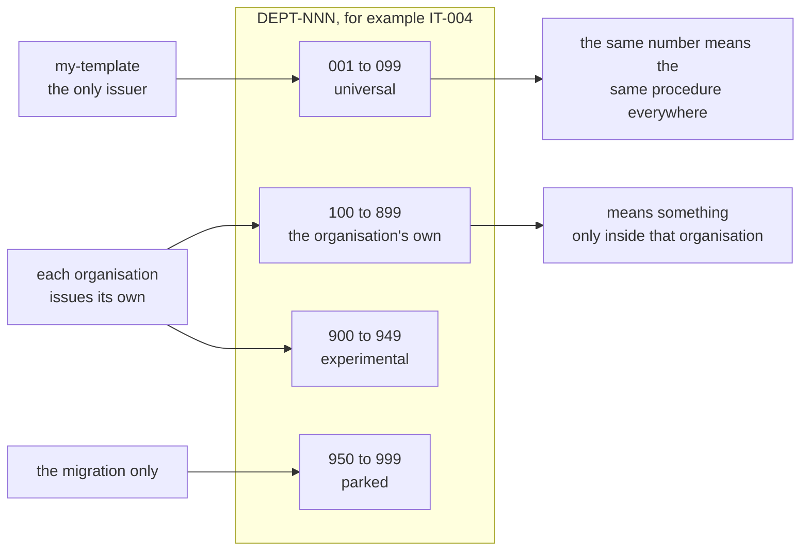

<!-- readme-standard: 2026-11-02 -->
<div align="center">



# Numbering: one scheme for every procedure and proposal

*A number is a name. It never changes, it is never used twice, and a machine checks.*


[](./LICENSE)


 **You are here:** drasticstatic lab › [`my-template`](./README.md) › `NUMBERING.md` · public · `main` is the working branch

</div>

##  TL;DR

1.  **A number is a name.** Once given, it stays with that page for life and goes to nobody else, even after the page is retired. The title and the words in the file name may change. The number may not.
2.  **Procedures have three ranges,** `DEPT-NNN`: **001 to 099** are universal (only this template issues them, and they mean the same in every organisation); **100 to 899** are the organisation's own; **900 and up** are experiments and old pages parked out of the way. A template number can never land on an organisation's page, because they do not draw from the same range.
3.  **Proposals number per desk,** and you name the desk when you cite one: **THEF-018**. A lab desk's number is not the organisation's number; a crosswalk maps one to the other.
4.  **Each page says who it is at the top,** in eight lines of front matter, so a library can give it a stable address and an index without renaming anything.
5.  **`catalog-docs.py --check` enforces it** across every local clone: a universal number used for two different things, a number the template never issued, a retired number reused.
6.  **Nothing has been renumbered.** [The migration](#-the-migration-only-on-christophers-word) is a table waiting for Christopher's word. No procedure has been approved by a tag yet, so this is the cheapest moment there will ever be to settle it.

##  Why this page exists

On Nov 5, 2026 Christopher noticed that a procedure was "numbered IT-004 because IT-003 was already taken", and asked for an order people would want to follow, one where nobody has to ask *why did you not think of this?*

Reading the history gave a slightly different story from the one we remembered, and a more useful one:

- **IT-003 was not an organisation's invention.** The template issued it on Oct 31, 2026 (`d1d96a3`), and the organisations levelled with the template the same day. IT-004 was simply the next free number when it joined the template on Nov 4 (`55a4a52`). Nothing collided there.
- **The real collision is elsewhere.** Four organisations hold two pages under **OPS-002**: the template's *Pull requests and Promotes*, and a members-only record they wrote themselves, which took the number of the page it belongs to. `catalog-docs.py --check` found it the first time it looked.
- **The weakness is the same either way.** There were two authorities drawing from one sequence, and nothing to say which numbers belonged to whom. It worked until somebody needed a number and the next one looked free. A rule that says *who may issue which numbers* removes the question.

##  The recommendation



| Range | Whose | Issued by | Example | What it promises |
|---|---|---|---|---|
| **001 to 099** | universal | a pull request on `my-template`, nowhere else | `OPS-002`, `IT-004` | the same procedure in every organisation, and a page you can cite to anyone in the fleet without saying whose |
| **100 to 899** | the organisation's | that organisation's stewards | `FIN-101` | means something only inside that organisation, so cite it with the name: *PIR's FIN-101* |
| **900 to 949** | experimental | the organisation or the template | `IT-912` | a trial. If it graduates it takes a real number and the trial records `supersededBy` |
| **950 to 999** | parked | the migration only | `OPS-950` | a page that had to give up a number before this standard existed. Nothing new is ever put here |

##  The rules

1.  **The ID is `DEPT-NNN` and it is permanent.** It never changes and is never reused, whatever happens to the page. The file is `SOP-DEPT-NNN-slug.md`; when you speak or write you may say `SOP-IT-004` or `IT-004`, they are the same.
2.  **The slug may change; the ID may not.** Rename `SOP-IT-004-tripwires.md` to `SOP-IT-004-tripwires-firewalls-and-shields.md` as often as the page needs. An organisation may also give a universal procedure its own words: Taylor'd Wraps' `SOP-GOV-001-who-reads-the-reading-room` is still GOV-001.
3.  **A retired page keeps its number.** It stays where it is with `status: retired`, and nothing is deleted. Its number is finished. "900 and up" is not where retired pages go in the ordinary way, because moving one there would change its ID and break rule 1. The parked range exists only for the one-time clean-up below.
4.  **Only the template issues 001 to 099.** An organisation that writes something every organisation needs writes it as its own (`IT-104`) and proposes it here. If the template takes it, it gets the next universal number and the organisation's page records `status: superseded` and `supersededBy: IT-007`. Numbers do not travel between ranges.
5.  **Departments are a short list:** OPS, IT, GOV, FIN and COM, issued by the template. A lane the template does not carry (the lab's `ARB`, `PERPS`) belongs wholly to its owner and has no universal range, so its `ARB-001` stays as it is.
6.  **Proposals are `NNN` per desk.** A desk's counter covers its root and its child folders (`bushido-code/010` is THEF-010). `000` is *Start here* on every desk. A draft has no number until it leaves `drafts/`.
7.  **Name the desk when you cite a proposal:** THEF-018. Without the desk, "018" means nothing to anyone outside the room you are standing in.
8.  **A lab desk's number is not the organisation's.** When a draft is offered to an organisation's own `proposals` repository it takes that repository's next number, and a crosswalk records both.
9.  **Every new page carries [front matter](#-front-matter-eight-lines-at-the-top).** An older page gets it the next time someone edits it, with no hurry.
10.  **A finished number goes in the ledger.** `RETIRED-NUMBERS.txt` at the root of the repository, one line each: `NUMBER | slug | date | why`. The template's is `sop-template/RETIRED-NUMBERS.txt` and binds everyone.

<details>
<summary> Two depths: what happens if 99 is not enough, and when to use a new department</summary>

**Plainly:** a department with 99 procedures everyone must follow is two departments. Split it rather than widen the range.

**Technically:** the three-digit width and the ranges are fixed, because the file pattern (`SOP-[A-Z]+-\d{3}-…`), the checker and every link depend on them. A new department code costs one pull request here and one row in the rule above. Six IT procedures in the template's first week sounds fast, and it is, but it is also how a young set behaves before it settles.

</details>

##  Proposals: the series, and the crosswalk

Each place that gives out proposal numbers is a **series**, with one short code. A code with no suffix is the lab's desk; `-P` is the organisation's own `proposals` repository.

| Series | Where | Numbers on Nov 5, 2026 | Cited as |
|---|---|---|---|
| `THEF` | `drasticstatic/proposals-thef`, the lab's desk | 000 to 023 | THEF-018 |
| `THEF-P` | `theholyearthfoundation/proposals` | 000 to 014 | THEF-P-010 |
| `PIR` · `PIR-P` | `pir`, the lab's desk · `psychedelicsinrecovery/proposals` | 000 to 003 · 000 to 004 | PIR-002 · PIR-P-004 |
| `PIR-TECH` · `PIR-PR` · `PIR-LIT` | the committees' own `proposals/` folders | 000 to 005 · 000 to 002 · 000 | PIR-TECH-005 |
| `ORG` · `ORG-P` | `O-R-G`, the lab's desk · `Octagon-Religious-Research-Group-ORG/proposals` | 000 to 001 · 000 to 008 | ORG-P-008 |
| `PSAN` · `PSAN-P` | `psanctuary`, the lab's desk · `psanctuary/proposals` | 000 to 001 · 000 to 005 | PSAN-P-005 |
| `DAPPU` | `proposals-dappu`, the lab's desk for Ethereal Offering | 000 to 002 | DAPPU-002 |
| `CHURCH` · `CHURCH-P` | the lab's desk · `psanctuarychurch/proposals` | 000 to 006 · 000 to 006 | CHURCH-P-006 |
| `TAYLOR` · `TAYLOR-P` | `taylordwraps`, the lab's desk · `taylordwraps-org/proposals` | 001 to 003 · 000 to 001 | TAYLOR-P-001 |
| `LAWN-P` | `WILSONSLAWNMAINTENANCE/proposals` | 000 | LAWN-P-000 |

Any other desk chooses a code the first time one of its proposals is cited, and adds a row. A reading room holds copies, so it is not a series: a page there keeps the number of the desk it came from.

The **crosswalk** is a table in the desk, one row per proposal: the desk's number, the organisation's number if it has one, the public twin's if it has one, and the title. THEF's already exists as `PUBLISH-MAP.md`, and it does the job, so nobody needs to rename it. It shows why the rule matters: **THEF-005** is **THEF-P-010**, and THEF-P-005 is a different page altogether. A proposal's front matter can carry the same fact in an optional `offeredAs: THEF-P-010`.

##  Front matter: eight lines at the top

```yaml
---
id: IT-004
title: "Tripwires, firewalls and shields"
status: draft
department: IT
owner: the organisation's stewards
supersedes: []
supersededBy: ""
tags: [security, public-lane]
---
```

| Field | Means | Rule |
|---|---|---|
| `id` | the permanent name | must match the number in the file or folder name; `--check` compares them. A proposal's includes its series: `THEF-022` |
| `title` | what people call it | free to change |
| `status` | where it stands | `draft`, `approved`, `experimental`, `superseded`, `retired`; proposals also `asking`, `decided`, `reference` |
| `department` | the folder it lives in | procedures only; a proposal leaves it out |
| `owner` | who answers for it | a role, never a person, so it stays true when people change |
| `supersedes` · `supersededBy` | what it replaced, and what replaced it | IDs. Fill in both ends |
| `tags` | what it is about | lower case, a few words, shared across the organisation; a library builds its topic pages from these |

**Why this gives a library stable addresses without renaming anything.** Each engine can build a page's address from the ID, not from the file's path, so a slug can change and the address does not:

- **Astro:** the `glob()` loader takes a `generateId` function that receives the entry's data ([Astro's content loader reference](https://docs.astro.build/en/reference/content-loader-reference/), read 2026-11-05), so it can return the `id` above.
- **Docusaurus:** a document's address comes from its `slug`, which defaults to the file path; `id` is a separate identifier ([Docusaurus's docs plugin reference](https://docusaurus.io/docs/api/plugins/@docusaurus/plugin-content-docs), read 2026-11-05). A Docusaurus library adds `slug: it-004` as a ninth line.

On GitHub the block shows as a small table above the page ([a public example, GitHub's own docs repository](https://github.com/github/docs/blob/main/content/get-started/index.md), opened 2026-11-05). `md-to-pdf`, which renders our PDFs, leaves it out of the print: THEF-022 and THEF-023 are the first pages to carry it, and were rendered that way on Nov 5, 2026.

##  Tags and git tags, which are different things

- **`tags:` in front matter are topics.** They help a reader find things and they never mean approval.
- **A git tag is an approval.** An organisation's procedures repository is tagged `v1.0.0` when its officers approve the set, `v1.1.0` when a procedure is added or revised, `v2.0.0` when the way the repository works changes (the versioning section of [`sop-template/README.md`](./sop-template/README.md) has the detail). Until the first tag, everything there is a draft.
- **The template's own releases** are tagged `sop-template-v1.0.0` on this repository, so an organisation's README can say *level with sop-template-v1.2.0*, and anyone can see which universal procedures it holds. No such tag exists yet.

##  Why not something else

| The idea | What is good about it | Why not here |
|---|---|---|
| **Dates**, `SOP-2026-11-05-…` | no authority needed; never collides by accident | it says *when*, not *what*. Two pages on one day need a tiebreak anyway. A universal procedure would carry a different date in each organisation that adopted it, or a date that looks wrong in all but one. You cannot say it aloud in a meeting |
| **Longer prefixes**, `SOP-THEF-IT-004` or `DRASTIC-IT-0004` | a citation carries its owner everywhere | it breaks the very thing we want, the same number everywhere. Copying a procedure to another organisation would mean renaming it and rewriting every link to it. And the owner is already in the address: the repository says whose it is. Where the owner does matter, for 100 and up and for proposals, we say so when citing (*PIR's FIN-101*, *THEF-018*), and the file stays short |
| **Everyone counts on their own** (what we had) | nothing to learn | it is how OPS-002 came to mean two things |
| **Random IDs or hashes** | collisions become impossible | nobody can remember, say or sort them, and they say nothing about what the page is |
| **Renumber when things tidy up** | a neat list | every link, PDF, citation and memory breaks, and the first person to trust an old PDF is misled. A gap in a list costs nothing |

We did not invent the core of this. Python's enhancement proposals number their documents and carry `Status`, `Replaces` and `Superseded-By` in a header at the top of each ([PEP 1](https://peps.python.org/pep-0001/), read 2026-11-05). The internet's RFC series publishes each distinct version under its own number, and corrections get a new number too ([RFC 2026](https://www.rfc-editor.org/rfc/rfc2026.html), read 2026-11-05). What we add is the reserved range, because unlike those series ours has one template and many organisations writing at once.

##  The enforcer

`python3 scripts/catalog-docs.py --check` in the private `mystarch_chief-of-staff` repository reads every local clone and writes nothing. It exits 1 when it finds:

| It flags | Example |
|---|---|
| a **universal number used for a different procedure** in two places | OPS-002: `honest-history` beside `pull-requests-and-promotes` |
| a **universal number the template never issued** | an organisation's own `IT-050` |
| a **retired number reused**, from a page's `status` or a `RETIRED-NUMBERS.txt` | a new page under a number the ledger closed |
| an **`id` that disagrees** with its file or folder name | `id: GOV-103` in `SOP-GOV-102-…` |
| a duplicate number in one repository, and a page's title drifting within one owner | as before |

A different slug under one universal number is printed as a note and not a problem when the names share their words, because rule 2 allows it. Names with nothing in common are flagged. `scripts/catalog-docs.selftest.sh` proves each of these on a small made-up fleet.

**What it cannot do.** It runs when someone runs it, on the clones that machine holds, so it is a smoke alarm rather than a lock. It knows a number is retired only because someone wrote that down. It cannot tell that two pages with similar names have drifted into different procedures; a person reads those. First run under these rules, Nov 5, 2026: 431 rows, 11 problems (one universal-number breach; seven duplicates, six of them the same OPS-002 pages seen in each organisation's repositories; three title drifts) and 3 notes.

##  The migration, only on Christopher's word

**Nothing in this table has been done.** Each move would be a `git mv`, a redirect line on the new page (*Formerly SOP-IT-003, renumbered 2026-MM-DD; see NUMBERING.md*), a short stub at the old path with `status: retired` and `supersededBy`, a ledger line, updated links, allowlists and PDFs. The old number plus 100 keeps it easy to remember. This one clean-up is the only time an ID moves, and it is allowed only because no procedure has been approved by a tag yet (checked Nov 5 on this repository and three organisations' procedures repositories).

| Today | Where | Would become | Why |
|---|---|---|---|
| `SOP-OPS-002-honest-history` | PIR, O-R-G, Psanctuary, Psanctuary Church, and their room copies | `SOP-OPS-102-honest-history` | **the real collision.** A page an organisation wrote itself, sitting in the universal range |
| `SOP-IT-003-observer-dashboards-local-by-default` | every organisation but Taylor'd Wraps, with room copies and twins | `SOP-IT-103-observer-dashboards-local-by-default`, with the redirect line | **as Christopher framed it,** see the question below |
| `SOP-IT-003-local-by-default` | Taylor'd Wraps, with its desk, room and twins | `SOP-IT-103-local-by-default` | the same page in that organisation's words; moves if and only if the row above does |
| `sop-template/repo/IT/SOP-IT-003-…` | this template | stops shipping; `IT-003` goes in `sop-template/RETIRED-NUMBERS.txt`, never reissued | only if the two rows above move |
| `SOP-GOV-001-who-reads-the-reading-room`, `SOP-IT-002-reading-and-helper-access` | Taylor'd Wraps and its desk | no change | an adapted name for the same procedure; rule 2 |
| Every other `OPS`, `IT`, `GOV`, `COM` page | everywhere | no change | already issued by the template, same number everywhere |
| `SOP-ARB-*`, `SOP-PERPS-*` | the lab's desks | no change | lanes the template does not carry; rule 5 |
| Proposal folders | every desk | no change | numbers already stand. The rule only adds how they are cited |

> [!IMPORTANT]
> **A question for Christopher before IT-103.** The history above says IT-003 was issued by the template, so under the new rules it already counts as universal and could simply stay, with no rename at all. Moving it is worth doing if you decide observer dashboards are *not* universal: the page is about a bot serving a dashboard from a person's machine, and most organisations run no such thing. The cost is about 56 files that mention it across the seven organisations' procedures and reading rooms, plus PDFs and public twins. **Suggested order: OPS-102 first, because it is a real collision; IT-103 only if you want that page out of the universal set.**

##  Suggest a change

Noticed a better way, or a case these rules get wrong? Open an [issue](https://github.com/drasticstatic/my-template/issues) or a pull request against `main`; Christopher reads them and a person with the role merges. Not on GitHub? Tell a steward of your organisation in your own words. It is yours to copy for your own organisation, with no need to ask.

<sub>Follows the living [README standard](./README-STANDARD.md) and [`LUCID.md`](./LUCID.md). Icons: Phosphor (MIT). Written Nov 5, 2026 by Alfred (Claude Code CLI) at Christopher's word.</sub>
