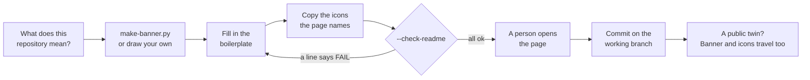

<!-- readme-standard: 2026-11-02 -->
<div align="center">



# README standard: a front door for every repository

*Where you are, what this is, what to do first, and how to make it better. A living standard: copy it, improve it, send back what you learn.*


[](./LICENSE)


 **You are here:** drasticstatic lab › [`my-template`](./README.md) › `README-STANDARD.md` · public · `main` is the working branch

</div>

##  TL;DR

1.  **A README is a front door.** A stranger, or their AI helper, should know within ten seconds where they are, what this is, and what to do first.
2.  **Every front door is its own.** A banner that could only belong to this repository, with motion that stops for anyone who asked for less.
3.  **Six parts, then whatever the repository needs:** banner, *You are here*, badges, TL;DR, Lucide icons, *Suggest a change*.
4.  **Two commands do the dull part:** `scripts/make-banner.py` draws the banner and checks the page. [Copy the boilerplate](#-the-boilerplate), fill it in, run the check.
5.  **It is yours.** Take it for any repository, ours or not, with no need to ask. If you find a better way, [tell us](#-suggest-a-change) and the standard changes.

##  Take it, and make it better

This page is not finished and is not meant to be. It is what the repositories here have learned so far about welcoming someone at the door, written so that you can use it tomorrow. Copy the boilerplate, copy the script, change the colours, throw away the parts that do not fit you. The words and the script are MIT; the icons are [Lucide](https://lucide.dev) (ISC). You do not need to credit us, though we would like to see what you made.

##  How a front door gets made



##  The six parts

###  1. A banner of its own

**Test: cover the title. Could this picture belong to another repository in the same house?** If so, it is not done. Choose the picture for what the repository *means*: a road for a method, a network for people who feed each other, an arch for a threshold. Colour says whose it is ([`TONES.md`](./proposals-template/TONES.md) has one family per organisation, or bring your own four shades). The shape says which one.

The rules, each learned by getting it wrong:

| Rule | Why |
|---|---|
| **Motion only inside** `@media (prefers-reduced-motion: no-preference)` | Outside that block every element sits in its finished state, so someone who asked for less motion, or a viewer that ignores CSS, sees the whole picture at once |
| **CSS animation, never `<animate>`** | SMIL ignores the reader's setting |
| **An opaque ground** | One file reads the same on GitHub's light and dark themes |
| **The words hold still** | A title that breathes is a title that is hard to read |
| **An intro that finishes, then at most two quiet loops** | An SVG in an `` repaints on the main thread; a banner should not warm anyone's laptop. Blur and filters are the worst of it, so use none, and `steps()` keeps a loop near 12 frames a second |
| **System fonts, no links, no images, no script** | An SVG in an `` cannot load anything anyway, and this is what lets it pass a public-lane tripwire |
| **Real `alt` text on the banner** | A screen reader cannot see inside an ``, so say the name and the picture |

```sh
python3 scripts/make-banner.py --list    # the colour families and the seven pictures
python3 scripts/make-banner.py --title my-repo --subtitle "What it is, in one breath." \
        --kicker "Whose it is" --family teal --motif constellation --out assets/banner.svg
python3 scripts/make-banner.py --check assets/banner.svg
```

The same words always draw the same picture, and different words draw a different one (`--seed` gives you another roll). A banner drawn by hand is welcome, and often better: this repository's own [`assets/banner.svg`](./assets/banner.svg) is one. Hold it to `--check` all the same.

**Two house styles.** When the picture should say *the lab made this* before it says anything else, `--style` picks a whole look instead of a motif: **`waves` for a front door** (a sun held by an open circle, waves drawing in beneath it: a repository that is open and running) and **`seed` for a beginning** (thin threads leave one point and find each other: a repository that is an idea with somewhere to live, first drawn by hand in November 2026 for a seed that was not yet a spec). A style wears the lab's brass on slate unless `--family` or `--palette` says otherwise, so an organisation can begin in its own colours. `python3 scripts/make-banner.py --style seed --title my-repo --subtitle "What it will be, in one breath." --out assets/banner.svg`.

###  2. *You are here*

One line under the name. People arrive from a search result, a link in a chat, or a fork, with no idea what house they have walked into:

> **You are here:** The organisation › `repository` · private or public · the working branch · its twin, if it has one

If a private repository syncs to a public twin, write the line so it is true on both: *source `x` (private) → twin `x-public-preview` (public)*. A repository's name may be public; what is inside it may not ([`NAMES-POLICY.md`](./NAMES-POLICY.md)).

###  3. Badges that say something true

Two to six: what it is, its status, its licence, a link to the live thing. Static badges (`img.shields.io/badge/...`) work everywhere; a badge that reads a private repository through an API shows an error to everyone, so use static ones there. Use the family's colours, and the shared slate `64748b` for "For". A badge nobody would miss should go.

###  4. TL;DR

The first heading. Three to five lines: what this is, who it is for, and the one thing to do first. Lead with the answer; the detail can fold away in `<details>` further down ([`LUCID.md`](./LUCID.md)).

###  5. Lucide icons, from the repository itself

One beside each idea: 24 on a heading, 16 inline, always `alt=""` because the words beside it already say it. They live in the repository's own `assets/icons/`, so they render on GitHub, in a PDF and on a public twin; never hot-link one.

```sh
python3 scripts/make-banner.py --icons README.md --family teal   # copies each icon the page names, in the family's colour
```

###  6. *Suggest a change*

Near the end. How someone who noticed something can tell you: an issue, a pull request against the working branch, and who decides. Say what to do if they are not on GitHub. A person who has found a mistake and cannot see where to put it will leave.

Everything after the TL;DR that the repository needs (setup, a table of what is in the box, how it deploys) is yours to arrange. **Improving a README you already have? Keep every true thing it says.** Put the front door on it; do not rewrite the house.

##  The boilerplate

Copy this to the top of `README.md`. Replace each `<ANGLE>`, delete what does not apply. Keep the first line: it is how a sweep finds what is already done.

````markdown
<!-- readme-standard: 2026-11-02 -->
<div align="center">

: <ONE SENTENCE SAYING WHAT THE PICTURE SHOWS>">

# <NAME>

*<WHAT IT IS, IN ONE BREATH>*


[](./LICENSE)
[](<LIVE URL>)


 **You are here:** <ORGANISATION> › `<REPOSITORY>` · <PRIVATE OR PUBLIC> · `<BRANCH>` is the working branch

</div>

##  TL;DR

1.  **What this is.** <ONE LINE>
2.  **Who it is for.** <ONE LINE>
3.  **Do this first.** <ONE COMMAND OR ONE LINK>

<!-- whatever the repository needs goes here: start here, what is inside, how it deploys -->

##  Suggest a change

Noticed something? Open an [issue](../../issues) or a pull request against `<BRANCH>`; <WHO> reads them and a person with the role merges. Not on GitHub? <HOW ELSE TO REACH US>.

<sub>The front door follows the living [README standard](https://github.com/drasticstatic/my-template/blob/main/README-STANDARD.md). Copy it, improve it. <LICENCE LINE></sub>
````

##  A public twin

A private repository whose README syncs to a public twin carries its pictures with it. `assets/banner.svg` and `assets/icons` must be on the twin's list, or the public page shows broken images. In an organisation's repository that list is an officer's to change ([`NAMES-POLICY.md`](./NAMES-POLICY.md), SOP-OPS-003), so ask rather than add. The tripwire [`scripts/scan-public-lane.sh`](./scripts/scan-public-lane.sh) reads a banner like any other file, and banners from `make-banner.py` pass it.

##  Images

**Images.** A banner or screenshot goes in at the size it is seen, not the size it was made: run `sh scripts/shrink-images.sh --check assets` before `git add`, and `sh scripts/shrink-images.sh <files>` when anything is over 2 MB (it resizes to 2500 px on the longer side, then quantises PNG with pngquant and re-saves JPEG at quality 80; `--no-quantise` for a photograph that must keep its colours). Nothing over 15 MB is ever committed or uploaded: that is the public-lane scanner's limit, so [`.githooks/pre-commit`](./.githooks/pre-commit) refuses it at commit time, the organisation template's [`image-size-check.yml`](./sop-template/repo/.github/workflows/image-size-check.yml) fails the pull request, and both print the pngquant line over 2 MB. The procedure an AI helper follows is the skill [`.claude/skills/compress-images.md`](./.claude/skills/compress-images.md). An SVG banner from `make-banner.py` is a few kilobytes and never meets either line.

 **A `SECURITY.md` beside the README** says in one page why a clone is safe to fetch (nothing runs on clone or install, hooks only by hand, every public page read before it left), where to report a concern, and the honest limit of branch protection on a private repository: [`SECURITY.md`](./SECURITY.md) here, [`sop-template/repo/SECURITY.md`](./sop-template/repo/SECURITY.md) for an organisation's repository.

##  What a front door never says

Secrets of any kind. Personal data, or anything about someone's family, health or legal matters. Filings. A person's account-security status. The contents of a private repository, when the page is public. A repository that publishes in costume keeps its costume in the banner and the alt text too. A picture of markets is illustration, never data.

##  Before you call it done

```sh
python3 scripts/make-banner.py --check-readme README.md
```

- [ ] `--check-readme` prints no `FAIL`. It reads what a machine can; the rest of this list is for a person.
- [ ] Cover the title: the banner could only be this repository's.
- [ ] Opened on GitHub, in the light theme and the dark, with reduced motion on and off. (macOS: System Settings › Accessibility › Display › Reduce Motion.)
- [ ] A stranger knows within ten seconds where they are and what to do first.
- [ ] Every link and path opened, every command run, or marked untested.
- [ ] Everything true the old README said is still there.

##  Suggest a change

This is the part we most want used. Found a rule that is wrong, a better picture, a check the script should make, a banner of yours we should learn from?

1.  **Open an [issue](https://github.com/drasticstatic/my-template/issues)** to talk it over, or
2.  **Send a pull request** against `main`, changing this page. A new picture goes in `MOTIFS` in `scripts/make-banner.py`, and `sh scripts/test-make-banner.sh` should still pass. A person with the role reads it and merges with a merge commit, so your name stays on it.
3.  **An AI helper may do all of that up to the merge**, signed as [the attribution spec](https://github.com/drasticstatic/my-template/blob/main/AGENT-SYNC/README.md) says.

Not on GitHub? Tell any steward you know, or your helper, in your own words. A change lands in the table below with its date, and existing READMEs catch up the next time someone is in the room; nobody has to redo a front door for a small improvement.

| Date | What changed |
|---|---|
| 2026-11-02 | First version, drawn from the banners and READMEs the fleet made by hand |
| 2026-11-04 | *Images*: the 2 MB warning and 15 MB refusal (the scanner's limit), `scripts/shrink-images.sh`, the `pre-commit` image guard, `image-size-check.yml`, the `/compress-images` skill |
| 2026-11-04 | *Two house styles*: `--style waves` for a front door and `--style seed` for a beginning (the seed picture, first drawn by hand, is now a motif of its own) |

<sub>Related: [`LUCID.md`](./LUCID.md) (how a page reads), [`ENTITIES.md`](./ENTITIES.md) (whom we name, and how), [`NAMES-POLICY.md`](./NAMES-POLICY.md) (what may be public), [`proposals-template/TONES.md`](./proposals-template/TONES.md) (colours), [`GITMOJI.md`](./GITMOJI.md) (commit subjects). Icons: Lucide (ISC). Diagrams: Mermaid (MIT). Words and script: MIT.</sub>
