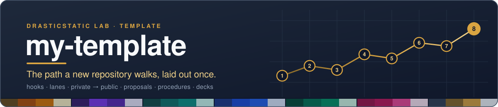

<div align="center">



# my-template

**The path a new repository walks, laid out once.** Hooks, coordination lanes, private-to-public sync, proposals in every organisation's colour, onboarding kits and plain-language walkthroughs, for a fleet that people and AI helpers run together.

[](https://github.com/drasticstatic/my-template/generate)
[](https://github.com/drasticstatic/.github)


**The families** (one colour per organisation, four shades each; [`TONES.md`](./proposals-template/TONES.md)):


</div>

---

## The path

Follow it top to bottom the first time. After that, jump to the stop you need.

### Stop 1 · Two commands, every clone

```sh
sh scripts/install-hooks.sh        # activate the commit-attribution hook
sh scripts/scaffold-agent-sync.sh  # create the right coordination lanes for this repo's visibility
```

Git refuses to version-control hooks on purpose, so a committed hook is inert until a human points the clone at it. And at the **start of every session**, before reading deeply or editing:

```sh
git pull --rebase --autostash
```

Several agents and a human push to these repos, including unattended ones. A stale clone fails at push time, after the work is done, when the tempting fix is a force-push that discards someone else's commit. `--autostash` makes this safe on a dirty tree.

### Stop 2 · Decide visibility before the first commit

`AGENT-SYNC/` and `logs/` must never exist in a public repo, and un-publishing is not something deletion can do ([`AGENT-SYNC_PUBLIC/README.md`](./AGENT-SYNC_PUBLIC/README.md)). Private source with a public twin? Name the twin `<repo>-public-preview` and wire the sync at Stop 5.

### Stop 3 · License, security, contributors, topics

Follow [`how-to-establish-cross_repo_CONTRIBUTORS_SECURITY_LICENSING.md`](https://github.com/drasticstatic/drasticstatic/blob/main/how-to-establish-cross_repo_CONTRIBUTORS_SECURITY_LICENSING.md) end to end: a real `LICENSE` in every public repo (the global `.github` fallback covers `SECURITY.md` and `CONTRIBUTING.md`, never `LICENSE`), a README license section that stays true on both halves of a private/public pair, and a description and topics via `gh repo edit`. Then `CLAUDE.md` and `.github/dependabot.yml` for the stack.

### Stop 4 · Let the helpers read the map

Run `./scripts/init-graphify.sh` from the repo root (keyless; [`workflow-templates/GRAPHIFY_SETUP.md`](./workflow-templates/GRAPHIFY_SETUP.md)). Write `AGENTS.md` from [`org-onboarding/AGENTS.template.md`](./org-onboarding/AGENTS.template.md). Every commit then carries the footer in [`AGENT-SYNC/README.md`](./AGENT-SYNC/README.md).

### Stop 5 · Publish the safe half

Pick a sync model below (allowlist when most is private, exclude list when most is public) and copy it to `.github/workflows/`. Any new root-level path is classified in the same commit that introduces it.

### Stop 6 · Proposals, in your colour

Copy [`proposals-template/repo/`](./proposals-template/repo/) into a private `proposals` repo. It opens with **000 Start here** (how a proposal reads, how to answer, how to bring your helper), renders a PDF on every push, keeps one child folder per site repo, and wears the organisation's family from [`TONES.md`](./proposals-template/TONES.md). [Why the markdown travels with the PDF.](./walkthroughs/MARKDOWN-BESIDE-PDF.md)

### Stop 7 · People, and their helpers

[`walkthroughs/`](./walkthroughs/): joining an organisation, connecting Littlebird, Firecrawl, Google Drive, Wix and WordPress, security settings, secret scans, ultra runs. [`org-onboarding/`](./org-onboarding/): the kit every organisation's `.github` carries, the **hook-in note** on the members' page, and the **`legal` repository** every organisation gets ([`LEGAL-REPO.md`](./org-onboarding/LEGAL-REPO.md)).

### Stop 8 · A folder of repos

[`NESTED-REPOS-GUIDE.md`](./NESTED-REPOS-GUIDE.md): a lightweight git-tracked parent with git-ignored children, no submodules; how `pir`, `psanctuary`, `the-holy-earth-foundation` and `dappu` are laid out.

---

## What's in the box

| File / folder | What it does |
|---|---|
| `.githooks/commit-msg` | Enforces the commit-attribution footer; inert until `scripts/install-hooks.sh` runs |
| `AGENT-SYNC/` | Cross-agent coordination lanes — **private repos only** |
| `AGENT-SYNC_PUBLIC/` | Coordination safe to publish — the only lane a public repo gets |
| `logs/` | Chronological session timeline — **private repos only**, no public counterpart exists |
| `scripts/install-hooks.sh` | Points this clone at `.githooks/` (one-time, per clone) |
| `scripts/scaffold-agent-sync.sh` | Detects repo visibility and creates the correct lanes |
| `.github/dependabot.yml` | Grouped Dependabot version updates — npm + GitHub Actions |
| `workflow-templates/sync-public-allowlist.yml` | Sync private → public via **allowlist** (strict — everything private by default) — copy to `.github/workflows/` in your repo |
| `workflow-templates/sync-public-excludelist.yml` | Sync private → public via **exclude list** (open — everything public except named paths) — copy to `.github/workflows/` in your repo |
| `gitexporter.config.json` | **Deprecated** — kept as a documentation manifest of what is public. Do not run it; the sync workflows own this now |
| `scripts/deployTest.sh` | Deploy a dated static snapshot of a Vite app to a new GitHub Pages repo |
| `scripts/syncDocs.sh` | Selectively rsync documentation from a private repo to a public docs repo |
| `scripts/init-graphify.sh` | Deploy `.graphifyignore` + install the Claude Code hook (keyless graphify setup) |
| `branch-protection/ruleset.json` | GitHub branch protection ruleset — prevents force-push and deletion on `main` |
| `changelog-template/` | Astro content-collection scaffold for a public, browsable changelog site — private source, `dist/`-only public pair via the standard sync workflow |
| `proposals-template/` | A ready-to-copy private `proposals` repo: plain-language proposals (TL;DR, itinerary, questions, decisions log) rendered to PDF on every push |
| `walkthroughs/` | Plain-language guides for people and their AI helpers: joining an org, connecting tools, keeping an org healthy |
| `org-onboarding/` | The onboarding kit every organization's `.github` carries: ONBOARDING.md, an AGENTS.md template, the advisory credit hook |

---

## Find your way

| You are… | Start at |
|---|---|
| **starting a new repo** | the two commands above, then the checklist |
| **a person joining an organisation we serve**, or their AI helper | [`walkthroughs/`](./walkthroughs/) (joining, connecting tools, keeping an org healthy) and [`org-onboarding/`](./org-onboarding/) (the kit every org's `.github` carries, the hook-in note, the `legal` repo) |
| **writing a proposal** | [`proposals-template/`](./proposals-template/): the shape, the 000 Start-here page, [`TONES.md`](./proposals-template/TONES.md) (one colour family per organisation, four shades each), and [why the markdown travels with the PDF](./walkthroughs/MARKDOWN-BESIDE-PDF.md) |
| **setting up a nested parent repo** (a folder of independent repos) | [`NESTED-REPOS-GUIDE.md`](./NESTED-REPOS-GUIDE.md) |
| **publishing a private repo's safe half** | the sync workflows below and [`AGENT-SYNC_PUBLIC/`](./AGENT-SYNC_PUBLIC/) |
| **an AI helper reading this fleet** | [`AGENTS.md`](./AGENTS.md), then [`AGENT-SYNC/README.md`](./AGENT-SYNC/README.md) for the commit footer |

---

## Workflow Patterns

### Sync to public repo — which model to use?

| Model | Use when | File |
|-------|----------|------|
| **Allowlist** | Most content is private; a small set is safe to publish | `sync-public-allowlist.yml` |
| **Exclude list** | Most content is public; a named set must stay private | `sync-public-excludelist.yml` |

Both use `git filter-repo --invert-paths` under the hood. The allowlist model adds a validation step that fails CI if an unclassified root-level path appears — forces an explicit privacy decision on every new file.

Whichever model a repo uses, **any new root-level entry must be classified in `sync-public.yml` in
the same commit that introduces it.** Under the allowlist model CI enforces this; under the exclude
list nothing will stop you, which is precisely why the habit has to be the same in both.

### gitexporter is deprecated

`gitexporter` was the original local path to a public preview. It is no longer used anywhere in this
fleet — **do not run `npx gitexporter`.** The GitHub Actions workflows own the pipeline end to end,
and a manual local export competing with them produces divergent history on the mirror.

`gitexporter.config.json` is retained deliberately, as a readable manifest of which paths are
intended to be public. Treat it as documentation, not as a tool.

### 🕰️ Public-facing changelogs & libraries

**[`changelog-template/README.md`](./changelog-template/README.md) is the single source of
truth** for this convention — same role `AGENT-SYNC/README.md` plays for attribution. 📋 It covers:

- The frontmatter schema (`title`, `date`, `priority`, `repo`, optional `org`) and the
  "confirmed-done + public-safe → straight to changelog" rule for
  `pending-tasks.md`/`PENDING-TASKS.md` files — no more internal holding sections once a project has
  a real changelog to land in.
- 🏢 **The org-vs-personal push-target split**, worth stating here too: a community/multi-owner
  GitHub org project pushes its public changelog repo *into that org*
  (`psychedelicsinrecovery/changelog-astro-public`, `theholyearthfoundation/changelog-astro-public` —
  both live 🌐), while a personal project pushes under personal `drasticstatic`, same as every other
  `-public-preview` pair.
- 🔒 Raw markdown never leaves the private repo — only the compiled Astro build does, via the same
  `sync-public-allowlist.yml` pattern every other private→public pair here uses.
- 📚 A richer pattern once a project outgrows one flat list: a repo-picker `/changelog`, a
  `/library` collection for deep technical write-ups, the project's own `README.md` rendered as the
  site's homepage, priority filter + search, prev/next by date, and Phosphor icons (`ph ph-*`) that
  work directly inside plain `.md` — no MDX required. All proven out on PIR's and THEF's live sites.

---

## Making Your Own Repo a Template

Once you've customised this scaffolding for your own use, you can share it the same way — mark your repo as a GitHub Template Repository so others get the green **"Use this template"** button too.

**Via GitHub CLI (one command):**
```bash
gh api repos/YOUR_USERNAME/YOUR_REPO --method PATCH --field is_template=true
```

**Via UI:** Repo → Settings → General → check **Template repository**

Then add this badge to your README (swap in your own repo URL):
```markdown
[](https://github.com/YOUR_USERNAME/YOUR_REPO/generate)
```

The `/generate` path takes visitors directly to the "create repo from template" screen — useful to link from docs, READMEs, or share with peers.

---

## Agent coordination and commit attribution

Every commit in this fleet carries a footer naming the agent, the harness, who ran the weights, and
which model:

```
Co-Authored-By: <Agent> · <Engine> · <Provider> [<Model>]                  # direct
Co-Authored-By: <Agent> · <Engine> · <Gateway> · <Provider> [<Model>]      # proxied
<Platform>-Session: <full session URL>
```

The reason is narrow and practical: when a commit later turns out to be subtly wrong, the first
useful question is which model produced it, and a footer that flattens every route into `Anthropic`
destroys that signal *silently*, because the line still reads correctly.

**[`AGENT-SYNC/README.md`](./AGENT-SYNC/README.md) is the single source of truth** for the field
definitions, the engine roster, and the coordination-lane convention. It is deliberately the only
copy — an earlier second copy in `scripts/README.md` went stale and spent a release teaching the
wrong thing. If you need to state the convention somewhere, link it instead.

---

## Related How-To Guides

Full setup walkthroughs live in the [`drasticstatic` profile repo](https://github.com/drasticstatic/drasticstatic):

- [`how-to-setup-GITEXPORTER.md`](https://github.com/drasticstatic/drasticstatic/blob/main/how-to-setup-GITEXPORTER.md) — GitExporter + sync-public.yml full pipeline
- [`how-to-establish-a-github-PROFILE-README.md`](https://github.com/drasticstatic/drasticstatic/blob/main/how-to-establish-a-github-PROFILE-README.md) — Profile README setup
- [`how-to-establish-cross_repo_CONTRIBUTORS_SECURITY_LICENSING.md`](https://github.com/drasticstatic/drasticstatic/blob/main/how-to-establish-cross_repo_CONTRIBUTORS_SECURITY_LICENSING.md) — Community health files at scale
- [`how-to-publish-react-APPS-to-ghPAGES.md`](https://github.com/drasticstatic/drasticstatic/blob/main/how-to-publish-react-APPS-to-ghPAGES.md) — CRA and Vite apps to GitHub Pages
- [`how-to-setup-BRANCH-PROTECTION-and-TOPICS.md`](https://github.com/drasticstatic/drasticstatic/blob/main/how-to-setup-BRANCH-PROTECTION-and-TOPICS.md) — Branch protection rulesets and GitHub topics via `gh api`

---

*Maintained by [drasticstatic](https://github.com/drasticstatic)*
