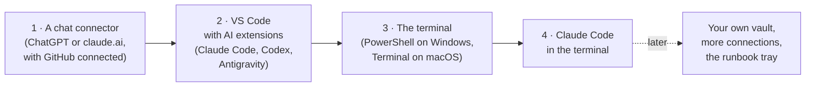
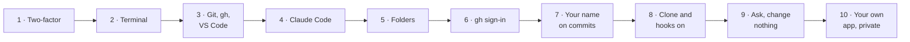
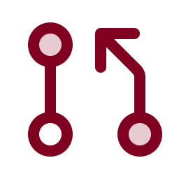

<div align="center">


# Start here

### For someone new to GitHub, the terminal and Claude Code, and for the steward sitting beside them

*Until now you have used GitHub through a chat window. This page is the road from there to your own computer: the editor, the terminal, Claude Code, and a safe place for your own work. One evening gets you onto it.*


 **You are here:** drasticstatic lab › [`my-template`](README.md) › `START-HERE.md` · public · `main` is the working branch

</div>

> **Handing this to your AI helper?** Paste the link and say: *"Read START-HERE.md. We are doing the first evening
> together. Take one step at a time, say what each command does before you ask to run it, and wait for me after each
> step. I type my own passwords and click my own browser prompts."*

##  TL;DR

1.  **The road has four stops:** a chat connector (where you are now), an editor with AI extensions, the terminal, and Claude Code in the terminal. You can stop at any of them for as long as you like.
2.  **The first evening is ten steps** ([below](#-the-first-evening)), each with what success looks like. A steward sits beside you; your own Claude Code can run most of it once step 4 is done.
3.  **Safe from day one.** Everything you create is private. Two-factor sign-in, a secret scan and the hooks are on before your first commit, and nothing becomes public without a check and a person ([the rules](#-safe-from-day-one)).
4.  **Three homes for repositories:** `~/code` for your own, `~/<your-login>Labs` for labs, `~/<organisation>` for an organisation's.
5.  **Nothing here asks for a password, a key or a code** to be typed into a chat. You type them into the tool that asks, yourself.

##  The road, and where you are on it



| | Stop | What changes for you |
|---|---|---|
|  | **A chat connector** | the AI reads your repositories on GitHub's servers; you copy what it writes |
|  | **VS Code with extensions** | the files are on your own computer; the AI edits them in front of you and asks first |
|  | **The terminal** | you type short commands; each one does one thing and says what happened |
|  | **Claude Code in the terminal** | it reads the project's own rulebook (`CLAUDE.md`) and works inside one folder, asking before it acts ([New to Claude Code](startup/NEW-TO-CLAUDE-CODE.md)) |

##  Read these, in this order

You do not need all of them tonight. The first five are the evening; the rest are for the days after.

| | Page | What it gives you |
|---|---|---|
|  | [Opening your gift](walkthroughs/OPENING-YOUR-GIFT.md) | what GitHub is, in plain words, and your first ten minutes |
|  | [Secure two-factor](walkthroughs/SECURE-TWO-FACTOR.md) | an authenticator app or a passkey instead of text-message codes |
|  | [Set up your computer](walkthroughs/SET-UP-YOUR-COMPUTER.md) | every install and sign-in, Windows and macOS side by side, each checked against the maker's own page |
|  | [New to Claude Code](startup/NEW-TO-CLAUDE-CODE.md) | your first hour in the terminal: where to start it, what its questions mean, how to stop |
|  | [Join an organization](walkthroughs/JOIN-AN-ORGANIZATION.md) | accepting an invitation and connecting your helpers to an organisation's repositories |
|  | [The secret scan](walkthroughs/SECRET-SCAN.md) | the one check that stops a commit, and what to do when it speaks |
|  | [Many AI tools, one team](walkthroughs/MANY-AI-TOOLS-ONE-TEAM.md) | how Claude, Codex and the others share one rulebook and one notebook |
|  | [Working with the fleet](walkthroughs/WORKING-WITH-THE-FLEET.md) | pull first, pull requests, never merge, sign every commit |
|  | [Start Claude in the right folder](walkthroughs/CLAUDE-SESSION-ORDER.md) | why the folder you start Claude Code in matters |
|  | [Nested repositories](NESTED-REPOS-GUIDE.md) | a folder of repositories whose parent ignores its children |
|  | [The second brain](walkthroughs/THE-SECOND-BRAIN.md) | your own private vault, for later |

##  Safe from day one

The same rules the lab keeps for itself. Each one is cheap on the first day and expensive to add after a leak.

| | Rule | How it is kept |
|---|---|---|
|  | **Private by default** | every repository is created with `--private`. Making one public is a separate decision, made later, by its owner, never by a helper |
|  | **Two-factor sign-in, a secure kind** | an authenticator app or a passkey; recovery codes saved somewhere offline ([Secure two-factor](walkthroughs/SECURE-TWO-FACTOR.md)) |
|  | **A secret scan before every commit** | GitGuardian's `ggshield` on your computer, and on GitHub where an owner has set it up ([The secret scan](walkthroughs/SECRET-SCAN.md)) |
|  | **Hooks on in every clone** | `sh scripts/install-hooks.sh` once per clone; git never switches hooks on by itself ([`scripts/install-hooks.sh`](scripts/install-hooks.sh)) |
|  | **No `.env` file is ever committed** | `.gitignore` lists `.env` before the first commit, and you read `git status` before every commit ([this template's `.gitignore`](.gitignore) is a good start) |
|  | **Nothing public without the scanner** | before any folder is published, `sh scripts/scan-public-lane.sh <folder>` reads every file in it, and a person reads what it flags ([`scripts/scan-public-lane.sh`](scripts/scan-public-lane.sh)) |
|  | **Helpers stop at the merge** | a helper may edit, commit, push a working branch and open a pull request; a person with the role merges |
|  | **Outside code is read before it runs** | anything unfamiliar to install goes through [SOP-IT-900](sop-template/repo/IT/SOP-IT-900-bringing-in-outside-code.md) first |

##  The first evening

Ten steps, about two hours with breaks. **A steward sits beside you.** Steps 1 to 4 are yours, with a browser and the
installers; from step 5 your own Claude Code can lead, with the prompt below. The commands for each step, on Windows
and on macOS, are in [Set up your computer](walkthroughs/SET-UP-YOUR-COMPUTER.md).

> [!IMPORTANT]
> **Installers and sign-ins open windows on your screen.** Windows may ask *"Do you want to allow this app to make
> changes to your device?"*; a Mac may ask for its password; a browser opens for each sign-in. The steward says so
> before each one. **You** read it, and **you** type the password or press the button.



| | Step | Who | Success looks like |
|---|---|---|---|
| 1 |  **Two-factor sign-in on GitHub**, an authenticator app or a passkey; recovery codes downloaded and kept offline | you, in the browser | **Settings › Password and authentication** shows two-factor on, and you can say where the recovery codes are |
| 2 |  **Open the terminal.** Windows: **Win + X**, then **Terminal** or **Windows PowerShell**. macOS: **Cmd + Space**, type `Terminal`, **Return** | you | a window with a blinking cursor; on Windows the line starts with `PS C:\Users\` |
| 3 |  **Install Git, the GitHub CLI (`gh`) and VS Code** | you, the steward reads each command aloud first | in a *new* terminal window, `git --version`, `gh --version` and `code --version` each print a version number |
| 4 |  **Install Claude Code** (the terminal command and the VS Code extension) and sign in with your Claude account | you | `claude --version` prints a version; the Claude Code panel in VS Code shows you signed in |
| 5 |  **Make the three homes:** `code`, `<your-login>Labs` and one folder per organisation you belong to, all in your home folder. Then start Claude Code inside `code` for the rest of tonight, and paste the prompt below | you, then your Claude Code | the folders exist; Claude Code answers inside `code` |
| 6 |  **Sign the terminal in to GitHub:** `gh auth login`, in your own terminal window, choosing GitHub.com, HTTPS and the browser | you type it; Claude Code checks after | `gh auth status` says you are logged in to github.com as your login |
| 7 |  **Your name on commits:** `user.name`, and for `user.email` the private address GitHub gives you, `<id>+<login>@users.noreply.github.com` | Claude Code, after asking you | `git config --global --list` shows both, and the email ends in `users.noreply.github.com` |
| 8 |  **Clone one repository** your steward names into its home, switch the hooks on, and sign the secret scan in (`ggshield auth login`, you, in the browser) | Claude Code; you for the sign-in | in that clone, `git config core.hooksPath` prints `.githooks`, `git status` says *nothing to commit*, and `ggshield api-status` answers |
| 9 |  **Start a fresh Claude Code inside that repository** and ask what it is, changing nothing ([the first message](startup/NEW-TO-CLAUDE-CODE.md#-copy-and-paste)) | you, then Claude Code | five plain lines about the repository, and `git status` still says *nothing to commit* |
| 10 |  **Put one of your own app folders in git, privately,** under your own account: a `.gitignore` first, then `gh repo create <name> --private --source . --push` | Claude Code, after showing you `git status` | `gh repo view <login>/<name> --json visibility` prints `PRIVATE`, and `git ls-files` lists no `.env` |

**Then stop.** That is a lot for one evening. Tomorrow, in any repository: `git pull --rebase --autostash` first, then
`claude` inside it.

###  The prompt for your Claude Code (step 5)

Paste this into Claude Code once it is running inside your `code` folder:

```text
We are setting up this computer for GitHub work, following
https://github.com/drasticstatic/my-template/blob/main/START-HERE.md (the first evening, steps 5 to 10) and
https://github.com/drasticstatic/my-template/blob/main/walkthroughs/SET-UP-YOUR-COMPUTER.md for the commands.
Read both first. Steps 1 to 4 are done. Then take one step at a time:
- say in one sentence what each command does before you ask to run it;
- anything that signs in, opens a browser or asks for a password, I run myself in my own terminal window;
  you check the result afterwards;
- install nothing that the two pages do not name, and say so before anything that installs or opens a window;
- every repository you create is --private; never make anything public; never commit a .env file;
  never use --no-verify;
- after each step, show me the "success looks like" check and wait for me.
```

<details>
<summary> <b>For the AI helper running the evening</b></summary>

1. **Follow the person's pace.** One step, the check, then wait. If a check fails, say what you see and what you think
   it means before you try anything else.
2. **Sign-ins are the person's.** `gh auth login`, `claude` login, `ggshield auth login` and any browser flow are typed
   by the person in their own terminal window. You run the read-only checks (`gh auth status`, `ggshield api-status`).
   Never ask them to paste a token, a code or a password into the conversation.
3. **Warn before anything that opens a window** or asks for a password (installers, Windows' User Account Control,
   a browser sign-in). Say what will appear and that they should read it.
4. **Install only what the setup page names**, from the maker's own command. If a command fails, read the maker's
   troubleshooting page with the person; do not reach for a different installer.
5. **Before the first commit in any folder**, write the `.gitignore`, run `git status`, and read the list aloud. If
   you see `.env`, a key, a wallet or a credentials file, stop: name the file, never its contents.
6. **Visibility:** `gh repo create` always with `--private`. Never `--public`, never `gh repo edit --visibility`.
   Check with `gh repo view <owner>/<name> --json visibility`.
7. **Delete nothing.** Move with `git mv`; leave anything you are unsure of where it is and ask.
8. **Commits** start with one gitmoji and a type ([`GITMOJI.md`](GITMOJI.md)) and end with your credit line
   ([the attribution spec](https://github.com/drasticstatic/my-template/blob/main/AGENT-SYNC/README.md)), where the
   repository's hook asks for one.

</details>

##  Later, when you are ready

| | What | Where to start |
|---|---|---|
|  | **Your own personal vault**, a private git repository of notes | [The second brain](walkthroughs/THE-SECOND-BRAIN.md), then [Open your first vault](tutorials/OPEN-YOUR-FIRST-VAULT.md). The lab keeps its own in a folder of its own in the home folder, private, and nothing in it goes to a shared vault |
|  | **A shared vault** for an organisation or a lab | a separate repository, cloned into its home; the personal vault may point at it, never the other way ([why](walkthroughs/THE-SECOND-BRAIN.md#-a-personal-vault-and-a-shared-one)) |
|  | **More connections** (Linear, Miro, Littlebird and others) | each tool's own page, then [Connect Littlebird](walkthroughs/CONNECT-LITTLEBIRD.md) for the pattern; the commands are at the end of [Set up your computer](walkthroughs/SET-UP-YOUR-COMPUTER.md#-later-connections-for-your-helpers) |
|  | **The runbook tray** | [A runbook tray in the menu bar](tutorials/A-RUNBOOK-TRAY-IN-THE-MENU-BAR.md). It runs on macOS only today; on Windows it is designed, not built ([the design](scripts/runbook-tray/DESIGN-NATIVE-SHELLS.md)) |
|  | **An organisation's own start page** | each house's repositories carry their own `START-HERE.md` for what a member needs there |

##  Change log

| Date | Change |
|---|---|
| 2026-11-18 | First version: the road from a chat connector to Claude Code in the terminal, the rules for day one, and the first evening in ten steps, for a newcomer on Windows or macOS. |

##  Suggest a change

Followed this and a step was wrong, missing or unkind? Open an [issue](https://github.com/drasticstatic/my-template/issues) or a pull request against `main`; the lab steward reads them, and a person with the role merges with a merge commit so your name stays on it. Not on GitHub? Tell any steward you know, or your helper, in your own words.

<sub>Part of [`my-template`](README.md). Icons: Phosphor duotone (MIT). The install commands live, with their sources, in [Set up your computer](walkthroughs/SET-UP-YOUR-COMPUTER.md).</sub>
