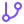

# Start here

### How this folder reads, how to answer, and how to bring your AI helper along

*Read this one once. Every other proposal assumes you have.*

---

##  TL;DR

> [!TIP]
> **Five lines, if that's all you read tonight.**
>
> 1.  **A proposal is one folder with one page.** The five-line TL;DR comes first, the detail folds away underneath, and the same page is rendered as a **PDF** in [`pdf/`](../pdf/) for anyone who would rather not open GitHub.
> 2.  **Answering is short.** One line per question, in any order, in your own words. *"Not sure"* and *"ask someone else"* are good answers. Nothing changes until you answer.
> 3.  **Bring your helper.** If you use ChatGPT, Claude or another assistant, three steps connect it to these pages so it can read, summarise and draft replies for you. The steps are on __ORG_SHORT__'s members' page and below.
> 4.  **The markdown travels with the PDF.** When a proposal is sent as a PDF, the `.md` goes with it, so a helper can read it word for word instead of guessing at a picture of a page.
> 5.  **Nothing is published by a proposal.** A proposal asks. People decide. __DECIDES__

---

##  How a proposal is shaped

| Part | What it is for |
|---|---|
| **TL;DR** | five lines or fewer; if you read nothing else, read these |
| **What and why** | the idea in plain words, and the reason it is being raised now |
| **Itinerary or at-a-glance table** | the stops, each lighting up as it is done |
| **Details** | the technical material, folded into `
` sections you can open or ignore |
| **Decisions log** | what was chosen, when, and why, so the reasoning is never lost |
| **Asks** | the questions that need a person, each with who can answer it |
| **Sources** | where every fact came from, with the date it was read |

The icons beside each idea are a reading aid, not decoration: the same icon means the same thing on every page.

### Status words

&nbsp;**asking**: we need your answer &nbsp;·&nbsp; &nbsp;**proposed**: written, waiting for a decision &nbsp;·&nbsp; &nbsp;**in progress**: agreed and under way &nbsp;·&nbsp; &nbsp;**done** &nbsp;·&nbsp; &nbsp;**idea**: not yet asked of anyone

---

##  How to answer

1. **Read the TL;DR.** If it is enough, answer from it.
2. **Answer in one line each**, in any order: *"F1 yes · F2 the second one · F3 not sure, ask Ash"*.
3. **Send it the way you already talk to us:** __ANSWER_ROUTES__
4. **Then the proposal changes, not before.** Your answers go into the decisions log with the date.

---

##  Bring your helper (three steps)

> [!IMPORTANT]
> **Your AI helper can read these pages for you.** Any assistant that can connect to GitHub (ChatGPT, Claude, and others) can be pointed here, so it can summarise a proposal, explain a term, and help you answer in your own words.
>
> 1. **Connect it to GitHub.** In the assistant's apps or connectors list, connect **GitHub** and sign in with the account that belongs to __ORG_SHORT__. An owner may need to approve the helper and choose which repositories it may read. ([How to join an organisation](https://github.com/drasticstatic/my-template/blob/main/walkthroughs/JOIN-AN-ORGANIZATION.md), [who can read what](https://github.com/drasticstatic/my-template/blob/main/walkthroughs/MEMBERS-PROFILE.md).)
> 2. **Paste a first message:** *"Read __ONBOARDING_LINK__, then __WELCOME_LINE__ Tell me what you will do before you change anything."*
> 3. **Ask in your own words.** Every change a helper proposes goes to a pull request that a person reviews. Nothing publishes itself.

__WELCOME_PARA__

---

##  The markdown beside the PDF

Every proposal exists twice: the `README.md` you are reading, and `pdf/NNN-name.pdf`, rendered from it. The PDF is
for eyes; the markdown is for helpers. A helper given only a PDF has to rebuild the words from a picture of a page,
and loses the links, the fold-away sections and the exact phrasing. So, whenever a proposal is sent on, **both files
go**, and whenever one comes back to us, we ask for the markdown too. The full note:
[Markdown beside the PDF](https://github.com/drasticstatic/my-template/blob/main/walkthroughs/MARKDOWN-BESIDE-PDF.md).

---

##  Five GitHub words, and no more

| Word | Plain meaning |
|---|---|
| **Repository** (repo) | a folder with a memory: every change to every file, with who made it and when |
| **Issue** | a numbered conversation attached to a repo; the simplest way to answer or ask |
| **Branch** | a draft copy of the folder where work happens before anyone sees it on the main copy |
| **Pull request** | *"please look at this draft and, if you agree, make it the real one"*; a person reviews it |
| **Commit** | one saved step, with a sentence saying what changed and who did it |

That is all a reader needs. Everything else is for the people who build.

---

##  Where things live

| | Place | What it holds |
|---|---|---|
|  | [this repository](../README.md) | every proposal, numbered, with the index on its front page |
|  | __MEMBERS_LINK__ | the members' page, which opens with the three steps above |
|  | __ONBOARDING_LINK__ | the welcome for people and helpers: who we are, what is private, how we work |
__WHERE_EXTRA__

---

__FOOTER__ · Icons: Lucide (ISC). This page is the pattern every organisation's proposals repo opens with; the template lives in <a href="https://github.com/drasticstatic/my-template/tree/main/proposals-template">my-template</a>.

