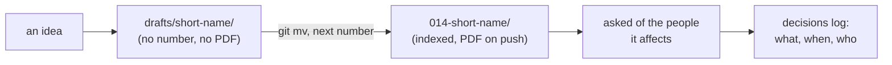

<div align="center">


# Drafts

*Where a proposal grows before it has a number.*

</div>

##  The convention

-  **A draft is a folder here with no number:** `drafts/short-name/README.md`, copied from [`../_template/`](../_template/README.md).
-  **Drafts are not rendered to PDF,** not listed in the index, not collected by a board's inbox, and never put on a public allowlist. They are for the author, the helpers and whoever the author asks to read early.
-  **A draft graduates** when it is ready to ask a decision of someone: give it the next number with a move, so its history comes along, and add its row to the index.
  ```sh
  git mv drafts/short-name 014-short-name
  ```
  The next push renders its PDF.
-  **Private stays private.** A draft is still in the private repository; the names policy lets its *folder name* be mentioned, never its contents (`my-template/NAMES-POLICY.md`).
-  **A draft that will not go forward** is deleted, or kept with one line at the top saying why it stopped. Nothing here is a promise.

##  From idea to decision



<sub>Write it lucid: plain words, an icon beside each idea, one Mermaid diagram where a picture explains the mechanism (`my-template/LUCID.md`).</sub>
