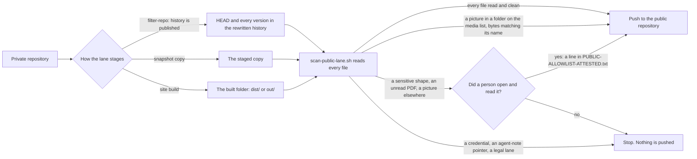

#  Tripwire copies: every public lane that carries the scanner

**TL;DR:** the public-lane tripwire ([`scripts/scan-public-lane.sh`](../scripts/scan-public-lane.sh), self-test beside
it) reads every file a lane is about to publish, and stops the lane when something has not been read. This page says
where each copy stands on 2026-11-04. 61 repositories are listed below; every copy was refreshed to the `8002408` master that day, and again that evening to `06ac002` (v3: own-repo links and their anchor text). Nine lanes were finished
this round and **their fixes wait on branch `r5-lanes`, not yet pushed.** Six of the nine rehearse clean. Two others each
need one decision from Christopher, and the lab `iamoneself` needs a master rule.

> **The rule:** a public lane never publishes a file a machine or a person has not read.
> (Written up for SOP-OPS-003 in [`repo/OPS/_fragments/tripwire.md`](repo/OPS/_fragments/tripwire.md).)

##  The master today

| File | Commit | md5 |
|---|---|---|
| `scripts/scan-public-lane.sh` | `06ac002` | `fc54aa60a95f278eb366280f30049dae` |
| `scripts/scan-public-lane.selftest.sh` | `06ac002` | `639a7c43b7314ff48cf8c9e6640dbdfd` |

Copy, do not fork: when the master changes, copy it again into each repository on this page. The self-test reports
127/127 in a copy, 131/131 where `scripts/sync-allowlist.sh` sits beside it, and 133/133 here (the `8002408` master
reported 112, 116 and 118). Lanes on the template's family
carry `sop-template/repo/scripts/sync-allowlist.sh` byte for byte (md5 `504181e2…`). Psanctuary's `--check` family keeps
its own script with the call site edited.

**2026-11-04, four exceptions, each narrow (`120bee1`, then `8002408` minutes later; both re-copied the same day: see the next section).** (a) A link whose
target is `github.com/drasticstatic/<name>-public-preview` or `drasticstatic.github.io/<name>-public-preview/` is not a
personal-matter hit: a public preview is public by definition. Only that link token is exempt, and only from the
personal-matter words; the same word elsewhere on the line, a preview under another owner, or a name that goes on after
`-public-preview` still trips. (b) The guardianship word negated ("no …", "non-…", so "no payments, no …" and "no …, no
tokens") is a compliance note, not the matter, so Taylor's compliance notes pass; the negation must sit right before the
word. (c) Pagefind's search index under a folder named `pagefind/` passes the "binary no machine here can read" rule when
its bytes are what pagefind writes: gzip (`1f 8b`) for `*.pf_fragment`, `*.pf_index` and `*.pf_meta`, and for
`wasm.*.pagefind` gzip that inflates to pagefind's marker `pagefind_dcd` followed by the WebAssembly magic (`00 61 73 6d`),
or a bare WebAssembly module (pagefind gzips its wasm too, which the first live run showed; `8002408` reads that shape); `pagefind-entry.json`, `pagefind.js`, `pagefind-ui.js/.css` and
`pagefind-highlight.js` are plain text and are read as text. The gzip is inflated (capped at 64 MB) and searched for
credentials, which no attestation opens; a `.pf_*` that is not gzip, a wasm that is not WebAssembly, the same gzip
outside `pagefind/` and any other binary there are refused. This is the master rule the `iamoneself` lanes waited for.
(d) The street-address shape is kept on purpose: a self-test case proves a plain address still trips, and that an
address inside a public-preview link still trips with no personal-matter refusal on that line.

**2026-11-04 evening, v3: own-repo links and their anchor text (`06ac002`).** Christopher's rule of Nov 3: "I don't name
my repos in ways that have anything to hide"; repository names are public, their contents are what the lane protects. Two
real cases still tripped the `8002408` exception: a repository linking to itself or a sibling by a non-preview address
(the tax desk's README badge, `github.com/drasticstatic/<name>/actions/workflows/…/badge.svg`), and the anchor text of such
a link (the tax desk's `index.html`, and three files in `anthropas-argus-alfred`: a 404 page's card, a palette deck's
list item and its Markdown source). Exception (a) widens: any link under `github.com/drasticstatic/<name>`,
`drasticstatic.github.io/<name>` or the SSH form `git@github.com:drasticstatic/<name>` (the Nov 4 verifier found that one
was not exempt), with or without `-public-preview` and with any path after it, is blanked for the personal-matter rule
only. The anchor text of such a link is blanked too, HTML `<a href="…">TEXT</a>` or Markdown `[TEXT](…)`, when TEXT shows
at most 120 characters: a Markdown TEXT sits on one line; an HTML anchor may wrap a short card over a few lines (the 404
page's card is five lines: a div, a heading and a paragraph inside one `<a>`), 600 characters of markup at most, no anchor
inside it. Everything else stays: the same word in prose outside a link still trips (the tax desk's *You are here* line,
which names the repository in backticks, now surfaces as the next refusal), a street address or a credential inside the
link or its text still trips, a link under another owner or domain is not exempt. Fifteen self-test cases were added, the
five real lines among them, copied verbatim; the case "a name that goes on after `-public-preview`" flipped to pass, since
that is one of our own repositories too. The self-test here reports 133/133.

The 28188db master (2026-11-02) added the media list. `PUBLIC-LANE-MEDIA.txt` names folders whose pictures and fonts a
lane publishes on purpose: a person chose them, and a machine still reads what it can. Base64 in text is decoded and
read, and an SVG that can run something is refused.

##  Re-copy of the 06ac002 master (2026-11-04, evening)

The v3 master was copied into every repository of the previous section the same way, the same evening: clone pulled
(`git pull --rebase --autostash`), the pair copied from the master, the self-test run there and green, the two files
committed on their own (`:lock: security(tripwire): scanner copy refreshed (own-repo links and their anchor text)`) and
pushed to the working branch; held `r5-lanes` branches committed and not pushed; parked clones (`genesis`,
`nav-reading-room`) refreshed through a temporary worktree on the working branch. `drasticstatic/tax-assistant` joins the
page this round. Every copy was checked by md5 against `fc54aa60…` / `639a7c43…` after the push.

<!-- v3 re-copy table: filled after the fan-out -->

##  Re-copy of the 8002408 master (2026-11-04)

Two passes the same day: every copy below first took `120bee1`, and then `8002408` after the first live run
(`iamoneself-retreats`, `preview`) showed pagefind gzips its WebAssembly too; the table shows the second commit in each
repository, the first sits just below it in each history. Copies were found the round-five way: `find` under `~/code ~/dappu ~/theholyearthfoundation ~/psychedelicsinrecovery
~/Octagon-Religious-Research-Group-ORG ~/psanctuary ~/psanctuarychurch ~/taylordwraps-org` (to eight folders deep this
time: four clones sit one level further down than the round-five search reached). In each repository the clone was pulled
(`git pull --rebase --autostash`), the pair was copied from the master, the self-test was run there and had to be green,
and the two files were committed on their own and pushed to the working branch (`preview` where the repository has one).
Four clones were parked on a feature branch (`nav-reading-room`, `genesis`), so their working branch was checked out in a
temporary worktree for the copy. Three held `r5-lanes` branches carry their own scanner copy; those were refreshed by a
commit on the held branch and **not pushed**, as the hold says. The self-test passed everywhere: 112/112, or 116/116
where `scripts/sync-allowlist.sh` sits beside it (the master's own 118/118 adds two "matches the master" checks). Every
copy below was checked by md5 against the master after the push: all 60 rows match
`a9d35d6d2162ec0d4df47a4d7f8d7fc8` / `c6bcd75658dafa6856da97aed9f7abf2`. The two duplicate clones of
`theholyearthfoundation/changelog-astro` and `psychedelicsinrecovery/changelog-astro` were pulled afterwards and match.

| Repository | Branch | Commit | Self-test |
|---|---|---|---|
| `drasticstatic/alexandrina` | main | `f9fdcfa` | 112/112, matches |
| `drasticstatic/anthropas-argus-alfred` | main | `e37830d` | 112/112, matches |
| `drasticstatic/augment-intent-properties` | main | `e7d1a5a` | 112/112, matches |
| `drasticstatic/aunt-harriot` | main | `c462fc3` | 112/112, matches |
| `drasticstatic/david-amaringo` | preview | `54b0dfb` | 112/112, matches |
| `drasticstatic/david-amaringo` | r5-lanes | `9a1f22f` | 112/112, matches, on the held branch, not pushed |
| `drasticstatic/dpnelson` | main | `c79ce72` | 112/112, matches |
| `drasticstatic/findyourfeathers` | main | `539c584` | 112/112, matches |
| `drasticstatic/fortuna-vision` | main | `075d1b0` | 112/112, matches |
| `drasticstatic/gratitude-token-project_astro` | main | `2ef7581` | 112/112, matches |
| `drasticstatic/iamoneself` | preview | `7389cea` | 112/112, matches |
| `drasticstatic/iamoneself` | r5-lanes | `bdb5ecd` | 112/112, matches, on the held branch, not pushed |
| `drasticstatic/littlebird-ambassador` | main | `2451956` | 112/112, matches (first copy, 2026-11-04; the lane was found without one) |
| `drasticstatic/O-R-G` | main | `3f8cd51` | 112/112, matches |
| `drasticstatic/O-R-G-astro` | main | `e65d916` | 112/112, matches |
| `drasticstatic/O-R-G-dapp` | main | `81fe465` | 112/112, matches |
| `drasticstatic/ops-standard-operating-procedures-thef` | preview | `f7fc502` | 116/116, matches |
| `drasticstatic/pir` | main | `8a29400` | 112/112, matches |
| `drasticstatic/pir-devine-news` | main | `3b45af2` | 112/112, matches |
| `drasticstatic/proposals-thef` | preview | `19c0841` | 116/116, matches |
| `drasticstatic/Psanctuary` | main | `6d5e04b` | 116/116, matches |
| `drasticstatic/psychedelic-policy-reform-astro` | main | `cc36365` | 112/112, matches |
| `drasticstatic/psychedelic-policy-reform-dapp` | main | `d06e983` | 112/112, matches |
| `drasticstatic/taylordwraps` | main | `1a290a4` | 112/112, matches |
| `drasticstatic/trading-assistant` | main | `7c45252` | 112/112, matches |
| `drasticstatic/trading-bot_arbitrage_DAPPUv3_hardhat_UNI-CAKE` | main | `1f90a80` | 112/112, matches |
| `drasticstatic/wilson-lawn-ai-assist` | main | `39ece62` | 112/112, matches |
| `Octagon-Religious-Research-Group-ORG/changelog-astro` | r5-lanes | `81d252b` | 112/112, matches, on the held branch, not pushed |
| `Octagon-Religious-Research-Group-ORG/legal` | main | `d8606e4` | 112/112, matches |
| `Octagon-Religious-Research-Group-ORG/ops-standard-operating-procedures` | main | `74a7564` | 112/112, matches |
| `Octagon-Religious-Research-Group-ORG/reading-room` | main | `33b196f` | 112/112, matches |
| `psanctuary/changelog-astro` | main | `c627c74` | 112/112, matches |
| `psanctuary/legal` | main | `893d87f` | 116/116, matches |
| `psanctuary/ops-standard-operating-procedures` | main | `d5c5b34` | 116/116, matches |
| `psanctuary/reading-room` | main | `6208517` | 112/112, matches |
| `psanctuarychurch/changelog-astro` | main | `36497a6` | 112/112, matches |
| `psanctuarychurch/legal` | main | `3b5955b` | 116/116, matches |
| `psanctuarychurch/ops-standard-operating-procedures` | main | `3d3c625` | 116/116, matches |
| `psanctuarychurch/reading-room` | main | `a94b027` | 116/116, matches |
| `psychedelicsinrecovery/.github-private` | main | `2a7d555` | 112/112, matches (first copy, 2026-11-04; the lane was found without one) |
| `psychedelicsinrecovery/alex-desk` | main | `4e4af64` | 112/112, matches |
| `psychedelicsinrecovery/board-of-directors` | main | `e4fd5b7` | 112/112, matches |
| `psychedelicsinrecovery/catalyst-desk` | main | `cdcabc8` | 112/112, matches |
| `psychedelicsinrecovery/changelog-astro` | main | `8bd784b` | 112/112, matches |
| `psychedelicsinrecovery/github-desk` | main | `dabeb3d` | 112/112, matches |
| `psychedelicsinrecovery/legal` | main | `dbe4043` | 116/116, matches |
| `psychedelicsinrecovery/litcom-desk` | main | `753fc6e` | 112/112, matches |
| `psychedelicsinrecovery/literature-committee` | main | `c15c23e` | 112/112, matches |
| `psychedelicsinrecovery/ops-standard-operating-procedures` | main | `883bb9d` | 116/116, matches |
| `psychedelicsinrecovery/pr-desk` | main | `442ec82` | 112/112, matches |
| `psychedelicsinrecovery/public-relations` | main | `438a495` | 112/112, matches |
| `psychedelicsinrecovery/reading-room` | main | `c229fc8` | 116/116, matches |
| `psychedelicsinrecovery/tech-committee` | main | `585682e` | 112/112, matches |
| `psychedelicsinrecovery/techcom-desk` | main | `0171fe0` | 112/112, matches |
| `taylordwraps/ops-standard-operating-procedures` | main | `eedc9c0` | 116/116, matches |
| `taylordwraps/reading-room` | main | `1059c7d` | 116/116, matches |
| `theholyearthfoundation/changelog-astro` | main | `a09c13e` | 112/112, matches |
| `theholyearthfoundation/david-amaringo` | preview | `e7efe88` | 112/112, matches |
| `theholyearthfoundation/iamoneself-retreats` | preview | `adad907` | 112/112, matches |
| `theholyearthfoundation/legal` | main | `1a9863d` | 116/116, matches |
| `theholyearthfoundation/ops-standard-operating-procedures` | main | `ac9a877` | 116/116, matches |
| `theholyearthfoundation/reading-room` | main | `1450371` | 116/116, matches |

**Not refreshed, and why:**

- `drasticstatic/divorce-custody-assistant` (`45c2d96c…`) and `drasticstatic/tax-assistant`: the two personal repositories
  this page leaves to the main session, as before.
- `drasticstatic/my-template-clean`: it takes `scripts/` and `sop-template/repo/` from this repository by
  `sync-clean-template.yml` on push, so it follows `8002408` on its own; it is not a hand copy.
- `Octagon-Religious-Research-Group-ORG/changelog-astro` on `main`: GitHub's `main` carries no scanner yet; the held
  `r5-lanes` branch does, and is refreshed above.

When the held `r5-lanes` branches of the two lab sites land, their scanner copies now equal `preview`'s, so that file no
longer conflicts at the merge. The six other held branches never touched the scanner, so `main`'s new copy carries through.

##  The nine lanes finished this round

Nothing here has run on GitHub yet. Pushing one of these branches to its working branch starts a publish to a public
repository, so that step waits for a person or the main session. Each branch sits in the local clone, on top of the
remote branch as it stood at the time of writing. "Rehearsed" means the lane's own filter and scan steps ran in a fresh
clone, with no push. The counts are files at HEAD · versions in history.

| Repository | Target | `r5-lanes` | What changed | Rehearsed |
|---|---|---|---|---|
| `drasticstatic/dpnelson` | main | `5257afd` | media list (`docs`), `--media` wired | **clean:** 19 files of the committed build |
| `drasticstatic/findyourfeathers` | main | `02713be` | media list (`public`), `--media` wired | **clean:** 36 files |
| `drasticstatic/aunt-harriot` | main | `d087681` | reworded; hooks, scripts and two config files stripped | **clean:** 22 · 91 |
| `drasticstatic/augment-intent-properties` | main | `d06015d` | reworded; an old notes folder stripped from history | **clean:** 6 · 17 |
| `Octagon-Religious-Research-Group-ORG/changelog-astro` | main | `bfa8c07` | scanner added as THEF's has it, in report mode; media list | **clean:** 116 · 123, on the last local build |
| `drasticstatic/david-amaringo` | preview | `a264f1b` | scanner re-copied, media list, `--media` wired, README line | **clean:** 50 source files; built site read on GitHub only |
| `drasticstatic/wilson-lawn-ai-assist` | main | `80926e1` | reworded; hooks, scripts, `bun.lockb` and a mislabelled favicon stripped | **stops:** 1 · 1, a street-address shape |
| `drasticstatic/pir-devine-news` | main | `02fc878` | reworded; hooks stripped | **stops:** 1 · 1, one picture of about 40 MB |
| `drasticstatic/iamoneself` | preview | `d9e7ee0` | scanner re-copied, media list, `--media` wired, README line | source **clean:** 26 files; built site will stop, see below |

Rewording follows the fleet's way: `.github/public-reword.txt`, passed to `git filter-repo` with `--replace-text` and
`--replace-message`, so the mirror's history and commit messages read the same as its HEAD. The private files keep their
paths.

**What is left after these land:**

- `wilson-lawn-ai-assist`: the address field's example text on the quote page. A person reads it and attests it, or
  the example changes. Its favicon also needs a real `.ico` if the mirror should carry one.
- `pir-devine-news`: one edition picture over the scanner's 15 MB limit, at HEAD and in one past version. A person
  chooses a smaller copy or keeps it private.
- `iamoneself` (lab) and `iamoneself-retreats` (THEF): the built site carries a search index, 27 binary files whose names
  change with each build, so they cannot be attested by path. The Nov 4 master (`8002408`) reads them: pagefind's files
  under `pagefind/` pass when their bytes are what pagefind writes. The apply form's birth-date label still appears in
  three built files and needs a person's reading.
- `changelog-astro` (ORG): `TRIPWIRE_ENFORCE` stays `0` until a run on GitHub is clean, then it can become `1`.

##  Every copy, as GitHub holds it

Read through the GitHub API on 2026-11-02 from every unarchived repository of the seven owners, on `main` and `preview`.
A commit is the last one to change the scanner there, on `main` unless a branch is named. "Lane" is the last run of the
lane workflow that day or earlier. This table replaces the older re-copy tables, which remain in this file's history.

| Repository | Scanner commit | Media list | Lane |
|---|---|---|---|
| `drasticstatic/alexandrina` | `24f5a83` |  | green |
| `drasticstatic/anthropas-argus-alfred` | `5084a94` |  | stops: words in published pages, and a legal-lane path in history |
| `drasticstatic/augment-intent-properties` | `a2ac077` |  | stopped; fix held, see above |
| `drasticstatic/aunt-harriot` | `335cd7b` |  | stopped; fix held, see above |
| `drasticstatic/david-amaringo` | preview `654c87e` (older) |  | `lanes.yml` stopped on `preview`; fix held |
| `drasticstatic/dpnelson` | `c5a2393` |  | stopped; fix held, see above |
| `drasticstatic/findyourfeathers` | `16839d2` |  | stopped; fix held, see above |
| `drasticstatic/fortuna-vision` | `06382c5` |  | stops at the push: the mirror token is refused. The scanner passed |
| `drasticstatic/gratitude-token-project_astro` | `f20085e` | yes | green |
| `drasticstatic/iamoneself` | preview `48db96d` (older) |  | `lanes.yml` stopped on `preview`; fix held, more remains |
| `drasticstatic/littlebird-ambassador` | `e4870b7` (2026-11-04) | yes | `sync-public.yml` stops at the tripwire: one personal-matter line in the scope table and the library page built from it, for Christopher to attest; agent-note pointers and two private repo names were reworded in the sources and in history, two old root paths stripped from history |
| `drasticstatic/my-template` | `28188db` |  | the master |
| `drasticstatic/my-template-clean` | `b76f5b4` |  | no public lane here |
| `drasticstatic/O-R-G` | `fa76728` |  | no public lane here |
| `drasticstatic/O-R-G-astro` | `04c1d59` | yes | green, and `deploy-pages.yml` green |
| `drasticstatic/O-R-G-dapp` | `b7a0881` | yes | stops: one giver-list word |
| `drasticstatic/ops-standard-operating-procedures-thef` | preview `0fa39ec` |  | no public lane here |
| `drasticstatic/pir` | `7de2910` |  | no public lane here |
| `drasticstatic/pir-devine-news` | `79cadb2` |  | stopped; fix held, one item for Christopher |
| `drasticstatic/proposals-thef` | `75a5a96` (older) · preview `efc37df` |  | no public lane here |
| `drasticstatic/Psanctuary` | `9b49916` |  | no public lane here |
| `drasticstatic/psychedelic-policy-reform-astro` | `bee5f8c` | yes | green, and `deploy-pages.yml` green |
| `drasticstatic/psychedelic-policy-reform-dapp` | `4ff8390` | yes | green, and `deploy-pages.yml` green |
| `drasticstatic/taylordwraps` | `c115cc9` | yes | `sync-lanes.yml` stopped |
| `drasticstatic/trading-assistant` | `31c9ae9` | yes | green |
| `drasticstatic/trading-bot_arbitrage_DAPPUv3_hardhat_UNI-CAKE` | `18c11a2` |  | green |
| `drasticstatic/wilson-lawn-ai-assist` | `64a1052` |  | stopped; fix held, one item for Christopher |
| `Octagon-Religious-Research-Group-ORG/legal` | `411ebd4` |  | green |
| `Octagon-Religious-Research-Group-ORG/ops-standard-operating-procedures` | `b501baf` |  | no public lane here |
| `Octagon-Religious-Research-Group-ORG/reading-room` | `9bd4e2d` |  | green |
| `psanctuary/changelog-astro` | `196cfbe` |  | green |
| `psanctuary/legal` | `1887ea1` |  | green |
| `psanctuary/ops-standard-operating-procedures` | `4bb2606` |  | in_progress |
| `psanctuary/reading-room` | `173483c` |  | green |
| `psanctuarychurch/changelog-astro` | `2d5a8cc` |  | green |
| `psanctuarychurch/legal` | `b4b4b87` |  | green |
| `psanctuarychurch/ops-standard-operating-procedures` | `e701a6a` |  | green |
| `psanctuarychurch/reading-room` | `5691889` |  | green |
| `psychedelicsinrecovery/.github-private` | `177f610` (2026-11-04) |  | green: `publish-public-contacts.yml` runs the self-test (112/112) and reads the masked `CONTACTS.md` before the push (run 41836219891, clean) |
| `psychedelicsinrecovery/alex-desk` | `bd863e5` |  | green |
| `psychedelicsinrecovery/board-of-directors` | `ce1a5c3` |  | green |
| `psychedelicsinrecovery/catalyst-desk` | `6c52008` |  | green |
| `psychedelicsinrecovery/changelog-astro` | `f386e1f` |  | green |
| `psychedelicsinrecovery/github-desk` | `6260360` |  | green |
| `psychedelicsinrecovery/legal` | `f7e72d4` |  | green |
| `psychedelicsinrecovery/litcom-desk` | `211b955` |  | green |
| `psychedelicsinrecovery/literature-committee` | `95a6e4b` |  | green |
| `psychedelicsinrecovery/ops-standard-operating-procedures` | `63f3613` |  | green |
| `psychedelicsinrecovery/pr-desk` | `fba5c86` |  | green |
| `psychedelicsinrecovery/public-relations` | `9416adc` |  | green |
| `psychedelicsinrecovery/reading-room` | `b1e5af0` |  | green |
| `psychedelicsinrecovery/tech-committee` | `d0bff40` |  | green |
| `psychedelicsinrecovery/techcom-desk` | `51412ca` |  | green |
| `taylordwraps/ops-standard-operating-procedures` | `d4011eb` |  | in_progress |
| `taylordwraps/reading-room` | `be2847f` |  | green |
| `theholyearthfoundation/changelog-astro` | `3e1df4f` | yes | green |
| `theholyearthfoundation/david-amaringo` | preview `672ba50` | yes | green |
| `theholyearthfoundation/iamoneself-retreats` | preview `3998e68` | yes | stops: search index, and a form label |
| `theholyearthfoundation/legal` | `774a45b` |  | green |
| `theholyearthfoundation/ops-standard-operating-procedures` | `fd1204c` |  | in_progress |
| `theholyearthfoundation/reading-room` | `d951ee3` |  | green |

**Older copies:** the lab `david-amaringo` and `iamoneself` on `preview` (fixes held above), and `proposals-thef` on
`main`, which follows its `preview` by Promote, a person's merge.

**Private repositories not named here:** two personal repositories are left to the main session and are outside this
page. One carries the current pair and its lane is stopped; the other was not read in this pass.

**Public lanes with no scanner:**

- `Octagon-Religious-Research-Group-ORG/changelog-astro`, until its held branch lands.
- ~~`drasticstatic/littlebird-ambassador`~~ and ~~`psychedelicsinrecovery/.github-private`~~: both carried a public lane with no
  tripwire until 2026-11-04 (`e4870b7`, `177f610`); each now copies the master, runs the self-test and reads the staged tree
  before the push. See their rows above.

**Other lanes that are stopped today,** outside this round's nine: `anthropas-argus-alfred`, `fortuna-vision` (the scan
passes, and the push fails because `PUBLIC_REPO_TOKEN` is refused), `O-R-G-dapp` (`sync-public-allowlist.yml` and
`deploy-pages.yml`), `taylordwraps` (`sync-lanes.yml`) and `iamoneself-retreats` (`lanes.yml`).

##  How a lane is gated

Each workflow installs `pdftotext` and runs the self-test first, so a broken reader can never wave a PDF through. In
snapshot and site lanes the scanner refuses the folder name `.github` by itself, so a deploy workflow that travels with
the lane is copied aside as `dot-github/` and read like any other file. A lane in report mode (`TRIPWIRE_ENFORCE: "0"`)
prints refusals as warnings and still publishes, until its files are fixed or attested. A legal-lane path stops it in
either mode.

##  Templates in this repository

| Path | Carries |
|---|---|
| [`workflow-templates/sync-public-allowlist.yml`](../workflow-templates/sync-public-allowlist.yml) | the tripwire steps |
| [`workflow-templates/sync-public-excludelist.yml`](../workflow-templates/sync-public-excludelist.yml) | the same steps, plus a gotcha: the tripwire narrows the denylist model |
| [`workflow-templates/publish-masked-public-copy.yml`](../workflow-templates/publish-masked-public-copy.yml) | the masked copy is read before it is committed |
| [`repo/`](repo/) (the SOP template) | the tripwire |

##  Seen and left alone, and why

- **`.github/workflows/sync-clean-template.yml`** here: public to public (`my-template` to `my-template-clean`); nothing
  private crosses.
- **Reference copies that never run,** outside `.github/workflows/`: `~/code/trading-assistant/github/workflows/sync-public_template.yml`
  and one more in a private repository. Refresh them from this repository when touched.
- **`monitoring-outputs-thef`** and its `-public` twin: no sync workflow yet. When one is added, start from
  [`repo/.github/workflows/sync-public.yml`](repo/.github/workflows/sync-public.yml).
- **Public repositories that publish only themselves** (the profile repository, `gratitude-token-project_docs`).

##  Turning a stopped lane green

Each refusal in the run's log names the file and the kind of match (never the matched text) and prints the exact
attestation line. There are four ways through, and only a person chooses:

1.  **Fix the file.** Agent-note pointers, the agent-notes folder name, credentials and legal lanes
   are never opened by an attestation: reword the public text, or remove the file. A history lane rewords with
   `.github/public-reword.txt`.
2.  **Keep it private.** Add the path to the lane's private list (or take it off the allowlist). In
   a filter-repo lane this also removes it from the rewritten history.
3.  **List the folder.** Pictures and fonts a person put there to be shown go in
   `PUBLIC-LANE-MEDIA.txt`, under a header line: `approved by <name> | YYYY-MM-DD`. Their bytes must still match their
   names. The workflow passes the list with `--media`.
4.  **Attest it.** A person opens and reads the file, then adds the printed line to
   `PUBLIC-ALLOWLIST-ATTESTED.txt` at the repository root: `path | officer | YYYY-MM-DD | opened and read | sha256:<hex>`.
   With the fingerprint, the line lapses when the file changes. In a history lane, a line without a fingerprint covers
   every version of that path.

Two cautions. A stopped lane leaves the public repository as it was: whatever it already shows stays there until the
next green run replaces it. And build folders name some files by content hash. A media list covers fonts and pictures
named that way, but a search index cannot be attested by path, so such a lane needs a master rule before it can go green.
