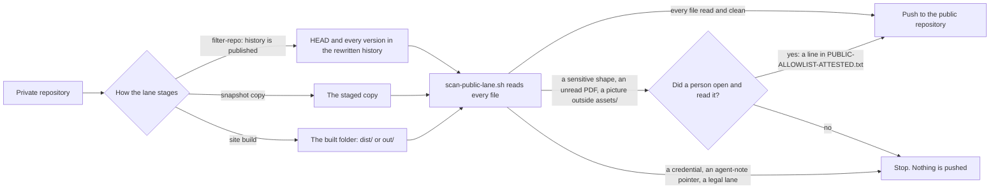

#  Tripwire copies: every public lane that carries the scanner

**TL;DR:** the public-lane tripwire ([`scripts/scan-public-lane.sh`](../scripts/scan-public-lane.sh), self-test beside
it) now runs in every lab-owned lane that publishes to a public repository. Each lane reads its files before it
pushes. This page lists every copy, the commit that added it, and what a local rehearsal found. Most lanes now **stop**
until a file is fixed, moved to the private side, or attested by a person. That is the tripwire working as designed.

> **The rule:** a public lane never publishes a file a machine or a person has not read.
> (Written up for SOP-OPS-003 in [`repo/OPS/_fragments/tripwire.md`](repo/OPS/_fragments/tripwire.md).)

Swept 2026-11-01 (round four, package 0.b sweep). Master fingerprints at the time of the sweep: `scan-public-lane.sh`
md5 `45c2d96c…`, `scan-public-lane.selftest.sh` md5 `7848957c…`. Every copy below was checked byte for byte against
them. Copy, do not fork: when the master changes, copy it again into each repository on this page.

> **Current master: my-template `06dd9d1`** (2026-11-01 review): the `.eot` font signature is checked, every
> picture's and font's bytes and every office file's attributes are searched for credentials, and the account,
> street and number shapes catch an IBAN, a numbered street and a dashed number. Fingerprints:
> `scan-public-lane.sh` md5 `17f4649733fb425e95e0fc1e747b1833`, `scan-public-lane.selftest.sh` md5
> `0875af14f5aee3cf7c2ba95d020aed58`. **Every copy on this page was copied again the same day** and now matches
> them byte for byte (see the re-copy table below). No copy still carries `45c2d96c…`, except one that is left for
> Christopher and named there.

##  Re-copy of the 06dd9d1 master (2026-11-01)

Copies were found with `find ~/code ~/dappu ~/theholyearthfoundation ~/Octagon-Religious-Research-Group-ORG ~/psanctuary
~/psanctuarychurch ~/psychedelicsinrecovery -name 'scan-public-lane*.sh'`. Each clone's `origin/preview` and
`origin/main` were also checked, to find copies on a branch that was not checked out. In each repository, both files
were copied from the master and the self-test was run there. It passed everywhere: 40/40, or 42/42 where the copy also
carries the reading-room checks. (The master's own 44/44 adds two "matches the master" checks.) Each copy was then
committed on its own and pushed to the working branch. 52 repositories carry the pair, and all 52 match the master.
(The first pass found 42. A review the same day read every repository on GitHub, not only local clones, and found ten
more in PsychedelicsInRecovery: committee and desk repositories whose copies were added at 09:46 from `5d4ab42`, just
before `06dd9d1`. Their only local clones were in a session scratch folder, which the `find` above does not reach.
They are the last ten rows below.)
Commits are on `main` unless marked `preview`.

| Repository | Commit |
|---|---|
| `drasticstatic/alexandrina` | `439043e` |
| `drasticstatic/anthropas-argus-alfred` | `3e1886f` |
| `drasticstatic/augment-intent-properties` | `cec8bb6` |
| `drasticstatic/aunt-harriot` | `fc8a9a6` |
| `drasticstatic/dpnelson` | `25d5d2b` |
| `drasticstatic/findyourfeathers` | `b08dbb7` |
| `drasticstatic/fortuna-vision` | `5a79b54` |
| `drasticstatic/gratitude-token-project_astro` | `edbf153` |
| `drasticstatic/trading-bot_arbitrage_DAPPUv3_hardhat_UNI-CAKE` | `31735e7` |
| `drasticstatic/tax-assistant` | `c0202da` |
| `drasticstatic/trading-assistant` | `a3ac577` |
| `drasticstatic/wilson-lawn-ai-assist` | `aa06e79` |
| `drasticstatic/taylordwraps` | `1655866` |
| `drasticstatic/psychedelic-policy-reform-astro` | `0284cda` |
| `drasticstatic/psychedelic-policy-reform-dapp` | `30f9b06` |
| `drasticstatic/O-R-G` | `777e61b` |
| `drasticstatic/O-R-G-astro` | `54dd53d` |
| `drasticstatic/O-R-G-dapp` | `5a201b3` |
| `drasticstatic/pir` | `6aa267c` |
| `drasticstatic/pir-devine-news` | `8f08192` |
| `drasticstatic/proposals-thef` | preview `75a5a96` |
| `drasticstatic/ops-standard-operating-procedures-thef` | preview `984bdad` |
| `drasticstatic/david-amaringo` (lab) | preview `654c87e` |
| `drasticstatic/iamoneself` (lab) | preview `48db96d` |
| `theholyearthfoundation/david-amaringo` | preview `95ef051` (newly gated, see below) |
| `theholyearthfoundation/iamoneself-retreats` | preview `fa623e8` (newly gated, see below) |
| `theholyearthfoundation/reading-room` | `2550d29` |
| `theholyearthfoundation/ops-standard-operating-procedures` | `ce282fb` |
| `theholyearthfoundation/legal` | `7216d5d` |
| `Octagon-Religious-Research-Group-ORG/reading-room` | `d784630` |
| `Octagon-Religious-Research-Group-ORG/ops-standard-operating-procedures` | `1b25913` |
| `Octagon-Religious-Research-Group-ORG/legal` | `1f225fa` |
| `psychedelicsinrecovery/reading-room` | `a806d71` |
| `psychedelicsinrecovery/ops-standard-operating-procedures` | `d6f4e94` |
| `psychedelicsinrecovery/changelog-astro` | `ec4b7f9` |
| `psychedelicsinrecovery/legal` | `4795104` |
| `psanctuarychurch/reading-room` | `fd9fd56` |
| `psanctuarychurch/ops-standard-operating-procedures` | `0daf05a` |
| `psanctuarychurch/changelog-astro` | `88aa174` |
| `psanctuarychurch/legal` | `430287e` |
| `taylordwraps/reading-room` | `7cea9f6` |
| `taylordwraps/ops-standard-operating-procedures` | `04e047a` |
| `psychedelicsinrecovery/alex-desk` | `943f232` |
| `psychedelicsinrecovery/board-of-directors` | `fcba4a8` |
| `psychedelicsinrecovery/catalyst-desk` | `00312c3` |
| `psychedelicsinrecovery/github-desk` | `1ded0f8` |
| `psychedelicsinrecovery/litcom-desk` | `af6482c` |
| `psychedelicsinrecovery/literature-committee` | `22ce427` |
| `psychedelicsinrecovery/pr-desk` | `1a7ee07` |
| `psychedelicsinrecovery/public-relations` | `fc30714` |
| `psychedelicsinrecovery/tech-committee` | `cd7cad3` |
| `psychedelicsinrecovery/techcom-desk` | `ea1f8e8` |

Some copies already matched the master, so they needed no commit: `psanctuary/legal`, `psanctuary/reading-room`,
`psanctuary/ops-standard-operating-procedures`, the `~/code/psanctuary` lab desk, and this repository's
`sop-template/repo/scripts/`.

**Left for Christopher:** `~/code/divorce-custody-assistant`. Its `origin/main` still carries `45c2d96c…`. The
repository is on hold, and the first sweep read only its workflow file there, so it needs his go-ahead before anyone
touches it.

**THEF's two live site lanes are patched now.** `theholyearthfoundation/david-amaringo` and
`theholyearthfoundation/iamoneself-retreats` used to publish `out/` to their `-public` repositories through
`peaceiris/actions-gh-pages` with no tripwire. Their `lanes.yml` now does three things before the peaceiris step:

- it installs poppler-utils, and fails without `pdftotext`;
- it runs the self-test;
- it reads every file in `out/`, after the public documents are added, so it reads exactly what `publish_dir` sends.

These are the same steps as the lab rehearsal (`b1d359c`, `72e8339`). Both lanes stay inert until `LANES_ENABLED` and
the deploy keys exist. A local rehearsal on the Oct 27 builds stops in both:

- david-amaringo refuses 105 of 410 files (89 pictures and 16 fonts outside `assets/`);
- iamoneself-retreats refuses 72 of 225 (29 pictures, 13 fonts, 27 search-index binaries and 3 birth-date shapes).

**Two more checks the same day:**

- **`gratitude-token-project_astro`:** its sync had stopped at "Validate root path classification", because the root
  path `.intent` was on neither list. `.intent` is now on the private list, and filter-repo strips it (`cc44945`).
  The next run (41322031803) passed that step, then stopped at the tripwire as designed (11 refusals at HEAD).
- **`O-R-G-astro`:** its `deploy-pages.yml` runs the tripwire on `dist/` before the gh-pages push. Runs 41321781414
  and 41321822507 both show the self-test passed, the tripwire failed and the push was skipped.

##  How a lane is gated now

Each workflow also installs `pdftotext` (and fails without it) and runs the self-test first, so a broken reader can
never wave a PDF through.

##  Every copy patched

Paths are local clone paths (`~/code`, `~/dappu`). Repository names are public under the Nov 1 names policy; the
rehearsal column gives only counts and kinds, never file names or contents.

###  Filter-repo lanes (they publish history, so history is read too)

| | Repository | Workflow | Branch · commit | Local rehearsal (HEAD · history) |
|---|---|---|---|---|
|  | `~/dappu/trading-bot_arbitrage_DAPPUv3_hardhat_UNI-CAKE` | `sync-public.yml` | main · `3548d86` | **clean**: 57 files · 317 versions. `.env.example` moved to the private list (an environment-file name never travels) |
|  | `~/code/anthropas-argus-alfred` | `sync-public.yml` | main · `59f39c9` | stops: 15 · 110. Agent-note pointers and the agent-notes folder name, personal-matter words, two base64 embeds |
|  | `~/code/augment-intent-properties` | `sync-public.yml` | main · `6a7fa7b` | stops: 2 · 13. The agent-notes folder name and pointers; two never-travel names in old versions |
|  | `~/code/aunt-harriot` | `sync-public.yml` | main · `ca21f8d` | stops: 10 · 28. Agent-note pointers and the folder name |
|  | `~/code/fortuna-vision` | `sync-public.yml`; also `scripts/sync-public.sh` (the token-free local path) | main · `e5e9e86`, `7ba0564` | stops: 2 · 4. The agent-notes folder name |
|  | `~/code/tax-assistant` | `sync-public.yml` | main · `91d2390` | stops: 4 · 10. Personal-matter words (the repository's own name) and a picture outside `assets/`. **graphify-out:** the strip now removes it and `.graphifyignore` at any depth, and the run stops if either survives; none survives |
|  | `~/code/trading-assistant` | `sync-public.yml` | main · `38f66a9` | stops: about 400, mostly history. Pictures outside `assets/` (382), PDFs without text (3), an office file with a drawing, street-address shapes, agent-note pointers |
|  | `~/code/pir/pir-devine-news` | `sync-public.yml` | main · `a1b9a4e` | stops: 4 · 8. The agent-notes folder name, a base64 embed, a picture over 15 MB |
|  | `~/code/wilson-lawn-ai-assist` | `sync-public.yml` | main · `ada09ec` | stops: 6 · 11. The agent-notes folder name, a binary lockfile, an `.ico` whose bytes are not an icon, street-address shapes |
|  | `~/dappu/gratitude-token-project_astro` | `sync-public-allowlist.yml` | main · `5da6189` | stops: 11 · 31. A never-travel name (the pending-tasks file), agent-note pointers (some in the graph output), an `.ico` whose bytes are not an icon |
|  | `~/code/psychedelic-policy-reform/psychedelic-policy-reform-astro` | `sync-public-allowlist.yml` | main · `ab8f4a1` | stops: 8 · 12. Pictures and fonts outside `assets/`, base64 inside two banner SVGs |
|  | `~/code/psychedelic-policy-reform/psychedelic-policy-reform-dapp` | `sync-public-allowlist.yml` | main · `de4f80a` | stops: 4 · 8. Pictures outside `assets/`, base64 inside two banner SVGs |
|  | `~/code/O-R-G/O-R-G-astro` | `sync-public-allowlist.yml` | main · `dda4ea0` | stops: 17 · 21. Pictures and fonts outside `assets/`, agent-note pointers |
|  | `~/code/O-R-G/O-R-G-dapp` | `sync-public-allowlist.yml` | main · `16af22c` | stops: 14 · 18. Pictures outside `assets/`, giver-list words, agent-note pointers |
|  | `~/code/divorce-custody-assistant` | `sync-public.yml` | main · `fad63a8` | not rehearsed: by instruction only the workflow file was read there |

###  Snapshot and site-build lanes (the staged copy or the built folder is read)

| | Repository | Workflow (what it reads) | Branch · commit | Local rehearsal |
|---|---|---|---|---|
|  | `~/code/alexandrina` | `sync-public.yml` (`public-preview/`) | main · `3463c1f` | **clean**: 25 files |
|  | `~/code/dpnelson` | `sync-public.yml` (the staged public clone) | main · `067235c` | stops: 13 pictures outside `assets/` (read from the committed `docs/`) |
|  | `~/code/findyourfeathers` | `sync-public.yml` (the staged public clone) | main · `18f99d0` | stops: 3 site icons outside `assets/` |
|  | `~/code/the-holy-earth-foundation/david-amaringo` | `sync-public.yml` (staged clone) and `lanes.yml` (`out/`) | preview · `b1d359c` | stops: about 56 fonts and pictures in the Next.js build (read from a local build of Oct 27) |
|  | `~/code/the-holy-earth-foundation/iamoneself` | `sync-public.yml` (staged clone) and `lanes.yml` (`out/`) | preview · `72e8339` | stops: about 61, including 27 search-index binaries and 3 birth-date shapes (local build of Oct 27) |
|  | `~/code/taylordwraps` | `sync-lanes.yml` (each lane's staged clone, beside `lane-tripwire.mjs`) | main · `de9ea2e` | stops: car show 12, carport 9 (fonts outside `assets/`, street-address shapes, a few words) |
|  | `~/code/psychedelic-policy-reform/psychedelic-policy-reform-astro` | `deploy-pages.yml` (`dist/` to the twin's gh-pages) | main · `26c22f3` | stops: 25 (pictures outside `assets/`, base64) |
|  | `~/code/psychedelic-policy-reform/psychedelic-policy-reform-dapp` | `deploy-pages.yml` (`out/`) | main · `cb574b6` | stops: 2 pictures |
|  | `~/code/O-R-G/O-R-G-astro` | `deploy-pages.yml` (`dist/`) | main · `70be52a` | stops: 43 pictures |
|  | `~/code/O-R-G/O-R-G-dapp` | `deploy-pages.yml` (`out/`) | main · `d698fdb` | stops: 44 (fonts, pictures, giver-list words, base64) |

In these lanes the scanner refuses the folder name `.github` by itself, so a deploy workflow that travels with the
lane is copied aside as `dot-github/` and read like any other file. An attestation there names that path.

###  Lab desks that feed members-only reading rooms

| | Repository | Workflow | Branch · commit | What changed |
|---|---|---|---|---|
|  | `~/code/the-holy-earth-foundation/proposals-thef` | `sync-reading-room.yml` + `scripts/sync-allowlist.sh` (THEF stage/apply family) | preview · `f0ef6c1` | pdftotext is installed and required (it used to warn and check PDFs by name only); self-test runs; the scanner is in place. The room is members-only, so `TRIPWIRE_PUBLIC` stays `0`; at `1` every staged file is read. Allowlist still empty |
|  | `~/code/the-holy-earth-foundation/ops-standard-operating-procedures-thef` | same | preview · `78d07f0` | same |
|  | `~/code/pir` (the PIR lab desk) | `sync-reading-room.yml` | main · `616e76f` | its old check (`grep -I`) skipped PDFs; now each PDF's text is checked for the same secrets and words, the self-test runs, and `TRIPWIRE_PUBLIC: "1"` would run the full scanner. Allowlist still empty |

###  Templates in this repository

| | Path | What changed |
|---|---|---|
|  | [`workflow-templates/sync-public-allowlist.yml`](../workflow-templates/sync-public-allowlist.yml) | already carried the tripwire (0.b); the steps above were pasted from it |
|  | [`workflow-templates/sync-public-excludelist.yml`](../workflow-templates/sync-public-excludelist.yml) | the same two steps, plus gotcha 4: the tripwire narrows the open model's silent leak but does not replace the strip list |
|  | [`workflow-templates/publish-masked-public-copy.yml`](../workflow-templates/publish-masked-public-copy.yml) | the masked copy is read before it is committed |
|  | [`repo/`](repo/) (the SOP template) | already carried the tripwire (0.b) |

##  Seen but not patched here, and why

- **Organisation lanes** (THEF, PIR, Psanctuary, PsanctuaryChurch, ORG) belong to the organisation packages. At sweep
  time the scanner was already in THEF's `reading-room` and `ops-standard-operating-procedures`, ORG's `reading-room`,
  `ops-standard-operating-procedures` and the `O-R-G` lab desk, Psanctuary's and PsanctuaryChurch's `reading-room` and
  `ops-standard-operating-procedures`, and PIR's `ops-standard-operating-procedures`. Not yet at sweep time: PIR's
  `reading-room` and `changelog-astro` (both carry it since, from the PIR package the same day), THEF's
  `changelog-astro` (still none: its `sync-public.yml` carries no scanner), and THEF's own `david-amaringo` and
  `iamoneself-retreats`, whose `lanes.yml` published the built site to their `-public` repositories with no tripwire.
  Those two are gated since the 06dd9d1 re-copy (see that section). The lab copies above are a different pair of
  repositories, under `drasticstatic`.
- **`~/code/psanctuary`** (the Psanctuary lab desk, two syncs into members-only rooms): left to the Psanctuary package.
- **`.github/workflows/sync-clean-template.yml`** here: public to public (`my-template` to `my-template-clean`); nothing
  private crosses.
- **Reference copies that never run** (outside `.github/workflows/`): `~/code/tax-assistant/workflow-templates/` and
  `~/code/trading-assistant/github/workflows/sync-public_template.yml`. Refresh them from this repository when touched.
- **`monitoring-outputs-thef`** and its `-public` twin: no sync workflow yet (the deploy keys do not exist). When one is
  added, start from [`repo/.github/workflows/sync-public.yml`](repo/.github/workflows/sync-public.yml).
- Public repositories that publish only themselves (the profile repository, `gratitude-token-project_docs`).

##  Turning a stopped lane green

Each refusal in the run's log names the file and the kind of match (never the matched text) and prints the exact
attestation line. There are three ways through, and only a person chooses:

1.  **Fix the file.** Agent-note pointers,
   the agent-notes folder name, credentials and legal lanes are never opened by an attestation: reword the public
   text, or remove the file.
2.  **Keep it private.** Add the path to the
   lane's private list (or take it off the allowlist). In a filter-repo lane this also removes it from the rewritten
   history.
3.  **Attest it.** A person opens and reads
   the file, then adds the printed line to `PUBLIC-ALLOWLIST-ATTESTED.txt` at the repository root:
   `path | officer | YYYY-MM-DD | opened and read | sha256:<hex>`. With the fingerprint, the line lapses when the file
   changes. In a history lane, a line without a fingerprint covers every version of that path.

Two cautions. A stopped lane leaves the public repository as it was: whatever it already shows stays there until the
next green run replaces it. And build folders name some files by content hash (Next.js media, a search index), so those
names change with every build and cannot be attested by path; such lanes need a master rule before they can go green.
