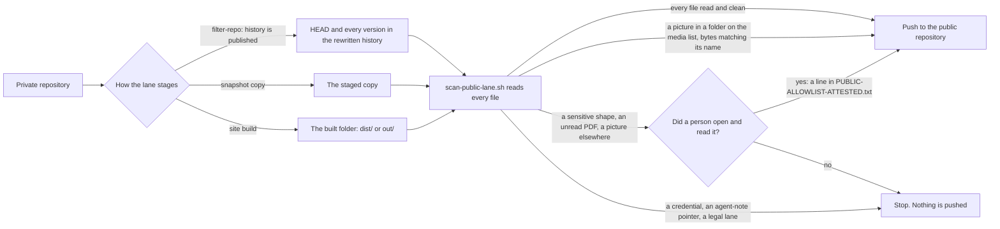

#  Tripwire copies: every public lane that carries the scanner

**TL;DR:** the public-lane tripwire ([`scripts/scan-public-lane.sh`](../scripts/scan-public-lane.sh), self-test beside
it) reads every file a lane is about to publish, and stops the lane when something has not been read. This page says
where each copy stands on 2026-11-02. 59 repositories are listed below; nearly all match the master. Nine lanes were finished
this round and **their fixes wait on branch `r5-lanes`, not yet pushed.** Six of the nine rehearse clean. Two others each
need one decision from Christopher, and the lab `iamoneself` needs a master rule.

> **The rule:** a public lane never publishes a file a machine or a person has not read.
> (Written up for SOP-OPS-003 in [`repo/OPS/_fragments/tripwire.md`](repo/OPS/_fragments/tripwire.md).)

##  The master today

| File | Commit | md5 |
|---|---|---|
| `scripts/scan-public-lane.sh` | `28188db` | `3b313e7bae73bfc66205db40018351ab` |
| `scripts/scan-public-lane.selftest.sh` | `28188db` | `e125c6059e63a29019f7905ff2801b1f` |

Copy, do not fork: when the master changes, copy it again into each repository on this page. The self-test reports
92/92 in a copy, 96/96 where `scripts/sync-allowlist.sh` sits beside it, and 98/98 here. Lanes on the template's family
carry `sop-template/repo/scripts/sync-allowlist.sh` byte for byte (md5 `504181e2…`). Psanctuary's `--check` family keeps
its own script with the call site edited.

This master added the media list. `PUBLIC-LANE-MEDIA.txt` names folders whose pictures and fonts a lane publishes on
purpose: a person chose them, and a machine still reads what it can. Base64 in text is decoded and read, and an SVG that
can run something is refused.

##  The nine lanes finished this round

Nothing here has run on GitHub yet. Pushing one of these branches to its working branch starts a publish to a public
repository, so that step waits for a person or the main session. Each branch sits in the local clone, on top of the
remote branch as it stood at the time of writing. "Rehearsed" means the lane's own filter and scan steps ran in a fresh
clone, with no push. The counts are files at HEAD · versions in history.

| Repository | Target | `r5-lanes` | What changed | Rehearsed |
|---|---|---|---|---|
| `drasticstatic/dpnelson` | main | `5257afd` | media list (`docs`), `--media` wired | **clean:** 19 files of the committed build |
| `drasticstatic/findyourfeathers` | main | `02713be` | media list (`public`), `--media` wired | **clean:** 36 files |
| `drasticstatic/aunt-harriot` | main | `d087681` | reworded; hooks, scripts and two config files stripped | **clean:** 22 · 91 |
| `drasticstatic/augment-intent-properties` | main | `d06015d` | reworded; an old notes folder stripped from history | **clean:** 6 · 17 |
| `Octagon-Religious-Research-Group-ORG/changelog-astro` | main | `bfa8c07` | scanner added as THEF's has it, in report mode; media list | **clean:** 116 · 123, on the last local build |
| `drasticstatic/david-amaringo` | preview | `a264f1b` | scanner re-copied, media list, `--media` wired, README line | **clean:** 50 source files; built site read on GitHub only |
| `drasticstatic/wilson-lawn-ai-assist` | main | `80926e1` | reworded; hooks, scripts, `bun.lockb` and a mislabelled favicon stripped | **stops:** 1 · 1, a street-address shape |
| `drasticstatic/pir-devine-news` | main | `02fc878` | reworded; hooks stripped | **stops:** 1 · 1, one picture of about 40 MB |
| `drasticstatic/iamoneself` | preview | `d9e7ee0` | scanner re-copied, media list, `--media` wired, README line | source **clean:** 26 files; built site will stop, see below |

Rewording follows the fleet's way: `.github/public-reword.txt`, passed to `git filter-repo` with `--replace-text` and
`--replace-message`, so the mirror's history and commit messages read the same as its HEAD. The private files keep their
paths.

**What is left after these land:**

- `wilson-lawn-ai-assist`: the address field's example text on the quote page. A person reads it and attests it, or
  the example changes. Its favicon also needs a real `.ico` if the mirror should carry one.
- `pir-devine-news`: one edition picture over the scanner's 15 MB limit, at HEAD and in one past version. A person
  chooses a smaller copy or keeps it private.
- `iamoneself` (lab) and `iamoneself-retreats` (THEF): the built site carries a search index, 27 binary files whose names
  change with each build, so they cannot be attested by path. They need a master rule. The apply form's birth-date label
  also appears in three built files and needs a person's reading.
- `changelog-astro` (ORG): `TRIPWIRE_ENFORCE` stays `0` until a run on GitHub is clean, then it can become `1`.

##  Every copy, as GitHub holds it

Read through the GitHub API on 2026-11-02 from every unarchived repository of the seven owners, on `main` and `preview`.
A commit is the last one to change the scanner there, on `main` unless a branch is named. "Lane" is the last run of the
lane workflow that day or earlier. This table replaces the older re-copy tables, which remain in this file's history.

| Repository | Scanner commit | Media list | Lane |
|---|---|---|---|
| `drasticstatic/alexandrina` | `24f5a83` |  | green |
| `drasticstatic/anthropas-argus-alfred` | `5084a94` |  | stops: words in published pages, and a legal-lane path in history |
| `drasticstatic/augment-intent-properties` | `a2ac077` |  | stopped; fix held, see above |
| `drasticstatic/aunt-harriot` | `335cd7b` |  | stopped; fix held, see above |
| `drasticstatic/david-amaringo` | preview `654c87e` (older) |  | `lanes.yml` stopped on `preview`; fix held |
| `drasticstatic/dpnelson` | `c5a2393` |  | stopped; fix held, see above |
| `drasticstatic/findyourfeathers` | `16839d2` |  | stopped; fix held, see above |
| `drasticstatic/fortuna-vision` | `06382c5` |  | stops at the push: the mirror token is refused. The scanner passed |
| `drasticstatic/gratitude-token-project_astro` | `f20085e` | yes | green |
| `drasticstatic/iamoneself` | preview `48db96d` (older) |  | `lanes.yml` stopped on `preview`; fix held, more remains |
| `drasticstatic/my-template` | `28188db` |  | the master |
| `drasticstatic/my-template-clean` | `b76f5b4` |  | no public lane here |
| `drasticstatic/O-R-G` | `fa76728` |  | no public lane here |
| `drasticstatic/O-R-G-astro` | `04c1d59` | yes | green, and `deploy-pages.yml` green |
| `drasticstatic/O-R-G-dapp` | `b7a0881` | yes | stops: one giver-list word |
| `drasticstatic/ops-standard-operating-procedures-thef` | preview `0fa39ec` |  | no public lane here |
| `drasticstatic/pir` | `7de2910` |  | no public lane here |
| `drasticstatic/pir-devine-news` | `79cadb2` |  | stopped; fix held, one item for Christopher |
| `drasticstatic/proposals-thef` | `75a5a96` (older) · preview `efc37df` |  | no public lane here |
| `drasticstatic/Psanctuary` | `9b49916` |  | no public lane here |
| `drasticstatic/psychedelic-policy-reform-astro` | `bee5f8c` | yes | green, and `deploy-pages.yml` green |
| `drasticstatic/psychedelic-policy-reform-dapp` | `4ff8390` | yes | green, and `deploy-pages.yml` green |
| `drasticstatic/taylordwraps` | `c115cc9` | yes | `sync-lanes.yml` stopped |
| `drasticstatic/trading-assistant` | `31c9ae9` | yes | green |
| `drasticstatic/trading-bot_arbitrage_DAPPUv3_hardhat_UNI-CAKE` | `18c11a2` |  | green |
| `drasticstatic/wilson-lawn-ai-assist` | `64a1052` |  | stopped; fix held, one item for Christopher |
| `Octagon-Religious-Research-Group-ORG/legal` | `411ebd4` |  | green |
| `Octagon-Religious-Research-Group-ORG/ops-standard-operating-procedures` | `b501baf` |  | no public lane here |
| `Octagon-Religious-Research-Group-ORG/reading-room` | `9bd4e2d` |  | green |
| `psanctuary/changelog-astro` | `196cfbe` |  | green |
| `psanctuary/legal` | `1887ea1` |  | green |
| `psanctuary/ops-standard-operating-procedures` | `4bb2606` |  | in_progress |
| `psanctuary/reading-room` | `173483c` |  | green |
| `psanctuarychurch/changelog-astro` | `2d5a8cc` |  | green |
| `psanctuarychurch/legal` | `b4b4b87` |  | green |
| `psanctuarychurch/ops-standard-operating-procedures` | `e701a6a` |  | green |
| `psanctuarychurch/reading-room` | `5691889` |  | green |
| `psychedelicsinrecovery/alex-desk` | `bd863e5` |  | green |
| `psychedelicsinrecovery/board-of-directors` | `ce1a5c3` |  | green |
| `psychedelicsinrecovery/catalyst-desk` | `6c52008` |  | green |
| `psychedelicsinrecovery/changelog-astro` | `f386e1f` |  | green |
| `psychedelicsinrecovery/github-desk` | `6260360` |  | green |
| `psychedelicsinrecovery/legal` | `f7e72d4` |  | green |
| `psychedelicsinrecovery/litcom-desk` | `211b955` |  | green |
| `psychedelicsinrecovery/literature-committee` | `95a6e4b` |  | green |
| `psychedelicsinrecovery/ops-standard-operating-procedures` | `63f3613` |  | green |
| `psychedelicsinrecovery/pr-desk` | `fba5c86` |  | green |
| `psychedelicsinrecovery/public-relations` | `9416adc` |  | green |
| `psychedelicsinrecovery/reading-room` | `b1e5af0` |  | green |
| `psychedelicsinrecovery/tech-committee` | `d0bff40` |  | green |
| `psychedelicsinrecovery/techcom-desk` | `51412ca` |  | green |
| `taylordwraps/ops-standard-operating-procedures` | `d4011eb` |  | in_progress |
| `taylordwraps/reading-room` | `be2847f` |  | green |
| `theholyearthfoundation/changelog-astro` | `3e1df4f` | yes | green |
| `theholyearthfoundation/david-amaringo` | preview `672ba50` | yes | green |
| `theholyearthfoundation/iamoneself-retreats` | preview `3998e68` | yes | stops: search index, and a form label |
| `theholyearthfoundation/legal` | `774a45b` |  | green |
| `theholyearthfoundation/ops-standard-operating-procedures` | `fd1204c` |  | in_progress |
| `theholyearthfoundation/reading-room` | `d951ee3` |  | green |

**Older copies:** the lab `david-amaringo` and `iamoneself` on `preview` (fixes held above), and `proposals-thef` on
`main`, which follows its `preview` by Promote, a person's merge.

**Private repositories not named here:** two personal repositories are left to the main session and are outside this
page. One carries the current pair and its lane is stopped; the other was not read in this pass.

**Public lanes with no scanner:**

- `Octagon-Religious-Research-Group-ORG/changelog-astro`, until its held branch lands.
- `drasticstatic/littlebird-ambassador`: its `sync-public.yml` publishes to a public repository with no tripwire. Found
  in this pass, and not yet assigned.

**Other lanes that are stopped today,** outside this round's nine: `anthropas-argus-alfred`, `fortuna-vision` (the scan
passes, and the push fails because `PUBLIC_REPO_TOKEN` is refused), `O-R-G-dapp` (`sync-public-allowlist.yml` and
`deploy-pages.yml`), `taylordwraps` (`sync-lanes.yml`) and `iamoneself-retreats` (`lanes.yml`).

##  How a lane is gated

Each workflow installs `pdftotext` and runs the self-test first, so a broken reader can never wave a PDF through. In
snapshot and site lanes the scanner refuses the folder name `.github` by itself, so a deploy workflow that travels with
the lane is copied aside as `dot-github/` and read like any other file. A lane in report mode (`TRIPWIRE_ENFORCE: "0"`)
prints refusals as warnings and still publishes, until its files are fixed or attested. A legal-lane path stops it in
either mode.

##  Templates in this repository

| Path | Carries |
|---|---|
| [`workflow-templates/sync-public-allowlist.yml`](../workflow-templates/sync-public-allowlist.yml) | the tripwire steps |
| [`workflow-templates/sync-public-excludelist.yml`](../workflow-templates/sync-public-excludelist.yml) | the same steps, plus a gotcha: the tripwire narrows the denylist model |
| [`workflow-templates/publish-masked-public-copy.yml`](../workflow-templates/publish-masked-public-copy.yml) | the masked copy is read before it is committed |
| [`repo/`](repo/) (the SOP template) | the tripwire |

##  Seen and left alone, and why

- **`.github/workflows/sync-clean-template.yml`** here: public to public (`my-template` to `my-template-clean`); nothing
  private crosses.
- **Reference copies that never run,** outside `.github/workflows/`: `~/code/trading-assistant/github/workflows/sync-public_template.yml`
  and one more in a private repository. Refresh them from this repository when touched.
- **`monitoring-outputs-thef`** and its `-public` twin: no sync workflow yet. When one is added, start from
  [`repo/.github/workflows/sync-public.yml`](repo/.github/workflows/sync-public.yml).
- **Public repositories that publish only themselves** (the profile repository, `gratitude-token-project_docs`).

##  Turning a stopped lane green

Each refusal in the run's log names the file and the kind of match (never the matched text) and prints the exact
attestation line. There are four ways through, and only a person chooses:

1.  **Fix the file.** Agent-note pointers, the agent-notes folder name, credentials and legal lanes
   are never opened by an attestation: reword the public text, or remove the file. A history lane rewords with
   `.github/public-reword.txt`.
2.  **Keep it private.** Add the path to the lane's private list (or take it off the allowlist). In
   a filter-repo lane this also removes it from the rewritten history.
3.  **List the folder.** Pictures and fonts a person put there to be shown go in
   `PUBLIC-LANE-MEDIA.txt`, under a header line: `approved by <name> | YYYY-MM-DD`. Their bytes must still match their
   names. The workflow passes the list with `--media`.
4.  **Attest it.** A person opens and reads the file, then adds the printed line to
   `PUBLIC-ALLOWLIST-ATTESTED.txt` at the repository root: `path | officer | YYYY-MM-DD | opened and read | sha256:<hex>`.
   With the fingerprint, the line lapses when the file changes. In a history lane, a line without a fingerprint covers
   every version of that path.

Two cautions. A stopped lane leaves the public repository as it was: whatever it already shows stays there until the
next green run replaces it. And build folders name some files by content hash. A media list covers fonts and pictures
named that way, but a search index cannot be attested by path, so such a lane needs a master rule before it can go green.
