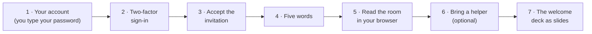

# SOP-COM-001 · New to GitHub: your first hour

**Department:** COM · **ID:** 001 · **Status:** draft (approved when tagged) · **Owner:** the organisation's stewards · **Last changed:** 2026-11-02

##  Purpose
A person who has never used GitHub can, within one hour, have their own account, be inside the organisation, know five words, read the reading room in a browser, and bring an AI helper if they want one. Nothing in this hour asks them to type a command.

##  Scope
Every newcomer to any of the organisation's GitHub spaces: members, board members, volunteers, partners. It ends where SOP-IT-002 (helper access in depth) and SOP-GOV-002 (how collaboration works) begin.

##  Roles
| Role | Does |
|---|---|
|  Newcomer | creates their own account, types their own password, accepts, reads |
|  Steward | sends the invitation and the links, answers questions, never asks for a password |
|  Helper (optional) | reads alongside the newcomer, explains, never receives a password or a code |

##  The hour at a glance

##  Prerequisites
An email address you read, a phone (for two-factor sign-in), a browser. The steward has your email address or will send you a link once you have an account.

##  Steps

###  1 · Your account (about 10 minutes)
1. Go to `https://github.com/signup` and enter **your own** email address. *You should see:* a page asking for a password.
2. **Type your own password.** Nobody else types it, sees it or keeps it: not a steward, not a friend, not an AI helper. A password manager may suggest one. *You should see:* a username field.
3. Choose a username. It is public and lasts; your first name and something you like works. *You should see:* GitHub's puzzle or email code.
4. Confirm the code from your email, choose the **Free** plan. *You should see:* your empty dashboard, your picture (a pattern for now) top right.
5. Send your **username** (never the password) to the steward where you already talk.

> [!IMPORTANT]
> If anyone, a person or a helper, ever asks for your password or a sign-in code, the answer is no. A steward never needs them: invitations go to your username.

###  2 · Two-factor sign-in (about 10 minutes)
1. Picture (top right) → **Settings** → **Password and authentication** → **Enable two-factor authentication**. *You should see:* a QR code.
2. Scan it with an authenticator app (or use a passkey or SMS, if offered), type the six digits. *You should see:* a list of **recovery codes**.
3. **Download the recovery codes and keep them where you keep important papers.** They are the only way back in if the phone is lost. Never paste them anywhere. *You should see:* "Two-factor authentication is enabled".

Organisations in this fleet require two-factor sign-in; the invitation waits until it is on.

###  3 · Accept the invitation (2 minutes)
1. Open the email titled *"… invited you to join the … organization"*, or the bell icon on GitHub. *You should see:* a green **Join** button.
2. Click **Join**. *You should see:* the organisation's page; its name under your profile's **Organizations**.
3. If you were also added to a team (for example **readers**), GitHub may ask you to accept that too.

###  4 · Five words (5 minutes)

| Word | Means | Where you see it |
|---|---|---|
|  **Repository** | a folder that remembers every change and who made it | every link that looks like `github.com/<org>/<name>` |
|  **Branch** | one line of that history; `main` is the live copy, `preview` the rehearsal | the branch picker above the file list |
|  **Pull request** | a change asking to move from one branch to another, with a place to comment | the **Pull requests** tab |
|  **Issue** | a conversation thread: the easiest way to ask or answer | the **Issues** tab |
|  **Merge** | accepting a pull request, so the change lands; a person with the role does it | the green button at the foot of a pull request |

That is all the vocabulary this hour needs. SOP-GOV-002 has the rest when you want it.

###  5 · Read the room in your browser (15 minutes)
1. Open the reading room link the steward sent (`https://github.com/<org>/reading-room`) while signed in. *You should see:* its README, an index of what to read first.
2. Click **000 Start here** (or the first link in the index). *You should see:* a page with a TL;DR at the top.
3. For a printable copy, open the `pdf/` folder beside it and click the PDF. *You should see:* the same page as a document.
4. **A 404 means "no permission yet"**, not "broken": check you are signed in as the account you sent the steward, and tell them the link.
5. Visitors (and you, signed out) can see the public room: `https://<org>.github.io/reading-room-public/`.

###  6 · Bring a helper (optional, 10 minutes)
1. Choose a helper you already use (Claude, ChatGPT, Codex, Littlebird, any of them).
2. Ask it to **read with you, not for you**: paste the page's text, or give it the link if it is already connected to GitHub with your permission.
3. A good first question: *"Read 000 Start here and tell me, in five lines, what is waiting for my answer."*
4. **Never give a helper your password, a sign-in code or a recovery code.** If it needs its own access to private pages, follow SOP-IT-002 (a read-only key in your own account, or an approved connection).

###  7 · The welcome deck as slides (5 minutes)
1. Open the organisation's public profile: `https://github.com/<org>`. *You should see:* a banner and a **Welcome deck** link.
2. Click it. The deck is in `.github/decks/` as a PDF (slides you page through), an HTML page and the markdown it was made from. *You should see:* the first slide, *Welcome to …*.
3. Page through it once. It walks the same road as this hour and points at the real pages.

##  Later, on a Mac: hidden files
This isn't part of the hour. It's for the day you keep a copy of a repository on your own computer and copy a folder.

-  **In Finder, ⌘⇧. (Command, Shift, full stop) shows hidden files.** Press it again to hide them. Names that start with a dot are normally hidden, among them `.git`, which holds the folder's whole history and the address it pushes to.
-  **Copying a folder copies its `.git`, address included.** Rename the copy, swap everything inside, and it still pushes to the original.
-  **After any copy, check where it pushes:** open Terminal, go into the copy (`cd`), and run `git remote -v`. *You should see:* two lines with the address of the repository this copy belongs to. If the organisation's name is wrong, don't push.

**A worked example.** Two organisations each keep their logos in a `brand-assets` repository. You copy Organisation A's folder to start Organisation B's, and swap in B's logos. The copy's `.git` still says A, so `git push` from there puts B's logos into A's repository, and if A's is public, in front of everyone. Nothing warns you: to git it's an ordinary push.

**If the copy is the start of something new,** drag its `.git` to the Trash and start with `git init`. Changing only the address would carry the old history along. The full walkthrough is `my-template/walkthroughs/SHOW-HIDDEN-FILES.md`.

##  Verification
The newcomer: has two-factor sign-in on; sees the organisation under **Organizations**; opened the reading room's README and one PDF from their own account; can say the five words in their own words. The steward: sees them as a member (and in the readers team) on the organisation's **People** page.

##  Troubleshooting
| Symptom | Likely cause | What to do |
|---|---|---|
| No invitation email | sent to another address, or two-factor not yet on | check the bell icon on GitHub; turn on two-factor; ask the steward to resend to your username |
| The reading room shows 404 | signed out, signed in as another account, or the team not yet accepted | sign in; accept the team; tell the steward the link and your username |
| "Your organization requires two-factor authentication" | step 2 not done | do step 2, then accept again |
| Lost phone | the authenticator is gone | sign in with a recovery code, then set up two-factor again |
| A helper asks for your password | it should not | say no; follow step 6 or SOP-IT-002 |
| You copied a folder and aren't sure where it pushes | a copied folder keeps its `.git`, address included | run `git remote -v` in the copy; see *Later, on a Mac: hidden files* |

##  Related
- SOP-GOV-002 *GitHub collaboration* (organisations, teams, issues, pull requests, Pages)
- SOP-IT-002 *Reading room and helper access* (a helper's own key, in depth)
- SOP-OPS-001 *How a change travels* (what `preview` and `main` mean in practice)
- `my-template/walkthroughs/JOIN-AN-ORGANIZATION.md`, `my-template/decks-template/` (the welcome deck)
- `my-template/walkthroughs/SHOW-HIDDEN-FILES.md` (hidden files and copied folders), `my-template/walkthroughs/OPENING-YOUR-GIFT.md` (for someone who has never heard of GitHub)

##  Change log
| Date | Change | By |
|---|---|---|
| 2026-11-01 | Drafted for every organisation in the fleet: account (your own password), two-factor, invitation, five words, the reading room in a browser, a helper, the welcome deck | Alfred |
| 2026-11-02 | *Later, on a Mac: hidden files*: ⌘⇧. shows `.git`, copying a folder copies where it pushes, check with `git remote -v` | Alfred |
