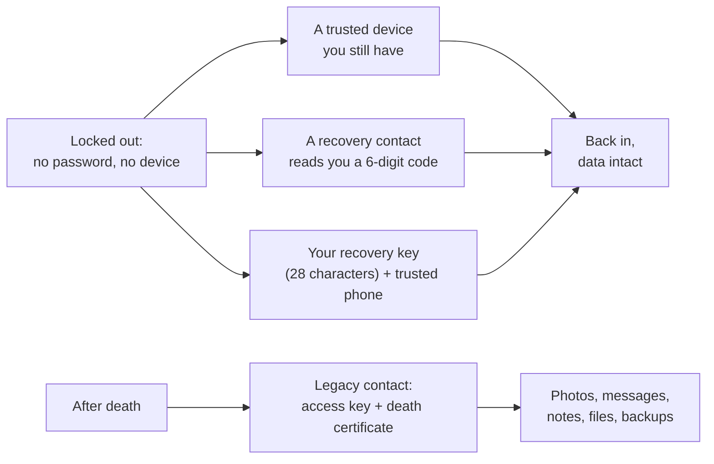

# SOP-COM-002 · Apple account recovery: for the people who hold your keys

**Department:** COM · **ID:** 002 · **Status:** draft (approved when tagged) · **Owner:** the organisation's stewards · **Last changed:** 2026-11-04

> [!NOTE]
> This page is for two readers at once: the **account holder** who turned on Apple's strongest protection, and the **people they chose** to hold a way back in. It names roles, never people. The holder keeps their own private list of who is who. Written from Apple's own support pages, read on 2026-11-04 and linked below; Apple changes these things, so check the links when it matters.

##  Purpose
When an Apple account is protected end to end, Apple can no longer open it for you. A person who loses their password and every device needs one of three things: a trusted device, a **recovery contact**, or a **recovery key**. After a death, a **legacy contact** needs an access key. This page says what each role is, what each person can and cannot do, and how to practise before it is needed.

##  Scope
Any member or steward who turns on **Advanced Data Protection** for iCloud, and anyone they name as a recovery or legacy contact. It covers the Apple account only. Passwords for GitHub, banks or wallets have their own pages; a password manager's emergency kit is mentioned because the two now depend on each other.

##  Roles
| Role | Does | Can see | Cannot |
|---|---|---|---|
|  Account holder | turns the protection on, names contacts, keeps the key, tests yearly | everything | ask Apple to open the account once the key is set |
|  Recovery contact (up to five) | when asked, reads a **six-digit code** from their own Apple device to the holder, by phone or in person | the code, nothing else | see photos, messages, files, or sign in; Apple does not even know their name |
|  Recovery key | a 28-character code the holder keeps on paper or in a password manager | | be recovered from Apple if lost: a lost key and lost devices mean a lost account |
|  Legacy contact | after the holder's death, requests the data with the **access key** and a death certificate | photos, messages, notes, files, backups | purchases, subscriptions, saved passwords, passkeys, payment cards |

##  The three ways back in

##  Prerequisites
- Two-factor sign-in on the Apple account (Apple requires it for the protection to turn on).
- Every device on the account updated (iOS 16.2, macOS 13.1 or later for the protection; recovery contacts need iOS 15 / macOS 12 or later and iMessage on).
- At least one recovery contact **or** a recovery key before the protection turns on; both is the lean.
- A password manager with its own emergency kit on paper, because the recovery key lives there.

##  Steps

### 1 · For the account holder: set it up (about 20 minutes)
1. System Settings → your name → **Sign-In & Security** → **Recovery Contacts** → Add. Choose people who will answer the phone in a bad week. Each one must **accept in Messages**; until then they do not count. *You should see:* their names listed with "accepted".
2. Same screen → **Recovery Key** → Turn On. Write the 28 characters down **by hand** and put them in the password manager. Apple's own warning: never in Apple Passwords, Notes, Photos or iCloud Drive, because those are what is locked when you need it. *You should see:* "Recovery Key: On".
3. Same screen → **Legacy Contact** → Add. Apple makes an **access key**; send it by iMessage (it is stored on their device when they accept) or print it. *You should see:* each name listed.
4. Your name → **iCloud** → **Advanced Data Protection** → Turn On. *You should see:* "On". From now on Apple does not hold the keys to your iCloud Drive, Photos, Notes, backups or Messages backups.
5. Write a private page that lists who holds which role and where the key lives (the organisation's helpers keep theirs in a private spec). This public page never names anyone.

### 2 · For a recovery contact: what to do when the call comes
1. The holder phones you or stands in front of you and says they are locked out. **Ask them something only they would know.** A stranger with their phone number is the risk this role exists to stop.
2. Open Settings → your name → **Sign-In & Security** → **Account Recovery** → their name → **Get Recovery Code**. *You should see:* six digits.
3. Read the six digits to them, by voice. Never text them to a number you did not already have, never read them to anyone else, never to an email.
4. That is all. You never see their data; the code only lets them set a new password.

### 3 · For a legacy contact: what to do one day
1. Find the access key (the iMessage thread where it was sent, or the paper).
2. Go to Apple's Digital Legacy page, enter the access key, and upload the death certificate. Apple reviews it and then gives you a special Apple account to download the data.
3. Decide with the family what to keep. Apple notes each legacy contact can act alone, including deleting; talk first.

### 4 · The yearly test (15 minutes, put it on the calendar)
1. Holder: the Sign-In & Security screen still lists the contacts as accepted, the key as On, the legacy contacts as set.
2. One recovery contact: confirm the holder's name appears under Account Recovery on their own device.
3. The key in the password manager still reads 28 characters.
4. Each legacy contact can still find their access key.
5. Note the date on the holder's private page.

##  What never happens here
- Nobody is ever asked for a password, a code or the key by text, email or a stranger on the phone. A real recovery is a voice you know.
- The recovery key is never typed into a website, a chat or an AI helper.
- This page never names the contacts. The holder's private list does.

##  Sources (read 2026-11-04)
- Apple, *iCloud data security overview*: <https://support.apple.com/en-us/102651>
- Apple, *Set up a recovery contact for your Apple Account*: <https://support.apple.com/en-us/102641>
- Apple, *Set up a recovery key for your Apple Account*: <https://support.apple.com/en-us/109345>
- Apple, *How to add a Legacy Contact for your Apple Account*: <https://support.apple.com/en-us/102631>

*Not legal advice. A will and an estate plan say who may act after a death; a legacy contact is Apple's door, not the law's.*
