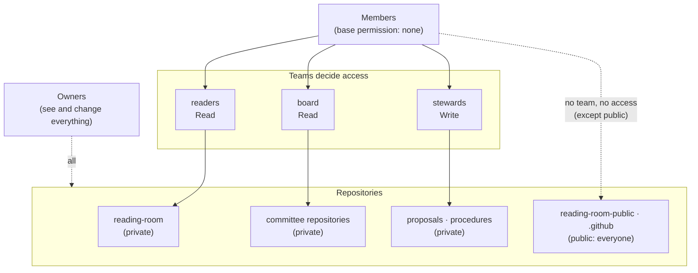

# SOP-GOV-002 · GitHub collaboration: organisations, teams, issues, discussions, pull requests, projects, Pages


**Department:** GOV · **ID:** 002 · **Status:** draft (approved when tagged) · **Owner:** the organisation's owners; the steward executes · **Last changed:** 2026-11-01

##  Purpose
One page that says what each GitHub collaboration tool is for in this organisation, who may use it, and how access is decided: by **teams**, with the organisation's **base permission set to No permission**, so that a private repository is read only by the people a team names.

##  Scope
The organisation's GitHub space: owners, members, outside collaborators, teams, and the tools on each repository. Not credentials (SOP-IT-002), not the road a change travels (SOP-OPS-001/002), not board membership itself (SOP-GOV-001).

##  Roles
| Role | Does |
|---|---|
|  Owner | full control: settings, billing, base permission, teams, invitations. Two or more, so no single person is a point of failure |
|  Member | belongs to the organisation; reads and writes **only** what their teams grant (base permission none) |
|  Team maintainer | adds and removes people in one team, on an officer's yes |
|  Outside collaborator | not a member; granted one repository at a time; use sparingly |
|  Helper | works through a person's own access or an approved connection; opens pull requests, never merges |

##  How access is decided



###  Base permission: No permission, and why
The **base permission** is what every member gets on every repository before any team is counted. GitHub's default for a new organisation is **Read**: every member can read every private repository. That quietly defeats a readers team or a board team, because a member outside the team can read the repository anyway.

The fleet sets it to **No permission**:
-  **Teams become the truth.** A member reads a private repository only through a team that names it; a page that lists a team's repositories lists exactly who can read them.
-  **Owners are unaffected.** They keep full access.
-  **Public repositories stay public** to everyone, signed in or not.
-  **Before switching, put every member in a team** that grants what they need. A member in no team loses access to every private repository the moment it changes. Hold the switch for that organisation until they are placed.

> [!NOTE]
> **Where the heads-up came from.** The session's "You should know" reader (SOP-IT-003 describes it) pointed out on
> 2026-11-01 that the fleet's organisations still had base permission **Read**, so the readers and board teams were not
> actually gating anything for members. The lab steward switched the organisations to **No permission** the same day,
> holding one until its member was placed in a team.

**Set it** (an owner's action; settings → Member privileges → Base permissions, or):
```sh
gh api orgs/<org> --jq .default_repository_permission                       # read it first
gh api -X PATCH orgs/<org> -f default_repository_permission=none            # then set it
```
*You should see:* `none` when you read it again.

##  The tools, one by one

| Tool | Use it for | Who | Notes |
|---|---|---|---|
|  **Organisation** | the house: its people, teams and repositories under one name | owners | free plan; GitHub for Nonprofits gives Team free once incorporation is confirmed |
|  **Teams** | who reads or writes what: `readers`, `board`, `stewards`, one per committee | owners, team maintainers | **closed** (visible to members) is the default; **secret** only when the team's existence is itself private |
|  **Issues** | one question, task or decision per thread; "yes / not yet" on a proposal | anyone with Read on the repository | title with the proposal or SOP number; close it when answered |
|  **Discussions** | open conversation that is not a task: ideas, introductions, Q&A | members, when switched on | switch on per repository (Settings → Features) or for the organisation; move a discussion to an issue when it becomes a task |
|  **Pull requests** | a change asking to move (`preview` → `main` is a **Promote**) | helpers and members open; a person with the role merges | **merge commit only**, never squash (SOP-OPS-002) |
|  **Projects** | a board of issues and pull requests across repositories: what is waiting, moving, done | members | optional; a board is a view, the issues stay the truth |
|  **Pages** | a website from a repository: the public reading room, a site's live and rehearsal lanes | owners switch it on | on the free plan Pages publishes from **public** repositories, and a Pages site is **public**; members-only sites need Enterprise Cloud |
|  **The `.github` profile** | the organisation's front door: banner, welcome deck, links | owners | public; carries only welcome decks and links |

##  Steps: steward, once per organisation
1. Two owners at least. *You should see:* two names under People → Role: Owner.
2. Create the teams (closed): `gh api -X POST orgs/<org>/teams -f name=readers -f privacy=closed` (and `board`, `stewards` as needed). *You should see:* each on the Teams page.
3. Grant each team its repositories (SOP-GOV-001 and SOP-IT-002 have the commands; `permission=pull` is Read, `push` is Write).
4. Place every member in at least one team. *You should see:* `gh api --paginate orgs/<org>/members --jq '.[].login'` and the union of the teams' members agree.
5. Set the base permission to none (above). *You should see:* `none`.
6. Set merge commits only on the proposals and procedures repositories (SOP-OPS-002). Switch on Discussions where people want them.
7. Ask one member (not an owner) to open one private link they should see and one they should not. *You should see:* the first opens, the second is a 404.

##  Verification
`gh api orgs/<org> --jq .default_repository_permission` prints `none`; every member is in a team; a member's own test (step 7) matches the teams page.

##  Troubleshooting
| Symptom | Likely cause | What to do |
|---|---|---|
| A member suddenly sees 404 on a repository they used to read | base permission switched to none and they are in no team that grants it | add them to the right team; never switch the base back to Read to "fix" one person |
| A member reads a repository no team grants | base permission is still Read, or they are an outside collaborator on it | read the base permission; check the repository's Collaborators page |
| Discussions tab missing | not switched on | Settings → Features → Discussions |
| Pages on a private repository will not switch on | the free plan publishes Pages only from public repositories | publish from the public twin instead (SOP-OPS-003) |

##  Related
- SOP-COM-001 *New to GitHub: your first hour* · SOP-GOV-001 *Board reading room membership* · SOP-IT-002 *Reading room and helper access*
- SOP-OPS-002 *Pull requests and Promotes* · SOP-OPS-003 *Private houses everything, public lanes witness*
- `my-template/walkthroughs/ORG-SECURITY-SETTINGS.md`, `my-template/NAMES-POLICY.md`

##  Change log
| Date | Change | By |
|---|---|---|
| 2026-11-01 | Drafted: the tools one by one, access by teams, base permission none and why (the "You should know" heads-up) | Alfred |
