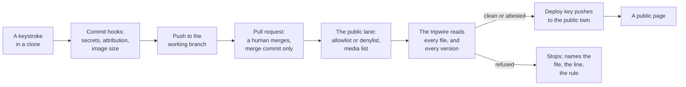
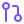
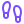
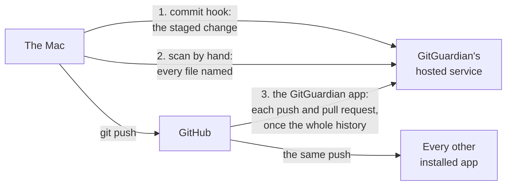

# SOP-IT-004 · Tripwires, firewalls and shields: every layer between a keystroke and a public page

**Department:** IT · **ID:** 004 · **Status:** draft (approved when tagged) · **Owner:** the organisation's stewards · **Last changed:** 2026-11-16 (a proposed section, *What leaves the Mac*)

> [!NOTE]
> Written for a newcomer who has heard the words *tripwire*, *allowlist*, *attestation*, *deploy key* and *hook* and wants one page that says what each one catches, where it sits, and what it cannot do. Nothing here needs a terminal to understand. The pages it points to say how to run each piece.

##  Purpose
Name every guard in the drasticstatic ecosystem, in the order a change meets them, so that a person who clones one of our repositories knows why it is safe to fetch, a person who merges knows what has already been checked, and a person who finds a refusal knows which guard spoke and what it wants.

##  Scope
Every repository the lab tends: the labs under drasticstatic, the organisations' desks, rooms and twins, and partners' organisations built on the same template. It describes the guards as they stand on the date above; each guard's own page is the source for its details.

##  The path, and the guard at each step

##  The guards, one by one

| # | Guard | Where it sits | What it catches | What it cannot do | Its page |
|---|---|---|---|---|---|
| 1 |  **ggshield** (secret scan) | the `pre-commit` hook on your own machine | API keys, tokens, private keys about to be committed | run on a machine that never installed the hooks (see #10); keep the change on the Mac, since the scan is hosted (see *What leaves the Mac*) | `my-template/walkthroughs/SECRET-SCAN.md` |
| 2 |  **Commit attribution hook** | the `commit-msg` hook | a commit without the two trailers (who wrote it, which session) | prove the trailer is true; it checks shape | `my-template/AGENT-SYNC/README.md` |
| 3 |  **Image guard** | the same `pre-commit` hook, and `image-size-check.yml` on pull requests | a picture over 15 MB (refused), over 2 MB (warned, with the shrink command) | judge whether a picture should be public at all; that is #6 | `my-template/.claude/skills/compress-images.md` |
| 4 |  **The merge rule** | GitHub, per repository: squash and rebase turned off | history rewritten by a squash; a merge by a helper (helpers stop at the merge) | force a review on a private repository without a paid plan (see *Safe to merge*) | SOP-OPS-002 |
| 5 |  **Allowlist** (rooms, twins) or **denylist** (labs) | `PUBLIC-ALLOWLIST.txt`, or the lane's strip list in `sync-public.yml` | a path that was never listed (allowlist) or was listed as private (denylist) leaving at all | read inside a file; that is #7 | SOP-OPS-001, SOP-OPS-003 |
| 6 |  **Media list** | `PUBLIC-LANE-MEDIA.txt` | a picture or font outside a folder a person approved by name and date | tell a good picture from a bad one; it trusts the person's yes | SOP-OPS-003 |
| 7 |  **The tripwire** (`scan-public-lane.sh`) | the lane, just before the push, on the current tree and on every historical version | credentials (never pass), identifiers (SSN, EIN, account numbers), street-address shapes, giver-list and personal-matter words, legal-lane folders, unreadable binaries, oversize files | know intent: a public shop address and a home address look alike, which is why #8 exists | `my-template/scripts/scan-public-lane.sh`, `TRIPWIRE-COPIES.md` |
| 8 |  **Attestation** | `PUBLIC-ALLOWLIST-ATTESTED.txt`, one line per file, signed by an officer, fingerprinted | nothing; it opens a refusal a person has read and accepts (a shop address, a company's line in a statement) | open a credential; those stay refused whatever the line says | SOP-OPS-003 |
| 9 |  **Deploy keys** | one key pair per lane: private half as a secret on the source, public half on one twin | a lane pushing anywhere but its own twin; a stolen token with wide reach | protect the twin from a person with write access to it | `DEPLOY-KEYS_20261102.md` on the ARB desk; SOP-OPS-003 rotation |
| 10 |  **Safe to clone** | repository policy, `SECURITY.md`, and `lifecycle-scripts-check.yml` | a `package.json` that runs a script on install; hooks that run without being installed by hand | protect a machine that runs `npm install` on a stranger's fork; that is #13 | this page, *Safe to clone* |
| 11 |  **Dependabot** and **Dependency Review** | GitHub | a dependency with a known vulnerability; a pull request that adds one | fix it; a person merges the bump | `my-template/walkthroughs/DEPENDABOT.md` |
| 12 |  **The safety bundles** and **Time Machine** | `git-safety-backup.sh` to iCloud; the Time Machine drive | work lost to a dead machine: uncommitted edits, stashes, unpushed branches | replace a push; GitHub is the record | `my-template/walkthroughs/ICLOUD-AND-GITHUB-TOGETHER.md`, proposal 019 |
| 13 |  **The evaluation VM** | a virtual machine on the Studio or the iMac | a fork or a tool under review doing harm to the real machine | review the code for you; the checklist does | proposal 013; the external-repo checklist in every `CLAUDE.md` |
| 14 |  **Session messaging limits** | `isolatePeerMachines`, per-repo `crossSessionInbound` | a session's doorbell leaving the machine or reaching a walled-off lane | replace the written guideline that says who may ring whom | `my-template/walkthroughs/SESSION-MESSAGING.md` |

##  Safe to clone: why fetching one of our repositories is safe

1. **Nothing runs when you clone or install.** Our `package.json` files carry no `preinstall`, `postinstall` or `prepare` scripts, and `lifecycle-scripts-check.yml` fails any pull request that adds one. Git hooks live in `.githooks/` and do nothing until a person runs `sh scripts/install-hooks.sh`.
2. **What the hooks do is written down** (#1, #2, #3 above) and each is a short shell script you can read before installing.
3. **Every public page was read before it left** (#7), and the private history never travels: the twin is rebuilt from the listed tree.
4. **A `SECURITY.md`** in each repository says the above in one paragraph and names where to report a concern.

##  Safe to merge: what a stranger's pull request meets

1. The checks run on the pull request itself: the tripwire self-test, ggshield, the image guard, the lifecycle-script check, Dependency Review. A red check blocks the merge button for anyone who respects it.
2. A person with the role merges, with a merge commit, never a helper (SOP-OPS-002).
3. **An honest limit:** GitHub enforces "required checks" and "required reviews" through branch protection or rulesets, which are free on public repositories and need GitHub Pro (personal) or Team (organisations) on private ones. On a private repository without that plan, step 2 is a rule people keep, not a lock the platform holds. The stewards' page for each repository says which it is.
4. Code from outside is read in the evaluation VM first (#13) when it is more than a page.

##  When a guard speaks

| You see | Who spoke | Do |
|---|---|---|
| "No secrets have been found" | ggshield | nothing; carry on |
| "ggshield found …" | ggshield | stop; the secret never enters a commit; rotate it if it was ever real |
| "refused … a street-address shape (line N)" | the tripwire | open the line; a public business address gets an attestation from an officer (#8); a person's home address gets reworded |
| "refused … over 15 MB" | the tripwire | shrink the file (#3); the lane cannot be talked into it |
| "a legal lane … appears in the history" | the tripwire | the folder's old name is still in history; the lane renames it in the published history (`--path-rename`) or holds the path |
| "secret … is not set, skipping push" | the lane | the deploy key was never minted; run the lane's `setup-lane-keys.sh` as the owner |
| a grey merge button | GitHub | you are not an owner on this repository, or a check is red; read the checks |

##  What leaves the Mac, and where it goes (added 2026-11-16 · status: proposed)

> [!IMPORTANT]
> **TL;DR.** The secret scan (#1) is a hosted service. ggshield does not judge a file on the Mac. It sends what it scans to GitGuardian and reads back the answer. That happens on three roads, and one of them starts at GitHub, not at the Mac. For most repositories this is the right trade. For a repository with legal or tax material, the owner should choose it on purpose. The options at the end are proposed, not adopted.

###  The three roads

| Road | What is sent | When | Sent from | How we know (read 2026-11-16) |
|---|---|---|---|---|
| 1. The commit hook | the staged change of each commit | every commit in a clone with the fleet's hooks: `.githooks/pre-commit` runs `ggshield secret scan pre-commit`. A clone without them still runs ggshield's own global hook, where ggshield installed one | the Mac | this template's `.githooks/pre-commit`; on the lab's Mac, `git config --global core.hooksPath` names ggshield's own hook folder |
| 2. A scan by hand | every file under the folder named | when a person or a helper runs `ggshield secret scan path …` | the Mac | the lab ran one over rebuilt session transcripts on 2026-11-12 and 13; some came from sessions about legal matters |
| 3. The GitGuardian GitHub app | each pushed commit and pull request; on first connection, the whole history of each repository it watches | whenever GitHub tells the app about a push | GitHub's servers | a "GitGuardian Security Checks" run on pull requests; GitGuardian check suites on recent commits of every private repository of the lab's account that we checked |

An organisation's desk may add a fourth: the Guardrails workflow sends each pushed change from GitHub's runner, where the repository holds `GITGUARDIAN_API_KEY` (`my-template/walkthroughs/SECRET-SCAN.md`).

`ggshield api-status` on the lab's Mac answers `API URL: https://dashboard.gitguardian.com`, `Instance source: default` and `Token scopes: scan`. Every road above ends at GitGuardian's hosted service, not at a copy we run.

Road 1 runs in every repository that installed the fleet's hooks. That includes repositories with legal or tax material. On 2026-11-13 two such repositories had 52 and 48 commits since October 1, and the hook sent each one to be scanned.

###  What the vendor says (their words; we cannot check them)

- ggshield's README: *"Only metadata such as call time, request size and scan mode is stored from scans using `ggshield`, therefore secrets will not be displayed on your dashboard and **your files and secrets won't be stored**."* Read it closely: it is about what is **kept**, not what is **sent**. The content is sent to be scanned.
- The same README: the `pre-commit`, `pre-push` and `ai-hook` scans *"also send the machine hostname, from which GitGuardian registers the users of these hooks."* It names an opt-out: `endpoint_registration: false` in `.gitguardian.yaml`, or the environment variable `GGSHIELD_NO_ENDPOINT_REGISTRATION`. The lab's Mac runs ggshield 1.49.0. Whether that version already sends the hostname is unverified.
- The same README: on macOS, *"upgrading to 1.54.0 triggers a Keychain prompt"*. Warn the person before an upgrade.
- GitGuardian's GitHub integration page: on first connection *"GitGuardian performs a comprehensive scan of your entire content history"*, within the repositories it monitors. Unselect a repository and *"GitGuardian will no longer fetch the content of its commits."* Removing the integration *"preserves your incident history"*. The page does not say how long content is kept.

###  Other apps read the same pushes

A push reaches every app installed on the repository. On 2026-11-16 Augment Code's GitHub app also had a check suite on recent commits of every private repository we checked. Its docs list read-only access to repository contents. An issue tracker (Linear) left no check suite and no comment, yet it listed pull-request titles from a private repository in its Reviews page. Linear's docs say Reviews works through each person's own GitHub connection, even without code access. So a pull-request title, a branch name and a commit message travel further than the code. Write them as you would a public sentence: the kind of change, never a case fact, a figure or a person's name.

###  The options (proposed; the owner chooses)

| Option | What changes | What it costs | Suits |
|---|---|---|---|
| **A. Keep hosted** (today) | nothing | the content of each commit goes to GitGuardian; we rely on their storage statement | most repositories: code, procedures, public pages |
| **B. A local-only scanner** for private-class repositories (legal, tax, health or family material) | the hook runs gitleaks or trufflehog there instead of ggshield | a second tool to pin, review and update; its rules differ from GitGuardian's | repositories with legal or tax material; by-hand scans of private folders |
| **C. Limit the GitHub app** | github.com/settings/installations → GitGuardian → **Configure** → *Repository access* → **Only select repositories**, leaving private-class repositories out. Or take them out of the monitored perimeter in GitGuardian's dashboard | a new repository is not added on its own; add it when it should be | the same repositories. Review every other installed app the same way |
| **D. No hosted scan by hand** of a private folder | scan those folders with option B's tool | none | rebuilt transcripts, case folders |

Option C stops road 3 only; road 1 keeps sending until option B is in place. What was sent before stays under GitGuardian's own statement.

If option B is chosen:

1. Pin one version and its checksum. Read it under SOP-IT-900 (bringing in outside code), in the evaluation VM, before its first run.
2. gitleaks runs on the Mac. Its README names no network step (read 2026-11-16). Confirm that once, at review, by watching the network.
3. trufflehog checks a found key by trying it: *"A verified result means TruffleHog confirmed the credential is valid by testing it against the service's API."* In a private-class repository, run it with `--no-verification`. Its licence is AGPL-3.0.
4. The hook decides by a setting in the clone (for example `git config fleet.secretScan local`), never by the repository's name, and prints which scanner ran.
5. Nothing is removed: ggshield stays for every other repository.

*Sources for this section, read 2026-11-16: ggshield's README (github.com/GitGuardian/ggshield, main branch); GitGuardian's [Integrate GitHub](https://docs.gitguardian.com/internal-monitoring/integrate-sources/vcs-integrations/github) page; Linear's [GitHub](https://linear.app/docs/github) and [Reviews](https://linear.app/docs/diffs) pages; Augment Code's [Install the GitHub App](https://docs.augmentcode.com/setup-augment/install-github-app) page (as summarised by a search; its exact wording is unverified); the READMEs of [gitleaks](https://github.com/gitleaks/gitleaks) and [trufflehog](https://github.com/trufflesecurity/trufflehog); `ggshield api-status` and the GitHub check-suites API, run read-only on the lab's Mac. Proposed by Alfred (a helper); not approved.*

##  Roles
| Role | Does |
|---|---|
|  Contributor | installs the hooks once, commits with the trailers, opens pull requests, never merges their own |
|  Officer or steward | merges, signs attestations, approves media folders by name and date, mints deploy keys |
|  Helper (an agent) | everything up to the merge; prepares attestation lines and attests only where the officers delegated it in writing (their `CLAUDE.md`), never a merge, never a public-surface action without a person's command |

*Sources: the pages named in the table, all in this organisation's procedures or in `my-template`, read on 2026-11-04. Not legal advice.*
