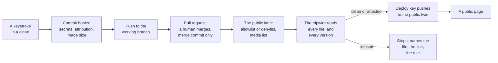

# SOP-IT-004 · Tripwires, firewalls and shields: every layer between a keystroke and a public page

**Department:** IT · **ID:** 004 · **Status:** draft (approved when tagged) · **Owner:** the organisation's stewards · **Last changed:** 2026-11-06

> [!NOTE]
> Written for a newcomer who has heard the words *tripwire*, *allowlist*, *attestation*, *deploy key* and *hook* and wants one page that says what each one catches, where it sits, and what it cannot do. Nothing here needs a terminal to understand. The pages it points to say how to run each piece.

##  Purpose
Name every guard in the drasticstatic ecosystem, in the order a change meets them, so that a person who clones one of our repositories knows why it is safe to fetch, a person who merges knows what has already been checked, and a person who finds a refusal knows which guard spoke and what it wants.

##  Scope
Every repository the lab tends: the labs under drasticstatic, the organisations' desks, rooms and twins, and partners' organisations built on the same template. It describes the guards as they stand on the date above; each guard's own page is the source for its details.

##  The path, and the guard at each step

##  The guards, one by one

| # | Guard | Where it sits | What it catches | What it cannot do | Its page |
|---|---|---|---|---|---|
| 1 |  **ggshield** (secret scan) | the `pre-commit` hook on your own machine | API keys, tokens, private keys about to be committed | run on a machine that never installed the hooks; see #10 | `my-template/walkthroughs/SECRET-SCAN.md` |
| 2 |  **Commit attribution hook** | the `commit-msg` hook | a commit without the two trailers (who wrote it, which session) | prove the trailer is true; it checks shape | `my-template/AGENT-SYNC/README.md` |
| 3 |  **Image guard** | the same `pre-commit` hook, and `image-size-check.yml` on pull requests | a picture over 15 MB (refused), over 2 MB (warned, with the shrink command) | judge whether a picture should be public at all; that is #6 | `my-template/.claude/skills/compress-images.md` |
| 4 |  **The merge rule** | GitHub, per repository: squash and rebase turned off | history rewritten by a squash; a merge by a helper (helpers stop at the merge) | force a review on a private repository without a paid plan (see *Safe to merge*) | SOP-OPS-002 |
| 5 |  **Allowlist** (rooms, twins) or **denylist** (labs) | `PUBLIC-ALLOWLIST.txt`, or the lane's strip list in `sync-public.yml` | a path that was never listed (allowlist) or was listed as private (denylist) leaving at all | read inside a file; that is #7 | SOP-OPS-001, SOP-OPS-003 |
| 6 |  **Media list** | `PUBLIC-LANE-MEDIA.txt` | a picture or font outside a folder a person approved by name and date | tell a good picture from a bad one; it trusts the person's yes | SOP-OPS-003 |
| 7 |  **The tripwire** (`scan-public-lane.sh`) | the lane, just before the push, on the current tree and on every historical version | credentials (never pass), identifiers (SSN, EIN, account numbers), street-address shapes, giver-list and personal-matter words, legal-lane folders, unreadable binaries, oversize files | know intent: a public shop address and a home address look alike, which is why #8 exists | `my-template/scripts/scan-public-lane.sh`, `TRIPWIRE-COPIES.md` |
| 8 |  **Attestation** | `PUBLIC-ALLOWLIST-ATTESTED.txt`, one line per file, signed by an officer, fingerprinted | nothing; it opens a refusal a person has read and accepts (a shop address, a company's line in a statement) | open a credential; those stay refused whatever the line says | SOP-OPS-003 |
| 9 |  **Deploy keys** | one key pair per lane: private half as a secret on the source, public half on one twin | a lane pushing anywhere but its own twin; a stolen token with wide reach | protect the twin from a person with write access to it | `DEPLOY-KEYS_20261102.md` on the ARB desk; SOP-OPS-003 rotation |
| 10 |  **Safe to clone** | repository policy, `SECURITY.md`, and `lifecycle-scripts-check.yml` | a `package.json` that runs a script on install; hooks that run without being installed by hand | protect a machine that runs `npm install` on a stranger's fork; that is #13 | this page, *Safe to clone* |
| 11 |  **Dependabot** and **Dependency Review** | GitHub | a dependency with a known vulnerability; a pull request that adds one | fix it; a person merges the bump | `my-template/walkthroughs/DEPENDABOT.md` |
| 12 |  **The safety bundles** and **Time Machine** | `git-safety-backup.sh` to iCloud; the Time Machine drive | work lost to a dead machine: uncommitted edits, stashes, unpushed branches | replace a push; GitHub is the record | `my-template/walkthroughs/ICLOUD-AND-GITHUB-TOGETHER.md`, proposal 019 |
| 13 |  **The evaluation VM** | a virtual machine on the Studio or the iMac | a fork or a tool under review doing harm to the real machine | review the code for you; the checklist does | proposal 013; the external-repo checklist in every `CLAUDE.md` |
| 14 |  **Session messaging limits** | `isolatePeerMachines`, per-repo `crossSessionInbound` | a session's doorbell leaving the machine or reaching a walled-off lane | replace the written guideline that says who may ring whom | `my-template/walkthroughs/SESSION-MESSAGING.md` |

##  Safe to clone: why fetching one of our repositories is safe

1. **Nothing runs when you clone or install.** Our `package.json` files carry no `preinstall`, `postinstall` or `prepare` scripts, and `lifecycle-scripts-check.yml` fails any pull request that adds one. Git hooks live in `.githooks/` and do nothing until a person runs `sh scripts/install-hooks.sh`.
2. **What the hooks do is written down** (#1, #2, #3 above) and each is a short shell script you can read before installing.
3. **Every public page was read before it left** (#7), and the private history never travels: the twin is rebuilt from the listed tree.
4. **A `SECURITY.md`** in each repository says the above in one paragraph and names where to report a concern.

##  Safe to merge: what a stranger's pull request meets

1. The checks run on the pull request itself: the tripwire self-test, ggshield, the image guard, the lifecycle-script check, Dependency Review. A red check blocks the merge button for anyone who respects it.
2. A person with the role merges, with a merge commit, never a helper (SOP-OPS-002).
3. **An honest limit:** GitHub enforces "required checks" and "required reviews" through branch protection or rulesets, which are free on public repositories and need GitHub Pro (personal) or Team (organisations) on private ones. On a private repository without that plan, step 2 is a rule people keep, not a lock the platform holds. The stewards' page for each repository says which it is.
4. Code from outside is read in the evaluation VM first (#13) when it is more than a page.

##  When a guard speaks

| You see | Who spoke | Do |
|---|---|---|
| "No secrets have been found" | ggshield | nothing; carry on |
| "ggshield found …" | ggshield | stop; the secret never enters a commit; rotate it if it was ever real |
| "refused … a street-address shape (line N)" | the tripwire | open the line; a public business address gets an attestation from an officer (#8); a person's home address gets reworded |
| "refused … over 15 MB" | the tripwire | shrink the file (#3); the lane cannot be talked into it |
| "a legal lane … appears in the history" | the tripwire | the folder's old name is still in history; the lane renames it in the published history (`--path-rename`) or holds the path |
| "secret … is not set, skipping push" | the lane | the deploy key was never minted; run the lane's `setup-lane-keys.sh` as the owner |
| a grey merge button | GitHub | you are not an owner on this repository, or a check is red; read the checks |

##  Roles
| Role | Does |
|---|---|
|  Contributor | installs the hooks once, commits with the trailers, opens pull requests, never merges their own |
|  Officer or steward | merges, signs attestations, approves media folders by name and date, mints deploy keys |
|  Helper (an agent) | everything up to the merge; prepares attestation lines and attests only where the officers delegated it in writing (their `CLAUDE.md`), never a merge, never a public-surface action without a person's command |

*Sources: the pages named in the table, all in this organisation's procedures or in `my-template`, read on 2026-11-04. Not legal advice.*
