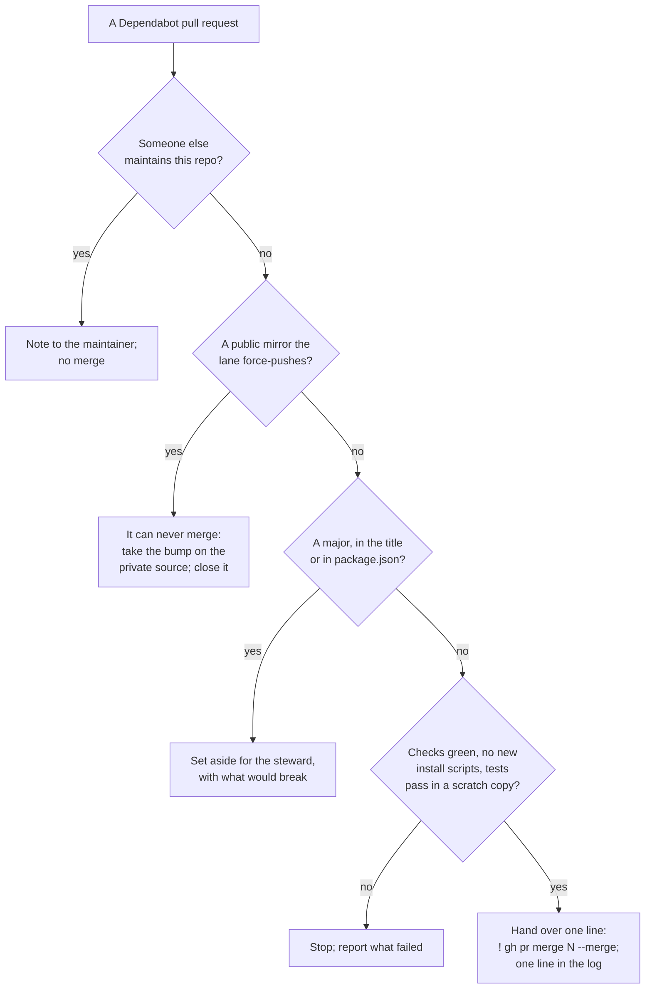

# SOP-IT-005 · Dependabot, by the fleet: who tests the updates, and the one line a helper hands over

**Department:** IT · **ID:** 005 · **Status:** draft (approved when tagged) · **Owner:** the lab steward · **Last changed:** 2026-11-05

##  Purpose
Dependabot's pull requests should not sit waiting for someone to notice them. The lab steward decided on Nov 4, 2026 that the fleet's helpers take them periodically. **What a helper does today:** tests and prepares each one, then hands the steward a one-line `! gh pr merge N --merge`. The permission system refused a session's `gh pr merge` on Nov 5, 2026, and a helper does not work around a refusal. If the steward adds a permission rule later, this page changes and step 6 becomes the helper's own. A change the fleet writes for an organisation still waits for a human with the role (SOP-OPS-002). This page says what a helper must check, and when to stop and ask.

##  Scope
Pull requests authored by `dependabot[bot]` on the lab's repositories and the organisations' repositories the lab maintains. **Not covered:** repositories someone else maintains (a member's own apps, third-party copies under `code-forked`), which get a note to their maintainer and no merge. How Dependabot is configured to stay gentle is in `my-template/walkthroughs/DEPENDABOT.md`.

##  Roles
| Role | Does |
|---|---|
|  Helper | runs this page, prepares what passes, hands over the one-line merge, writes one line per sweep |
|  Lab steward | runs the one-line merge; decides every major upgrade the sweep sets aside; can stop the sweep with a word |

##  The decision

##  Prerequisites
A clean scratch worktree, never the working clone. A desk with something running from its folder (the ARB monitor, a listener) is never tested in place: installing would change what is running.

##  Steps

1. **List them.** `gh search prs --author app/dependabot --owner <owner> --state open --json repository,number,title,url`. They never appear in a person's inbox at `github.com/pulls`, because nobody is assigned; that is why a sweep exists. *You should see:* the same list as each repository's Pull requests tab.
2. **Sort by version, from the diff.** Read `package.json` in the diff (`gh pr diff <n>`), because a Dependabot group title can hide a major: the ARB repository's #6 was titled a security group and carried Hardhat 3 and toolbox 7. A patch or minor goes on. **A major stops here** and goes to the steward's list, with one sentence on what it would change. A group containing one major is treated as a major.
3. **Check the checks.** `gh pr checks <n> -R <repo>`. Red or pending means not today.
4. **Look for what is new.** In the lockfile diff, look for a package name that was not there before, and for `"hasInstallScript": true` on anything added or changed. Either one means reading that package's repository first (the external-package checklist in every `CLAUDE.md`: scripts, credential paths, provenance, typosquatting, network calls). An unexplained new package is a stop.
5. **Run it in a scratch copy.** `git worktree add <scratch> <pr-branch>`, then `npm ci --ignore-scripts`, then the repository's build and tests, or the offline tests a desk names. *You should see:* the same pass counts as `main`. If `main` itself fails, say so and stop: that failure is not the update's.
6. **Hand over the merge.** Give the steward one line per pull request, `! gh pr merge <n> -R <repo> --merge`, never squash. One at a time on a repository, waiting for its checks in between, because each merge can conflict the next. Dependabot rebases the rest; `@dependabot rebase` asks it to. *Today a session's own `gh pr merge` is refused by the permission system (seen Nov 5, 2026): report it and hand over the line; do not look for another route.*
7. **Write the line.** In the repository's `logs/` or pending tasks: the date, what is ready, what merged, what was set aside and why.
8. **Leave running desks alone.** A merge changes the lockfile, not the installed folder. Whoever next restarts that desk runs the install on purpose, during a quiet hour, and checks its heartbeat afterwards.

##  When to stop and ask
- A major version, or a compiler, framework or runtime change (Hardhat, solc, Next.js, Astro majors).
- Anything that touches signing, wallets, keys or money movement, whatever its version number.
- A new package nobody asked for, a new install script, or a maintainer change in the release notes.
- Tests that pass on `main` and fail on the branch.
- A security alert marked critical with no patched version: that goes to the steward the same day.

##  Verification
After the steward's merges, the repository's Pull requests tab shows only what was set aside. `main`'s checks are green after the last merge. The log line exists. The desk's own monitor is still ticking.

##  Change log
| Date | Change |
|---|---|
| 2026-11-05 | The first sweep: the permission system refused a session's `gh pr merge`, so a helper tests and prepares and hands over `! gh pr merge N --merge`; the page changes if the steward adds a rule. Read `package.json` in the diff: a group title can hide a major (#6 did). |
| 2026-11-04 | Drafted on the lab steward's word: Dependabot's pull requests are the fleet's to take, on these checks; first sweep queued in Mystarch's pending tasks. |
