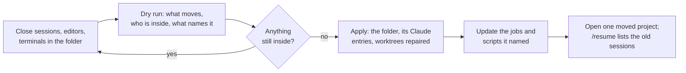

# SOP-IT-006 · Renaming a local folder: what is filed under its old name, and how to move it all

**Department:** IT · **ID:** 006 · **Status:** draft (approved when tagged) · **Owner:** the lab steward · **Last changed:** 2026-11-05

##  Purpose
Renaming a folder looks harmless, and to git it is: a clone doesn't care what its folder is called. But other things on your machine are filed by the folder's **full path**, and a rename quietly cuts them off. This page says what they are, and how to move a folder so nothing is stranded. Nothing is deleted by a careless rename. The history just gets hard to find, which on a bad day is nearly the same.

##  Scope
Any local folder holding a repository, or holding folders of them, on a machine where Claude Code, launchd jobs or editors work in it. Renaming a repository **on GitHub** is a different job, and GitHub redirects its old address.

##  What a rename cuts off

| Filed by path | What you would notice | What fixes it |
|---|---|---|
| **Claude Code's sessions and memory,** `~/.claude/projects/<the path, flattened>/` | `/resume` no longer lists your old sessions, and saved memory stops loading: Claude greets the folder as a brand-new project | move that folder too |
| **Everything inside a renamed parent.** Each subfolder has its own project entry | a session in a child repo is orphaned though you only renamed the parent | move every child entry too |
| **Scheduled jobs** (launchd agents, cron) and scripts with a hard-coded path | a job fails at night, possibly silently | update the path; give the job a failure alert |
| **Linked git worktrees** record absolute paths both ways | `fatal: not a git repository` inside a worktree | `git worktree repair` |
| **Open editors and terminals** hold the old folder | VS Code shows stale files; a terminal sits in a folder that "no longer exists" | close them first, reopen after |
| **Documents and handoffs** naming the path | a helper follows a dead path and gets confused | search and update the ones in use; leave dated history as it was |

**The flattening trap.** Claude Code turns every character but a letter or a digit into `-`, so `~/code/pir/foo` and `~/code/pir-foo` both become `...-code-pir-foo`. A move by name alone can take the wrong folder's history. Check what is inside first: each session file records the real working folder in a `cwd` field.

##  The move

##  Steps

1. **Dry run.** `python3 -I my-template/scripts/rename-local-repo.py OLD NEW --ref <folder of scripts to check>`. *You should see:* the Claude project folders it would move, anything it left alone and why, what is working inside the folder now, and which files still name the old path. It changes nothing.
2. **Close what it names:** Claude sessions in that folder or below, VS Code windows, terminals. A job due to run soon counts: don't rename at 23:50 if a job runs at 23:55.
3. **Read what it left alone.** A project folder is left alone when its sessions name a different path. That may be a real name collision, or the mark of an earlier move. Look before you vouch for it with `--adopt <name>`.
4. **Apply.** Add `--apply`. It refuses while anything is still inside. *You should see:* "moved", and how many repositories had worktrees repaired.
5. **Update the paths it named,** and restart any launchd agent whose plist changed (`launchctl unload` then `load`, by hand, once).
6. **Prove it.** Open the moved project in Claude Code and run `/resume`. *You should see:* the old sessions. Then run `git status` in a worktree, and check the next scheduled job's result in the morning.

##  What it never does
It deletes nothing. It does not edit transcripts, so an old session still records the old path in its history, and that is true history. It does not rename anything on GitHub.

##  If it already happened
Nothing is lost. Your old sessions sit in `~/.claude/projects/` under the old flattened name. Move that folder to the new flattened name and `/resume` finds them again.

##  Related
`my-template/NESTED-REPOS-GUIDE.md` (where clones live), SOP-OPS-003 (the lanes), `scripts/clone-map.sh` (where everything is now). *Read Nov 5, 2026 from the machine itself; Claude Code may change how it files projects, so re-check `~/.claude/projects/` if this page ever seems wrong.*

##  Change log
| Date | Change |
|---|---|
| 2026-11-05 | Drafted before the lab's own renames, from a heads-up about orphaned sessions. |
