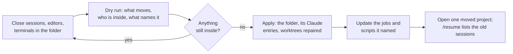

# SOP-IT-006 · Renaming a local folder: what is filed under its old name, and how to move it all

**Department:** IT · **ID:** 006 · **Status:** draft (approved when tagged) · **Owner:** the lab steward · **Last changed:** 2026-11-06

##  Purpose
Renaming a folder looks harmless, and to git it is: a clone doesn't care what its folder is called. But other things on your machine are filed by the folder's **full path**, and a rename quietly cuts them off. This page says what they are, and how to move a folder so nothing is stranded. Nothing is deleted by a careless rename. The history just gets hard to find, which on a bad day is nearly the same.

##  Scope
Any local folder holding a repository, or holding folders of them, on a machine where Claude Code, launchd jobs or editors work in it. Renaming a repository **on GitHub** is a different job, and GitHub redirects its old address.

##  What a rename cuts off

| Filed by path | What you would notice | What fixes it |
|---|---|---|
| **Claude Code's sessions and memory,** `~/.claude/projects/<the path, flattened>/` | `/resume` no longer lists your old sessions, and saved memory stops loading: Claude greets the folder as a brand-new project | move that folder too |
| **Everything inside a renamed parent.** Each subfolder has its own project entry | a session in a child repo is orphaned though you only renamed the parent | move every child entry too |
| **Scheduled jobs** (launchd agents, cron) and scripts with a hard-coded path | a job fails at night, possibly silently | update the path; give the job a failure alert |
| **Linked git worktrees** record absolute paths both ways | `fatal: not a git repository` inside a worktree | `git worktree repair` |
| **Open editors and terminals** hold the old folder | VS Code shows stale files; a terminal sits in a folder that "no longer exists" | close them first, reopen after |
| **Documents and handoffs** naming the path | a helper follows a dead path and gets confused | search and update the ones in use; leave dated history as it was |

**The flattening trap.** Claude Code turns every character but a letter or a digit into `-`, so `~/code/pir/foo` and `~/code/pir-foo` both become `...-code-pir-foo`. A move by name alone can take the wrong folder's history. Check what is inside first: each session file records the real working folder in a `cwd` field.

##  The move

##  Steps

1. **Dry run.** `python3 -I my-template/scripts/rename-local-repo.py OLD NEW --ref <folder of scripts to check>`. *You should see:* the Claude project folders it would move, anything it left alone and why, what is working inside the folder now, and which files still name the old path. It changes nothing.
2. **Close what it names:** Claude sessions in that folder or below, VS Code windows, terminals. A job due to run soon counts: don't rename at 23:50 if a job runs at 23:55.
3. **Read what it left alone.** A project folder is left alone when its sessions name a different path. That may be a real name collision, or the mark of an earlier move. Look before you vouch for it with `--adopt=<name>` (the `=` form, because the name starts with a dash).
4. **Apply.** Add `--apply`. It refuses while anything is still inside. *You should see:* "moved", and how many repositories had worktrees repaired.
5. **Update the paths it named,** and restart any launchd agent whose plist changed (`launchctl unload` then `load`, by hand, once).
6. **Prove it.** Open the moved project in Claude Code and run `/resume`. *You should see:* the old sessions. Then run `git status` in a worktree, and check the next scheduled job's result in the morning.

##  What it never does
It deletes nothing. It does not edit transcripts, so an old session still records the old path in its history, and that is true history. It does not rename anything on GitHub.

##  If it already happened
Nothing is lost. Your old sessions sit in `~/.claude/projects/` under the old flattened name. Move that folder to the new flattened name and `/resume` finds them again.

##  Working in VS Code workspaces
A **workspace** is a small `.code-workspace` file, a JSON list of folders plus any settings for them, that VS Code opens as one window with every folder in its sidebar.

**The three windows.** Each file sits in its parent folder, lists that folder's repositories by relative path, and lists the parent itself last. All three are gitignored: they describe this machine.

| Window | File | What it holds |
|---|---|---|
| dappu | `~/dappu/dappu.code-workspace` | the active dappu repositories and `ops-arbitrage`, then `dappu (parent)` |
| code | `~/code/code.code-workspace` | every repository directly in `~/code` except the one Christopher keeps in a window of its own, then `code (parent)` |
| labs | `~/drasticstaticLabs/drasticstaticLabs.code-workspace` | `drasticstaticLabs (map)` first, then each `-lab` folder |

**Using one.**
- **Open:** File > Open Workspace from File, and pick the file. Or double-click it in Finder, or run `code ~/dappu/dappu.code-workspace` in a terminal (once the `code` command is installed: Command Palette > *Shell Command: Install 'code' command in PATH*). Next time it is in File > Open Recent, marked *(Workspace)*.
- **Add a folder:** File > Add Folder to Workspace. A new clone does not appear by itself; add it, then save.
- **Save:** File > Save Workspace As. VS Code writes the folder paths relative to wherever you save the file, so keep it in its parent folder.

**Why it matters for order.**
1. **Each folder stays its own repository.** A workspace is a view, not a parent repository: git, the Source Control panel and every commit still belong to one folder at a time. Nothing about a workspace is committed anywhere.
2. **A Claude session is filed under the folder it starts in.** Claude Code's VS Code pages speak of "the folder you have open"; they do not say which folder a session takes in a window with several (read Nov 6, 2026). Don't leave it to chance: open the integrated terminal, `cd` into the repository, then type `claude`. To be sure afterwards, find the session's folder in `~/.claude/projects/MANIFEST-LOG.md`, or type `/cd ~/path/to/the-repo` in the session to move it. The session-order walkthrough (`my-template/walkthroughs/CLAUDE-SESSION-ORDER.md`) and its hook speak up when a session starts in a parent folder.
3. **After a folder moves, update the workspace files.** `rename-local-repo.py` reports a file only when you pass it with `--ref` and it names the old path in full; the relative entries here (`"path": "pir-lab"`) never match. So look for yourself: `grep -n '"path"' ~/code/code.code-workspace ~/dappu/dappu.code-workspace ~/drasticstaticLabs/drasticstaticLabs.code-workspace`, fix any entry that names the old folder, and reopen the window.

##  Worked example, Nov 6, 2026
The lab's own renames, written down so others know how this is done. **Eight folders:** seven labs under `~/code/` were to take a `-lab` suffix (`pir` became `pir-lab`, `the-holy-earth-foundation` became `the-holy-earth-foundation-lab`, and so on), and one organisation folder was to drop its `-org` (`~/taylordwraps-org` became `~/taylordwraps`).

1. **The dry run first, for all eight,** before anything moved. It listed each folder's Claude project entries (a parent and every child inside it), the scripts that still named the old paths, and what was working in each folder right then.
2. **A VS Code window held one back.** One lab was still open in an editor window, so the apply refused that folder. The other seven went ahead. The eighth waits until its window is closed, then runs on its own; nothing is lost by waiting.
3. **Parked Terminal tabs.** Several tabs sat idle in folders being renamed, with nothing running in them. `--allow-idle-shells` lets the apply go past a shell that is only sitting there (macOS keeps it working through the move, still showing the old path). A program running in the folder still stops it. Afterwards, `cd` to the new name in such a tab before typing `claude`.
4. **Two vouches, in the `=` form.** The dry run left two project folders alone because their sessions named another path: the mark of an earlier move, checked by reading their `cwd` fields. Both were vouched for with `--adopt=NAME`. Write the `=`: a project folder's name starts with a dash (`-Users-...`), and after a space the name reads as another option.
5. **Seven sessions found only in an archive.** Seven old sessions sat only in `~/.claude/projects/_archived-pre-move-sessions/`, filed under paths that had not existed since earlier moves, so `/resume` could list them nowhere. They were **copied, not moved,** into the project folders of their repositories' current homes. The archive stays as it was.
6. **The nightly job, before its run.** The nightly job named two paths inside a renamed lab. Both were fixed the same day, before its next run, so it never had the chance to fail at night.

##  Worked example two, later on Nov 6, 2026: the labs get a home of their own
The same morning, a second move, this time out of `~/code` altogether. `~/code` was to keep Christopher's own repositories and the tools; every lab was to live in `~/drasticstaticLabs`. **Ten folders:** the seven labs renamed above, the one the editor window had held back (`taylordwraps` became `taylordwraps-lab` on the way), and three more that took the suffix as they moved (`wilson-lawn-ai-assist`, `RhebekahStar` and `dpnelson`, each now `<name>-lab`). One of the ten is a plain folder holding two spares, not a repository; it moves the same way.

1. **The nightly job first.** The nightly job keeps clones inside one of the labs. Its paths were pointed at `~/drasticstaticLabs/...` and committed before any folder moved, so a run falling between the moves still found its clones. Do this first whenever a scheduled job lives inside what you are moving.
2. **One dry run per folder, then one apply per folder.** Each old path and its new one. The dry run listed every Claude project entry, the parent and each child; each slug changed from `-Users-<you>-code-<old>` to `-Users-<you>-drasticstaticLabs-<new>`.
3. **`--allow-idle-shells` again.** Terminal tabs parked in several of the labs, from the first move, still sat there with nothing running. The flag let the apply go past them. In each such tab, `cd ~/drasticstaticLabs/<new>` before typing `claude`, or the session files itself under a path that no longer exists.
4. **`--adopt=NAME` for what the first move left.** Some project folders the first move had carried still held sessions whose `cwd` named the pre-suffix path (`~/code/pir`, not `~/code/pir-lab`). The tool rightly left them alone; reading their `cwd` fields showed they were this lab's own history, and each was vouched for with `--adopt=-Users-...` (the `=` form).
5. **The fleet's tools learn the new root.** A move out of every default root drops the folder out of the sweeps without a word: the pull-everything sweep, the clone map, the lane health check, the backup and the document catalog all walk a list of roots. `~/drasticstaticLabs` was added to each list, right after `~/code`, the same day. Then `clone-map.sh` was run to see the ten under their new home.
6. **The living pages, not the history.** Guides, walkthroughs, READMEs and SOP bodies that named the old paths were updated; dated handoffs, session logs and change-log rows were left saying what was true on their day. A dated page that a session reads next as its "start here" got one line at its top giving the new path.

##  Related
`my-template/NESTED-REPOS-GUIDE.md` (where clones live), SOP-OPS-003 (the lanes), `scripts/clone-map.sh` (where everything is now). *Read Nov 5, 2026 from the machine itself; Claude Code may change how it files projects, so re-check `~/.claude/projects/` if this page ever seems wrong.*

##  Change log
| Date | Change |
|---|---|
| 2026-11-05 | Drafted before the lab's own renames, from a heads-up about orphaned sessions. |
| 2026-11-06 | A worked example from the lab's renames that day; `--adopt=` written with its `=`. |
| 2026-11-06 | Worked example two: the ten labs moved from `~/code` to `~/drasticstaticLabs`; the nightly job repointed first, `--allow-idle-shells` and `--adopt=` again, the fleet scripts given the new root. |
| 2026-11-06 | Working in VS Code workspaces: what a workspace is, the dappu, code and labs windows, and starting Claude from the repository's own folder. |
