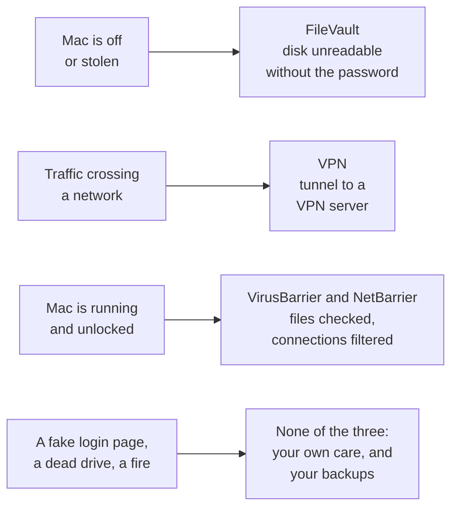

# SOP-IT-007 · The machine's three guards: FileVault, a VPN, an antivirus


**Department:** IT · **ID:** 007 · **Status:** draft (approved when tagged) · **Owner:** the organisation's stewards · **Last changed:** 2026-11-05

> [!NOTE]
> **TL;DR.** Three guards, three different doors. **FileVault** guards a Mac that is off or stolen. A **VPN** guards your traffic on its way across a network. An **antivirus and firewall** guard the running machine from bad files and unwanted connections. None of them is a backup, and none of them stops you typing a password into a fake page.
>
> **The one trade-off to decide:** with FileVault on, a Mac that restarts by itself after a power cut stops at the login screen until a person types the password. That is the protection working. So "start up automatically" gets you a Mac that is awake and waiting, not one that is running.

| If you want to know | Go to |
|---|---|
| Which guard covers what, in one table? | [What each guard does and does not do](#what-each-guard-does-and-does-not-do) |
| Should my Mac restart itself after a power cut? | [FileVault and a power cut](#filevault-and-a-power-cut) |
| Where does the recovery key go? | [The recovery key](#the-recovery-key) |
| Why did GitHub or a data feed stall behind the VPN? | [The fleet's known issue](#the-fleets-known-issue) |
| Is there split tunnelling on a Mac? | [Kill switch and split tunnelling](#kill-switch-and-split-tunnelling) |
| Why is my build slow, and how do I exclude a folder? | [Why a scanner can slow a build](#why-a-scanner-can-slow-a-build) |

##  Purpose
Say in plain words what each of the three guards on a Mac protects, what it leaves open, and which settings have a real cost, so nobody leans on a guard for something it was never built to do.

##  Scope
Macs that people and helpers in the fleet work on. The products named here, NordVPN and Intego, are what the lab has in front of it; the same questions apply to any VPN or antivirus, and a different product means re-reading its own pages. Backups are in proposal 019 and [SOP-IT-009](SOP-IT-009-cold-storage-data-and-wallets.md). Apple account recovery is in [SOP-COM-002](../COM/SOP-COM-002-apple-account-recovery.md).

##  Roles
| Role | Does |
|---|---|
|  The Mac's owner | decides every setting here, keeps the recovery key, types the password after a restart |
|  Helper | reads status, compares it with this page, writes down differences; never changes a setting, never sees a key |

<a id="what-each-guard-does-and-does-not-do"></a>

##  What each guard does and does not do



| Guard | Guards against | Does **not** protect against |
|---|---|---|
|  **FileVault** | someone reading the disk of a Mac that is off, lost or stolen | anything while the Mac is on and unlocked; malware; a backup drive with no encryption of its own; losing the disk |
|  **VPN** | the local network and your internet provider reading your traffic; sites seeing your home address on the network | malware; fake pages; a site recognising you once you log in; files on your disk. It also moves trust: the VPN company now carries the traffic |
|  **VirusBarrier** | known malware in files as they are created, copied, changed or saved | a file on its Trusted list; malware too new to recognise; a stolen password; a dead drive |
|  **NetBarrier** | unwanted connections in and out of the Mac | a connection you allowed; what happens after you say yes; anything on the disk |

*The "does not" column is plain reasoning from what each tool is built to do, not a vendor's statement.*

<a id="filevault"></a>

##  FileVault

| Depth | What it is |
|---|---|
| **In plain words** | The Mac's disk is locked with your login password. Without it, the disk is unreadable, even if someone takes the Mac apart. |
| **Technically** | On Apple silicon and T2 Macs the data is always encrypted; FileVault adds the requirement that your login password is needed to decrypt it. Apple's deployment guide names AES-XTS on full internal volumes. Removable drives are a separate matter. |

Turning it on also requires a password at wake and after the screen saver ([Apple, How does FileVault work](https://support.apple.com/guide/mac-help/how-does-filevault-work-on-a-mac-flvlt001/mac)). Only an administrator can turn it on ([Apple, Protect data with FileVault](https://support.apple.com/guide/mac-help/protect-data-on-your-mac-with-filevault-mh11785/mac)).

<a id="filevault-and-a-power-cut"></a>

### FileVault and a power cut

Apple says two things that settle this, though neither page is about power cuts:

1. With FileVault on, credentials are needed during startup ([Apple, Intro to FileVault](https://support.apple.com/guide/deployment/intro-to-filevault-dep82064ec40/web)).
2. With FileVault on, automatic login is not available; login has to be by hand ([Apple, log in automatically](https://support.apple.com/en-us/102316)).

So a Mac with FileVault that restarts on its own stops at the login screen until a person types the password. Nothing that starts at login runs until then: no monitors, no scheduled jobs, no file shares. Apple's Energy page describes the switch only as starting up after a power interruption and does not mention FileVault ([Apple, Energy settings, macOS 15](https://support.apple.com/guide/mac-help/change-energy-settings-mchlp1168/15.0/mac/15.0)).

| *Start up automatically after a power failure* | ON | OFF |
|---|---|---|
| **With FileVault on** | The Mac wakes and waits at the login screen. It saves a trip to the power button, not the login. | The Mac stays dark until someone presses the button, and then the login is the same. |
| **Suits** | A **headless home server, a file hub, a media server**: a machine you want back without you, where you have decided what it holds and how it unlocks | A desk where a person has to come anyway, and where a flickering supply with no battery would otherwise switch the Mac on and off |
| **Costs** | With no battery in between, a flickering supply can cycle a desktop on and off. A server that must truly come back alone may mean no FileVault, which is a real loss if it is stolen | A return from a cut needs a person at the Mac, every time |

**A real choice, as an example.** Christopher looked at this on Nov 5, 2026 and chose not to use the option on his desk, for the reason above: FileVault would stop the Mac at the login screen anyway. Choosing the other way on a machine that does a different job would be just as sensible.

**Two things that are not a way round it:**
- **`sudo fdesetup authrestart`** restarts once without asking at startup, and only because you started it by hand. It cannot help with a power cut you did not plan, and `man fdesetup` warns that FileVault's protections are reduced during such a restart, because a copy of the unlock key is held on purpose until the Mac comes back.
- **Unlocking over `ssh`.** On Apple silicon with macOS 26 or later, Apple says FileVault can be unlocked over `ssh` after a restart if Remote Login is on and the network is up ([Apple, Intro to FileVault](https://support.apple.com/guide/deployment/intro-to-filevault-dep82064ec40/web)). A person still types the password; they just needn't be in the room. Not tested on any of our machines, so **UNVERIFIED** in practice.

Newer Macs have a related row: on macOS 26.5 or later, *Start up when power is connected* on a Mac mini from 2024, a Mac Studio from 2025 or an iMac from 2024 can be set to Always, which also covers a power failure ([Apple, 125517](https://support.apple.com/en-us/125517)). That page does not mention FileVault either; the reasoning above still applies.

<a id="the-recovery-key"></a>

### The recovery key

| Depth | What it is |
|---|---|
| **In plain words** | The spare key for the disk. If you forget your password, this or your iCloud account is the way back in. |
| **Technically** | When you turn FileVault on you choose: let your iCloud account unlock the disk, or create a recovery key, a string of letters and numbers. Lose your password, your way of resetting it and the key, and Apple says the files and settings are gone for good. |

- **Choosing iCloud** means no key to keep track of, and it ties the Mac to the Apple account. Read [SOP-COM-002](../COM/SOP-COM-002-apple-account-recovery.md) first: that account should not need this Mac to be recovered.
- **Choosing a key:** copy it exactly. Apple says to keep it away from the encrypted disk and not in the same physical place as the Mac.
- **Our habit:** paper, in two places, the same as the Apple recovery key in SOP-COM-002. Never a photo, never a note on that same Mac, never typed into a website, a chat or a helper.

### Check it

```sh
fdesetup status                          # no password needed
sudo fdesetup haspersonalrecoverykey     # true or false; it never prints the key
fdesetup supportsauthrestart             # true or false
```
*You should see:* `FileVault is On.` Read the commands' meaning in `man fdesetup`. To replace a key that may have been seen, `sudo fdesetup changerecovery -personal` makes a new one and retires the old; write the new one down before you close the window.

<a id="a-vpn"></a>

##  A VPN (NordVPN, as read on the date below)

| Depth | What it is |
|---|---|
| **In plain words** | A private pipe from your Mac to a server the VPN company runs. People on your Wi-Fi and your internet provider see that you use the pipe, not what is in it. Websites see the server's address instead of yours. |
| **Technically** | An encrypted tunnel (a `utun` interface on macOS) that usually carries the default route and often the DNS too. Past the VPN server, traffic goes on as normal. Nord's list of features covers encryption, a no-logs policy that is its own claim, DNS leak protection and a separate file and web filter called Real-time protection ([Nord, features](https://support.nordvpn.com/hc/en-us/articles/19559429814545-What-features-does-NordVPN-have)). |

**Two Mac versions, different features.** The version from Nord's website has the App Kill Switch and custom DNS. The App Store version has neither and has VPN bypass prevention instead ([Nord, macOS versions](https://support.nordvpn.com/hc/en-us/articles/19445793501585-NordVPN-macOS-application-versions-website-vs-App-Store)). Find out which one you have before following anything here.

<a id="the-fleets-known-issue"></a>

### The fleet's known issue

A VPN's resolver, the service that turns a name into an address, can stop answering for some names while everything else keeps working. In the fleet that has stalled **Alchemy and GitHub**, and bots and helpers then time out with no obvious cause. **[SOP-IT-001](SOP-IT-001-vpn-dns-resolver-stalls.md) is the whole procedure:** how to prove it in a minute, how to fix it. Its first fix is a custom DNS in the VPN app, which Nord documents for macOS in the website version ([Nord, change your DNS](https://support.nordvpn.com/hc/en-us/articles/35512783419281-How-to-change-your-DNS-using-the-NordVPN-app)). The same page says macOS settings can do it too.

<a id="kill-switch-and-split-tunnelling"></a>

### Kill switch and split tunnelling

| Term | In plain words | What Nord's pages say for a Mac |
|---|---|---|
| **Kill switch** | If the VPN drops, stop the traffic rather than let it go out in the open. | Website version: the **App Kill Switch** cuts the connection of the apps you chose when the VPN drops. App Store version: **VPN bypass prevention** forces covered traffic through the tunnel, including across restarts and sleep ([Nord, Kill Switch](https://support.nordvpn.com/hc/en-us/articles/19509682644369-NordVPN-Kill-Switch-how-does-it-work), updated Nov 4, 2026). |
| **Split tunnelling** | Send some traffic outside the VPN, on purpose. | **Not on macOS.** Nord says it offers this only on Windows, Android, Android TV and the browser extension ([Nord, in its CarPlay article](https://support.nordvpn.com/hc/en-us/articles/48351729193745-How-do-I-use-CarPlay-Android-Auto-or-cast-while-connected-to-NordVPN), updated Oct 30, 2026; the [how-to page](https://support.nordvpn.com/hc/en-us/articles/19618692366865-What-is-Split-Tunneling-and-how-to-use-it-with-NordVPN) has no macOS section). |

- **On a Mac you cannot exclude `git` or a bot from the tunnel with Nord's app.** The browser extension can exclude a domain, for browser traffic only, and Nord says that traffic then uses your real address unencrypted ([Nord, Exclude from VPN](https://support.nordvpn.com/hc/en-us/articles/20321703651985-How-to-use-the-Exclude-from-VPN-Split-Tunneling-feature-on-the-NordVPN-extension)).
- **Where both exist,** the kill switch wins and blocks excluded apps too ([Nord, how they interact](https://support.nordvpn.com/hc/en-us/articles/46236661588497-How-Kill-Switch-and-Split-Tunneling-interact-in-NordVPN)). Nord itself suggests auto-reconnect for most people and the kill switch only for strict no-traffic-without-VPN needs.
- **For an always-on machine, think before turning a kill switch on.** A dropped tunnel would then stop the observers too. An unattended job needs the stall alert from SOP-IT-001 either way. This is our reasoning, not Nord's, and it has not been measured here.

<a id="an-antivirus"></a>

##  An antivirus and firewall (Intego, as read on the date below)

| Product | In plain words | Technically |
|---|---|---|
| **VirusBarrier** | Checks files for known malware, all the time and when you ask. | Its real-time scanner covers every file created, copied, changed or saved, and no others. That is why Intego suggests a full scan at install and after each definitions update ([VirusBarrier X9 manual](https://support.intego.com/hc/en-us/articles/223149367-VirusBarrier-X9-User-Manual)). |
| **NetBarrier** | A doorman for network connections, in and out. | A personal firewall that filters packets entering or leaving the Mac, with profiles for Home, Work, Public Hotspot and VPN, and an Application Monitor showing what is using the network ([NetBarrier X9 manual](https://support.intego.com/hc/en-us/articles/223209868-NetBarrier-X9-User-Manual)). |
| **Personal Backup** | Copies chosen folders on a schedule. | See [Its backup product, and why 019 declined it](#its-backup-product-and-why-019-declined-it). |

### Their scheduled tasks

- **VirusBarrier:** Intego says scheduled scans are optional, since the real-time scanner runs all the time ([Scheduling a Scan](https://support.intego.com/hc/en-us/articles/207114838-VirusBarrier-X9-Scheduling-a-Scan)). If you want them: **Schedule…** → On → Daily or Weekly. **Advanced** picks folders, chooses Scan or Quick Scan, and adds more schedule rows. The option *Display scheduled scans in Task Manager* decides whether a small window appears. **Scan with low priority** uses fewer resources and takes longer.
- **NetBarrier:** its manual describes no schedule. It runs all the time, so there is nothing to time.
- **On a machine that is working at night,** place a full scan away from the jobs that matter, and watch the first one.
- **Updates:** Intego's release notes point to its NetUpdate app for keeping these current ([release notes](https://support.intego.com/hc/en-us/articles/4402158049298-VirusBarrier-X9-Release-Notes)).

<a id="why-a-scanner-can-slow-a-build"></a>

### Why a scanner can slow a build

A build or an `npm install` creates thousands of small files, and a real-time scanner looks at each one as it is written. So the slowdown is what you would expect from how it works. **That is reasoning, not a measurement:** Intego's manual gives no figure, and we have not measured it here. Measure before you exclude anything.

1. In a scratch copy, run your project's build twice, timing the second run: `time npm run build`.
2. Turn the Real-Time Scanner off, time it again, and **turn it back on straight away**. Intego's manual treats turning it off as a troubleshooting step only, and this counts as one.
3. If the difference is small, stop here. Nothing needs excluding.

### How to exclude a folder, Intego's way on a Mac

**Watch out:** Intego's article titled *How to Exclude Items From Scans* is about **Intego Antivirus for Windows** ([it says so in its first line](https://support.intego.com/hc/en-us/articles/12024630687122-How-to-Exclude-Items-From-Scans)). Its Real-Time Protection exclusions are not a Mac menu. On a Mac the tool is **Trusted Files** ([VirusBarrier X9 manual](https://support.intego.com/hc/en-us/articles/223149367-VirusBarrier-X9-User-Manual)):

1. Open VirusBarrier and click **Trusted Files**.
2. Click the small **+** at the bottom left, choose the folder, click **Add**. Dragging it from the Finder also works. The manual says a folder or volume can be listed, and files listed are assumed safe and not scanned.
3. To undo it, select the item and use the **-** button, as the older X6 manual describes. The X9 screen may differ; **UNVERIFIED** on a current install.
4. Time the build again. *You should see* the gain, if it applies. The manual doesn't separately say whether Trusted Files covers the real-time scanner, so the timing is your proof. **UNVERIFIED** until you have measured it.

**Trust as little as you can.** Intego says to use this only for files already scanned. Build output and caches are the first candidates. Be careful with `node_modules`, since it holds code from strangers that has only just arrived. Never trust `Downloads`, a whole home folder or a whole disk.

<a id="its-backup-product-and-why-019-declined-it"></a>

### Its backup product, and why 019 declined it

Intego Personal Backup X9 makes backup, synchronise and bootable-copy tasks on a schedule ([manual](https://support.intego.com/hc/en-us/articles/223374007-Personal-Backup-X9-User-Manual)). Proposal 019, *Backed up three ways*, weighed it and said no: a second thing to watch, gaining nothing Time Machine lacks. Two pages from Intego show why not to rely on the old selling point. Its 2020 comparison promises a bootable clone ([Intego blog, 2020](https://www.intego.com/mac-security-blog/intego-personal-backup-compared-with-apples-time-machine/)). Its 2024 support page says that on Big Sur and later the startup volume cannot be cloned reliably, because of Apple's signed system volume, and that the Backup and Synchronize tasks still work ([Intego, bootable compatibility](https://support.intego.com/hc/en-us/articles/360017336500-Bootable-Backup-Compatibility-with-macOS-Big-Sur-and-Higher)).

##  Steps: a five-minute check of all three

1. **FileVault.** `fdesetup status`. *You should see:* `FileVault is On.`
2. **The key.** `sudo fdesetup haspersonalrecoverykey`, or check that iCloud unlock is what you chose. Then look at the paper. It exists, it is readable, and it is not near the Mac.
3. **The VPN's version.** Look at where you installed it from, and note whether custom DNS exists.
4. **The VPN's resolver.** Run the one-minute check in [SOP-IT-001](SOP-IT-001-vpn-dns-resolver-stalls.md).
5. **Intego.** Open VirusBarrier: is the Real-Time Scanner on? Read the Trusted Files list and ask of every line whether it still needs to be there. Open NetBarrier: which profile is active, and does it match the network you are on?
6. **Write down what differs,** with the date. A helper proposes; the owner changes it.

##  Verification
FileVault reports On and a way to recover exists on paper or through a tested Apple account. The resolver check answers. The Real-Time Scanner is on, and the Trusted Files list is short enough to explain out loud.

##  Troubleshooting
| What you see | What it means | What to do |
|---|---|---|
| The Mac came back after a cut and nothing is running | it stopped at the login screen, as designed | type the password; check your jobs restarted |
| A bot times out while websites load | probably the VPN's resolver | [SOP-IT-001](SOP-IT-001-vpn-dns-resolver-stalls.md) |
| No custom DNS tab in the VPN app | probably the App Store version | set DNS in macOS, or install the website version on purpose |
| No split tunnelling on the Mac | Nord doesn't offer it on macOS | don't hunt for it; use the fix in SOP-IT-001 |
| Everything is slow during builds | maybe the scanner | measure first, then Trusted Files, as above |

##  Sources and related
Read on **2026-11-05**: every page linked above, Apple's and Nord's support pages and Intego's support manuals, plus `man fdesetup` on macOS 15.4.1. Intego's support site refused an ordinary page fetch that day, so its manuals were read through the help centre's public feed of the same articles. Vendors change these pages and their menus, so check when it matters. Nord's marketing pages returned 403 and are not cited.

Related: [SOP-IT-001](SOP-IT-001-vpn-dns-resolver-stalls.md) (resolver stalls), [SOP-IT-008](SOP-IT-008-disk-utility-and-sparse-images.md) (encrypted images), [SOP-IT-009](SOP-IT-009-cold-storage-data-and-wallets.md) (cold storage), [SOP-COM-002](../COM/SOP-COM-002-apple-account-recovery.md) (Apple account recovery), proposal 019 (*Backed up three ways*).

##  Change log
| Date | Change |
|---|---|
| 2026-11-05 | Drafted, with Christopher's Nov 5 decision on the power-failure switch as the worked example. No setting was changed to write it. |
