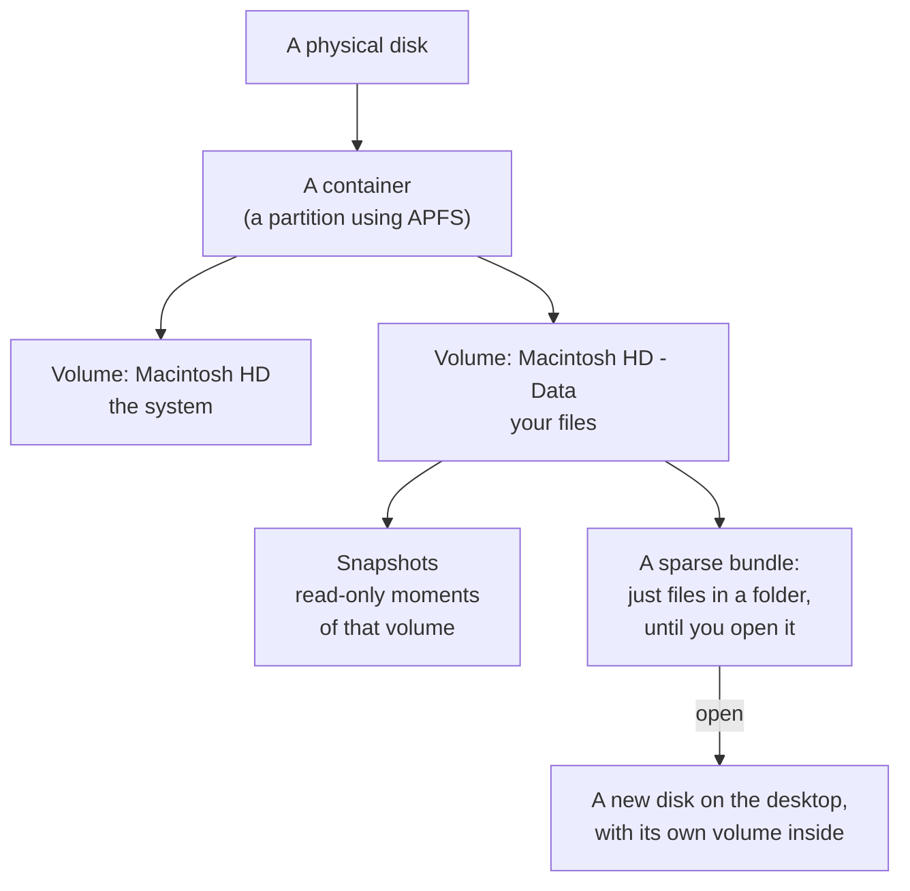
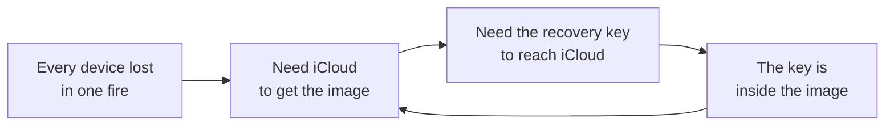

# SOP-IT-008 · Disk Utility and sparse images: volumes, containers, snapshots, and an encrypted folder you can carry


**Department:** IT · **ID:** 008 · **Status:** draft (approved when tagged) · **Owner:** the organisation's stewards · **Last changed:** 2026-11-05

> [!NOTE]
> **TL;DR.** A disk image is a file that acts like a disk. A **sparse bundle** is one that grows as you fill it and is stored as a folder of small pieces, which makes it the kinder choice for a cloud drive. Make one encrypted, with a password you have written down, because **nobody can open it if that password is lost**, Apple included. And never put the keys you would need to reach iCloud inside an image that lives on iCloud.

| If you want to | Go to |
|---|---|
| Learn the words | [The words, in two depths](#the-words-in-two-depths) |
| Choose a kind of image | [Which image](#which-image) |
| Make one by clicking | [Disk Utility](#create-one-in-disk-utility) |
| Make one by typing | [`hdiutil`](#create-one-with-hdiutil) |
| Get the space back | [Sizing and compacting](#sizing-and-compacting) |
| Avoid locking yourself out | [The loop to avoid](#the-loop-to-avoid) |

##  Purpose
Explain what the Mac's storage words mean, and give one tested way to make an encrypted image, open it, close it, keep it small and not lose it.

##  Scope
Macs on current macOS. The commands were tested on macOS 15.4.1 on Nov 5, 2026, on a throwaway image. Whole-machine backup is proposal 019; keeping keys and copies safe is [SOP-IT-009](SOP-IT-009-cold-storage-data-and-wallets.md); the Mac's own disk encryption is [SOP-IT-007](SOP-IT-007-the-machines-three-guards.md).

##  Roles
| Role | Does |
|---|---|
|  The image's owner | chooses the password, keeps it, opens and closes the image |
|  Helper | may explain and give commands; never holds or types the password |

<a id="the-words-in-two-depths"></a>

##  The words, in two depths



| Word | In plain words | Technically |
|---|---|---|
| **Volume** | What you see as a disk in the Finder. | A formatted file system. Your Mac's macOS sits on a pair of them, one for the system and one for your data ([Apple](https://support.apple.com/guide/disk-utility/add-delete-or-erase-apfs-volumes-dskua9e6a110/mac)). |
| **Container** | A box on the disk that several volumes share. | An APFS partition. Its free space is shared among its volumes on demand, and you may set a reserve or a quota for each ([Apple, file system formats](https://support.apple.com/guide/disk-utility/file-system-formats-dsku19ed921c/mac)). |
| **APFS snapshot** | A frozen picture of a volume at one moment. | A read-only copy of its parent volume ([Apple](https://support.apple.com/guide/disk-utility/view-apfs-snapshots-dskuf82354dc/mac)). See them with **View > Show APFS Snapshots** in Disk Utility, or `tmutil listlocalsnapshots /`. It lives on the same disk, so **it is not a backup**: it helps with a deleted file, not a dead drive. |
| **Disk image** | A file that behaves like a disk when you open it. | Attaching makes a device and mounting makes its volume appear (`man hdiutil`). Apple calls it a file containing other files and folders ([Apple](https://support.apple.com/guide/disk-utility/create-a-disk-image-dskutl11888/mac)). |
| **Sparse image** | A disk image that takes up only the room its contents need. | One file, `.sparseimage`, growing as you fill it, up to the size set at creation (`man hdiutil`, type UDSP). |
| **Sparse bundle** | The same idea, kept as a folder of small pieces. | A package, `.sparsebundle`, holding `bands/` files, 8 MB each by default (`man hdiutil`, type UDSB). In the Finder it looks like one file. |
| **Mount / eject** | Open it and close it. | `hdiutil attach` and `hdiutil detach`. Disk Utility and a double-click in the Finder do the same. |

<a id="which-image"></a>

##  Which image

| | Read/write `.dmg` | Sparse image | **Sparse bundle** | Apple Sparse Image (ASIF) |
|---|---|---|---|---|
| **On disk** | full size at once | one file, growing | a folder of bands, growing | sized by its contents; whether one file or many, Apple's page doesn't say |
| **A small change touches** | that one big file | that one big file | **only the bands that changed** | **UNVERIFIED** |
| **Good for** | a fixed size you'll fill | short-term work | **long-term storage, a cloud drive, a network** | newer Macs; see below |
| **What Apple says** | | `man hdiutil`: not recommended for persistent storage; prefers the bundle as more robust and faster | Disk Utility guide: often used for Time Machine over a network | newest Disk Utility guide only |

**Why a sparse bundle suits cloud sync better.** A sync service works in files. Change one line inside a 50 GB single-file image and that whole file has changed as far as the service can see. In a sparse bundle, only the bands holding that line have changed, and each is small. On our test, adding one small text file to a bundle holding 60 MB changed 2 of its 11 band files. A file-by-file service would send those two and leave the rest. How iCloud Drive itself uploads inside a changed file isn't documented on the pages we read, so that part is **UNVERIFIED**.

**Three cautions for a bundle on a cloud drive.** They are our reasoning, not Apple's, and we have not tested them on iCloud (**UNVERIFIED**):
- Eject it, and let the upload finish, before you open it on another Mac. Never open it on two Macs at once.
- Keep it downloaded. A bundle with bands that have been offloaded from the Mac may be slow to open or fail.
- A cloud drive sends deletions and damage everywhere as well. It is sync, not a backup, so keep a second copy (proposal 019).

**A note on names.** Menus differ by version. Apple's guide for macOS 15 offers sparse bundle, sparse and read/write images ([15](https://support.apple.com/guide/disk-utility/create-a-disk-image-dskutl11888/22.6/mac/15.0)). The current guide lists Sparse Bundle (UDSB), RAW, Apple Sparse Image (ASIF) and DVD/CD master for a blank image ([current](https://support.apple.com/guide/disk-utility/create-a-disk-image-dskutl11888/mac)). `man hdiutil` on 15.4.1 has no ASIF, so don't expect it there. Choose **sparse bundle** in all of them, unless you have a reason not to.

##  Prerequisites
- A password written down **before** you start, on paper, away from the Mac, and in your password manager if you use one.
- Enough free space for what you will put inside. The image grows into the disk it is on.

<a id="create-one-in-disk-utility"></a>

##  Create one in Disk Utility

From [Apple's guide](https://support.apple.com/guide/disk-utility/create-a-disk-image-dskutl11888/mac):

1. Open **Disk Utility** and choose **File > New Image > Blank Image**.
2. **Save As:** the file's name, and where it goes. **Name:** what the disk will be called once it's open. **Size:** the most it may ever hold.
3. **Format:** APFS, for a Mac on macOS 10.13 or later with an SSD. If Windows must read it, Apple's guide says FAT at 32 GB or less, ExFAT above.
4. **Encryption:** choose an option. Take **256-bit AES** if offered. Enter the password twice. Apple's warning is plain: forget it and the files can't be opened.
5. **Partitions:** leave the default.
6. **Image Format:** **sparse bundle disk image**.
7. **Save**, then **Done**. *You should see:* the new disk on the desktop and in the Finder sidebar.
8. Copy your files in, then **eject** it. *You should see:* the disk gone, and a `.sparsebundle` where you saved it.
9. **Prove it.** Double-click the file, type the password from your paper copy, and open one file.

If the password prompt offers to remember it in your keychain, consider what that means: anyone logged in to your Mac as you can then open it without knowing the password.

<a id="create-one-with-hdiutil"></a>

##  Create one with `hdiutil`

```sh
# Prompts for the password. It is not on the command line, so it stays out of your shell history.
hdiutil create -size 50g -type SPARSEBUNDLE -fs APFS -encryption AES-256 -volname Vault ~/Documents/vault.sparsebundle

hdiutil attach ~/Documents/vault.sparsebundle      # open: prompts, then mounts at /Volumes/Vault
hdiutil detach /Volumes/Vault                      # close
hdiutil compact ~/Documents/vault.sparsebundle     # give unused space back, closed; prompts
du -sh ~/Documents/vault.sparsebundle              # how much room it really takes
```

- *You should see* `created:` with the path, then `/dev/disk…` lines and `/Volumes/Vault`, then `"disk…" ejected.`
- **Leave off `-encryption` and the image isn't encrypted.** Name the cipher: `man hdiutil` gives AES-128 as the default when you ask for encryption without choosing one.
- **Never use `-passphrase`.** `man hdiutil` calls it insecure because the password shows up in the process list. `-stdinpass` exists for scripts. A helper never runs one with your password.
- A wrong password says `attach failed - Authentication error`, and there is no way round it.

##  Mounting and unmounting
- **Open:** double-click, or `hdiutil attach`. **Close:** eject in the Finder, or `hdiutil detach /Volumes/Vault`.
- **While it is open, it is unlocked** for anything running as you, so leave it closed when you're not using it.
- **If it won't eject,** something still has a file open. Close the app, or read `lsof +D /Volumes/Vault` to find out which one. Then try again rather than pulling the drive it lives on.

<a id="sizing-and-compacting"></a>

##  Sizing and compacting

- **The size is a ceiling.** Both sparse kinds grow only up to the size set at creation, and take less until then (`man hdiutil`). So a generous ceiling costs nothing up front, as long as the disk beneath can really hold it.
- **Need more?** `hdiutil resize -size 80g <image>` on the closed image, then open it and read `df -h /Volumes/Vault`. On our test the APFS volume inside grew with it.
- **Deleting doesn't shrink it.** The image keeps its bands until you compact. On our test, after removing 60 MB of 74 MB, `compact` reported about 56 MB reclaimed and the bundle fell to 18 MB.
- **Compact it closed, plugged in, and unhurried.** `man hdiutil` warns that a single-file sparse image can be damaged if power is lost during a compact, which is another reason to choose the bundle, and refuses to run on battery by default. Also, depending on where files sit inside, a compact may shrink it little.
- **Imaging a whole disk has limits.** Apple notes you can't image an individual APFS volume, and on Apple silicon or T2 Macs you can't image an APFS container. It also warns against trusting an image made from a failing disk.

##  Passwords, and what happens if one is forgotten

**It is gone.** Apple's guide says the image can't be opened without the password, and nobody has a spare. An encrypted image with a lost password is a file full of noise.

- Keep the password in two places that do not depend on each other: on paper, and in a password manager that itself doesn't need this image.
- Open the image from the written copy once when you make it, and once a year after that.
- To change it, `hdiutil chpass` on the closed image. It changes what opens the image, and any old copy of the image still opens with the old password.
- Never type it into a website or chat, and never hand it to a helper.

<a id="the-loop-to-avoid"></a>

##  The loop to avoid

An encrypted image on iCloud is a good backup and a bad last resort. [SOP-COM-002](../COM/SOP-COM-002-apple-account-recovery.md) says why.



**Do this instead.** The Apple recovery key, your password manager's emergency kit and this image's password live **on paper, outside the loop**. Everything else may live in the image. Ask of each secret you put in: would I need this to get back to where the image is kept? If yes, it can't only be in there. Walk through it with the *day every device is gone* table in SOP-COM-002.

##  Verification
The image opens from the password on paper, not from a keychain. `hdiutil imageinfo <image>` asks for the password, then shows `Format: UDSB` and `Encrypted: true`. Nothing needed to reach iCloud is only inside it.

##  Sources and related
Read on **2026-11-05**: Apple's Disk Utility guide, [create a disk image](https://support.apple.com/guide/disk-utility/create-a-disk-image-dskutl11888/mac) (current and the [macOS 15 version](https://support.apple.com/guide/disk-utility/create-a-disk-image-dskutl11888/22.6/mac/15.0)), [file system formats](https://support.apple.com/guide/disk-utility/file-system-formats-dsku19ed921c/mac), [APFS volumes](https://support.apple.com/guide/disk-utility/add-delete-or-erase-apfs-volumes-dskua9e6a110/mac), [APFS snapshots](https://support.apple.com/guide/disk-utility/view-apfs-snapshots-dskuf82354dc/mac); `man hdiutil` and `man tmutil` on macOS 15.4.1. The commands were run on a throwaway image with a throwaway password.

Related: [SOP-COM-002](../COM/SOP-COM-002-apple-account-recovery.md), [SOP-IT-007](SOP-IT-007-the-machines-three-guards.md), [SOP-IT-009](SOP-IT-009-cold-storage-data-and-wallets.md), proposal 019 (*Backed up three ways*).

##  Change log
| Date | Change |
|---|---|
| 2026-11-05 | Drafted, with each `hdiutil` command run once on macOS 15.4.1. |
