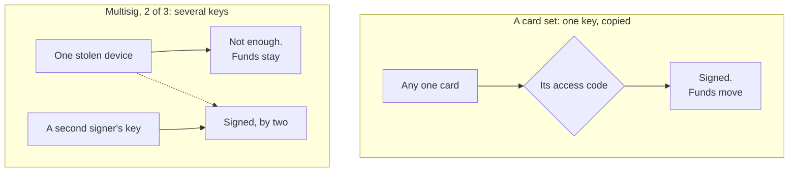

# SOP-IT-009 · Cold storage: data and wallets

**Department:** IT · **ID:** 009 · **Status:** draft (approved when tagged) · **Owner:** the organisation's stewards · **Last changed:** 2026-11-05

> [!IMPORTANT]
> **Not legal, tax or investment advice.** This page explains how storage fails. It doesn't say what to buy or hold, and it describes nobody's holdings.

> [!NOTE]
> **TL;DR.** *Hot* means connected and ready. *Cold* means it takes a person and a physical step to reach. Cold protects you from what happens over a network, and exposes you to what happens in a room. So think of **fire, flood, theft and "I lost it" as four separate failures**, and keep copies in **two places, not one safe**. A safe rated for paper isn't rated for a drive.
>
> **For wallets, one fact people miss:** the backup cards of a seedless card wallet such as Tangem are **copies** of one key, and **each can sign alone**. A stolen card is guarded only by its access code. That is useful, and it is **not multisig**.
>
> **Test your recovery.** A copy you have never restored from is a hope. And **never type a seed into a website.**

| If you want to know | Go to |
|---|---|
| Hot and cold for files | [Data](#data-hot-and-cold) |
| Hot and cold for wallets | [Wallets](#wallets-hot-and-cold) |
| What a Tangem card set really is | [Seedless card wallets](#seedless-card-wallets-such-as-tangem) |
| What fire does, and what theft does | [Four failures](#four-failures-not-one) |
| Where to keep things | [Two places, not one safe](#two-places-not-one-safe) |
| How to know it works | [Test the recovery](#test-the-recovery) |

##  Purpose
Give a person the words and the failure list they need before deciding where to keep something they cannot replace, whether that is a file or a key.

##  Scope
Personal and organisational data, and self-held crypto wallets, explained in general terms. **Not covered:** which product to buy, what any treasury does, tax, inheritance law. How the lab backs up its machines is proposal 019, *Backed up three ways*. Apple account recovery is [SOP-COM-002](../COM/SOP-COM-002-apple-account-recovery.md). Encrypted images are [SOP-IT-008](SOP-IT-008-disk-utility-and-sparse-images.md).

##  Roles
| Role | Does |
|---|---|
|  The holder | decides where things go, keeps their own private list, tests recovery |
|  Anyone helping in person | may read this page with the holder; never sees a seed or an access code |
|  Helper (an agent) | explains and points to sources; **never** reads, holds, types or stores a seed, a code or a key, and never asks for one |

##  Data: hot and cold

| How cold | Example | What it gives | What it risks |
|---|---|---|---|
| **Hot** | iCloud, GitHub, a synced folder | always there, out of the house | an account lock-out; a deletion or a scramble travels with the sync |
| **Warm** | a Time Machine drive plugged in at the desk | every file by the hour, with no internet needed | it sits in the same room, and a bad script can reach a mounted drive |
| **Cold** | a drive unplugged and kept elsewhere, updated by rotation | out of reach of malware and of the room | only as fresh as the last rotation; forgotten drives fail unnoticed |
| **Coldest** | paper | needs no power, no password, no software | a single fire or flood; anyone who finds it can read it |

**The 3-2-1 rule.** Three copies, on two kinds of media, with one away from the house. That is CISA's rule, in its paper *Data Backup Options*, as quoted in proposal 019 on Nov 4, 2026. CISA's PDF refused our fetch on Nov 5, so that quote wasn't re-read. Proposal 019 walks through the test row by row: what passes today, and what a drive and an off-site copy would each add.

**Hot and cold help each other.** A Time Machine drive is at risk from malware while it is mounted, and a cloud copy is at risk from a lock-out. Proposal 019's table shows no single column stays strong all the way down.

**Paper is for the few things that open everything else:** the Apple recovery key and your password manager's emergency kit ([SOP-COM-002](../COM/SOP-COM-002-apple-account-recovery.md)), a FileVault recovery key ([SOP-IT-007](SOP-IT-007-the-machines-three-guards.md)), an image's password ([SOP-IT-008](SOP-IT-008-disk-utility-and-sparse-images.md)). The test for them is the same: walk through the day every device is gone, and look for a loop.

##  Wallets: hot and cold

| Depth | Hot | Cold |
|---|---|---|
| **In plain words** | The key lives on a phone or a computer that is online. Quick, and open to whatever gets onto that device. | The key lives somewhere offline. Slow on purpose, and the risks become physical. |
| **Technically** | The private key is held in software on a networked device, and signing happens there. | The private key stays in an offline device or chip. The transaction goes in, the signature comes out, and the key doesn't leave. |

A wallet doesn't hold the coins; the coins are on a public ledger. It holds **the key that can move them**. So everything below is really one question: **who, or what, can sign?**

### Four ways to hold a key

| | In plain words | Technically | What a thief needs | What losing it means |
|---|---|---|---|---|
|  **Seed phrase** | A list of ordinary words that can rebuild your whole wallet. | A BIP-39 mnemonic of 12 to 24 words from which keys are derived, with an optional extra passphrase ([BIP-39](https://raw.githubusercontent.com/bitcoin/bips/master/bip-0039.mediawiki)). | the words, and nothing else (plus the passphrase, if one was set) | words gone and devices gone: the wallet is gone |
|  **Hardware wallet** | A small device that keeps the key inside and signs for you. | The key stays in the device, and it usually shows the transaction on its own screen. Most have a seed as the backup, so the seed is the real target. | the device and its PIN, **or** the seed alone | device gone: restore from the seed. Seed gone too: gone |
|  **Multisig** | A wallet that takes several keys to move anything, like a safe with two locks and two people. | M of N: a set number of signers out of the total must approve ([Ledger Academy](https://www.ledger.com/academy/what-is-a-multisig-wallet)). No one person or key can move funds alone ([Trezor](https://trezor.io/learn/supported-assets/bitcoin/multisig-wallets-how-multi-key-security-protects-your-bitcoin)). | enough keys to reach M | depends on the numbers: 2 of 3 survives losing one key, 3 of 3 doesn't. Trezor adds that losing the extended public keys can stop you sending even with enough private keys |
|  **Seedless card wallet** | Two or three cards that each hold the same key, with no words to write down. | See below. | **one** card and its access code | one card gone: use another. All gone with no seed: gone |

**A seed phrase is the wallet.** Whoever reads it owns everything behind it, from anywhere, without touching your device. So it is the one thing you never photograph, never store in the cloud, and **never type into a website**. Trezor's own warning is to enter it only as your device instructs, and ["never type it into a website, form, app or message"](https://trezor.io/blog/news/coldcard-vulnerability-trezor-devices-are-not-affected). A site asking for your words is a thief, however official it looks. This holds whatever the page, the email, the support agent or the helper says.

### Seedless card wallets, such as Tangem

**The plain fact.** Tangem's backup cards are copies, and each can sign alone. A stolen card is guarded only by its access code. This is not multisig.

| What Tangem's own pages say | Page, as read Nov 5, 2026 |
|---|---|
| Each card receives a copy of the same private key, and all two or three give identical access. | [Security features](https://tangem.com/en/blog/post/tangem-security-features/) (Feb 23, 2026) |
| Any one card gives full access to the wallet. | [Multi-account vs multiple wallets](https://tangem.com/en/learning-hub/post/multi-account-vs-multiple-wallets/) (Sep 22, 2026) |
| A found or stolen card can't reach the funds without the access code. | [Lost card](https://tangem.com/en/blog/post/lost-tangem-wallet/) (Jun 2, 2025) |
| After six wrong tries, delays grow, up to 45 seconds, and reset on a correct entry. The code has a minimum of 4 characters and no maximum. | [Security features](https://tangem.com/en/blog/post/tangem-security-features/) |
| Resetting a forgotten code takes two cards from the set, so one stolen card can't reset it. The newer wallet lets you turn that reset off, and then a forgotten code can't be reset at all. | [Reset a code](https://tangem.com/en/blog/post/how-to-reset-your-password-on-tangem-wallet/) (Apr 10, 2024) |
| You can't add a card to an existing wallet. If you suspect a lost card is compromised, Tangem suggests moving to a new wallet. It also says never to keep all your devices in one place. | [Lost card](https://tangem.com/en/blog/post/lost-tangem-wallet/) |
| Set up without a seed, losing every card means losing access for good. A seed is an option on second-generation wallets and the Ring. | [Lost card](https://tangem.com/en/blog/post/lost-tangem-wallet/), [Seed FAQ](https://tangem.com/en/blog/post/seed-phrase-faq/) |

Tangem's help-centre pages showed only navigation to our reader on Nov 5, so these come from its blog and learning hub. **None of the pages we read uses the word multisig about the cards.** The conclusion below is ours, drawn from their words.

**What follows from that, in two depths.**

| | In plain words | Technically |
|---|---|---|
| **Copies, not parts** | Three cards are three whole keys, not three pieces. More cards protect you from loss, and give a thief more cards to find. | Redundancy is not a threshold. On-chain, one key signs, and nothing about the transaction shows a second approval. |
| **The code is the whole guard** | Pick a long one. A short code and a stolen card are all that stands between a thief and the wallet. | The delay slows guessing, and Tangem's pages describe no wipe or lockout. The minimum of 4 characters is not a recommendation. Whether a card resists other attacks is beyond what these pages show, so **UNVERIFIED** here. |
| **Two cards together** | Keep the cards apart. Two taken at once may be enough to get round the code. | Since a reset takes two cards from the set, two stolen together could reset the code, unless that reset was turned off. Tangem's page doesn't spell this out; it follows from the procedure. |
| **A lost card is a decision** | If one may be in someone's hands, the wallet has a spare key out there forever. | You can't revoke it or add a new card. The way out is a new wallet and moving the funds, Tangem's own suggestion. |

Each of these designs is a real choice. Cards mean no words to find on a shelf and a simple recovery. Multisig means more to set up and more ways to get it wrong. The point is only to know which one you have.

##  Four failures, not one

"Keep it safe" means nothing until you say safe from what. A plan that handles one of these may do nothing for the next.

| Failure | What it takes | What survives | What people get wrong |
|---|---|---|---|
|  **Fire** | everything in one building, and the phone, the Mac and the drive at once | a copy elsewhere; maybe a rated safe, if the rating matches what's in it | one safe at home, and a paper rating for a drive |
|  **Flood** | floor-level things, paper, a safe that isn't water-rated | a copy upstairs or elsewhere; paper sealed against water | assuming fireproof means waterproof. Check each rating separately |
|  **Theft** | whatever can be carried, including a small safe. **It also reads:** a seed on paper is the wallet, and a card comes with a guess at its code | what's elsewhere and useless without something the thief lacks | a written code stored with the card; two cards in one drawer; a label saying what it is |
|  **"I lost it"** | one item, quietly, and you may not know when | whatever you check on a schedule | finding out only on the day you need it. Also forgetting a code, a passphrase or where you put things, and being the only person who knows |

**The honest tension.** More copies protect you from loss and expose you to theft. Fewer copies do the reverse. A multisig or a seed with a passphrase is one way of easing that, since a single stolen item isn't enough. It costs more care in exchange.

##  Two places, not one safe

- **Two places, far enough apart that one bad night doesn't reach both.** One at home, and one away: a bank box, or a sealed envelope with someone you trust who isn't already one of your recovery contacts. SOP-COM-002 says the same for Apple's key.
- **A safe rated for paper isn't rated for media.** Fire ratings measure how hot the inside may get. A retailer's guide to the UL classes puts paper at under 350°F (Class 350) and digital media at under 125°F (Class 125) ([Safe and Vault Store, fire ratings](https://www.safeandvaultstore.com/pages/fire-ratings), read Nov 5, 2026). So paper can come through a heat well above what that guide gives for media. We read a seller's summary, as UL 72's own text wasn't open to us, so read the label on the actual product. **A drive, a card or a hardware wallet in a paper-rated safe has no promise behind it.** Whether any given card survives a fire is **UNVERIFIED**.
- **Don't store the lock with the key.** A code doesn't go on or beside its card, and a passphrase doesn't go on or beside its seed.
- **Label nothing with what it is.** Your private list says what is where. It isn't kept with the things it lists, and it names no amounts.
- **Someone else may need to find it.** Decide who, and how they would know, without giving them access today. That is a job for a will and a lawyer, not this page.

##  Steps: an afternoon with a list

1. **List what you cannot replace.** On paper, privately, with no amounts. For each item, write down where every copy is.
2. **Read across the four failures.** For each item ask: what's left after a fire, after a flood, after a theft, and if I lost this one thing? *You should see:* an answer for all four, or a gap you now know about.
3. **Mark the loops.** Does anything need itself to be recovered? [SOP-COM-002](../COM/SOP-COM-002-apple-account-recovery.md) has the test.
4. **Close the worst gap first.** For files, proposal 019's phases. For a key, a second place.
5. **Write down what kind of wallet you hold,** in the words above: seed, hardware, multisig, or copied cards. What can a single stolen item do?
6. **Put the test on the calendar.**

##  Test the recovery

A copy you have never restored from is a hope.

| What | The test | How often |
|---|---|---|
| A backup drive | restore one file you can recognise, and open it | yearly, and after any change |
| An encrypted image | open it from the password on paper, not from a keychain ([SOP-IT-008](SOP-IT-008-disk-utility-and-sparse-images.md)) | yearly |
| Paper keys and seeds | still there, still readable, seal intact. Don't take it out to read it near a camera or a helper | yearly |
| A seed phrase, before trusting it | restore on your own device, offline, as its maker instructs, before you put in anything that matters. Check that the addresses match | once, at setup |
| Each card in a set | use each one for a small transaction of your own, with its code, so you know each card and each code work | at setup, then yearly |
| A multisig | sign a small transaction using the keys you'd have left after losing one | at setup, then yearly |

##  What never happens here
- A seed is never typed into a website, a form, a chat or an AI helper, whoever asks and whatever it says is at stake. Nobody real needs it.
- No seed, code or key is ever photographed, screenshotted, emailed or stored in a repository.
- This page names no one's holdings, wallets or hiding places, and neither should anything built from it.

##  Sources and related
Read on **2026-11-05**, each dated in the text where its age matters: Tangem's [security features](https://tangem.com/en/blog/post/tangem-security-features/), [lost card](https://tangem.com/en/blog/post/lost-tangem-wallet/), [reset a code](https://tangem.com/en/blog/post/how-to-reset-your-password-on-tangem-wallet/), [access code](https://tangem.com/en/blog/post/how-access-code-works/), [before buying](https://tangem.com/en/blog/post/before-buying-tangem/), [seed FAQ](https://tangem.com/en/blog/post/seed-phrase-faq/) and [multi-account](https://tangem.com/en/learning-hub/post/multi-account-vs-multiple-wallets/); [BIP-39](https://raw.githubusercontent.com/bitcoin/bips/master/bip-0039.mediawiki); [Ledger Academy on multisig](https://www.ledger.com/academy/what-is-a-multisig-wallet); [Trezor on multisig](https://trezor.io/learn/supported-assets/bitcoin/multisig-wallets-how-multi-key-security-protects-your-bitcoin) and [on the wallet backup](https://trezor.io/blog/news/coldcard-vulnerability-trezor-devices-are-not-affected); [Safe and Vault Store on fire ratings](https://www.safeandvaultstore.com/pages/fire-ratings). Vendors write about their own products, and these pages change.

Related: proposal 019 (*Backed up three ways*), [SOP-COM-002](../COM/SOP-COM-002-apple-account-recovery.md), [SOP-IT-007](SOP-IT-007-the-machines-three-guards.md), [SOP-IT-008](SOP-IT-008-disk-utility-and-sparse-images.md).

*Not legal, tax or investment advice. Nothing here recommends a product, a holding or an amount.*

##  Change log
| Date | Change |
|---|---|
| 2026-11-05 | Drafted from the vendors' own pages. |
