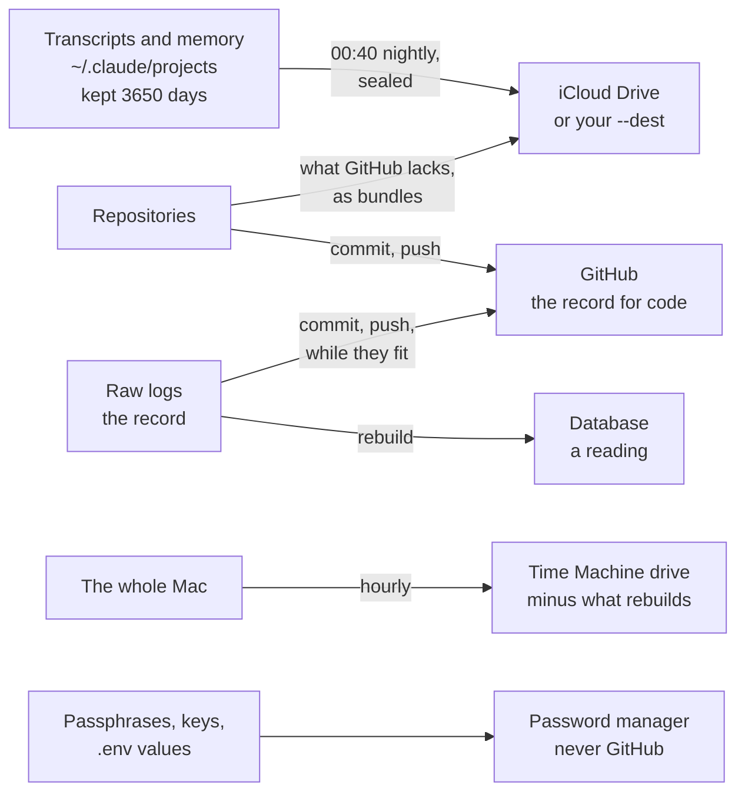

# SOP-IT-010 · How we keep our data: retention, backups, archives


**Department:** IT · **ID:** 010 · **Status:** draft (approved when tagged) · **Owner:** the organisation's stewards; any person may run the checks · **Last changed:** 2026-11-10

> [!NOTE]
> **TL;DR.** Each kind of data has one place that is its record, and at least one copy somewhere else.
>
> - **Transcripts:** Claude Code deletes them after **30 days** unless told otherwise, silently. We set `cleanupPeriodDays` to **3650** (ten years), and seal a copy of `~/.claude/projects` every night, encrypted, into iCloud Drive or a folder you name. The live `~/.claude` never goes into iCloud.
> - **Code:** git and GitHub are the record. The safety bundles carry what GitHub does not have yet.
> - **The whole Mac:** Time Machine, once a destination exists. Leave out only what can be rebuilt.
> - **Scratch that must survive a restart:** save it with `keep-scratch.sh`. It picks the road: anything that looks like a secret, or is over 1 GB, stays on the Mac (never synced; Time Machine covers it); everything else goes to a synced folder. Nothing is overwritten or deleted.
> - **Three layers, three different failures:** GitHub for pushed work, the sealed copies for what is not pushed, Time Machine for the whole Mac. During a legal hold, nothing is deleted or moved out of reach.
> - **Databases are readings, raw logs are the record.** Back up the logs; rebuild the database.
> - **Never to GitHub:** transcripts, keys, passphrases, `.env` files, databases, archives. **Passphrases and keys live in the password manager.**
> - **A copy you have never restored from is a hope.** Run the [restore drills](#7-the-restore-drills) on their schedule.

| If you want to know | Go to |
|---|---|
| Why old sessions vanish, and how to keep them | [1. Transcript retention](#1-transcript-retention) |
| How the nightly sealed copy works, and how to get it back | [2. The nightly archive](#2-the-nightly-archive-of-claudeprojects) |
| What Time Machine should leave out | [3. Time Machine](#3-time-machine) |
| What protects uncommitted work | [4. Git and the safety bundles](#4-git-and-the-safety-bundles) |
| Which copy is the record | [5. Readings and records](#5-databases-are-readings-raw-logs-are-the-record) |
| What must never be pushed | [6. What never goes to GitHub](#6-what-never-goes-to-github) |
| How often to prove it works | [7. The restore drills](#7-the-restore-drills) |
| Where scratch work goes so a restart cannot lose it | [8. Scratch that must survive a restart](#8-scratch-that-must-survive-a-restart) |
| Which layer protects against what, and what a legal hold changes | [9. Three layers, and a legal hold](#9-three-layers-and-a-legal-hold) |

##  Purpose
Say, in one place, how we keep each kind of data: how long it is kept, where its record lives, where its copies go, and how we prove we can get it back. The procedures are short and each has commands, so anyone can run them and anyone can check.

##  Scope
A Mac where a person works with Claude Code and git: their transcripts and agent memory, their repositories, the logs and databases a job writes, and the Mac as a whole. **Not covered:** wallets and seeds ([SOP-IT-009](SOP-IT-009-cold-storage-data-and-wallets.md)), encrypted disk images ([SOP-IT-008](SOP-IT-008-disk-utility-and-sparse-images.md)), FileVault and the other guards ([SOP-IT-007](SOP-IT-007-the-machines-three-guards.md)), and which drive or plan to buy.

##  Roles
| Role | Does |
|---|---|
|  The person at the keyboard | owns the Mac and its data; runs every step that changes their settings, makes a passphrase, schedules a job, or may put a prompt on the screen; keeps the passphrases in the password manager |
|  A steward | keeps this page true; checks the drill log each quarter |
|  Helper (an agent) | may run the self-tests, dry runs, `--list` and `--verify`, and hand over the other lines as `!` commands. **Never** runs `--init`, `--install` or the settings installer, and never reads or prints a passphrase, a key, a `.env` file or the values in `~/.claude/settings.json` |

##  Prerequisites
- A clone of `my-template` at `~/code/my-template` (the scripts below live in its `scripts/` folder).
- A password manager the person already uses.
- For the archive's default destination: iCloud Drive turned on. Without it, a folder or drive of your own (`--dest`).

##  How it works



| Data | Its record | Its copies | Kept |
|---|---|---|---|
| Transcripts, agent memory | `~/.claude/projects` on this Mac | the nightly sealed archive; Time Machine | ten years on the Mac; archives are never deleted |
| Code | GitHub, once pushed | a fresh clone; the safety bundles for what is not pushed; Time Machine | for as long as the repository lives |
| Raw logs | git, while they fit; an off-machine copy once they leave it | Time Machine | as their procedure says |
| Databases built from logs | none: they are readings | none needed: rebuild from the logs | until rebuilt |
| Passphrases, keys, `.env` values | the password manager | the password manager's own backup | as long as what they open |
| Scratch work waiting on a person | the folder `keep-scratch.sh` saved it to | Time Machine (the local road) or the sync service (the synced road) | until moved to `done/`; never deleted |
| The organisation's accounts (email, shared drive, GitHub organisation) | the organisation's own account, never a personal one | the provider's own; an export kept in the organisation's records | as the organisation decides |

##  1. Transcript retention

**Why.** Claude Code keeps session transcripts for **30 days by default** and then deletes them in a background sweep after a session starts, **without a message**. A session older than that drops out of `/resume`, and its history is gone. The setting is `cleanupPeriodDays`: a whole number of days, at least 1 (Claude Code's settings reference, read Nov 6, 2026). We set it to **3650**, ten years.

**Set it, once per Mac.** The person runs the installer themselves; a helper must not, because it changes their own settings and shell profile.

1. Run `sh ~/code/my-template/scripts/install-claude-session-order.sh`. It sets `"cleanupPeriodDays": 3650` (or keeps a larger value), adds the session-start hook and the parent-folder guard, keeps every other key as it was, and checks the file is valid JSON before it replaces the old one. *You should see:* the list of key names (never their values), then `cleanupPeriodDays: 3650`, and `Done.`
2. **Its backups, made on the first install only:** `~/.claude/backups/settings-before-session-order.json` and `~/.zshrc.before-session-order`. They are kept if they already exist, so they always hold the state from before the first install. Running the installer twice is safe.
3. **To undo:** `sh ~/code/my-template/scripts/install-claude-session-order.sh --undo` puts both files back from those backups. *You should see:* `restored` and each file's path.

**Check it, reading only that one key.** `settings.json` can hold tokens, so never print the whole file:

```sh
python3 -I -c 'import json,os; print(json.load(open(os.path.expanduser("~/.claude/settings.json"))).get("cleanupPeriodDays", "not set: 30 days"))'
```

*You should see:* `3650`. A project's own `.claude/settings.json` or `.claude/settings.local.json` outranks your user file in that project, so look there too. This prints only the lines naming the key:

```sh
find ~/code ~/dappu ~/drasticstaticLabs -maxdepth 3 -path '*/.claude/settings*.json' -exec grep -Hn '"cleanupPeriodDays"' {} + 2>/dev/null
```

*You should see:* nothing, or only values of 3650 or more.

##  2. The nightly archive of `~/.claude/projects`

**Why.** Keeping transcripts for ten years keeps them on one disk. `~/.claude/projects` holds every session and every agent's memory, is in no git repository, and must never go to GitHub. So a script seals a copy each night: `scripts/claude-projects-archive.sh`. The walkthrough is `my-template/walkthroughs/CLAUDE-PROJECTS-ARCHIVE.md`.

**What it does.**
- Archives everything under `~/.claude/projects`, and `~/.claude/CLAUDE.md`. Nothing is left out. The rest of `~/.claude` (settings, credentials, caches) stays out.
- `tar`, `gzip`, then `openssl enc -aes-256-cbc -pbkdf2 -iter 600000`. The passphrase is read from `~/.config/claude-archive/passphrase` (mode 600), never typed on a command line.
- **A full archive** on the first run for a destination, on the first run of each month, and with `--full`. Otherwise **an incremental**: the files changed since the last success. A transcript that grew by one line travels whole.
- Names carry the date and time, `claude-projects_YYYYMMDD-HHMMSS_full.tar.gz.enc` or `..._incr.tar.gz.enc`, each with a `.sha256` beside it. A plain sort of the names is the restore order.
- Each archive is written as `.partial`, decrypted again and counted, then renamed. A failed run leaves nothing and is retried. **No archive is ever deleted.**
- Default destination: `~/Library/Mobile Documents/com~apple~CloudDocs/Backups/claude-projects/YYYY/` (iCloud Drive).
- The nightly job is a LaunchAgent at **00:40** that runs `--if-due`: it also runs at login after a night the Mac was off, and does nothing if the last success is under 20 hours old.

**Measured Nov 6, 2026** into a scratch folder, not iCloud: a full archive of 1,913 files went from 2.8 GB to **1.2 GB** in 64 s, plus 7 s to verify; one day's incremental, 285 files, 557 MB to **216 MB** in 12 s. At that pace it is roughly **4 to 8 GB a month, 50 to 100 GB a year**, and growing. Check your iCloud plan before a year has passed.

**Never put the live `~/.claude` in iCloud Drive,** and never link it there. iCloud syncs files one at a time while Claude Code is still appending to them, so the cloud can hold half a transcript, or a conflicted second copy. "Optimize Mac Storage" can move a file off the disk, leaving a placeholder Claude Code cannot read. And `~/.claude` holds settings and tokens that do not belong in any sync. Only finished, sealed archives travel. The same goes for `~/Desktop` and `~/Documents` when iCloud's *Desktop & Documents Folders* is on: they are then iCloud Drive too.

**Set it up.** The person at the keyboard runs steps 2 to 5; a helper may run step 1 and hand over the rest.

1. **Prove the script on this Mac:** `sh ~/code/my-template/scripts/claude-projects-archive.selftest.sh`. It works in a temporary folder with a fake home. *You should see:* every check pass (138 of 138 on Nov 6, 2026).
2. **Make the passphrase:** `sh ~/code/my-template/scripts/claude-projects-archive.sh --init`. It writes a random passphrase only if there is none, and never shows it. *You should see:* the folder made and a `pbcopy` line to run next.
3. **Put it in the password manager,** then clear the clipboard. Make a password item (for example *claude-projects archive passphrase*) and paste between these two lines:
   ```sh
   pbcopy < ~/.config/claude-archive/passphrase
   pbcopy < /dev/null
   ```
   *You should see:* the item saved. Without this copy, a lost Mac means every archive is noise.
4. **The first archive, by hand:** `sh ~/code/my-template/scripts/claude-projects-archive.sh --run`. **This may put a prompt on your screen:** the first time Terminal writes into iCloud Drive, macOS may ask for access. *You should see:* a full archive, its size and the destination's total. iCloud uploads it in the background.
5. **Schedule it:** `sh ~/code/my-template/scripts/claude-projects-archive.sh --install`. macOS shows a *Background Items Added* notification; that is expected. *You should see:* the agent loaded. To turn it off later: `--uninstall` (the plist is moved aside, not deleted, and the archives stay).
6. **The morning after, once:** `sh ~/code/my-template/scripts/claude-projects-archive.sh --status`. *You should see:* `ok: the newest success is under 36 h old`. A failed night is never silent: it is recorded, shows a macOS banner, and goes to `~/.config/claude-archive/notify` if that file is executable (a one-line push to your phone). Where a nightly desk job exists, have it run `--status` and alert when it exits 1. If the log says *Operation not permitted*, macOS kept the background job out of iCloud Drive: schedule a folder outside iCloud instead (`--install --dest ~/Archives/claude-projects`, which Time Machine copies) and make the iCloud copy by hand from Terminal once a week. Do not give `/bin/sh` Full Disk Access.

**No iCloud, or a drive as well.** Any mode takes `--dest DIR`, or `CLAUDE_ARCHIVE_DEST=DIR`:

```sh
sh ~/code/my-template/scripts/claude-projects-archive.sh --run --dest /Volumes/Backup/claude-projects
sh ~/code/my-template/scripts/claude-projects-archive.sh --install --dest /Volumes/Backup/claude-projects
```

The folder must already exist, so an unplugged drive cannot quietly become a folder on the startup disk: the run is refused and the next night tries again. Each destination keeps its own chain, starting with a full, and its own nightly schedule: `--install --dest DIR` adds a LaunchAgent beside iCloud's rather than replacing it (`--uninstall --dest DIR` removes only that one). A destination inside `~/.claude` is refused.

**Get it back.** Always into a new, empty folder in your home, never over the live `~/.claude` (the script refuses that):

```sh
sh ~/code/my-template/scripts/claude-projects-archive.sh --restore-latest ~/claude-restore
diff -rq ~/claude-restore/.claude/projects ~/.claude/projects
```

*You should see:* the newest full and every incremental after it unpacked in order, then only the differences since last night. To copy anything back, quit every Claude Code session first and copy only what you need. For an earlier day, `--restore FULL INCR ... DIR` with the files oldest first. On a new Mac, put the passphrase file back from the password manager first; the walkthrough has the three lines.

**Keeping it smaller.** `--prune-plan 3` prints what keeping only the newest three full archives would move aside; it changes nothing. `--move-old 3 DIR` then moves those older chains (never deletes them) to a folder such as the backup drive, each checked against its `.sha256`. Suggested rhythm: three months in iCloud, the rest moved monthly. Check the iCloud plan (System Settings → your name → iCloud) **before** scheduling: a full iCloud also stops iPhone backups and photo uploads.

##  3. Time Machine

**Why.** Time Machine copies the whole Mac to a drive you own, hourly, without the internet. It is the only copy of anything that is in neither git nor the archive: gitignored logs, local databases, app settings. It starts once a destination exists.

> [!WARNING]
> Some `tmutil` commands may mount the backup disk or ask for Full Disk Access. Tell the person at the keyboard before running one, and let them run it.

1. **Is there a destination?** `tmutil destinationinfo`. *You should see:* a destination's name. If it says there are none, the rest of this part waits for a drive: a USB or Thunderbolt drive about twice the size of the Mac's disk, used only for backups, or a network share that speaks SMB.
2. **Add it:** System Settings › General › Time Machine › Add Backup Disk. Let the first backup finish.
3. **Leave out only what rebuilds.** A database filled from logs, `node_modules`, `.venv`, build output and caches come back by running a command; they change often and make every hourly backup larger. Mark each one; the mark travels with the item:
   ```sh
   tmutil addexclusion path/to/the-rebuildable.sqlite
   tmutil isexcluded path/to/the-rebuildable.sqlite
   ```
   *You should see:* `[Excluded]`. **Do not exclude** `~/.claude`, raw logs, or repositories. Virtual machines are the one larger exception: their makers advise copying a shut-down VM's folder to the drive yourself, outside Time Machine.
   The mark can be set **now, before any drive exists**: it is a flag on the item itself, needs no administrator password and shows no prompt. To take it off: `tmutil removeexclusion path/to/it`. Example, a desk database rebuilt nightly from its logs: `tmutil addexclusion ~/path/to/the-repo/logs/db`.
4. **Check it ran:** `tmutil latestbackup`. *You should see:* a date from the last hour or so.

**Out of sight is not out of the backup.** Hiding a folder from Finder is a different tool, for folders that confuse
more than they help (one an app keeps re-creating, for example) but must stay where they are:

```sh
chflags hidden ~/SomeFolder      # gone from Finder; still on disk, still in Time Machine and in Terminal's ls
ls -lO ~ | grep SomeFolder       # the word "hidden" in the flags column
chflags nohidden ~/SomeFolder    # back in Finder
```

In Finder, **Command-Shift-Period** shows or hides every hidden item for a moment. Hiding is not privacy (anyone with
the account can still open it) and not an exclusion: Time Machine still copies a hidden folder, and `tmutil addexclusion`
is what leaves a folder out. Use neither to "delete" something: move it into an archive folder instead.

##  4. Git and the safety bundles

**Why.** GitHub keeps what is committed and pushed. Everything else in a clone, the staged and unstaged edits, untracked files, stashes, branches not pushed, lives on one disk until it is pushed. `scripts/git-safety-backup.sh` puts exactly that into iCloud Drive as finished, verified git bundles. Its walkthrough is `my-template/walkthroughs/ICLOUD-AND-GITHUB-TOGETHER.md`.

**The rules.** Commit often and push the working branch; a push is the real backup. Never keep a repository in iCloud Drive: it syncs files one at a time, and a repository only makes sense whole.

**What the bundles carry, and leave out.** Each repository is backed up once, from its main worktree, with every linked worktree's uncommitted work. Only what GitHub lacks goes in, so bundles are small. Paths named like secrets, ignored files, `node_modules` and your exclude list stay out. A repository mid-rebase or mid-merge is left until the next run. The newest seven bundles per repository are kept, under `GitBackups/` in iCloud Drive (or `--dest`).

1. **Once per Mac, the person runs** `sh ~/code/my-template/scripts/git-safety-backup.sh --init`. It writes the skip list, the exclude list and the passphrase file, and shows the passphrase **once**: put it in the password manager. Nothing runs until the skip list exists, so a private repository is never sent before someone has thought about it. *You should see:* the three files' paths. Read the skip list and add any repository that must never leave the Mac.
2. **Dry run:** `sh ~/code/my-template/scripts/git-safety-backup.sh --dry-run`. *You should see:* `WOULD WRITE` for each repository holding work GitHub lacks, and nothing written. It doubles as a list of unpushed work.
3. **Write, sealed:** `sh ~/code/my-template/scripts/git-safety-backup.sh --encrypt`. *You should see:* `WROTE` lines and `.bundle.enc` files. Once sealing is on, keep it on.
4. **Schedule it,** every two hours, from `scripts/launchd/git-safety-backup.plist.template`, after reading a dry run. The walkthrough has the lines.
5. **Get work back:** copy the bundle out of iCloud, open it with `--decrypt FILE`, clone from GitHub, then `git bundle verify /path/to/copy.bundle` and `git fetch /path/to/copy.bundle 'refs/*:refs/restored/*'`. *You should see:* `... is okay`, then the restored refs under `refs/restored/`, beside your own, so nothing collides.

##  5. Databases are readings, raw logs are the record

**Why.** A database built from logs answers questions quickly, but it holds nothing the logs do not. Back up what cannot be made again; rebuild what can.

- **The raw logs are the record.** Append-only files (JSONL and the like) are what a job wrote at the time. Keep them in git and push them while they fit. Never edit an old line; a correction is a new line.
- **The database is a reading.** Keep it gitignored (`*.sqlite`), out of the bundles, and out of Time Machine if it is large. Its loader rebuilds it from the logs, and a check proves the two agree. Restore means *rebuild*, not *copy back*.
- **When logs leave git.** Logs that outgrow a repository leave it on purpose, never by accident, and only after an off-machine copy exists and a restore from it has been rehearsed: files frozen per day, packed per month, snapshots to a drive and to an off-site bucket. The desk's database SOP holds one worked plan, with its measurements and a restore rehearsal.
- **Gitignored logs** (ticks, snapshots) are on this Mac only until Time Machine has a destination. Say so where they are written.

##  6. What never goes to GitHub

| Never pushed | Why | Where it lives instead |
|---|---|---|
| **Transcripts** (`~/.claude/projects`) and their archives | they are private material: what people said, paths, pasted text, sometimes a token. On Nov 6, 2026 the lab's folder was 2.8 GB, with 13 files over 50 MiB and 2 over 100 MiB. GitHub warns above 50 MiB and **refuses any file over 100 MiB**, so one push would fail, or leave history that cannot be taken back | the Mac, the sealed archive, Time Machine |
| **Keys, tokens, `.env` files, wallets** | anything pushed is copied at once to every clone and cache. GitHub's push protection blocks many known secret formats, but not every one, and never a passphrase. If it blocks a push, do not bypass it: remove the secret, and rotate it if it ever left the Mac | the password manager |
| **Passphrases** (the archive's, the bundles') | without them the copies are noise; with them in a repository, the copies are open | the password manager, and one file on the Mac (mode 600) |
| **Databases and their files** | readings, rebuilt in seconds; binary, so every change is a whole new copy in history | rebuilt from the logs |
| **Archives and bundles** (`.enc`, `.bundle`) | large and binary; the public-lane tripwire refuses unread binaries | iCloud Drive or your `--dest` |

Make it hard to slip: `.gitignore` the patterns (`.env`, `*.sqlite`, `*.enc`, `*.bundle`), keep secrets out of repository folders altogether, and let the tripwires of [SOP-IT-004](SOP-IT-004-tripwires-firewalls-and-shields.md) speak. **Passphrases and keys live in the password manager,** one item each, named for what they open. Nobody reads one aloud to a helper, and no helper asks for one.

##  7. The restore drills

A drill restores into a new folder, never over live data. The person at the keyboard removes the restored folder afterwards if they want the space back; a helper leaves it and says where it is.

| When | Drill | Command | Right looks like |
|---|---|---|---|
| **Monthly**, first week | transcripts still kept | the one-key check in [part 1](#1-transcript-retention) | `3650` |
| **Monthly**, first week | the newest archive opens | `claude-projects-archive.sh --list`, then `--verify FILE` on the newest | the list grows night by night; `verify` passes, nothing written |
| **Quarterly** | a full transcript restore | `--restore-latest ~/claude-restore-YYYYMM`, then `diff -rq` against `~/.claude/projects` | only files changed since the last archive differ |
| **Quarterly** | a git bundle | open one, then `git bundle verify` and `git fetch` into a fresh clone, as in [part 4](#4-git-and-the-safety-bundles) | `is okay`; the work under `refs/restored/` |
| **Quarterly** | one file from Time Machine | Finder › Browse Time Machine Backups (it mounts the backup: say so first), restore one file to a new place | the file opens, from a dated backup |
| **Twice a year** | the second key works | `--verify` an archive with `CLAUDE_ARCHIVE_PASSFILE` pointing at a file pasted from the password manager, not the Mac's own | `verify` passes: the password manager's copy opens the archives |
| **Monthly** | the space | `--list` total against the iCloud plan | under the plan with room to spare; otherwise `--move-old 3 DIR` to the drive |
| **Monthly** | nothing waiting forgotten | `keep-scratch.sh status` | every open folder has a `NOTE.md`, and none is older than 30 days without a reason |

**Drill log.** One row per drill, newest last. A missed month is written down too.

| Date | Drill | Result | By |
|---|---|---|---|
| 2026-11-06 | archive measured before first use: a full and a one-day incremental of the real folder, into scratch, with a scratch passphrase, then verified | full 1,913 files, 1.2 GB sealed, verified in 7 s; incremental 285 files, 216 MB. Not yet run into its real destination | a helper |

##  8. Scratch that must survive a restart

**Why.** A helper's scratchpad lives in a temporary folder, and a restart empties it. Work that has to wait for a person, such as a list of `!` commands, a backup made before a risky move, or a draft for review, would be lost. So it goes through one script that picks the right place for it.

**The fork in the road.** `scripts/keep-scratch.sh` looks at what you are saving:

| If it | It goes | Because |
|---|---|---|
| has file names that look like secrets (`.env`, keys, passphrases, credentials, wallets) | a local folder on this Mac | it must never sync anywhere; Time Machine covers it |
| is over 1 GB | the same local folder | too big to sync for no reason |
| is saved with `--local` | the same local folder | you asked |
| is anything else | a synced folder | it follows you to your other devices |

The two folders are named in the person's own user-level instructions, never in a public page.

1. **Save:** `sh ~/code/my-template/scripts/keep-scratch.sh save SRC REPO TOPIC "what it is waiting on"`. *You should see:* the folder it was copied to. A `NOTE.md` inside says when, from where, which road and why, and what it waits on. It copies, and it never overwrites: a second save of the same topic gets `-2`.
2. **See what is open:** `sh ~/code/my-template/scripts/keep-scratch.sh status`. *You should see:* a count for each road and one line per open folder. A session-start hook runs `status --hook`, so every new session sees the list; it prints nothing when both are empty.
3. **Finish:** once the commands have run and the work is committed, `sh ~/code/my-template/scripts/keep-scratch.sh done FOLDER`. *You should see:* the folder's new place under `done/YYYY/MM/`. Nothing is deleted; the person empties `done/` themselves if they ever want the space.

A helper may run `save`, `status` and `done`. It never moves a secret into the synced road by hand, and case or legal documents go in neither road.

##  9. Three layers, and a legal hold

**Three layers, each covering a different failure:**

| Layer | Holds | Protects against | Does not protect against |
|---|---|---|---|
| **GitHub** | everything committed and pushed | a lost, stolen or broken Mac | work not yet pushed; anything that should never be pushed |
| **Sealed copies** (the nightly transcript archive, the git safety bundles, the synced scratch road) | what GitHub does not have | a dead disk before a push; a session swept away by retention | a lost passphrase, which turns every copy into noise |
| **Time Machine** | the whole Mac, hourly | everything else on the disk, including the local scratch road and gitignored logs | the house itself: a fire or theft takes the drive too, which is why a copy away from the house comes next |

A layer the organisation has never restored from is a hope, not a backup. Section 7's drills prove each one.

**During a legal hold, nothing is deleted.** the organisation's legal-hold procedure says when a hold applies (in an organisation's own procedures repository, SOP-GOV-101). Once a hold applies, keep every copy in every layer as it is: no clean-up, no `--move-old`, no emptying `done/`, no rewriting git history, and no moving material somewhere a request cannot reach. Restructuring existing material to keep it from a request can be treated as concealment. Changes to how *new* work is kept are fine, and are written down here.

**Who checks, monthly.** A steward, in the first week of each month: runs `keep-scratch.sh status` and asks about any folder open for more than 30 days, runs the drills in section 7 that fall due, confirms Time Machine has a recent backup or says plainly that it has no drive yet, and adds a row to the drill log.

##  Verification
The procedure is in place when all of these are true:
- the one-key check prints `3650`;
- `--list` shows an archive from the last night or two, and `launchctl print gui/$(id -u)/com.drasticstatic.claude-projects-archive` shows the agent loaded;
- both passphrases are in the password manager, and the clipboard was cleared;
- `git-safety-backup.sh --dry-run` lists nothing you did not expect, or bundles are being written;
- `tmutil latestbackup` gives a recent date, or the page says plainly that Time Machine has no destination yet;
- `keep-scratch.sh status` shows nothing open for more than 30 days without a reason;
- the drill log has a row from this quarter.

##  Troubleshooting
| Symptom | Likely cause | What to do |
|---|---|---|
| `/resume` no longer lists a session from last month | `cleanupPeriodDays` is not set, or a project's own settings file sets it lower | run the one-key check and the `find` line in part 1; restore the session from the archive |
| The archive log says *Operation not permitted*, or `--status` says STALE | macOS keeps the background job out of iCloud Drive | schedule a folder outside iCloud (`--install --dest ~/Archives/claude-projects`) and make the iCloud copy by hand from Terminal weekly; never give `/bin/sh` Full Disk Access |
| *refused: no passphrase file* | `--init` never ran, or this is a new Mac | run `--init`, or put the file back from the password manager (the walkthrough's three lines) |
| *refused: ... is mode 644; it must be 600* | the passphrase file is readable by others | `chmod 600 ~/.config/claude-archive/passphrase` |
| *refused: --dest ... does not exist* | the drive is unplugged | plug it in; the next night tries again |
| `--list` shows a `.partial` | a run was cut off | nothing; the next run writes a whole archive |
| A restore says a file is missing in iCloud | Optimize Mac Storage moved it off the disk | open the folder in Finder and choose *Download Now* |
| A push is refused: *file exceeds GitHub's file size limit of 100 MiB* | a transcript, database or archive was staged | unstage it (`git restore --staged FILE`), add its pattern to `.gitignore`; if it is already in a commit that is not pushed, ask a steward before rewriting anything |
| A push is blocked by push protection | a secret is in a commit | do not bypass; remove it from the commit, and rotate the secret if it ever left the Mac |
| `tmutil destinationinfo` says there are no destinations | Time Machine is not set up | part 3, step 2; until then, say on the page that gitignored files have no copy |

##  Related
[SOP-IT-004](SOP-IT-004-tripwires-firewalls-and-shields.md) (the tripwires), [SOP-IT-006](SOP-IT-006-renaming-a-local-folder.md) (a rename strands sessions; this page keeps them), [SOP-IT-007](SOP-IT-007-the-machines-three-guards.md), [SOP-IT-008](SOP-IT-008-disk-utility-and-sparse-images.md), [SOP-IT-009](SOP-IT-009-cold-storage-data-and-wallets.md), proposal 019 (*Backed up three ways*), the desk's database SOP (a worked off-machine copy for logs). In `my-template`: `walkthroughs/CLAUDE-PROJECTS-ARCHIVE.md`, `walkthroughs/ICLOUD-AND-GITHUB-TOGETHER.md`, `walkthroughs/CLAUDE-SESSION-ORDER.md`, `scripts/claude-projects-archive.sh`, `scripts/git-safety-backup.sh`, `scripts/install-claude-session-order.sh`.

*Read on 2026-11-06:* Claude Code's settings reference, `cleanupPeriodDays` (default 30, minimum 1, the sweep deletes without a message). Claude Code and GitHub may change these numbers; re-check them if this page ever seems wrong.

##  Change log
| Date | Change |
|---|---|
| 2026-11-10 | Scratch that must survive a restart (`keep-scratch.sh`, its two roads and the session-start hook); the three layers and what each protects against; what a legal hold changes; the monthly check. Time Machine is still waiting on a drive. |
| 2026-11-06 | A failed night is never silent: `--status`, the failure record, the banner and the `notify` hook; the morning-after check; what to do when macOS blocks the background job from iCloud Drive. |
| 2026-11-06 | Later the same day: an exclusion can be set before a drive exists, and how to take it off; hiding a folder from Finder (`chflags hidden`), and why it is neither privacy nor an exclusion; each destination gets its own schedule; `--move-old` and the three-months-in-iCloud rhythm; check the iCloud plan before scheduling; a renamed project folder is caught. |
| 2026-11-06 | Drafted, on the ask to bake transcript retention into how we protect, back up and store our data: retention at 3650 days, the nightly sealed archive and its measured sizes, Time Machine's exclusions, the safety bundles, readings and records, what never goes to GitHub, and a restore drill schedule with its log. |
