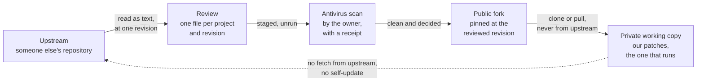

# SOP-IT-900 · Bringing in outside code: review, pin, scan, private copy


**Department:** IT · **ID:** 900 (experimental range, [`NUMBERING.md`](https://github.com/drasticstatic/my-template/blob/main/NUMBERING.md)) · **Status:** draft (approved when tagged) · **Owner:** the organisation's stewards · **Last changed:** 2026-11-12

> [!NOTE]
> **TL;DR.** Outside code travels **one way**: upstream, then a **public fork pinned at a revision someone has read as
> text**, then a **private working copy** that carries our patches and is the only copy that runs. Nothing is fetched
> from upstream into the copy that runs, and **nothing updates itself**. An update happens when there is a reason (a
> fix we need, an advisory, a break), and every update is the same three moves: **review, scan, merge**. A helper
> prepares each step; a person decides, scans and publishes.

| If you want to know | Go to |
|---|---|
| The road, in one picture | [How it works](#how-it-works) |
| What a text review looks for | [The review checklist](#the-review-checklist) |
| The antivirus step and its receipt | [SOP-IT-901](SOP-IT-901-antivirus-screening-of-outside-code.md) |
| How far behind upstream a pin sits | [Step 11](#steps) |
| What is never done | [Never](#never) |

##  Purpose
Make sure that every piece of someone else's code we run was read before it ran, at a revision that cannot move by itself, so that what runs on our machines is something a person chose and can name.

##  Scope
Any repository, tool, proxy, plugin, package or script written outside the organisation that a person or a helper wants to install, build or run on an organisation's machine. **Not covered:** routine dependency updates inside our own repositories, which follow [SOP-IT-005](SOP-IT-005-dependabot-by-the-fleet.md); the antivirus step itself, which is [SOP-IT-901](SOP-IT-901-antivirus-screening-of-outside-code.md).

##  Roles
| Role | Does |
|---|---|
|  The owner (the person whose machine will run it) | decides whether the code comes in at all, and which revision; runs the antivirus scan; pushes the public fork; installs and first runs the private copy |
|  A steward | keeps this page true; reads the review before a fork is published, when the owner asks for a second pair of eyes |
|  Helper (an agent) | reads the code **as text**, writes the review, stages the revision unrun, prepares every command as an `!` line for the owner, runs the read-only staleness report. **Never** installs, builds or runs the code under review, never runs the scan, never pushes a public repository |

##  Prerequisites
- A reason, written in one line: the need, the fix, the advisory or the break that makes this worth doing now.
- A place for reviews: a **library of reviews**, one file per project and revision, with a **public edition** that leaves out private paths and names. A private repository holds the full reviews; the public edition is published through the public-lane scanner like any other page ([SOP-OPS-003](../OPS/SOP-OPS-003-private-houses-everything-public-lanes-witness.md)).
- The fork's front door template: [`workflow-templates/FORK-FRONT-DOOR.md`](https://github.com/drasticstatic/my-template/blob/main/workflow-templates/FORK-FRONT-DOOR.md).

<a id="how-it-works"></a>

##  How it works



The same road in words:

1. **Upstream** is the original project. We read it; we never run it directly.
2. **The review** is a text file about one revision (a full commit hash). It says what the code does that matters to us, using the checklist below.
3. **The scan** is the owner's antivirus check of that same revision, staged but never run ([SOP-IT-901](SOP-IT-901-antivirus-screening-of-outside-code.md)).
4. **The public fork** sits at the reviewed revision. It is the line in the sand: it moves only when a newer revision has been reviewed and scanned the same way. Its front door, `DRASTICSTATIC.md` in this fleet (a file named after the owner's GitHub handle, in capitals), says why the fork exists, thanks upstream, and names the pin, the licence, the review and the private copy that runs it.
5. **The private working copy** is cloned from the public fork, carries our own patches, and is the only copy that runs. Its remotes point at the fork, never at upstream.

<a id="steps"></a>

##  Steps

1.  **Write the reason.** One line in the review file: why now. "A newer version exists" is not a reason on its own. *You should see:* a reason the owner agrees with, or the work stops here.
2.  **Read before fetching anything.** The helper reads the project's metadata and source as text, without cloning or running: `gh api repos/<owner>/<repo>` (age, stars, forks), `gh api repos/<owner>/<repo>/commits` (the pattern of work) and `gh api repos/<owner>/<repo>/contents/<path>` (a file's contents). Check the name letter by letter against the one you meant. The red flags are listed in the template's `CLAUDE.md`, *Before Cloning or Installing Any External Repo / Package*. *You should see:* enough to judge, or an open question, which is a stop.
3.  **Choose the revision.** The full commit hash, its date and its tag if it has one. A branch name is not a revision: it moves. *You should see:* a 40-character hash written at the top of the review.
4.  **Review it as text,** against [the checklist](#the-review-checklist). One file per project and revision, for example `<reviews-library>/<project>/<revision>.md`. Moving an existing pin? Review **the difference** between the old pin and the new one, and say so. *You should see:* every row of the checklist answered, or marked *not found* or *open*.
5.  **Stage the revision, unrun.** The helper fetches that one revision into a new, empty staging folder and checks it out, without installing, building or running anything in it:
   ```sh
   git clone <fork-or-upstream-url> <stage>
   git -C <stage> checkout --detach <revision>
   git -C <stage> rev-parse HEAD          # must print the reviewed hash
   ```
   *You should see:* the reviewed hash, and no install or build command run.
6.  **The owner scans the staged folder** with the antivirus product's own app and saves a receipt: [SOP-IT-901](SOP-IT-901-antivirus-screening-of-outside-code.md). The helper says where the folder is and waits. *You should see:* a receipt with a complete scan and a clean result. Anything else, and nothing moves on.
7.  **The owner decides.** Review and receipt together, in one sentence: in, not in, or not yet. *You should see:* the decision written at the end of the review, with its date.
8.  **Pin the public fork.** First time: fork upstream, add the front door from [`FORK-FRONT-DOOR.md`](https://github.com/drasticstatic/my-template/blob/main/workflow-templates/FORK-FRONT-DOOR.md). Moving the pin: merge the reviewed revision into the fork's branch **with a merge commit**, and change the front door's pin table **in the same commit**. Never rewrite the fork's history. The helper prepares the commit; pushing a public repository is the owner's own command. *You should see:* the fork's front door naming the hash you reviewed.
9.  **Update the private working copy from the fork only.**
   ```sh
   git -C <working-copy> remote -v        # the fork only; no upstream remote
   git -C <working-copy> fetch origin
   git -C <working-copy> merge --no-ff origin/<branch>
   ```
   Our patches stay in this copy as its own commits; the fork's new pin arrives as a merge commit, so nothing of ours is rewritten and nothing ever needs a force-push. *You should see:* no remote that points at upstream, and `git -C <working-copy> merge-base --is-ancestor <revision> HEAD && echo contains` printing `contains`.
10.  **Switch off every self-updater** the review found (an update check, an auto-install, a plugin that fetches newer code at start) in the private copy's own settings, and write in the review how it was switched off. *You should see:* the review naming each updater and its setting.
11.  **Know how far behind the pin is, read-only.** From a clone of `my-template`:
    ```sh
    sh scripts/fork-staleness.sh <forks-folder>          # no network call by default
    sh scripts/fork-staleness.sh --fetch <forks-folder>  # its only network call: git fetch upstream --tags
    ```
    It reports each fork's pin and how many commits it sits behind its upstream, and changes nothing. Being behind is not a reason to move; step 1 still decides. *You should see:* one row per fork.

<a id="the-review-checklist"></a>

##  The review checklist

A review answers each row from the code itself, with the file and line. It describes what the code does; it does not accuse anyone. "Not found" is an answer; "open" is a stop.

| # | Ask | Where to look |
|---|---|---|
| 1 |  **What do the installer and the updater fetch and run?** Is what they fetch checked against a published checksum or signature, or run as it arrives? | install scripts, `postinstall`/`prepare` hooks, build scripts, any "update" or "upgrade" command, release scripts |
| 2 |  **What address does a server bind to by default?** Every network (`0.0.0.0`) or this machine only (`127.0.0.1`)? **Is a token required by default,** and is the default token a published one? | the server's start command, its settings defaults, its example environment file |
| 3 |  **What does it write outside its own folder?** Global instruction files, global hooks, hooks inside other repositories, shell profiles, launch agents | setup and "init" commands, anything that writes under the home folder |
| 4 |  **What is logged, where, and for how long?** Can the logs hold whole conversations or keys? Is there any retention, or do rotated files pile up? | logging configuration, log paths, rotation settings, the project's `.gitignore` for its own logs |
| 5 |  **What leaves the machine?** Telemetry, analytics, crash reports, calls home, and whether each can be turned off | network calls outside the feature itself |
| 6 |  **Does an agent mode run with permission checks off?** By default, or behind a flag? | how it starts any AI agent or tool runner, and the flags it passes |
| 7 |  **Did the licence change** between the old pin and the new one? | `LICENSE`, the package metadata, a `NOTICE` file |
| 8 |  **Which dependency names are new** since the old pin, and who publishes each? Any name one letter away from a well-known one? | the lockfile and manifest, compared across the two pins |
| 9 |  **Does the source match the README?** Is the real product a separate compiled download that the source does not build? | the README beside the source; the Releases page, read but never downloaded to run |

**The public edition** of the review keeps every answer and leaves out private paths, private repository contents and people's names; it is published only after the public-lane scanner reads it.

<a id="never"></a>

##  Never

- **No self-updaters.** Nothing in the private copy updates itself; every update comes down this road.
- **No installer piped from the network** (`curl … | sh` and its kind). If the project offers only that, read the script as text, review it, and run the reviewed copy, or do not install.
- **No fetch from upstream into the copy that runs.** The private copy has no upstream remote.
- **No force-push,** on the fork or the private copy. A pin moves by a merge commit.
- **No running a release binary "just to check".** Reading the source and metadata is enough to judge; if it is not, the answer is no.
- **No helper-run scan, install, build or first run.** Those are the owner's.
- **Nothing deleted.** A retired fork stays, marked retired in its front door.

##  Verification
For each outside project that runs: a review file exists for the pinned revision; a receipt from [SOP-IT-901](SOP-IT-901-antivirus-screening-of-outside-code.md) names the same revision; the public fork's front door names the same hash; `git -C <working-copy> remote -v` shows the fork and no upstream; the review lists each self-updater and how it was switched off.

##  Troubleshooting
| Symptom | Likely cause | What to do |
|---|---|---|
| The private copy's remotes include upstream | it was cloned from upstream, or a remote was added later | remove nothing in a hurry: rename that remote out of use, then point `origin` at the fork; write it in the review |
| The fork cannot move to the new revision without rewriting history | the fork's branch was rebased or force-pushed earlier | stop; merge the reviewed revision with a merge commit, never force; ask a steward if the history is unclear |
| The project changed its licence between pins | a real change upstream | the owner decides before anything moves; the review says what changed |
| `fork-staleness.sh` shows a fork far behind | upstream kept working | nothing, unless step 1 gives a reason |
| The only install route is a piped script | the project's own choice | read the script as text, review it, run the reviewed copy; or do not install |

##  Related
- SOP: [SOP-IT-901](SOP-IT-901-antivirus-screening-of-outside-code.md) (antivirus screening and its receipt), [SOP-IT-005](SOP-IT-005-dependabot-by-the-fleet.md) (our own dependency updates), [SOP-IT-007](SOP-IT-007-the-machines-three-guards.md) (the machine's guards), [SOP-OPS-003](../OPS/SOP-OPS-003-private-houses-everything-public-lanes-witness.md) (how a public edition leaves).
- In `my-template`: `CLAUDE.md`, *Before Cloning or Installing Any External Repo / Package*; `workflow-templates/FORK-FRONT-DOOR.md`; `scripts/fork-staleness.sh` (described in `scripts/README.md`).

##  Change log
| Date | Change | By |
|---|---|---|
| 2026-11-12 | Drafted in the experimental range, from two text reviews of outside projects done that day: the one-way road, the review checklist, the scan, the pin and the private copy, and what is never done | Alfred (Claude Code CLI) |
