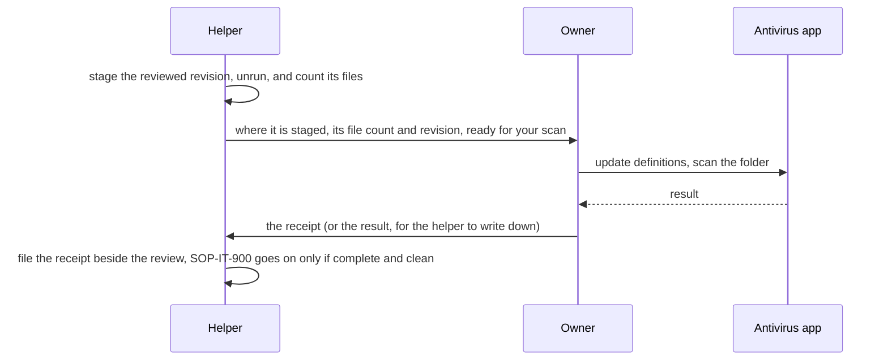

# SOP-IT-901 · Antivirus screening of outside code, and its receipt


**Department:** IT · **ID:** 901 (experimental range, [`NUMBERING.md`](https://github.com/drasticstatic/my-template/blob/main/NUMBERING.md)) · **Status:** draft (approved when tagged) · **Owner:** the organisation's stewards · **Last changed:** 2026-11-12

> [!NOTE]
> **TL;DR.** Before outside code is installed, built or run, **the owner scans a staged copy of the reviewed revision
> by hand, in the antivirus product's own app,** and saves a **receipt**: what was scanned, its path and file count,
> the product and its definitions date, the result, and the time. A helper stages the folder, says where it is, and
> **waits**: it never runs the scan, and it warns before anything that mounts a disk or raises a prompt. A partial
> scan counts as no scan. **A clean scan is not a review**: the text review of [SOP-IT-900](SOP-IT-900-bringing-in-outside-code.md) still decides.

##  Purpose
Check the exact files we are about to trust against what the machine's antivirus already knows, before any of them runs, and keep a short record that anyone can read later.

##  Scope
Step 6 of [SOP-IT-900](SOP-IT-900-bringing-in-outside-code.md): every revision of outside code, the first time and every time a pin moves. It applies to whatever antivirus product the machine runs; [SOP-IT-007](SOP-IT-007-the-machines-three-guards.md) describes the one this fleet uses as a worked example. **Not covered:** scheduled whole-machine scans, and what to do about a product's own settings.

##  Roles
| Role | Does |
|---|---|
|  The owner (the person at the machine) | runs the scan in the product's own app; reads the result; fills in the receipt, or reads it back when the helper drafts it; decides what happens after a finding |
|  Helper (an agent) | stages the folder, counts its files, drafts the receipt's first lines, says where the folder is, then waits. **Never** runs a scan, never drives the product's window, never uses a command-line scanner, and never moves on before the owner's receipt exists |
|  A steward | keeps the receipt template true; reads receipts when a review is offered to the organisation |

**Why the helper never runs it.** The fleet relies on no command-line scanner for this product, so the only scan the fleet counts is the one the owner starts in the app. Running a scan can also raise a prompt on the screen, and in this fleet anything that mounts a disk or raises a prompt gets a warning first and is the owner's to run.

##  Prerequisites
- A finished text review of the revision ([SOP-IT-900](SOP-IT-900-bringing-in-outside-code.md), step 4).
- The antivirus product installed, with its definitions brought up to date by its own updater before the scan.
- A new, empty staging folder, outside every repository, outside any synced folder, and not on a mounted image the helper would have to mount.

##  How it works



##  Steps

1.  **The helper stages the revision** as in [SOP-IT-900](SOP-IT-900-bringing-in-outside-code.md), step 5, and confirms the hash: `git -C <stage> rev-parse HEAD`. *You should see:* the reviewed hash. Nothing has been installed or built in the folder.
2.  **The helper counts what is there,** so the receipt can say what was scanned:
   ```sh
   find <stage> -type f | wc -l
   ```
   *You should see:* one number. It counts the files under `.git` too, which the scan should also cover.
3.  **The helper hands over and waits.** One message: where the folder is, the revision, the file count, and *"the scan may raise a prompt on your screen."* Then it stops. *You should see:* the owner's reply, not the helper carrying on.
4.  **The owner updates the definitions,** in the product's own app. *You should see:* the definitions date, which goes on the receipt.
5.  **The owner scans the staged folder,** in the product's own app, the whole folder, hidden files included. *You should see:* the product's summary: how many items it looked at and what it found.
6.  **Write the receipt** (the template is below) and file it beside the review, in the private library of reviews. *You should see:* every field filled. A field the product does not show is written as *not shown*, never guessed.
7.  **Decide.** Complete and clean: [SOP-IT-900](SOP-IT-900-bringing-in-outside-code.md) continues at step 7. Anything else: stop (see Troubleshooting). *You should see:* the receipt's last line saying which.

##  The receipt

One receipt per revision scanned. Copy this block into a file beside the review, for example `<reviews-library>/<project>/<revision>.receipt.md`:

```text
ANTIVIRUS RECEIPT
Project:            <project name>
Revision scanned:   <full commit hash>   (tag <tag, if any>)
Staged at:          <the staging folder's path>          # private: left out of the public edition
Files in folder:    <N>   (find <stage> -type f | wc -l, .git included)
Product:            <antivirus product and version>
Definitions date:   <YYYY-MM-DD, as the product shows it>
Scan started:       <YYYY-MM-DD HH:MM, time zone>
Scan finished:      <YYYY-MM-DD HH:MM, time zone>
Items examined:     <as the product reports, or "not shown">
Complete:           <yes | no: why>
Result:             <clean | N findings: what the product named, and where>
Scanned by:         <the owner, by role>
Receipt written by: <who wrote this block>
Decision:           <continue to SOP-IT-900 step 7 | stop: why>
```

**The public edition** of a receipt keeps every line but *Staged at*, which holds a private path. The receipt holds no key, no token and no account name.

##  Never

- **A helper never runs the scan,** never drives the product's window, and never uses an undocumented or third-party scanner in its place.
- **Nothing runs before the receipt.** No install, build, test run or "quick look" in the staged folder.
- **A partial scan is not a scan.** Stopped early, an unreadable folder, a timeout: the receipt says *Complete: no*, and nothing moves on.
- **A finding is never trusted away in a hurry.** Adding the folder to the product's trusted list to make a finding disappear is not allowed; the owner decides what a finding means.
- **No self-updater, no piped installer, no force-push,** as in [SOP-IT-900](SOP-IT-900-bringing-in-outside-code.md). Nothing is deleted: a rejected staging folder is moved aside and named, and the product's own quarantine is left to the product.

##  Verification
For every pinned revision of outside code: a receipt exists beside its review, names the same hash as the review and the fork's front door, says *Complete: yes* and *Result: clean*, and its *Scan finished* time is earlier than the first install or run.

##  Troubleshooting
| Symptom | Likely cause | What to do |
|---|---|---|
| The product reports a finding | a known-bad file, or a false alarm | stop; the owner reads the product's own description of the finding; the review records it; nothing runs until the owner decides, and a second opinion from a steward is welcome |
| The scan stops part-way, or skips files | permissions, a folder the product cannot read, or the scan was cancelled | *Complete: no*; fix the cause (a staging folder inside the home folder, not inside a synced or protected one) and scan again |
| The definitions date is old | the product's updater has not run | update first, in the product's own app; then scan |
| The file count and the product's item count differ | products count differently (an archive as one item or many) | write both down; a difference alone is not a finding |
| A prompt asks for access to a folder | the operating system guarding a protected place | the owner answers it; the helper had warned it might come |

##  Related
- SOP: [SOP-IT-900](SOP-IT-900-bringing-in-outside-code.md) (the whole road), [SOP-IT-007](SOP-IT-007-the-machines-three-guards.md) (the antivirus on a Mac, as a worked example, with its vendor's pages).
- In `my-template`: `CLAUDE.md`, *Screen the staged copy before anything runs*; `workflow-templates/FORK-FRONT-DOOR.md` (the receipt's line in the pin table).

##  Change log
| Date | Change | By |
|---|---|---|
| 2026-11-12 | Drafted in the experimental range: the owner scans, the helper stages and waits, the receipt and its public edition | Alfred (Claude Code CLI) |
