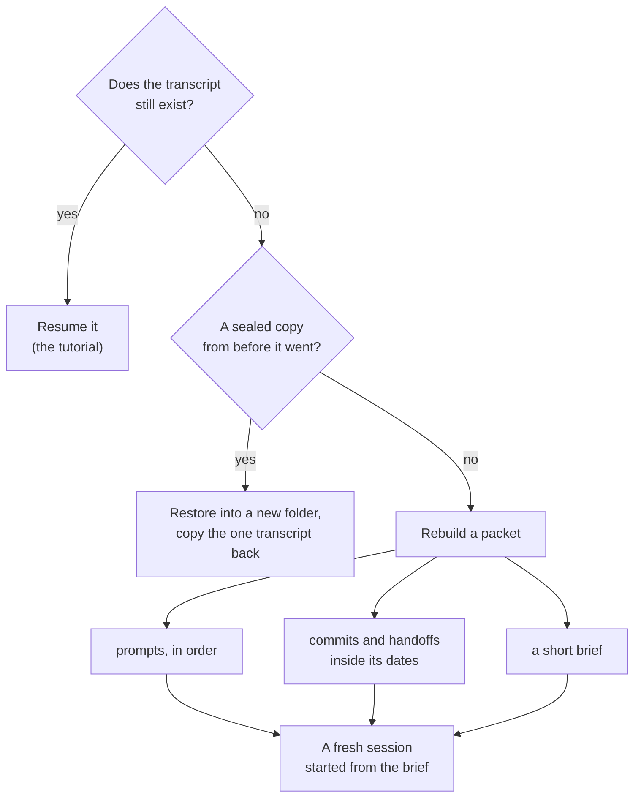

# SOP-IT-902 · Salvaging a session whose transcript is gone


**Department:** IT · **ID:** 902 (experimental range, [`NUMBERING.md`](https://github.com/drasticstatic/my-template/blob/main/NUMBERING.md)) · **Status:** draft (approved when tagged) · **Owner:** the organisation's stewards · **Last changed:** 2026-11-12

> [!NOTE]
> **TL;DR.** Claude Code keeps each session's transcript as a local file and deletes old ones after
> `cleanupPeriodDays` (30 days by default). Your typed prompts are kept separately, in a history file the sweep leaves
> alone. When a transcript is gone, first look for a sealed copy; if there is none, **rebuild a packet**: the prompts
> in order, what the session left behind in commits and handoffs inside its dates, and a short brief to start a fresh
> session from. A packet is **always marked as rebuilt** and never passed off as the original.

| If you want to know | Go to |
|---|---|
| Is it really gone? | [Step 1](#steps) |
| A copy exists: put it back | [Step 2](#steps) |
| No copy: what goes in the packet | [The packet](#the-packet) |
| What a resumed long session remembers | [Step 9](#steps) |

##  Purpose
Recover as much as can honestly be recovered of a Claude Code session whose transcript has been deleted, and start the work again from a record that says plainly what it is.

##  Scope
Claude Code sessions on a person's own machine. **Not covered:** keeping transcripts longer and sealing a nightly copy, which is [SOP-IT-010](SOP-IT-010-how-we-keep-our-data.md); finding and resuming a session whose transcript still exists, which is the tutorial *Find, resume or rebuild an old session* in `my-template/tutorials/`.

##  Roles
| Role | Does |
|---|---|
|  The person whose session it was | decides whether to salvage at all, which session, and where the packet lives; restores a sealed copy; starts the fresh session; decides whether any of it is ever shared |
|  Helper (an agent) | with the person's yes, reads the history file for that session's dates and folder only, gathers commits and handoffs, writes the packet and its brief. **Never** prints a key or token it finds in a prompt (it names the line, not the value), never edits a transcript or the history file, never publishes a packet |
|  A steward | keeps this page true |

##  Prerequisites
- The session's ID, or enough to find it: the folder it ran in, roughly when, a few words you typed.
- The repositories it worked in, cloned and up to date (`git pull --rebase --autostash`).

##  How it works



<a id="steps"></a>

##  Steps

1.  **Make sure it is gone.** From any folder, `claude --resume <session-id>`. Claude Code looks in the current project, then every other project on the machine, and reports `No conversation found with session ID: <session-id>` when none holds it. *You should see:* either the session (stop here and use the tutorial) or that message.
2.  **Look for a sealed copy first.** If a nightly archive ran before the transcript was swept, restore the newest chain into a **new, empty folder**, never over `~/.claude` ([SOP-IT-010](SOP-IT-010-how-we-keep-our-data.md), part 2). Copy the one transcript back to `~/.claude/projects/<project>/<session-id>.jsonl`, where `<project>` is the start folder's path with every character other than a letter or a digit turned into `-`. Keep **one** copy only: Claude Code refuses to resume an ID by its cross-project search when two projects hold it. *You should see:* the session listed by `claude --resume` from its folder (observed on one machine on 2026-11-12; Claude Code's documentation says only that `claude --resume <transcript-path>` resumes from a transcript's absolute path). If a copy came back, stop here.
3.  **Gather the prompts, in order.** `~/.claude/history.jsonl` holds the prompts you typed, each with its time and the project's path, and the retention sweep does not remove it (the documentation names one exception, a configuration some organisations run under, where old entries are swept too). The helper reads only the lines for that session's folder and dates:
   ```sh
   grep -F '<the project path>' ~/.claude/history.jsonl | grep -F '<a few words you remember>'
   ```
   The line format is Claude Code's own and not documented, so read it; do not build a tool on it. *You should see:* your prompts, oldest first. If one holds a key or token, the helper names its line and leaves the value out of the packet.
4.  **Gather what it left behind in git,** inside its dates, in each repository it touched:
   ```sh
   git log --since=<first day> --until=<day after the last> --format='%h %ad %s%n  %(trailers:key=Claude-Session,valueonly)' --date=iso
   ```
   *You should see:* the commits it made, each with its session line; the ones carrying this session's ID are certain, the rest are context.
5.  **Gather its handoffs and notes,** inside the same dates: the repository's handoff lanes, its `created-by-*/` folders ([the lanes](https://github.com/drasticstatic/my-template/blob/main/AGENT-SYNC/README.md)), and the project's auto memory folder, `~/.claude/projects/<project>/memory/` (the sweep does not remove it). *You should see:* the handoffs it wrote and the ones it read.
6.  **Write the packet** ([below](#the-packet)), marked as rebuilt on its first line. *You should see:* four short files and a header that no reader could take for the original.
7.  **File it privately,** where the person decides: the repository's own `created-by-<you>/` handoff lane, or a private vault's folder for rebuilt packets. Prompts can hold anything that was typed, so a packet is private material. *You should see:* the packet committed in a private repository, never in a public one.
8.  **Start a fresh session from the brief,** in the right folder: `cd <repo> && claude`, then *"Read `<packet>/brief.md` and the latest handoff, then tell me where we stand before doing anything."* *You should see:* a session that knows the decisions and the state of the work, says what it cannot know, and asks before acting on anything the brief leaves open.
9.  **Know what a resumed long session remembers,** whether it came back in step 2 or is resumed later. A compacted session reopens at a *Conversation compacted* row and carries on with the last summary, the messages that summary left out, and everything since; the messages the summary covered are not loaded again. So point it at its latest handoff first. *You should see:* the session confirm it has read the handoff before it acts.

<a id="the-packet"></a>

##  The packet

A folder named `<short-id>_<title>/`, holding:

| File | Holds |
|---|---|
| `README.md` | the header below; the session's ID, folder and dates; where each part came from |
| `prompts.md` | the prompts in order, each with its time; any secret named by line, never shown |
| `left-behind.md` | the commits (hash, date, subject) and the handoffs and notes, inside the session's dates, each with its path |
| `brief.md` | a page at most: what the session was for, what it decided, what it finished, what was open, and what this record cannot know |

The first lines of `README.md`, always:

```text
REBUILT on <YYYY-MM-DD> from prompts, commits and handoffs. Not the original transcript.
Session <session-id>, started in <folder>, <first date> to <last date>.
What is missing: Claude's replies, tool output, anything decided aloud and not written down.
```

##  Never

- **Never pass a packet off as the original,** and never write Claude's replies into it from memory.
- **Never edit or tidy** a restored transcript or the history file; they are read, not changed.
- **Never publish a packet,** or copy it to a public lane; it holds what was typed.
- **Delete nothing:** not the history file, not a duplicate transcript (move it aside instead), not an old packet. No force-push of the repository the packet is filed in.

##  Verification
The packet's `README.md` opens with the REBUILT line; every prompt in `prompts.md` has its time; every commit in `left-behind.md` exists in its repository (`git cat-file -t <hash>` prints `commit`); the packet is committed in a private repository; the fresh session's first reply says what it read.

##  Troubleshooting
| Symptom | Likely cause | What to do |
|---|---|---|
| `claude --resume <id>` says *No conversation found* after a copy was put back | two copies of the transcript in two project folders, or the wrong project folder name | keep one copy (move the other aside); check the folder name against the start folder's path |
| No prompts for that folder in the history file | the session started in another folder (a parent folder, say), or it was a non-interactive run | search by words instead of path; check the parent folders |
| Commits exist but carry no session line | a person committed them, or the trailer was missing | list them as context, not as the session's own |
| The fresh session acts on something the brief does not say | the brief left a gap | stop it; add the gap to the brief as *open*; start again |

##  Related
- SOP: [SOP-IT-010](SOP-IT-010-how-we-keep-our-data.md) (retention and the nightly sealed copy), [SOP-IT-006](SOP-IT-006-renaming-a-local-folder.md) (a renamed folder strands sessions).
- In `my-template`: `tutorials/FIND-RESUME-OR-REBUILD-A-SESSION.md`, `walkthroughs/CLAUDE-PROJECTS-ARCHIVE.md`.

*Read on 2026-11-12, Anthropic's Claude Code documentation:* [Manage sessions](https://code.claude.com/docs/en/sessions) (where transcripts are stored and how `<project>` is named; `--resume` by ID from any folder, the order it looks in, the duplicate rule and the *No conversation found* message; `--resume <transcript-path>`; what a resumed session restores after compaction) and [Explore the .claude directory](https://code.claude.com/docs/en/claude-directory) (`cleanupPeriodDays`, 30 days by default, minimum 1; what the sweep deletes; `history.jsonl` holds typed prompts with time and project path and is kept until you delete it; auto memory is not swept; transcripts and history are plaintext). That a transcript copied back into its project folder is listed for resuming was observed on one machine on 2026-11-12 and is not stated in the documentation. The packet's shape and the REBUILT line are the fleet's practice.

##  Change log
| Date | Change | By |
|---|---|---|
| 2026-11-12 | Drafted in the experimental range: is it gone, a sealed copy first, the packet and its REBUILT header, starting fresh, what a resumed long session remembers | Alfred (Claude Code CLI) |
