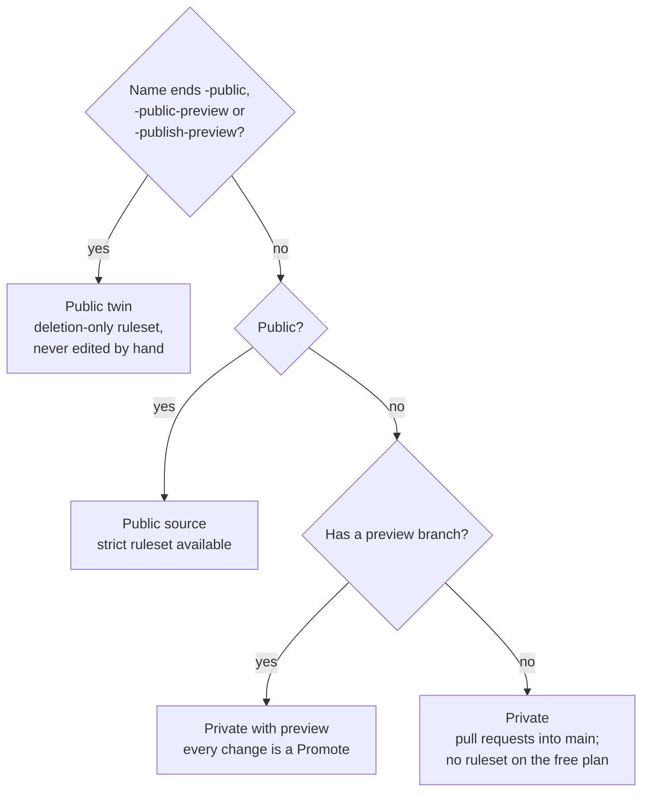

#  Legend: how each repository is guarded

**TL;DR:** one table per GitHub owner, one row per repository, saying whether `main` is protected, whether a `preview`
branch exists, which merge methods are allowed, whether Pages serves it, and whether it is a public twin. It is generated by
[`scripts/legend.sh`](scripts/legend.sh), which only reads. SOP-OPS-002 explains what each repository *type* means for you;
this page is the per-repository fact sheet behind it.

> **Names may be public; contents stay private.** Since 2026-11-01 every repository's *name* may appear publicly
> (`my-template/NAMES-POLICY.md`), so the full output may be pasted in a private or a public page. Use `--public-only`
> when a page should list only what a visitor can actually open.

##  Which kind is this repository?



##  Regenerate

```sh
sh scripts/legend.sh <owner> [<owner>...]                 # private SOP repository: everything the signed-in account can see
sh scripts/legend.sh --public-only <owner> [<owner>...]   # anything visitors can read
```

Paste the output below the line at the end of this page, replacing the previous run. The first line of the output is a
comment with the time it was generated (UTC). Rerun after changing a ruleset, a merge setting, Pages, or after creating a
repository. It needs `gh` signed in as someone who can see the repositories; merge methods show only for repositories
where that account is an administrator (`?` otherwise).

##  Columns

| Column | Values | Means |
|---|---|---|
| Visibility | `public` · `private` · `internal` | who can read it |
| Default | a branch name | the branch GitHub opens first (normally `main`) |
| preview branch | `yes` · `—` | a `preview` branch exists: changes rehearse there and reach `main` by a Promote (SOP-OPS-001) |
| Rulesets | `name:enforcement[rule types]`, `—`, `not on this plan` | GitHub rulesets on the repository and what each enforces: `[deletion]` is the twins' deletion-only set; `[deletion+non_fast_forward]` is the strict set (no deletion, no force-push). Both template files are named `main-branch-protection`, so read the rule types, not the name. `not on this plan`: the free plan offers no protection on private repositories (personal or organisation) |
| Merge methods | `merge`, `squash`, `rebase`, `?` | what the merge button allows. The fleet's proposals and procedures repositories show `merge` only (SOP-OPS-002) |
| Pages | `yes` · `—` | GitHub Pages publishes it as a website |
| Public twin | `yes` · `—` | the name ends `-public`, `-public-preview` or `-publish-preview`: it receives a sync or a site build, carries a deletion-only ruleset, and is never edited by hand |

##  What a healthy row looks like

| Repository | Visibility | Default | preview branch | Rulesets | Merge methods | Pages | Public twin |
|---|---|---|---|---|---|---|---|
| `proposals` | private | `main` | — | not on this plan | merge | — | — |
| `<site>` (the workshop) | private | `main` | yes | not on this plan | merge | — | — |
| `<site>-publish-preview` | public | `main` | — | `main-branch-protection:active[deletion]` | merge | yes | yes |
| `<site>-public` | public | `main` | — | `main-branch-protection:active[deletion]` | merge | yes | yes |
| `.github` | public | `main` | — | `main-branch-protection:active[deletion+non_fast_forward]` | merge | — | — |

(Illustrative rows with placeholder names. A twin showing `—` under Rulesets still needs its deletion-only ruleset; a twin
showing `non_fast_forward` in its rule types will break its own sync. Both are worth a pull request to the steward.)

---

<!-- paste the output of scripts/legend.sh below this line -->
