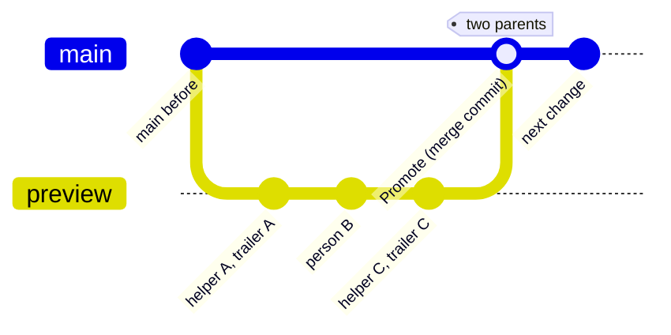

# SOP-OPS-002 · Pull requests and Promotes: who opens, who merges, merge not squash, getting the link

**Department:** OPS · **ID:** 002 · **Status:** draft (approved when tagged) · **Owner:** repository steward · **Last changed:** 2026-10-31

##  Purpose
A pull request is how a change asks to move. Helpers may prepare everything up to the merge; a human merges. This procedure says how to open one, how to get the link without understanding git, and why the fleet merges with a merge commit and never squashes.

##  Scope
Every fleet repository. Private repositories cannot enforce branch protection on the free plan (personal or organisation; the legend below has the detail), so there the rule is a working agreement enforced by permissions and habit, not by GitHub; public repositories, and private organisation repositories once the organisation is on Team, can add a ruleset (`my-template/branch-protection/ruleset.json`).

##  Roles
| Role | Does |
|---|---|
| Helper (Claude Code CLI, Littlebird, any agent) | commits on the working branch, opens the pull request, writes the description, posts the link; **does not merge** |
| Human with the merge role | reads, merges with a merge commit |
| Officer | decides repository settings (merge methods, rulesets) |

##  Prerequisites
A GitHub account signed in; for a helper, an authorised connection (SOP-IT-002). The repository's working branch is known (`preview` where it exists, otherwise a short-lived branch).

##  Steps: getting a pull request link
1. **Ask your helper**: "open the Promote for <repository>" or "open a pull request for this change". *You should see:* a link of the form `https://github.com/<owner>/<repo>/pull/<n>`.
2. In the terminal, the helper runs:
   ```sh
   gh pr create --base main --head preview --title "Promote: <what>" --body "<what moves and why>"
   ```
   *You should see:* the same link printed.
3. In the browser: open the repository, click **Pull requests**, then the one with your title. *You should see:* **Files changed** lists exactly the pages you expect.
4. Read the pages on `preview` (the **Files changed** tab shows the differences; the branch itself shows the whole page).
5. Merge with **Create a merge commit**. Do not choose **Squash and merge**. *You should see:* "Pull request successfully merged"; `main` now carries each commit from `preview`.

##  Why merge, never squash
Every commit in this fleet carries who made it and under which session (`Co-Authored-By` and the session trailer). A squash folds many commits into one and erases that record; a merge commit keeps it.



With a **merge commit** (above) `main` gains one extra commit with **two parents**, and every commit from `preview`, each with its own author and trailers, is in `main`'s history. A **squash** would instead put one new commit on `main` with **one parent**, authored by whoever clicked the button, and the three commits above would exist only on `preview`. The Holy Earth Foundation's repositories are set to merge only; other organisations should match. An officer sets it with:
```sh
gh api -X PATCH repos/<owner>/<repo> -F allow_squash_merge=false -F allow_rebase_merge=false -F allow_merge_commit=true
```
(The fleet's proposals and procedures repositories were set to merge commits only on 2026-10-31; each organisation keeps its own list in its private copy of this procedure.)

**Turn off squash and rebase on every repository, including new ones.** GitHub has no organisation-wide default for merge methods: every new repository starts with merge commit, squash and rebase all allowed, and rebase-merge drops the merge commit just as squash does. From a clone of `my-template`, after creating any repository:
```sh
sh scripts/set-merge-methods.sh --fix <owner>/<repo>     # squash off, rebase off, merge commit on
sh scripts/set-merge-methods.sh --audit <owner>          # read-only; exits 1 if any repository drifted
```
Repositories that keep another method on purpose go in `my-template/scripts/merge-methods-exceptions.txt`, with the reason. **The stronger option, where a ruleset is allowed** (see the legend below): a ruleset's *Require a pull request before merging* rule takes `allowed_merge_methods: ["merge"]`, and GitHub then blocks any other merge even if the repository setting drifts. Not applied by the template; an officer adds it.

**Merge commits only, set on 2026-10-31** (squash and rebase off, merge commit on; read back from the API the same day) on these twelve:

| Kind | Repositories |
|---|---|
| Proposals (7) | each organisation's own repositories of this kind (listed in its private copy) |
| Procedures (5) | the `ops-standard-operating-procedures` repositories of THEF, the lab desk (`-thef`), PIR, Psanctuary and O-R-G |

**Before the setting changed, some Promotes were squashed.** A check on 2026-10-31 looked only at the latest Promotes and found two-parent merges; a full audit on 2026-11-01 found earlier squashes. What that cost, and how it was recovered, is in **Honest history** below.

##  Guardrails on our repositories

**Guardrails, not distrust.** Everyone who helps gets real access. These two rules sit on the main branch so that a slip by anyone, person or helper, cannot undo work. They stay while we all learn the road together.

| Rule | What it blocks | Who can get past it |
|---|---|---|
| **Merge commits only** | A pull request can be merged only with a merge commit. Squash and rebase merges are refused, so every commit keeps its author. | Repository admins may still push directly to `main`. |
| **No force-push, no deletion** | Rewriting the history of `main`, or deleting `main`. | Nobody, admins included. |

**Where they apply today:** the `brand-assets` repository of every organisation we serve, as a pilot from 2026-11-10. If it causes no trouble, the same two rules go on the other public repositories. Private repositories cannot carry rulesets on GitHub's free plan; there, the merge settings and habit keep the rule (see the legend below).

**If a push is refused:** do not force it, and do not look for a way around it. Push to a branch, open a pull request (the steps above), and a person with the role merges it with a merge commit. If you believe the rule is wrong for this case, stop and ask.

**To ask for a change:** open an issue in this repository or tell a steward, naming the repository, the rule and the reason. A steward with admin rights edits the ruleset on GitHub, never deletes it, and records the change in the change log below.

**For stewards:** both rules are kept as files in `my-template/branch-protection/` (`ruleset-merge-commits-only.json` and `ruleset-no-force-push.json`). Apply one with `gh api -X POST repos/OWNER/REPO/rulesets --input FILE`. Never put the no-force-push rule on a public twin that a sync force-pushes into; twins take the deletion-only file.

##  Legend: what is protected, and what runs on pull requests
GitHub's free plan decides much of this, so the rule depends on what kind of repository you are in. Find your row.

| Repository type | Branch protection or ruleset | Runs on pull requests? | Merge method | Who merges |
|---|---|---|---|---|
| **Private, personal account** (a lab desk such as `proposals-thef`, Bushido, a bot) | **none possible** on the free plan (GitHub answers "Upgrade to GitHub Pro"); the rule is kept by habit and by who holds write | where a `preview` branch exists: yes, every change reaches `main` by a Promote. Working repositories without `preview` take the owner's commits on `main` directly | merge commit | the owner |
| **Private, organisation** (`proposals`, `ops-standard-operating-procedures`, a site workshop) | **not on the free plan either**: GitHub refuses rulesets on private repositories until the organisation is on Team (GitHub for Nonprofits gives Team free once incorporation is confirmed). Until then, permissions and habit | yes: helpers open the pull request (from `preview`, or a short-lived branch where there is no `preview`); a human merges | merge commit only (the twelve above) | a human with the merge role, never a helper |
| **Public, organisation or personal** (`.github`, `my-template`, a profile or docs site) | **ruleset available**: the strict one, `my-template/branch-protection/ruleset.json` (no deletion, no force-push) | site repositories whose working branch is `main`: a short-lived branch and a pull request. Template and profile repositories: the owner's commits on `main` | merge commit | the owner or a human with the role |
| **Public twin** (names ending `-public`, `-public-preview`, `-publish-preview`) | **deletion-only ruleset**: the sync or the site build force-pushes into it, so a no-force-push rule would break publishing (`my-template/branch-protection/`) | **never.** Nobody edits a twin by hand; change the source repository's allowlist or content instead | none: it only receives | the workflow |
| **Site with lanes** (a private workshop with `preview`, feeding a rehearsal twin and a live twin; SOP-OPS-001) | as its row above (private organisation) for the workshop; deletion-only on both twins | yes: every change is a Promote from `preview`; CI flags anything else reaching `main` | merge commit | a human with the role; merging rebuilds the live site |

**The per-repository legend** is generated, not typed: `sh scripts/legend.sh <owner> [<owner>...]` prints one table per owner (visibility, default branch, whether a `preview` branch exists, rulesets, merge methods allowed, Pages, whether it is a public twin). It only reads. Repository names may be public (`my-template/NAMES-POLICY.md`); use `--public-only` when a page should list only what a visitor can open. `LEGEND.md` beside this repository's README says how to read and regenerate it.

##  Honest history: auditing past merges for squashes

A procedure that says "never squash" should say plainly whether the organisation ever did. Each organisation runs this audit once, records the result in a members-only page beside this procedure (`OPS/SOP-OPS-002-honest-history.md`, never on `PUBLIC-ALLOWLIST.txt`, because this procedure itself usually goes public), and reruns it after any doubt.

###  How to audit (read-only; run under `sh`)
```sh
org=<org>
for r in $(gh repo list $org --limit 200 --json name --jq '.[].name'); do
  gh pr list -R $org/$r --state merged --limit 200 --json number,title,mergeCommit \
    --jq '.[] | "\(.number)\t\(.mergeCommit.oid)\t\(.title)"' |
  while IFS="$(printf '\t')" read -r n oid title; do
    p=$(gh api repos/$org/$r/commits/$oid --jq '.parents|length')
    [ "$p" = 1 ] && echo "$r #$n squashed (one parent): $title"
  done
done
```
- **Two parents** = a merge commit: every commit from the branch reached `main` with its author and trailers.
- **One parent** = a squash (or a rebase). For each one, list the pull request's commits (`gh api repos/<org>/<repo>/pulls/<n>/commits`) and their `Co-Authored-By` and session lines: those are whose attribution was folded.
- **Then check whether it came back:** for each of those commits, `gh api repos/<org>/<repo>/compare/<sha>...main --jq .status` prints `ahead` or `identical` when the commit is in `main`'s history today.
- Run loops under `sh`, not zsh: zsh does not split `$shas` on newlines, and a loop silently checks one "commit" made of every SHA.

###  What a squash costs, and how it can come back (a worked example)

> Generic, from a real audit in this fleet; each organisation keeps its own table in a members-only page.

A site repository had four Promotes squashed over two days, before merge commits only was set. Each squash commit:
- was **authored by the person who clicked merge**, though the pull request held 7 to 25 commits by a person, a helper and dependabot;
- kept the helpers' `Co-Authored-By` lines **only as text in its body**. GitHub's squash message ends with a `---------` divider and dependabot's sign-off; git stops reading trailers at that divider, so `git interpret-trailers --parse` found **no** trailers on any of them;
- left `git log --first-parent main` showing one author where there had been several.

**It came back** because `preview` was never reset: the next Promote was a merge commit, and it carried every original commit from `preview` into `main`'s history with its own author and trailers. The audit found every commit of every squashed pull request in `main`'s history. What remains is cosmetic: each change appears twice (the squash commit on the first-parent line, the originals through the later merge), and `git blame` may credit the squash author. **Nothing is rewritten and nothing is force-pushed** to tidy it.

| Record per squash | Example |
|---|---|
| repository, pull request, merged at | `<site>` #`<n>`, `<YYYY-MM-DD hh:mm>` UTC |
| commits in the pull request, by whom | 20 (6 dependabot, 14 a person with a helper) |
| squash commit, its author, the trailers git reads | `<sha>`, the merger, none |
| commits now in `main`'s history | 20 of 20 (restored by the next merge commit) |

##  What changed for helpers in October 2026
Claude Code CLI sessions in the fleet were given permission to do everything up to the merge: edit, commit, push the working branch, render, open the pull request and post its link. The merge itself waits for a human with the role. Littlebird works the same way through her own connection. A helper that cannot push (network, permissions) says so and hands back the commands.

##  Verification
The pull request page shows **Merged** with a merge commit; `git log --merges -1 origin/main` shows it; the authors of the merged commits are unchanged.

##  Troubleshooting
| Symptom | Likely cause | What to do |
|---|---|---|
| "not fast-forward" when the helper pushes | someone (or a workflow, such as the PDF renderer) committed to the branch meanwhile | `git pull --rebase --autostash`, then push again; never force |
| The merge button offers only "Squash and merge" | the repository's merge methods were changed | an officer restores merge commits with the command above |
| The helper's push or `gh` hangs | the network resolver is stalling (SOP-IT-001) | wait, or switch DNS; the helper hands back the commands |
| A pull request from a helper carries no attribution | the commit hook was not installed in that clone | `sh scripts/install-hooks.sh` in the clone; amend before pushing if not yet pushed |

##  Related
- SOP-OPS-001 (the road), SOP-IT-001 (resolver stalls), SOP-IT-002 (helper access)
- Proposal: THEF 013 *Procedures beside proposals*; `my-template/AGENT-SYNC/README.md` (the attribution spec)

##  Change log
| Date | Change | By |
|---|---|---|
| 2026-10-30 | Drafted after the first Promotes on `proposals-thef` and `bushido-code` | Alfred |
| 2026-10-31 | Merge commits only on the twelve proposals and procedures repositories (one PATCH each, read back); the five earlier Promotes verified as two-parent merges; the legend by repository type; `scripts/legend.sh` | Alfred |
| 2026-11-01 | Lucid pass (icons, a `gitGraph` of a merge commit); **Honest history**: the squash audit, what a squash costs and how a later merge restores it, with a generic worked example; the 2026-10-31 "no attribution was lost" corrected (it checked only the latest Promotes); names may be public | Alfred |
| 2026-11-01 | Each organisation's audit result goes on a members-only page beside this procedure (`SOP-OPS-002-honest-history.md`), not in this procedure, which usually travels to the public twin | Alfred |
| 2026-11-10 | **Guardrails on our repositories**: merge-commits-only and no-force-push rulesets, piloted on `brand-assets` in every organisation | Alfred |
