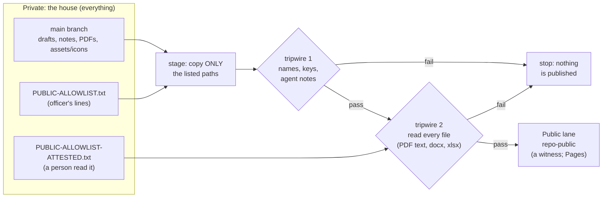
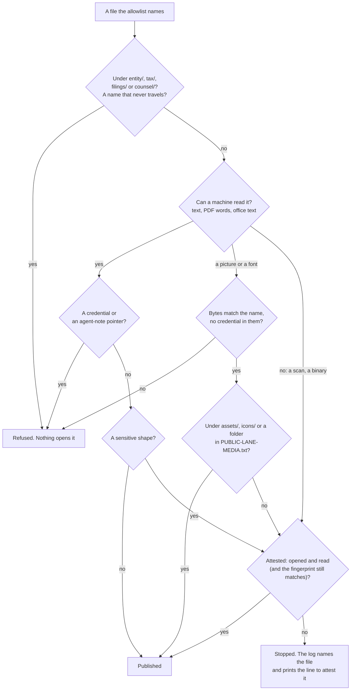
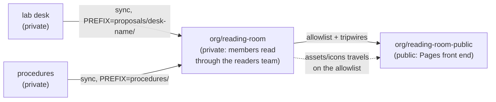
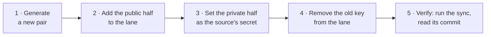

# SOP-OPS-003 · Private houses everything, public lanes witness


**Department:** OPS · **ID:** 003 · **Status:** draft (approved when tagged) · **Owner:** repository steward; officers decide each allowlist line · **Last changed:** 2026-11-02

##  Purpose
Everything the organisation writes lives first in a **private** repository: the house. A **public lane** (a repository whose name ends `-public`) is a witness: it carries only the pages an officer listed, copied by a machine after a tripwire, and nobody edits it by hand. This procedure says how a page reaches a public lane, how the reading room is built from the same mechanism, and why its icons never go stale.

##  Scope
Every private repository with a public lane: procedures (`ops-standard-operating-procedures` → `-public`), the reading room (`reading-room` → `reading-room-public`), legal (`legal` → `legal-public`, narrow), monitoring outputs, and any lab desk that feeds a room. Site repositories with rehearsal and live lanes follow the same rule through their own build (SOP-OPS-001).

##  Roles
| Role | Does |
|---|---|
|  Officer | decides each allowlist line, by pull request; attests a file a machine could not read |
|  Steward | provisions the deploy key, keeps the workflow, reads the sync's log |
|  Helper | proposes allowlist lines in a pull request; never edits a public lane; never attests |
|  The sync workflow | stages, runs the tripwires, commits to the lane |

##  The mechanism



###  The rule, in one sentence
> **A public lane never publishes a file a machine or a person has not read.**

**Allowlist, not exclude list.** A new file is private until a line names it, so forgetting to list something leaves it private: the safe failure. How the tripwire reads each kind of file, and what nothing opens, is the section [after the files](#-the-tripwire-a-public-lane-never-publishes-a-file-a-machine-or-a-person-has-not-read).

##  The files, in a repository that has a public lane

| File | What it does |
|---|---|
| `PUBLIC-ALLOWLIST.txt` | one path per line (a file, or a folder copied whole); no globs, no `..`, no hidden paths. Empty means nothing is public |
| `PUBLIC-ALLOWLIST-ATTESTED.txt` | files a person opened and read, one per line, never a folder |
| `PUBLIC-LANE-MEDIA.txt` | folders whose pictures and fonts the lane publishes on purpose, under `approved by <name> \| YYYY-MM-DD`; optional. A person chose them; a machine still reads what it can |
| `scripts/sync-allowlist.sh` | `stage` copies only the listed paths and runs tripwire 1; `apply` writes them into the lane's clone. Runs locally as a dry run |
| `scripts/scan-public-lane.sh` | tripwire 2: reads every staged file, refuses what it cannot read unless attested |
| `.github/workflows/sync-public.yml` | runs both on each push to `main` (and after the PDF render), commits to the lane through a **deploy key** held as a secret; inert, and green, until that secret exists |

A dry run on your own machine, before an officer says yes to a line (`brew install poppler` once, for `pdftotext`):
```sh
TRIPWIRE_PUBLIC=1 sh scripts/sync-allowlist.sh stage PUBLIC-ALLOWLIST.txt /tmp/public-stage
```
*You should see:* the staged paths listed and no `tripwire:` line; `ls /tmp/public-stage` shows exactly the allowlist.

##  The tripwire: a public lane never publishes a file a machine or a person has not read

Every public lane (a `-public` twin, a public reading room, a public monitor) is filled by a sync that copies only
the allowlisted paths. Before anything is pushed, a tripwire reads **every** staged file. The rule is one sentence:

> **A public lane never publishes a file a machine or a person has not read.**

Before 2026-11-01 the check read only plain text, so a PDF, a picture or a Word file passed through unread. Now each
kind of file is read its own way, or stopped.

###  How each file is read

| | Kind of file | How the tripwire reads it | Stopped when |
|---|---|---|---|
|  | Text (Markdown, HTML, SVG, scripts) | read directly; base64 inside it is decoded and read | it carries a credential, a pointer into agent notes, or a sensitive shape (below); it embeds a script, HTML, a PDF or an executable; or it is an SVG that can run something |
|  | PDF | its words are pulled out with `pdftotext` and read the same way | the same, **or** it has no words at all, or some pages have none (a scan, an image-only page), or it will not open |
|  | `.docx`, `.xlsx`, `.pptx`, OpenDocument | unzipped; the text inside is read | the same, **or** it carries an embedded picture or object |
|  | Pictures and fonts | checked to be what their name says; the pixels are not read, but the bytes are searched for credentials | they are not what their name says, carry a credential, or sit anywhere other than an `assets/` or `icons/` folder or a folder the lane's media list names |
|  | Anything else (archives, old `.doc`, unknown binaries) | cannot be read here | always, unless a person attests it |

**Sensitive shapes** are the ones a public page should almost never carry: an employer or social-security number
shape, a label for a tax identifier or a birth date, a street address or post-office box, the word for a giver of
gifts, an account number longer than four digits beside its label, and the fleet's personal-matter words. The exact
patterns live in the script, assembled from pieces so the script itself can travel; this page names them in plain
words so it can travel too.

###  When a person reads it instead: attestation

A machine cannot read a scanned letter or a photograph. A person can. When the tripwire stops a file it prints the
exact line to add, and an officer who has **opened the file and read every page** adds it to
`PUBLIC-ALLOWLIST-ATTESTED.txt` by pull request:

```text
pdf/OPS/SOP-OPS-001-how-a-change-travels.pdf | <officer> | 2026-11-01 | opened and read | sha256:<fingerprint>
```

The fingerprint is optional and recommended: with it, the attestation ends the moment the file changes, and the next
sync asks for a fresh reading. An attestation clears a sensitive shape, one picture outside `assets/` and the media
list, and a PDF with no words. It never clears the three things below.

###  When a person chose the folder: the media list

> **A person chose these folders; a machine still reads what it can.**

A lane shows pictures on purpose: a site's images, a project's screenshots, a brand's fonts. Asking an officer to attest
each one, or moving them all into `assets/`, is not reading; it is paperwork. So a lane may keep one more list,
`PUBLIC-LANE-MEDIA.txt`, of the folders whose pictures and fonts it publishes on purpose:

```text
# Folders this lane shows on purpose. A person chose them.
approved by <name> | 2026-11-02
public/images
docs/screenshots
.                     # the top level only, for a favicon; never its subfolders
```

| | What the list does | What it does not do |
|---|---|---|
|  | Opens a picture or font under a listed folder, subfolders too, when its bytes match its name | Open anything else: text, PDFs, office files and binaries under the folder are read and refused exactly as anywhere else |
|  | Leaves every other check running: the picture's own bytes are still searched for credentials | Read the pixels. **Nothing reads a picture's pixels, so whoever lists a folder is the reader:** a screenshot showing an account number, or a photo carrying its location, is theirs to catch before listing |
|  | Records who chose and when, in the header above each folder | Reach the legal lanes, names that never travel, symbolic links or files over 15 MB; a line naming one, or a line with no header above it, stops the run |

No list, or a picture outside it, is refused as before, and the refusal names the folder and how to add it. Adding a line
is a person's decision, made by pull request like the allowlist. A helper may propose a line; a helper never decides one.

**Base64 inside text is read too.** A `data:` address is decoded: a plain picture passes; a script, HTML, a PDF or an
executable is refused, and so is a credential inside it. An `.svg` is text, so it is read as text, and one that carries a
script, an event handler or a link that runs code is refused wherever it sits, in `assets/` too. Those refusals are not
credentials: a person who opened the file may still attest it.

###  What nothing opens

1.  **A credential or a pointer into agent notes** found in any readable text, attested or not. Remove it from the file.
2.  **The legal lanes by path:** `entity/`, `tax/`, `filings/`, `counsel/`. A file under any of them is refused whatever the allowlist or an attestation says. The legal public lane carries only its README, its folder map and policy skeletons.
3.  **Names that never travel:** agent-note folders, tool configuration (`CLAUDE.md`, `AGENTS.md`, `.claude/`, `.github/`), keys, wallets, environment files, symbolic links, and any file over 15 MB.



###  Running it yourself

```sh
brew install poppler                                   # once, on a Mac: gives pdftotext
sh scripts/scan-public-lane.selftest.sh                # proves it: a planted fake number in a PDF must be refused
TRIPWIRE_PUBLIC=1 sh scripts/sync-allowlist.sh stage PUBLIC-ALLOWLIST.txt /tmp/stage   # a dry run of the sync
sh scripts/scan-public-lane.sh /tmp/stage PUBLIC-ALLOWLIST-ATTESTED.txt                 # or scan any folder
```

*You should see:* `every file read; clean`, or a list of refused files, each with its reason. The scanner never
prints what it matched, only the kind of match and where, so a found secret does not land in a log. On GitHub the
sync installs `pdftotext` (`poppler-utils`) and runs the self-test before every sync; without a PDF reader, no PDF
travels.

**Master copy:** `my-template/scripts/scan-public-lane.sh` and its self-test. Every repository's copy is the
master, byte for byte; the self-test in my-template checks the SOP template's copies.

##  The reading room, built the same way



-  **The private room** gathers what members may read. Each source writes only into its own folder (`PREFIX`), so two sources never overwrite each other. Its README is the index; PDFs sit beside the markdown. Members read it through the **readers** team (SOP-IT-002, SOP-GOV-002).
-  **The public room** receives only the allowlisted pages of the private room. Its own top-level files (its README, its Pages front end) are **reserved**: the sync never overwrites them. With `MANIFEST` set, each sync writes the list of what it carried, so the front end shows exactly what arrived.
-  **The public room links to the private one.** A visitor who clicks it sees a 404; a member sees the room. Names may be public; contents stay private (`my-template/NAMES-POLICY.md`).
-  **Decks:** welcome decks live in the organisation's public `.github/decks/`; members-only decks live in the private room. The rooms link to the decks rather than copying them.

###  Icons that never go stale
Every page draws its icons from the repository's own `assets/icons/` with a relative path (`../assets/icons/route.svg`). Put **`assets/icons`** on the allowlist as one line, and every sync carries the whole folder from the house to the lane. A recoloured or added icon in the house reaches the lane on the next sync; nobody copies icons by hand, so the lane's icons cannot drift. (Pictures under `assets/` or `icons/` are the one kind of image tripwire 2 accepts without an attestation.)

##  Where the clones live on a machine
**Labs under `~/code`; organisation clones at `~/<org>/`**, the folder named exactly as the GitHub organisation. The house, its lane, the reading room and its public half all sit side by side there (`~/<org>/reading-room`, `~/<org>/reading-room-public`). A lab never holds an organisation's clone, not even git-ignored.

Why: `grep` over `~/<org>/` searches everything the organisation holds and nothing else, a search of a lab does not mix drafts with the published pages of the same name, and there is one place to look, the same for every organisation. `scripts/sync-local.sh` and the fleet's lane health check in `my-template` walk these folders by default. How to move a clone home: `my-template/NESTED-REPOS-GUIDE.md`.

##  Steps: publishing a page
1. Open a pull request that adds the page's path (and its PDF's path, and `assets/icons` if not already there) to `PUBLIC-ALLOWLIST.txt`. *You should see:* a one-line diff per path.
2. Run the dry run above, and paste its result into the pull request. *You should see:* no `tripwire:` line.
3. If the dry run refuses a file a machine cannot read, an officer opens it, reads every page, and adds an attestation line in the same pull request.
4. An officer merges (merge commit). *You should see:* the sync workflow run on `main`, green.
5. Open the lane. *You should see:* the page and its icons; nothing else new.

**To withdraw a page:** remove its line by pull request. The next sync removes it from the lane. (Git history in the lane keeps the old commit; if the page should never have been public, tell the steward, who decides whether the lane's history needs more.)

##  Rotating a deploy key
A deploy key lets one repository's sync write to one lane. **Rotate it** when someone who could have reached it leaves, when a machine or a secret may have been exposed, or when the steward's yearly habit comes round. The lane just waits while you do this: no site goes down and nothing is lost.

| Source → lane | Secret on the source |
|---|---|
| `<org>/ops-standard-operating-procedures` → `<org>/ops-standard-operating-procedures-public` | `SOP_PUBLIC_DEPLOY_KEY` |
| `<org>/reading-room` → `<org>/reading-room-public` | `READING_ROOM_PUBLIC_DEPLOY_KEY` |
| `<org>/legal` → `<org>/legal-public` | `LEGAL_PUBLIC_DEPLOY_KEY` |
| a lab desk → `<org>/reading-room` | `READING_ROOM_DEPLOY_KEY` |



**The private half is never printed, opened or pasted.** It goes from a temporary file straight into `gh secret set`, then the file is deleted. Only the steward's machine ever holds it, and only for these few minutes. A helper may prepare the commands; the steward runs them.

1. **Generate.** In a temporary folder that only you can read:
   ```sh
   umask 077; T="$(mktemp -d)"
   ssh-keygen -t ed25519 -N "" -C "<secret name>" -f "$T/key"
   ssh-keygen -lf "$T/key.pub"
   ```
   *You should see:* one line with a fingerprint starting `SHA256:`. Note it; the fingerprint is safe to write down.
2. **Add** the public half to the lane, with today's date in its title:
   ```sh
   gh repo deploy-key add "$T/key.pub" -R <lane> --allow-write --title "sync from <source> (<secret name>, YYYY-MM-DD)"
   ```
   *You should see:* a confirmation. The lane now has two keys, the old and the new.
3. **Set** the private half as the secret on the source, and on a second source if two share this key (see below):
   ```sh
   gh secret set <secret name> -R <source> < "$T/key"
   ```
   *You should see:* `Set Actions secret`.
4. **Remove** the old key from the lane, and delete the temporary files:
   ```sh
   gh repo deploy-key list -R <lane>
   gh repo deploy-key delete <id of the old key> -R <lane>
   rm -f "$T/key" "$T/key.pub"; rmdir "$T"
   ```
   *You should see:* the list showing both keys, then, listed again, only the new one. The old one goes before you test, because a key being rotated for a reason shouldn't stay open while you check.
5. **Verify.** Run the source's sync workflow (its file is in `.github/workflows/`), from its **Actions** tab or here, then watch it:
   ```sh
   gh workflow run <sync workflow file> -R <source>
   gh run list -R <source> --limit 3
   ```
   *You should see:* the sync green, and the lane's newest commit holding only allowlisted paths. **A run with nothing new to carry makes no commit, and proves only that the key can read;** the next real change proves it can write, so look at the lane once more after that one.

**Two sources, one lane.** Each deploy key belongs to one repository, and GitHub refuses the same public half twice. When two sources feed one room, they either share one key, with the same private half set as a secret on both, or each has its own key on the lane. Before you delete the temporary files, set every secret that used the old key, or that source's next sync stops.

**Afterwards,** record the title, fingerprint and date in the steward's key record. Never the private half.

| Symptom | Likely cause | What to do |
|---|---|---|
| `key is already in use` when adding | that public half is on another repository | generate a new pair; never reuse one |
| The sync fails with `Permission denied (publickey)` | the secret and the lane's key don't match, or `--allow-write` was left off | start again from step 1, and remove the key that didn't work |
| The sync is green but says it's inert | the secret's name doesn't match the workflow's | `gh secret list -R <source>`, and compare with the workflow |

##  Verification
The lane's tree contains exactly the allowlisted paths plus its reserved files; the last sync run is green; every non-text file in the lane outside `assets/` and `icons/` sits under a folder in `PUBLIC-LANE-MEDIA.txt`, whose header names who chose it and when, or has an officer and a date in `PUBLIC-ALLOWLIST-ATTESTED.txt`.

##  Troubleshooting
| Symptom | Likely cause | What to do |
|---|---|---|
| The sync run is green but nothing changed | the deploy key secret is not provisioned yet (inert by design), or the allowlist is empty | the steward provisions the key; an officer adds a line |
| `tripwire:` refuses a PDF | it has no extractable text (a scan) or a sensitive shape | read it; attest it, or replace it with a text PDF; never attest a personal matter |
| `refused` names a picture or font | it sits outside `assets/`, `icons/` and the media list | if a person means to show that folder, they add it to `PUBLIC-LANE-MEDIA.txt` by pull request; if not, take it off the allowlist |
| The media list stops the run | a folder with no `approved by` line above it, a wildcard or `..`, or a legal lane | fix the line; a legal lane is never listed |
| The lane's icons are missing | `assets/icons` is not on the allowlist | add the line |
| Someone edited the lane by hand | the next sync overwrites what it owns | make the change in the house instead |
| The sync fails pushing to the lane | the strict ruleset on a lane | lanes take the deletion-only ruleset (`my-template/branch-protection/`) |

##  Related
- SOP-OPS-001 *How a change travels* · SOP-OPS-002 *Pull requests and Promotes* · SOP-IT-002 *Reading room and helper access* · SOP-GOV-002 *GitHub collaboration*
- `my-template/NAMES-POLICY.md` (names may be public, contents stay private), `my-template/LUCID.md` (icons and diagrams)
- `my-template/workflow-templates/sync-public-allowlist.yml` (the same pattern for any repository)
- `my-template/NESTED-REPOS-GUIDE.md` (labs under `~/code`, organisation clones at `~/<org>/`)

##  Change log
| Date | Change | By |
|---|---|---|
| 2026-11-01 | Drafted: the rule (a public lane never publishes a file a machine or a person has not read), the allowlist files, the reading room's mechanics, icons carried by the sync; the tripwire section included whole from `OPS/_fragments/tripwire.md` (the tripwire package's own text) | Alfred |
| 2026-11-02 | The media list `PUBLIC-LANE-MEDIA.txt`: a person chose these folders, a machine still reads what it can. Base64 in text is decoded and read; an SVG that can run something is refused. The Nov 1 scanner had refused every picture outside `assets/`, which stopped lanes whose pictures were put there to be shown | Alfred |
| 2026-11-02 | Where the clones live on a machine: labs under `~/code`, organisation clones at `~/<org>/`, and why. | Alfred |
| 2026-11-02 | *Rotating a deploy key*: generate, add, set the secret, remove the old, verify; the private half is never printed | Alfred |
