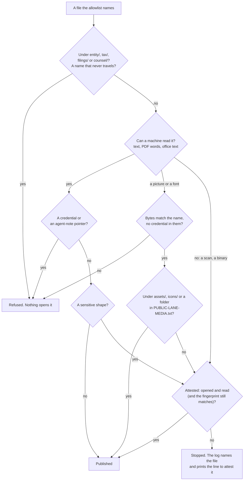

<!--
  FRAGMENT: tripwire (round four, package 0.b). Written for SOP-OPS-003 "Private houses everything, public lanes
  witness"; the templates agent includes it there (copy this section in whole, below its allowlist section).
  Icon paths are written for a page in OPS/ (../assets/icons/), so they resolve once the section sits in
  OPS/SOP-OPS-003-*.md; seen here, one folder deeper, they do not.
  Source of truth for the rule's mechanics: my-template/scripts/scan-public-lane.sh (its header comment) and its
  self-test. Change the script first, then this section.
-->

##  The tripwire: a public lane never publishes a file a machine or a person has not read

Every public lane (a `-public` twin, a public reading room, a public monitor) is filled by a sync that copies only
the allowlisted paths. Before anything is pushed, a tripwire reads **every** staged file. The rule is one sentence:

> **A public lane never publishes a file a machine or a person has not read.**

Before 2026-11-01 the check read only plain text, so a PDF, a picture or a Word file passed through unread. Now each
kind of file is read its own way, or stopped.

###  How each file is read

| | Kind of file | How the tripwire reads it | Stopped when |
|---|---|---|---|
|  | Text (Markdown, HTML, SVG, scripts) | read directly; base64 inside it is decoded and read | it carries a credential, a pointer into agent notes, or a sensitive shape (below); it embeds a script, HTML, a PDF or an executable; or it is an SVG that can run something |
|  | PDF | its words are pulled out with `pdftotext` and read the same way | the same, **or** it has no words at all, or some pages have none (a scan, an image-only page), or it will not open |
|  | `.docx`, `.xlsx`, `.pptx`, OpenDocument | unzipped; the text inside is read, and its link targets and other attributes are searched for credentials | the same, **or** it carries an embedded picture or object |
|  | Pictures and fonts | checked to be what their name says; the pixels are not read, but the bytes are searched for credentials | they are not what their name says, carry a credential, or sit anywhere other than an `assets/` or `icons/` folder or a folder the lane's media list names |
|  | Anything else (archives, old `.doc`, unknown binaries) | cannot be read here | always, unless a person attests it |

**Sensitive shapes** are the ones a public page should almost never carry: an employer or social-security number
shape, a label for a tax identifier or a birth date, a street address or post-office box, the word for a giver of
gifts, an account number longer than four digits beside its label, and the fleet's personal-matter words. The exact
patterns live in the script, assembled from pieces so the script itself can travel; this page names them in plain
words so it can travel too.

###  When a person reads it instead: attestation

A machine cannot read a scanned letter or a photograph. A person can. When the tripwire stops a file it prints the
exact line to add, and an officer who has **opened the file and read every page** adds it to
`PUBLIC-ALLOWLIST-ATTESTED.txt` by pull request:

```text
pdf/OPS/SOP-OPS-001-how-a-change-travels.pdf | <officer> | 2026-11-01 | opened and read | sha256:<fingerprint>
```

The fingerprint is optional and recommended: with it, the attestation ends the moment the file changes, and the next
sync asks for a fresh reading. An attestation clears a sensitive shape, one picture outside `assets/` and the media
list, and a PDF with no words. It never clears the three things below.

**Who may attest.** The officer field names whoever actually opened and read the file, never someone who did not, so
the trail stays honest. In this organisation's repositories that is a person who holds the role, unless the officers
delegate it in writing (in the repository's `CLAUDE.md`); until then a helper prepares the lines and hands them over.
(In repositories a single owner keeps for himself, the owner may let an agent attest, signing with its attribution
name.) When a flagged file names or describes another person or organisation, lean toward transparency, a short note
they could read, rather than dropping it silently or adding a gate that stalls publishing.

###  When a person chose the folder: the media list

> **A person chose these folders; a machine still reads what it can.**

A lane shows pictures on purpose: a site's images, a project's screenshots, a brand's fonts. Asking an officer to attest
each one, or moving them all into `assets/`, is not reading; it is paperwork. So a lane may keep one more list,
`PUBLIC-LANE-MEDIA.txt`, of the folders whose pictures and fonts it publishes on purpose:

```text
# Folders this lane shows on purpose. A person chose them.
approved by <name> | 2026-11-02
public/images
docs/screenshots
.                     # the top level only, for a favicon; never its subfolders
```

| | What the list does | What it does not do |
|---|---|---|
|  | Opens a picture or font under a listed folder, subfolders too, when its bytes match its name | Open anything else: text, PDFs, office files and binaries under the folder are read and refused exactly as anywhere else |
|  | Leaves every other check running: the picture's own bytes are still searched for credentials | Read the pixels. **Nothing reads a picture's pixels, so whoever lists a folder is the reader:** a screenshot showing an account number, or a photo carrying its location, is theirs to catch before listing |
|  | Records who chose and when, in the header above each folder | Reach the legal lanes, names that never travel, symbolic links or files over 15 MB; a line naming one, or a line with no header above it, stops the run |

No list, or a picture outside it, is refused as before, and the refusal names the folder and how to add it. Adding a line
is a person's decision, made by pull request like the allowlist. A helper may propose a line; a helper never decides one.

**Base64 inside text is read too.** A `data:` address is decoded: a plain picture passes; a script, HTML, a PDF or an
executable is refused, and so is a credential inside it. An `.svg` is text, so it is read as text, and one that carries a
script, an event handler or a link that runs code is refused wherever it sits, in `assets/` too. Those refusals are not
credentials: a person who opened the file may still attest it.

###  What nothing opens

1.  **A credential or a pointer into agent notes** found in any readable text, attested or not. Remove it from the file.
2.  **The legal lanes by path:** `entity/`, `tax/`, `filings/`, `counsel/`. A file under any of them is refused whatever the allowlist or an attestation says. The legal public lane carries only its README, its folder map and policy skeletons.
3.  **Names that never travel:** agent-note folders, tool configuration (`CLAUDE.md`, `AGENTS.md`, `.claude/`, `.github/`), keys, wallets, environment files, symbolic links, and any file over 15 MB.



###  Running it yourself

```sh
brew install poppler                                   # once, on a Mac: gives pdftotext
sh scripts/scan-public-lane.selftest.sh                # proves it: a planted fake number in a PDF must be refused
TRIPWIRE_PUBLIC=1 sh scripts/sync-allowlist.sh stage PUBLIC-ALLOWLIST.txt /tmp/stage   # a dry run of the sync
sh scripts/scan-public-lane.sh /tmp/stage PUBLIC-ALLOWLIST-ATTESTED.txt                 # or scan any folder
```

*You should see:* `every file read; clean`, or a list of refused files, each with its reason. The scanner never
prints what it matched, only the kind of match and where, so a found secret does not land in a log. On GitHub the
sync installs `pdftotext` (`poppler-utils`) and runs the self-test before every sync; without a PDF reader, no PDF
travels.

**Master copy:** `my-template/scripts/scan-public-lane.sh` and its self-test. Every repository's copy is the
master, byte for byte; the self-test in my-template checks the SOP template's copies.
