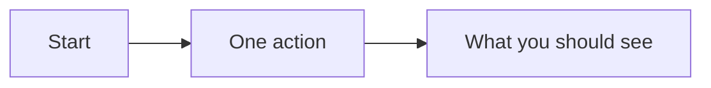

# SOP-DEPT-000 · Procedure name


<!--
  The badge row: SOP id in the organisation's PRIMARY shade, status in DEEP, date in MID, and the shared slate For badge
  (64748b, the same in every organisation and in proposals). Shipped in the lab's brass on slate; swap the first three
  colours for your organisation's (my-template/proposals-template/TONES.md). In a badge, a hyphen is written twice (--)
  and a space as _ . "For" names a role or a group (Stewards, Board, Every_member), so it stays true when people change.
  Lucid (my-template/LUCID.md): one Lucide icon beside each idea, from ../assets/icons/ (24px on a heading, 16px
  inline, alt=""), and one ```mermaid diagram where a picture explains the mechanism (the PDF draws it too).
  The block at the very top is front matter: the permanent id (it must match the file name), for a library's address and
  index. Your own number comes from 100 up; 001 to 099 come only from the template (my-template/NUMBERING.md).
  Delete this comment when you're done.
-->

**Department:** DEPT · **ID:** 000 · **Status:** draft (approved when tagged) · **Owner:** role, not a person · **Last changed:** YYYY-MM-DD

##  Purpose
One sentence: what this procedure achieves and why it exists.

##  Scope
Where it applies, where it does not.

##  Roles
| Role | Does |
|---|---|
| | |

##  Prerequisites
What must be true before step 1.

##  How it works (one picture, if a picture explains it)



##  Steps
1. One action. *You should see:* what confirms it worked.
2. …

##  Verification
How anyone can tell the procedure was completed correctly.

##  Troubleshooting
| Symptom | Likely cause | What to do |
|---|---|---|
| | | |

##  Related
- Proposal: …
- SOP: …

##  Change log
| Date | Change | By |
|---|---|---|
| YYYY-MM-DD | Drafted | |
