<!-- readme-standard: 2026-11-02 -->

# Tutorials template

*A ready-to-copy `tutorials/` folder: learn by doing, one task from start to finish, with what you should see at each step.*

 **You are here:** drasticstatic lab › [`my-template`](../README.md) › `tutorials-template/` · public · `main` is the working branch

##  TL;DR

1.  **A tutorial teaches by doing.** Not a procedure (a numbered, repeatable job), a proposal (an ask) or a walkthrough (a one-time setup): afterwards the reader can do it again alone, and knows why ([the four shelves](../tutorials/README.md#-the-four-shelves)).
2.  **The shape is fixed, the words are yours:** header, TL;DR, *What you will learn*, *Before you start*, one action per step with *You should see*, *Check what you learned*, *Where next*, sources, *Suggest a change*.
3.  **Do this first:** copy [`repo/_template/TUTORIAL-NAME.md`](repo/_template/TUTORIAL-NAME.md) to `tutorials/<WHAT-YOU-WILL-DO>.md` in your repository and fill it in.
4.  **Not numbered,** unless [`NUMBERING.md`](../NUMBERING.md) later says so.

##  What is in the box

| | Path | What it is |
|---|---|---|
|  | [`repo/_template/TUTORIAL-NAME.md`](repo/_template/TUTORIAL-NAME.md) | The skeleton to copy for each new tutorial, kept in `_template/` so it is never mistaken for a real one |
|  | [`repo/tutorials/README.md`](repo/tutorials/README.md) | The index: one row per tutorial, and the four shelves in one line |
|  | [`repo/assets/icons/`](repo/assets/icons/) | The Lucide icons (ISC) the two pages name, violet `#7c4dff`; the full set is in [`sop-template/repo/assets/icons/`](../sop-template/repo/assets/icons/) |
|  | [`assets/banner.svg`](assets/banner.svg) | This page's own banner, drawn by [`scripts/make-banner.py`](../scripts/make-banner.py) `--motif seed` (a beginning) |

The lab's own tutorials in [`../tutorials/`](../tutorials/) are the worked examples.

##  How a tutorial is laid out

| Part | Rule | Why |
|---|---|---|
|  **Name** | `tutorials/<VERB-PHRASE-IN-CAPITALS>.md`, verb first | the file name says what the reader will do |
|  **TL;DR** | three to five lines; one is the idea to keep | lead with the answer ([`LUCID.md`](../LUCID.md)) |
|  **Steps** | one action each, *You should see* after it, and a sentence of why where it helps | the reader learns the reason, not only the click |
|  **Check what you learned** | things the reader can now do or explain without the page | that is what makes it a tutorial |
|  **Sources** | a folded table: each claim, its link, the date checked; your own practice marked as yours | vendors change their pages; the date says how old the truth is |
|  **Placeholders** | `NAME`, `VAULT`, `REPO` in a table near the top; never a real path or address on a public page | [`NAMES-POLICY.md`](../NAMES-POLICY.md) |

##  Adopt it in three steps

1. **Copy** `repo/_template/`, `repo/tutorials/README.md` and `repo/assets/icons/` into your repository, keeping the folder names. On a machine with many procedures repositories and reading rooms, [`scripts/lay-tutorials-shelf.sh`](../scripts/lay-tutorials-shelf.sh) lays a pointer `tutorials/README.md` in each (a dry run unless `--apply`).
2. **Write the first tutorial:** copy `_template/TUTORIAL-NAME.md` to `tutorials/<WHAT-YOU-WILL-DO>.md`, do every step yourself as you write it, and run `python3 scripts/make-banner.py --icons tutorials/<FILE>.md --family <family>` so every icon it names is in `assets/icons/`.
3. **Add its row** to `tutorials/README.md`, commit on the working branch and open a pull request. A person with the role merges.

Or ask your AI helper: *"Read my-template/tutorials-template/README.md and write a tutorial for … in our repository."*

##  Suggest a change

Noticed something wrong, or know a better shape for a tutorial? Open an [issue](https://github.com/drasticstatic/my-template/issues) or a pull request against `main`; the lab steward reads them, and a person with the role merges with a merge commit so your name stays on it. Not on GitHub? Tell any steward you know, or your helper, in your own words.

Part of [`my-template`](../README.md). Related: [`tutorials/`](../tutorials/), [`walkthroughs-template/`](../walkthroughs-template/), [`LUCID.md`](../LUCID.md), [`README-STANDARD.md`](../README-STANDARD.md). Icons: Phosphor duotone (MIT) on this page, Lucide (ISC) in `repo/`.
