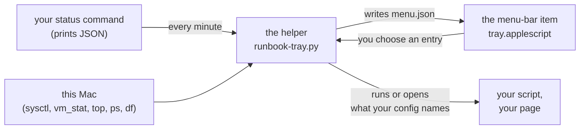

<div align="center">


# A runbook tray in the menu bar

*Learn to put one small item in the macOS menu bar that shows each scheduled job's state, your own checks and the Mac's memory at a glance, built from what macOS ships, with nothing installed.*


 **You are here:** drasticstatic lab › [`my-template`](../README.md) › [`tutorials`](README.md) › `A-RUNBOOK-TRAY-IN-THE-MENU-BAR.md` · public · `main` is the working branch

</div>

> [!IMPORTANT]
> **Built on Nov 13, 2026, and running on one Mac** (Apple silicon, macOS 15.4.1). It has not been tried on another
> Mac or another macOS version. Its self-test passes there; run it on yours before you trust it (step 1).

##  TL;DR

1.  **The tray:** one item in the menu bar. Its menu lists each scheduled job with a mark, your own checks, the Mac's memory, swap, processor and disk as meters, and a few entries that run a script or open a page.
2.  **The tools:** AppleScript, compiled by `osacompile`, and a helper in Python's standard library. Both are in [`scripts/runbook-tray/`](../scripts/runbook-tray/). No package, no download, no Xcode.
3.  **No outside code, so no outside-code gate.** The first design used the `rumps` package and waited on a review and a scan. This one needs neither, because every line is the template's own.
4.  **You bring two things:** a status command that prints your jobs' states as JSON, and a config that names it.
5.  **It starts nothing by itself.** Building it does not start it, and nothing is added to Login Items. Both are yours.

> **Handing this to your AI helper?** Say: *"Read A-RUNBOOK-TRAY-IN-THE-MENU-BAR.md. Help me write a status command
> for my scheduled jobs and a config, check them with doctor, and build the tray. Don't start it and don't add it
> to Login Items; I will."*

##  What you will learn

- what a runbook tray shows, and what it must never do;
- how a menu-bar app is put together from AppleScript alone, and why that keeps it out of the outside-code gate;
- how to write a status command and a config, and prove them before anything appears on screen;
- how to read the section on the Mac itself: what each meter measures, and what it does not.

##  Before you start

**You need:** a Mac, a `python3` that is not `/usr/bin/python3` (Homebrew's, for example), a scheduled job you already run, and about 30 minutes.

| Placeholder | Meaning | Example |
|---|---|---|
| `TRAY` | this template's tray folder | `~/code/my-template/scripts/runbook-tray` |
| `PYTHON` | the full path of your python3 | `/opt/homebrew/bin/python3` |
| `JOB_LABEL` | a scheduled job's launchd label | `local.example.nightly` |
| `MY_CONFIG` | your config, in a folder only you can write | `~/vault/scripts/runbook-tray.config.json` |
| `RUNBOOK` | the page you keep your runbook in | `~/vault/RUNBOOK.md` |

##  What the tray shows



- **A mark per row:** a green tick for good, an amber triangle for a look, a red octagon for bad, a grey dash for *off* (not running and not expected to be). The shape carries the state as well as the colour.
- **This Mac, as meters:** memory, swap, processor and disk, each a thin bar with its figure in words; the last hour of memory as a small line; and a submenu of the apps holding the most memory.
- **The menu bar itself:** a plain picture while all is good. When rows need a look it turns amber or red and shows how many. A small upright gauge beside it is memory used.
- **It only reads and runs what exists.** The tray never schedules, edits or stops a scheduled job, never asks for a password, and runs only the commands your config names.

##  The pieces

| Piece | What it does |
|---|---|
| [`tray.applescript`](../scripts/runbook-tray/tray.applescript) | the menu-bar item. It only draws: it reads `menu.json`, shows it, and asks the helper to act when you choose an entry |
| [`runbook-tray.py`](../scripts/runbook-tray/runbook-tray.py) | the helper. It runs your status command, reads the Mac, decides every word and mark, and writes `menu.json` |
| [`build.sh`](../scripts/runbook-tray/build.sh) | compiles the applet with `osacompile`, marks it as having no Dock icon, and signs it for this Mac only |
| your status command | prints one JSON object: a list of rows, each with a `name`, a `state` and a `detail` |
| your config | names the status command and the menu's entries |

Because the applet decides nothing, everything it shows can be tested without a screen. That is what the self-test does.

##  Why it needs no gate, and what still does

Outside code goes through a review and a scan before it runs ([SOP-IT-900](../sop-template/repo/IT/SOP-IT-900-bringing-in-outside-code.md), [SOP-IT-901](../sop-template/repo/IT/SOP-IT-901-antivirus-screening-of-outside-code.md)). The tray has none: `osacompile`, `plutil` and `codesign` are part of macOS, and the helper imports only Python's standard library.

What is still yours to look at: **your own status command and the scripts your entries run.** The tray runs them as you, every minute or on a click. Read them as you would any script you schedule.

##  The steps

### 1. Prove the tool on your Mac

```sh
sh TRAY/runbook-tray.selftest.sh
```

It works in a temporary folder with a made-up home, and never reads your jobs or `~/Applications`.

*You should see:* `222 passed, 0 failed` on a Mac (fewer where the compile and the live reading are skipped).

### 2. Write a status command

Start from [`status.example.py`](../scripts/runbook-tray/status.example.py), which reads `launchctl list`:

```sh
PYTHON -I TRAY/status.example.py "JOB_LABEL=Nightly backup"
```

*You should see:* one JSON object with a `rows` list, and your job's row with `"state": "good"` and a `detail` such as `waiting for its time`.

A row's `state` is `good`, `look`, `bad`, `off` or `unknown` (the check cannot tell from where it runs; shown, never counted). Add a `group` to a row to put it under a heading; name that group under `"fold"` in the config's `status` and its rows move into a submenu, under one row that counts them. Add `"counted": false` to a row that should show its state without raising the mark in the menu bar. Keep the command quick, and keep it away from the folders macOS guards (Desktop, Documents, Downloads, iCloud Drive): the tray runs it every minute, and a guarded folder makes macOS ask for permission in the tray's name.

### 3. Write the config, and check it

Copy [`config.example.json`](../scripts/runbook-tray/config.example.json) to `MY_CONFIG` and change its paths. Then:

```sh
PYTHON -I TRAY/runbook-tray.py doctor --config MY_CONFIG
```

*You should see:* each command and page the tray would use, and `doctor: the config is usable`. Doctor runs nothing.

The rules the config keeps: every command is a list of words whose first word is a full path; an entry has a `command` or an `open`, never both; and the file and its folder must be writable by you alone.

### 4. Read the menu as text first

```sh
PYTHON -I TRAY/runbook-tray.py render --config MY_CONFIG --state /tmp/tray-try --print
```

*You should see:* the menu, in words: the result line, your rows under their headings, *This Mac* with its meters as ten cells each, and your entries.

### 5. Build it

```sh
sh TRAY/build.sh --config MY_CONFIG --print     # what it would do; writes nothing
sh TRAY/build.sh --config MY_CONFIG
```

*You should see:* `built    ~/Applications/Runbook Tray.app`, and the line `at login ... yours to choose; this script adds nothing`. Nothing has started.

### 6. Start it

```sh
open -g "$HOME/Applications/Runbook Tray.app"
```

*You should see:* a small checklist picture in the menu bar, with an upright gauge beside it. No window opens and no Dock icon appears. Click it for the menu.

> [!NOTE]
> **This may put a prompt on your screen, later.** The tray's minute-by-minute check should touch nothing macOS
> guards. An *entry* you choose may: if its script reads iCloud Drive, Desktop, Documents or Downloads, macOS asks
> once whether "Runbook Tray" may. That was not seen on the Mac this was built on, because the entry had not yet
> been chosen there when this page was written.

### 7. Stop it, and decide about login

- **Stop:** its own menu, *Quit Runbook Tray*.
- **Open at login:** System Settings › General › Login Items › Open at Login › `+`, then choose the app. This is your choice; neither the build nor the tray does it.
- **After changing the config:** nothing to rebuild; the helper reads it each minute. **After changing the tool:** quit the tray, build again, start it. The build moves the earlier app into the tray's own folder, never deleting it.

##  Reading the section on the Mac

| Row | What it measures | What its bar is against |
|---|---|---|
| **Memory** | app memory + wired + compressed, from `vm_stat`, with the kernel's own pressure level in words | the Mac's memory |
| **Memory, part by part** | a submenu: one bar split into app memory, wired, compressed, cached files and free, a line for each with its amount, and the kernel's own pressure level with the share of memory it counts as available | the Mac's memory |
| **Swap** | swap in use, and how it moved in the last hour | the Mac's memory, since swap has no fixed limit |
| **Processor** | the share of time not idle since the tray's previous sample, and the one-minute load | all cores busy |
| **Disk** | used and free as `df` gives them | the disk |
| **Memory, last hour** | a thin line of memory used, minute by minute; the newest point is marked | its own range, never tighter than two points of the whole |
| **What is holding the most memory** | each app with its helpers added in, from `top`'s memory column | the largest in the list |

- **Only the memory bar changes colour,** to amber or red, when the kernel reports pressure as *warning* or *critical*. The other bars stay blue: no rule says when they are bad, so none is drawn.
- **The split bar's colours name parts, not states:** blue for app memory, pink for wired, violet for compressed, greys for cached files and free. Amber, red and green are kept for state everywhere in the menu.
- **There is no button that frees memory, on purpose.** Cached files are given back by macOS the moment something needs the room, and what apps hold comes back as soon as they are used. What helps is closing what the list names.
- **Each day is kept:** one line a minute, in `days/<date>.csv` in the tray's folder, so a working day can be read afterwards.
- **The app list names apps, never their arguments.** It is counted every five minutes, since `top` is the costliest reading.
- **It is not Activity Monitor.** Apple's guide lists App Memory, Wired Memory and Compressed beside *Memory Used*; the tray adds those three from `vm_stat` and was not compared with Activity Monitor's own figure.

##  Check what you learned

- [ ] You can say what the tray shows and three things it never does.
- [ ] You can say why this tray needs no outside-code review, and what you still read yourself.
- [ ] Your status command prints a row for your job, and doctor calls your config usable.
- [ ] The tray is in your menu bar, and you know how to quit it and where *Open at Login* is.
- [ ] You can say what the memory bar's colour means, and why the swap bar never changes colour.

##  Two other roads

| Road | When | What it costs |
|---|---|---|
| **Shortcuts in the menu bar** | you only want to *run* things, with no marks and no meters | nothing installed. Apple's Shortcuts guide names a **Menu Bar** collection whose shortcuts "appear in the Shortcuts menu in the macOS menu bar", an **Allow Running Scripts** setting with the warning "Running shortcuts with scripts could cause data loss", and `shortcuts run "<name>"` for the command line. The action that runs a shell script, and how a shortcut is put in that collection, are **unverified**: the pages read on Nov 12, 2026 do not describe them |
| **Python with `rumps`** | you want to write the menu in Python | the outside-code gate, for `rumps` and for PyObjC, which it needs. Its newest release on PyPI on Nov 12, 2026 was 0.4.0, from Oct 15, 2022. It was never installed here |

##  Windows counterpart (a listed task)

| Task | Waits on | Notes |
|---|---|---|
| The same tray for Windows: a mark per scheduled task, the same entries, the machine's meters | the first Windows machine in the fleet | not started. The helper's status format and config carry over; the drawing and the machine readings do not |

##  Where next

-  [`scripts/runbook-tray/README.md`](../scripts/runbook-tray/README.md): the tool's own page, with its rules and its limits.
-  [SOP-IT-900, bringing in outside code](../sop-template/repo/IT/SOP-IT-900-bringing-in-outside-code.md): the gate this tray did not need, and the `rumps` road would.
-  [The second brain](../walkthroughs/THE-SECOND-BRAIN.md): where a runbook and the daily check notes can live.

<details>
<summary><b>Sources, checked 2026-11-13 unless a row says otherwise</b></summary>

| Claim | Source |
|---|---|
| `osacompile`, `plutil` and `codesign` are macOS's own programs, not developer-tool stubs | compared byte for byte with a known stub on one Mac, macOS 15.4.1 |
| A menu-bar item, section headings, two-line rows, coloured marks, a timer and a child process all work from a plain AppleScript applet | the self-test's applet round on that Mac: it draws each menu and reads back from AppKit what was drawn |
| *Memory Used*, with App Memory, Wired Memory and Compressed listed beside it; "Swap Used: The amount of space being used on your startup disk to swap unused files to and from RAM" | <https://support.apple.com/guide/activity-monitor/view-memory-usage-actmntr1004/mac> |
| `top`'s `mem` column: "Physical memory footprint of the process" | `man top` on that Mac |
| "the total number of pages (uncompressed) held within the compressor" and "the number of pages used to store compressed VM pages" | `man vm_stat` on that Mac |
| "System-wide memory free percentage", the figure the tray shows as the share of memory the kernel counts as available | `memory_pressure` on that Mac; it printed the same number as `sysctl kern.memorystatus_level` |
| Cached Files: "The size of files cached by the system into unused memory to improve performance" | Apple's Activity Monitor guide, linked above |
| The three hues of the split bar pass as neighbours, light and dark | the charting validator used to choose them, run on Nov 13, 2026 with menu-like grounds; one hue is under 3:1 against a light menu, which is why every part also has a line with its name and amount |
| The pressure level's three values, 1 normal, 2 warning, 4 critical | read from `sysctl kern.memorystatus_vm_pressure_level` on that Mac; the meaning of the numbers is the template's reading, not quoted from Apple |
| `rumps` needs PyObjC; newest release 0.4.0, Oct 15, 2022 (checked 2026-11-12) | <https://github.com/jaredks/rumps>, <https://pypi.org/project/rumps/> |
| The *Menu Bar* collection, *Allow Running Scripts* and its warning, `shortcuts run` (checked 2026-11-12) | <https://support.apple.com/guide/shortcuts-mac/intro-to-shortcuts-apdf22b0444c/mac>, <https://support.apple.com/guide/shortcuts-mac/advanced-shortcuts-settings-apdfeb05586f/mac>, <https://support.apple.com/guide/shortcuts-mac/run-shortcuts-from-the-command-line-apd455c82f02/mac> |

**Unverified:** the action that runs a shell script in Shortcuts, and how a shortcut is added to the Menu Bar collection. **Not tested:** any Mac or macOS version but the one named above; an entry whose script reads a folder macOS guards. The tray's design, its marks and its rules are the fleet's own practice.

</details>

##  Suggest a change

Noticed something wrong, or built the tray on another Mac and learned something? Open an [issue](https://github.com/drasticstatic/my-template/issues) or a pull request against `main`; the lab steward reads them, and a person with the role merges with a merge commit so your name stays on it. Not on GitHub? Tell any steward you know, or your helper, in your own words.

<sub>One of the [tutorials](README.md) in `my-template`, in the shape of [`tutorials-template/`](../tutorials-template/). Icons: Phosphor duotone (MIT). `rumps` is its maintainers' work and Shortcuts, AppleScript and Activity Monitor are Apple's; this page is not affiliated with either, and their behaviour is theirs to change.</sub>
