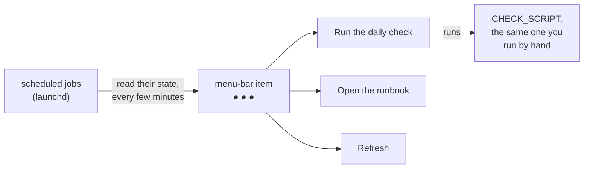

<div align="center">


# A runbook tray in the menu bar

*Learn how a small menu-bar item could show each scheduled job's state at a glance, why it goes through the same gate as any outside code, and how to get most of it today with the Shortcuts app.*


 **You are here:** drasticstatic lab › [`my-template`](../README.md) › [`tutorials`](README.md) › `A-RUNBOOK-TRAY-IN-THE-MENU-BAR.md` · public · `main` is the working branch

</div>

> [!IMPORTANT]
> **Designed, not built.** Nothing on this page has been installed or run. The tray is a design; its code below is a
> sketch that has never been executed. The part that works today is [step 6, the Shortcuts route](#-6-the-route-that-works-today-shortcuts-in-the-menu-bar).

##  TL;DR

1.  **The tray:** one small item in the menu bar, a coloured dot per scheduled job, and three entries: *Run the daily check*, *Open the runbook*, *Refresh*.
2.  **The tools:** Python and the `rumps` package, which its maintainers describe as "Ridiculously Uncomplicated macOS Python Statusbar apps". No Xcode.
3.  **Its packages are outside code.** `rumps` and what it needs go through [SOP-IT-900](../sop-template/repo/IT/SOP-IT-900-bringing-in-outside-code.md) and [SOP-IT-901](../sop-template/repo/IT/SOP-IT-901-antivirus-screening-of-outside-code.md) before anything runs.
4.  **Today:** the built-in Shortcuts app has a *Menu Bar* collection whose shortcuts appear in its menu in the macOS menu bar, so the same scripts can be one click away now.
5.  **Windows** gets its own counterpart, a listed task for the first Windows machine.

> **Handing this to your AI helper?** Say: *"Read A-RUNBOOK-TRAY-IN-THE-MENU-BAR.md. Help me set up step 6 for my
> daily check script. Don't install any package."*

##  What you will learn

- what a runbook tray is for, and what it should and should not do;
- how a menu-bar app is put together in Python with `rumps`, from its own documentation;
- why a tray you write yourself still brings in outside code, and the gate it goes through;
- how to put the same scripts in the menu bar today with Shortcuts.

##  Before you start

**You need:** a Mac, a script you already run by hand (a daily check, for example), and about 20 minutes for step 6. Steps 1 to 5 are reading.

| Placeholder | Meaning | Example |
|---|---|---|
| `CHECK_SCRIPT` | the script your daily check runs | `~/code/<tool>/scripts/daily-check.sh` |
| `RUNBOOK` | the page you keep your runbook in | `~/vault/RUNBOOK.md` |
| `JOB_LABEL` | a scheduled job's launchd label | `local.example.nightly` |

##  1. What the tray shows



- **A dot per job:** green when its last run succeeded, amber when it has not run when it should have, red when it failed. Hovering or opening the menu says which job is which.
- **Three entries, nothing more.** *Run the daily check* runs the script you already trust. *Open the runbook* opens `RUNBOOK`. *Refresh* reads the jobs' state again.
- **It only reads and runs what exists.** The tray never schedules, edits or deletes a job, and never asks for a password.

*You should see,* once it exists: one glance at the menu bar tells you whether the night went well.

##  2. The pieces, from `rumps`'s own documentation

| Piece | What `rumps` documents |
|---|---|
| **The app** | `rumps.App` takes a `name`, a `title` ("text that will be displayed for the application in the statusbar"), an `icon`, a `menu` and a `quit_button`; `run()` starts the timers, registers the click callbacks and starts the run loop |
| **A menu entry** | a method decorated with `@rumps.clicked("<entry name>")` runs when that entry is chosen |
| **A timer** | `rumps.Timer(callback, interval)`: "Function that should be called every interval seconds", with `start()` and `stop()` |
| **What it needs** | PyObjC; installed with `pip install rumps` |
| **Licence** | Modified BSD (the repository labels it BSD-3-Clause) |
| **An app of its own later** | its README recommends py2app, and setting `LSUIElement` to `True` so the app shows no Dock icon |

The newest release on PyPI on 2026-11-12 was **0.4.0, from Oct 15, 2022**. An old last release is not a fault by itself, but it is a question the review in step 3 asks out loud.

##  3. The gate comes before any code

You write the tray, but `rumps`, PyObjC, and py2app if you ever package it, are **someone else's code**. Before any of them is installed:

1.  A text review of each, at a pinned version, against the checklist in [SOP-IT-900](../sop-template/repo/IT/SOP-IT-900-bringing-in-outside-code.md#the-review-checklist): what the install runs, what it writes outside its folder, what leaves the machine, the licence, who publishes each dependency.
2.  The owner's antivirus scan of the staged packages, with a receipt ([SOP-IT-901](../sop-template/repo/IT/SOP-IT-901-antivirus-screening-of-outside-code.md)).
3.  Installed into the tray's own virtual environment, at those pinned versions, never system-wide and never by a piped installer.

*You should see:* a review and a receipt for each package before the first `import rumps`.

##  4. A sketch of the code (never run)

> [!WARNING]
> **Untested sketch.** This has not been run on any machine. It uses only the `rumps` names documented above and
> Python's own `subprocess`. Read it to learn the shape; do not install anything to try it until step 3 is done.

```python
import os
import subprocess
import rumps

JOBS = ["JOB_LABEL"]                      # one launchd label per scheduled job
CHECK_SCRIPT = "/path/to/daily-check.sh"  # the script you already run by hand
RUNBOOK = "/path/to/RUNBOOK.md"

def job_dot(label):
    """Green, amber or red for one job, from what launchctl prints. A sketch: the parsing is yours to write."""
    out = subprocess.run(["launchctl", "print", f"gui/{os.getuid()}/{label}"],
                         capture_output=True, text=True)
    if out.returncode != 0:
        return "🔴"
    return "🟢" if looks_healthy(out.stdout) else "🟠"

def looks_healthy(text):
    """Placeholder: decide from the job's own status file, or from launchctl's text once you have read it by eye."""
    return False

class RunbookTray(rumps.App):
    def __init__(self):
        super().__init__("Runbook", title="…", quit_button="Quit")
        self.timer = rumps.Timer(self.refresh, 300)   # every five minutes
        self.timer.start()

    def refresh(self, _=None):
        self.title = " ".join(job_dot(j) for j in JOBS)

    @rumps.clicked("Run the daily check")
    def run_check(self, _):
        subprocess.Popen(["/bin/sh", CHECK_SCRIPT])

    @rumps.clicked("Open the runbook")
    def open_runbook(self, _):
        subprocess.Popen(["open", RUNBOOK])

    @rumps.clicked("Refresh")
    def refresh_now(self, _):
        self.refresh()

if __name__ == "__main__":
    RunbookTray().run()
```

The text that `launchctl print` writes is the system's own and is not a documented interface, so the parsing in `job_dot` is a placeholder; the template's archive walkthrough reads the same command by eye ([*Check it*](../walkthroughs/CLAUDE-PROJECTS-ARCHIVE.md#-set-it-up-four-lines-in-this-order)). A job that writes its own status file is easier to read and is the better design.

##  5. Running it later, by hand

Once the gate is passed: start it from Terminal with the tray's own environment's Python, `python tray.py`, and stop it from its *Quit* entry. Making it start at login, or packaging it as an app with py2app, is a later step and a separate decision: py2app is outside code too.

##  6. The route that works today: Shortcuts in the menu bar

Apple's Shortcuts guide for macOS describes a sidebar collection named **Menu Bar**: it "contains shortcuts that appear in the Shortcuts menu in the macOS menu bar". So each entry of the tray can be a shortcut there today, with nothing installed.

1.  **Make a shortcut named *Run the daily check*** in the Shortcuts app, whose one action runs `CHECK_SCRIPT`. The action that runs a shell script is **UNVERIFIED** here: Apple's guide pages read on 2026-11-12 do not describe it; look for it in the app's action library. *You should see:* the shortcut in **All Shortcuts**.
2.  **Allow scripts, knowingly.** Apple's guide describes **Shortcuts › Settings › Advanced › Allow Running Scripts**, with its own warning: "Running shortcuts with scripts could cause data loss." Turn it on only if you will run your own reviewed scripts this way. *You should see:* the setting on.
3.  **Put the shortcut in the Menu Bar collection.** How a shortcut is added to that collection is **UNVERIFIED**: Apple's guide names the collection but, on the pages read today, does not say how a shortcut gets into it. *You should see:* the shortcut listed under **Menu Bar** in the sidebar.
4.  **Test it from Terminal first,** with the command Apple documents: `shortcuts run "Run the daily check"`. *You should see:* the same result as running `CHECK_SCRIPT` by hand.
5.  **Then from the menu bar:** open the Shortcuts menu there and choose it. Repeat for *Open the runbook*. *You should see:* both entries in the menu.

What Shortcuts does not give you is the row of dots: it runs things, it does not watch them. That is the part the tray adds.

##  Check what you learned

- [ ] You can say what the tray shows and what it never does.
- [ ] You can name the three `rumps` pieces the design uses, and where each is documented.
- [ ] You know why `rumps` goes through SOP-IT-900 and SOP-IT-901 before it is installed.
- [ ] Your daily check runs from the Shortcuts menu in the menu bar, and from `shortcuts run`.

##  Windows counterpart (a listed task)

| Task | Waits on | Notes |
|---|---|---|
| Design the same tray for Windows: a dot per scheduled task, the same three entries | the first Windows machine in the fleet | not started; its tools are outside code and take the same gate; checked against the vendor's own documentation when it is written, not before |

##  Where next

-  [SOP-IT-900, bringing in outside code](../sop-template/repo/IT/SOP-IT-900-bringing-in-outside-code.md): the gate in full.
-  [The second brain](../walkthroughs/THE-SECOND-BRAIN.md): where a runbook and the daily check notes can live.

<details>
<summary><b>Sources, checked 2026-11-12</b></summary>

| Claim | Source |
|---|---|
| `rumps`'s description, PyObjC requirement, `pip install rumps`, the licence, py2app and `LSUIElement`, the `@rumps.clicked` example | <https://github.com/jaredks/rumps> |
| `rumps.App`'s parameters and `run()` | <https://rumps.readthedocs.io/en/latest/App.html> |
| `rumps.Timer(callback, interval)`, `start()`, `stop()` | <https://rumps.readthedocs.io/en/latest/Timer.html> |
| Newest release 0.4.0, Oct 15, 2022; BSD licence | <https://pypi.org/project/rumps/> |
| The *Menu Bar* collection in the Shortcuts sidebar (guide for macOS 27) | <https://support.apple.com/guide/shortcuts-mac/intro-to-shortcuts-apdf22b0444c/mac> |
| *Allow Running Scripts* and its warning | <https://support.apple.com/guide/shortcuts-mac/advanced-shortcuts-settings-apdfeb05586f/mac> |
| `shortcuts run "<name>"` | <https://support.apple.com/guide/shortcuts-mac/run-shortcuts-from-the-command-line-apd455c82f02/mac> |

**Unverified:** the action that runs a shell script, and how a shortcut is added to the Menu Bar collection; neither is described on the Apple pages read that day. The tray's design, the three entries, the dots and the gate are the fleet's own practice.

</details>

##  Suggest a change

Noticed something wrong, or built the tray and learned something? Open an [issue](https://github.com/drasticstatic/my-template/issues) or a pull request against `main`; the lab steward reads them, and a person with the role merges with a merge commit so your name stays on it. Not on GitHub? Tell any steward you know, or your helper, in your own words.

<sub>One of the [tutorials](README.md) in `my-template`, in the shape of [`tutorials-template/`](../tutorials-template/). Icons: Phosphor duotone (MIT). `rumps` is its maintainers' work and Shortcuts is Apple's; this page is not affiliated with either, and their behaviour is theirs to change.</sub>
