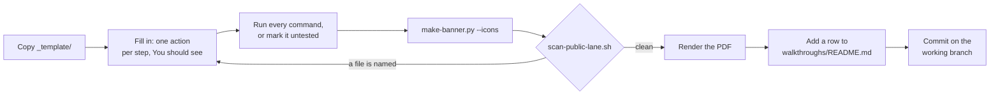

<!-- readme-standard: 2026-11-02 -->

# Walkthroughs template

*A ready-to-copy `walkthroughs/` folder: one guide per task, in the Lucid look, with a PDF beside each guide.*

 **You are here:** drasticstatic lab › [`my-template`](../README.md) › `walkthroughs-template/` · public · `main` is the working branch

##  TL;DR

1.  **A walkthrough is one task for a first-timer.** It is not a proposal (which asks for a decision) or a procedure (which says how an approved thing is done by the people whose job it is). It gets someone from nothing to done, alone or with their helper.
2.  **The shape is fixed, the words are yours:** centred header, badges, *You are here*, TL;DR, one action per step with *You should see*, a check that fails closed, a troubleshooting table, *Suggest a change*.
3.  **Do this first:** copy [`repo/_template/WALKTHROUGH-NAME.md`](repo/_template/WALKTHROUGH-NAME.md) to `walkthroughs/<TASK>.md` in your repository and fill it in.
4.  **The PDF is drawn from the markdown**, never edited by hand ([why both](../walkthroughs/MARKDOWN-BESIDE-PDF.md)).

##  What is in the box

| | Path | What it is |
|---|---|---|
|  | [`repo/_template/WALKTHROUGH-NAME.md`](repo/_template/WALKTHROUGH-NAME.md) | The skeleton to copy for each new guide. It sits in `_template/` so the PDF renderer, which reads only `walkthroughs/*.md`, never prints it |
|  | [`repo/walkthroughs/README.md`](repo/walkthroughs/README.md) | The index: one row per guide, with its PDF. The renderer skips it, because an index is not a guide |
|  | [`repo/assets/icons/`](repo/assets/icons/) | The Lucide icons (ISC) the two pages name, violet `#7c4dff` so they read in both GitHub themes; the full set of 79 is in [`sop-template/repo/assets/icons/`](../sop-template/repo/assets/icons/) |
|  | [`assets/banner.svg`](assets/banner.svg) | This page's own banner, drawn by [`scripts/make-banner.py`](../scripts/make-banner.py) `--motif path` (a road for a method) |

The lab's own walkthroughs in [`../walkthroughs/`](../walkthroughs/) are the worked examples: [`GOOGLE-WORKSPACE-CLI-NEW-PROFILE.md`](../walkthroughs/GOOGLE-WORKSPACE-CLI-NEW-PROFILE.md) is a short one, [`GEMINI-CLI-ACCESS.md`](../walkthroughs/GEMINI-CLI-ACCESS.md) a long one with a decision table.

##  How a walkthrough gets made

##  The Lucid look, for a walkthrough

| Part | Rule | Why |
|---|---|---|
|  **Header** | centred: a 56 px icon, the title, an italic line, then badges | the reader knows what this is before scrolling |
|  **Badges** | `Kind` and `Changed` in the organisation's PRIMARY shade, `For` in the shared slate `64748b` ([`TONES.md`](../proposals-template/TONES.md)) | the colour says whose guide it is |
|  **You are here** | organisation › repository › `walkthroughs` › file · public or private · working branch | people arrive from a link with no idea which house they are in |
|  **TL;DR** | three to five numbered lines, each with a 16 px icon; one of them says who does what | lead with the answer ([`LUCID.md`](../LUCID.md)) |
|  **Steps** | one action each, a 24 px icon on the heading, *You should see* after it | a person can stop and resume at any step |
|  **Fail closed** | a check that stops when the result is not exactly right (the wrong account, the wrong project) | a guide that carries on after a wrong result does harm quietly |
|  **Troubleshooting** | a table: what you see (exact error text), what it means, what to do | it grows each time someone gets stuck |
|  **Sources** | a folded `
` with each claim, its URL and the date it was checked; *unverified* where it is | vendors change their pages; the date says how old the truth is |
|  **Placeholders** | `ACCOUNT`, `NAME`, `PROJECT_ID` in a table near the top; never a real address, key, project id or private path on a public page | [`NAMES-POLICY.md`](../NAMES-POLICY.md) |

Icons: an organisation's repository wears Lucide in its tone (`python3 scripts/make-banner.py --icons walkthroughs/<TASK>.md --family <family>`); a page that is drasticstatic's own wears two-tone Phosphor in maroon (`--family maroon`), as the lab's walkthroughs do ([`LUCID.md`](../LUCID.md)).

##  Adopt it in four steps

1. **Copy** `repo/_template/`, `repo/walkthroughs/README.md` and `repo/assets/icons/` into your repository, keeping the folder names.
2. **Write the first guide:** copy `_template/WALKTHROUGH-NAME.md` to `walkthroughs/<TASK-IN-CAPITALS>.md`, fill it in, and run `--icons` on it so every icon it names is in `assets/icons/`.
3. **Render its PDF** into `walkthroughs/pdf/`. The lab's renderer is [`scripts/render-walkthrough-pdfs.sh`](../scripts/render-walkthrough-pdfs.sh) (`md-to-pdf`, Mermaid drawn first by [`sop-template/repo/scripts/mermaid-prerender.sh`](../sop-template/repo/scripts/mermaid-prerender.sh)); on GitHub, `.github/workflows/walkthroughs-pdf.yml` runs it on a push to `main`. Copy both, and the prerender script, and set your tone's shades at the top. The renderer names the prerender script's path (`PRERENDER=`) and the workflow lists the paths that trigger it; change both if you put the script somewhere else.
4. **Add its row** to `walkthroughs/README.md`, then commit on the working branch and open a pull request. A person with the role merges.

Or ask your AI helper: *"Read my-template/walkthroughs-template/README.md and write a walkthrough for … in our repository."*

##  Do not rename `workflow-templates/`

This folder is `walkthroughs-template/`, singular, like `sop-template/` and `proposals-template/`. Its neighbour [`workflow-templates/`](../workflow-templates/) is plural **on purpose**: `workflow-templates` is the folder name GitHub itself looks for, in an organisation's `.github` repository, to offer starter workflows under **Actions › New workflow**. Keeping the name means a file copied from there lands where GitHub expects it. Please leave it as it is, even though it breaks the pattern here.

##  Suggest a change

Noticed something wrong, or know a better shape for a guide? Open an [issue](https://github.com/drasticstatic/my-template/issues) or a pull request against `main`; the lab steward reads them, and a person with the role merges with a merge commit so your name stays on it. Not on GitHub? Tell any steward you know, or your helper, in your own words.

Part of [`my-template`](../README.md). Related: [`LUCID.md`](../LUCID.md), [`README-STANDARD.md`](../README-STANDARD.md), [`sop-template/`](../sop-template/), [`proposals-template/`](../proposals-template/), [`walkthroughs/`](../walkthroughs/). Icons: Phosphor duotone (MIT) on this page, Lucide (ISC) in `repo/`. Diagrams: Mermaid (MIT).
