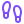
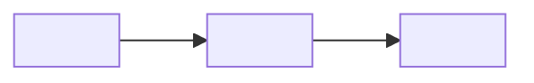

<!--
  A walkthrough: one task, for a person who has never done it, written so they can follow it alone or hand it to their
  AI helper. Copy this file to walkthroughs/<TASK-IN-CAPITALS>.md, replace every <ANGLE>, delete what does not apply,
  then delete this comment.
  Lucid (my-template/LUCID.md): an icon beside each idea from ../assets/icons/ (56 on the header, 24 on a heading, 16
  inline, always alt=""), one ```mermaid diagram only where a picture explains the mechanism (the PDF draws it too),
  one action per step with "You should see" after it, people named by role, and every command run or marked untested.
  Badges: Kind and Changed in the organisation's PRIMARY shade, For in the shared slate 64748b (TONES.md). In a badge a
  hyphen is written twice (--) and a space as _ .
  Placeholders only on a public page: no real addresses, project ids, keys or private paths (NAMES-POLICY.md).
-->
<div align="center">


# <WHAT THE READER WILL HAVE DONE, IN A FEW WORDS>

*<ONE SENTENCE: WHAT THIS GETS THEM, AND FOR WHOM.>*


 **You are here:** <ORGANISATION> › [`<REPOSITORY>`](../README.md) › [`walkthroughs`](README.md) › `<THIS-FILE>.md` · <PUBLIC OR PRIVATE> · `<BRANCH>` is the working branch

</div>

##  TL;DR

1.  **What you will have.** <ONE LINE>
2.  **Who does what.** <A HELPER CAN PREPARE …; A PERSON SIGNS IN, TYPES PASSWORDS AND APPROVES CONSENT SCREENS.>
3.  **Do this first.** <ONE COMMAND OR ONE LINK>

> **Handing this to your AI helper?** Say: *"Read <THIS-FILE>.md and walk me through it, one step at a time."*

**You need:** <TIME>, <ACCOUNTS>, <TOOLS ALREADY INSTALLED, AND HOW TO CHECK>.

Throughout, replace:

| Placeholder | Meaning | Example |
|---|---|---|
| `ACCOUNT` | <WHAT IT IS> | `you@yourorg.org` |
| `NAME` | <WHAT IT IS> | `acme` |

##  How it fits together

<!-- One picture, only if it explains the mechanism (who holds what, what talks to what). Delete the section otherwise. -->



##  1. <FIRST STEP, AS AN ACTION>

<ONE ACTION.>

```sh
<COMMAND>
```

*You should see:* <WHAT CONFIRMS IT WORKED>.

##  2. <A STEP A PERSON MUST DO HIMSELF OR HERSELF>

<SAY PLAINLY WHY A PERSON DOES THIS ONE: A PASSWORD, A CONSENT SCREEN, A PURCHASE.>

*You should see:* <…>.

##  3. Prove it worked, and stop if it did not

<A CHECK THAT FAILS CLOSED: IF THE RESULT IS NOT EXACTLY WHAT IT SHOULD BE, STOP AND SAY WHICH STEP TO GO BACK TO.>

##  If something goes wrong

| What you see | What it means | What to do |
|---|---|---|
| <ERROR TEXT, EXACTLY> | <PLAIN WORDS> | <STEP TO GO BACK TO> |

##  Taking it away

<HOW TO UNDO IT: REVOKE, MOVE ASIDE (NEVER DELETE WHAT YOU MAY NEED), AND WHAT IS GONE FOR GOOD.>

##  See also

- <RELATED WALKTHROUGH OR PROCEDURE, WITH ONE LINE ON WHEN TO READ IT>

<details>
<summary><b>Sources, checked YYYY-MM-DD</b></summary>

| Claim | Source | Checked |
|---|---|---|
| <WHAT THE PAGE RELIES ON> | <URL> | YYYY-MM-DD |

Anything not confirmed is marked *unverified* where it appears.

</details>

##  Suggest a change

Noticed something wrong, or know a better way? Open an issue or a pull request against `<BRANCH>`; <WHO> reads them, and a person with the role merges with a merge commit so your name stays on it. Not on GitHub? <HOW ELSE TO REACH US>.

<sub>One of the [walkthroughs](README.md) in `<REPOSITORY>`. Icons: Lucide (ISC). The PDF in `pdf/` is rendered from this page; edit the markdown, not the PDF.</sub>
