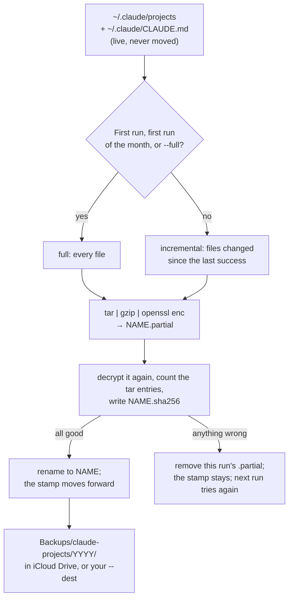

<div align="center">


# A nightly sealed copy of `~/.claude/projects`

### Every Claude Code transcript and memory file, archived and encrypted each night, into iCloud Drive or any folder you choose

*The live `~/.claude` stays where it is. Only finished, sealed archives of it travel.*


 **You are here:** drasticstatic lab › [`my-template`](../README.md) › [`walkthroughs/`](README.md) › `CLAUDE-PROJECTS-ARCHIVE.md` · public · `main` is the working branch

</div>

##  TL;DR

1.  **`~/.claude/projects` holds every session you have had,** and your agents' memory. It is not in git and it should never go to GitHub. Until now it lived on one disk.
2.  **One script seals a copy each night.** `tar`, `gzip`, then `openssl` AES-256 with a passphrase that lives in a file on this Mac and in your password manager.
3.  **It lands in iCloud Drive by default,** as finished files only. Advanced Data Protection covers it there; the passphrase covers it everywhere else.
4.  **A full copy once a month, then only what changed.** Each archive is checked after it is written. Nothing is ever deleted.
5.  **Restoring is one line,** into a new, empty folder. Never over the live `~/.claude`.
6.  **You set it up with four lines,** below. A helper may not: two of them show something on your screen.

> **Handing this to your AI helper?** Say: *"Read CLAUDE-PROJECTS-ARCHIVE.md. Run the self-test, tell me what it said, and
> give me the setup lines. Don't run --init, --run or --install yourself."*

##  How it works



| | |
|---|---|
| **What goes in** | everything under `~/.claude/projects` (transcripts, `memory/` folders, tool results, the manifest and session logs) and `~/.claude/CLAUDE.md`. Nothing is left out: all of it is wanted back. |
| **What stays out** | the rest of `~/.claude`: `settings.json`, credentials, caches, plugins. Those are not yours to lose in the same way, and some hold tokens. |
| **The script** | [`scripts/claude-projects-archive.sh`](../scripts/claude-projects-archive.sh), plain `/bin/sh` and the tools macOS ships with |
| **The proof** | [`scripts/claude-projects-archive.selftest.sh`](../scripts/claude-projects-archive.selftest.sh): a fake home in a temporary folder, 104 checks. Your real `~/.claude` is never read by it |
| **Names** | `claude-projects_20261107-004012_full.tar.gz.enc`, then `..._incr.tar.gz.enc`, each with a `.sha256` beside it. A plain sort of the names is the order they were made, and the order to restore them |
| **The seal** | `openssl enc -aes-256-cbc -pbkdf2 -iter 600000 -md sha256 -salt`. The passphrase is read from its file (`-pass file:`), never typed on a command line. LibreSSL (in macOS) and OpenSSL 3 open each other's archives; the self-test checks it |
| **Where the passphrase lives** | `~/.config/claude-archive/passphrase`, mode 600, in a folder of mode 700. The script refuses to run if the file is missing or anyone else can read it |
| **The schedule** | a LaunchAgent, `com.drasticstatic.claude-projects-archive`, at **00:40** each night, after the trading desk's 23:55 and 23:58 jobs. It runs `--if-due`, so it also runs at login after a night the Mac was off, and does nothing when the last success is under 20 hours old |
| **Logs** | `~/Library/Logs/claude-projects-archive/archive.log`, and one row per run in `~/.config/claude-archive/state/<destination>/history.tsv` |

##  Set it up: four lines, in this order

Run each one yourself, in a Terminal or with `!` in a Claude Code session. First prove the script on this Mac (safe for a
helper to run; it writes only in a temporary folder):

```sh
sh ~/code/my-template/scripts/claude-projects-archive.selftest.sh
```

**1. Make the passphrase.** It writes a random 44-character passphrase into `~/.config/claude-archive/passphrase`, only if
there is none yet, and never shows it.

```sh
! sh ~/code/my-template/scripts/claude-projects-archive.sh --init
```

**2. Put the passphrase in 1Password, then clear the clipboard.** Make a Password item (for example *claude-projects archive
passphrase*) and paste into its password field between these two lines:

```sh
! pbcopy < ~/.config/claude-archive/passphrase
! pbcopy < /dev/null
```

Without this passphrase nobody can open the archives, you included. If the Mac is lost, the copy in 1Password is the only key.

**3. The first archive, by hand.** It is a full one: about a minute and 1.2 GB at today's size (measured below).

> [!WARNING]
> **This one may put a prompt on your screen.** The first time Terminal (or VS Code, or the app you run it from) writes into
> iCloud Drive, macOS may ask to allow access to files in iCloud Drive. Allow it. iCloud then uploads the archive in the
> background, which takes a while on a slow connection.

```sh
! sh ~/code/my-template/scripts/claude-projects-archive.sh --run
```

**4. Schedule it.** This writes the LaunchAgent into `~/Library/LaunchAgents/` and loads it.

> [!NOTE]
> macOS shows a *Background Items Added* notification when a LaunchAgent is added. That is expected; the item then appears
> under System Settings › General › Login Items, where it can also be switched off.

```sh
! sh ~/code/my-template/scripts/claude-projects-archive.sh --install
```

**Check it.**

```sh
sh ~/code/my-template/scripts/claude-projects-archive.sh --list         # every archive, its size, the total
launchctl print gui/$(id -u)/com.drasticstatic.claude-projects-archive | grep -E 'state|last exit'
tail ~/Library/Logs/claude-projects-archive/archive.log                 # the morning after
sh ~/code/my-template/scripts/claude-projects-archive.sh --status       # ok, or STALE and why
```

**A failed night is never silent.** A background job that macOS blocks from iCloud Drive would just stop, and it would
look as if you were backed up. So a failed `--run` or `--if-due` is written to `~/.config/claude-archive/state/`, shows
a macOS banner (*Claude archive failed*, no prompt), and is passed to `~/.config/claude-archive/notify` if you make that
file executable (for example, two lines that push to your phone). `--status` reads it back without touching iCloud: exit
0 when the newest sealed copy is under 36 hours old and nothing failed after it, exit 1 otherwise. On the DEX desk's
Mac, the 23:58 journal job asks `--status` every night once the archive is installed and rings the phone when it is
stale.

**The morning after `--install`, check it once:**

```sh
sh ~/code/my-template/scripts/claude-projects-archive.sh --status   # "ok: ..." or "STALE: ..." and why
grep -i 'not permitted' ~/Library/Logs/claude-projects-archive/archive.log   # nothing printed is good
```

**If macOS blocked it** (*Operation not permitted* in the log, or `--status` says STALE while the hand run from Terminal
worked): the background job may not write into iCloud Drive. Pick one:
1. **Lean: schedule a folder outside iCloud** and keep iCloud for a hand run. `mkdir -p ~/Archives/claude-projects`,
   then `--install --dest ~/Archives/claude-projects` (Time Machine copies that folder), and once a week
   `--run` from Terminal for the iCloud copy. `--uninstall` the iCloud schedule if it keeps failing.
2. **Or a drive:** `--install --dest /Volumes/<drive>/claude-projects`; each destination has its own schedule.
3. **Not recommended:** giving `/bin/sh` Full Disk Access in System Settings › Privacy & Security. It would let every
   shell script read everything.

**Turn it off** any time: `sh ~/code/my-template/scripts/claude-projects-archive.sh --uninstall`. The plist is moved into
`~/.config/claude-archive/retired/`, not deleted, and the archives stay where they are.

##  Getting it back

**The newest state, in one line.** It finds the newest full archive and every incremental after it, checks each one's
`.sha256`, and unpacks them in order into a folder that must be new or empty:

```sh
sh ~/code/my-template/scripts/claude-projects-archive.sh --restore-latest ~/claude-restore
```

**By hand, any day you choose.** Give a full archive, then the incrementals that came after it, oldest first. The script
refuses a list that does not start with a full, or is out of order:

```sh
cd "$HOME/Library/Mobile Documents/com~apple~CloudDocs/Backups/claude-projects/2026"
sh ~/code/my-template/scripts/claude-projects-archive.sh --restore \
  claude-projects_20261201-004012_full.tar.gz.enc \
  claude-projects_20261202-004009_incr.tar.gz.enc \
  claude-projects_20261203-004011_incr.tar.gz.enc \
  ~/claude-restore-dec3
```

Each incremental holds whole files, newer copies of what the full already had plus anything new, so unpacking them in order
leaves each file as it was on the last day you gave. Stop at an earlier incremental to see an earlier day.

**Check one archive without unpacking it:** `--verify FILE` checks the `.sha256`, decrypts to a pipe and reads the tar
listing. Nothing is written.

Restore into a folder in your home, as above, not into Desktop or Documents: those may be synced to iCloud Drive, and
macOS may ask before a script writes there.

**Putting it back.** The restore lands in `<folder>/.claude/projects` and `<folder>/.claude/CLAUDE.md`. Compare first
(`diff -rq ~/claude-restore/.claude/projects ~/.claude/projects`). Then quit every Claude Code session and copy back
only what you need. The script never writes into `~/.claude`, and refuses to restore there.

**On a new Mac.** Clone `my-template`, then put the passphrase back from 1Password (copy it in 1Password first; a missing final newline does
not matter, tested):

```sh
mkdir -p -m 700 ~/.config/claude-archive
( umask 077; pbpaste > ~/.config/claude-archive/passphrase ) && pbcopy < /dev/null
sh ~/code/my-template/scripts/claude-projects-archive.sh --restore-latest ~/claude-restore
```

If iCloud has moved older archives off the disk to save space, open the folder in Finder and choose *Download Now* first.

##  Another destination: no iCloud, or a drive as well

Any folder works: an external drive, a NAS share, another cloud's folder.

```sh
sh ~/code/my-template/scripts/claude-projects-archive.sh --run --dest /Volumes/Backup/claude-projects
CLAUDE_ARCHIVE_DEST=/Volumes/Backup/claude-projects sh ~/code/my-template/scripts/claude-projects-archive.sh --list
sh ~/code/my-template/scripts/claude-projects-archive.sh --install --dest /Volumes/Backup/claude-projects   # its own nightly job
```

- **Each destination gets its own schedule.** `--install` alone schedules iCloud (`com.drasticstatic.claude-projects-archive`); `--install --dest DIR` adds a second LaunchAgent for that folder (`…archive.dest-<number>`, its own log in `~/Library/Logs/claude-projects-archive/`) beside it, so iCloud and a drive both run nightly. `--uninstall --dest DIR` removes only that one.

- **The folder must already exist.** The script makes only the year folder inside it. That way an unplugged drive does not
  quietly become a folder on your startup disk; the run is refused instead, and the next night tries again.
- **Each destination keeps its own chain.** The first run into a new destination is a full one.
- **It refuses any destination inside `~/.claude`,** symlinks followed, and any that contains it.
- Without iCloud Drive and without `--dest`, it refuses and says to pass `--dest`.

##  Optional: a backup upon commit

If you would like a run soon after you work, rather than at 00:40, add this one line to the `post-commit` hook of a
repository you choose (`.git/hooks/post-commit`, or the folder its `core.hooksPath` names, with `#!/bin/sh` as the first
line and the file executable):

```sh
( sh "$HOME/code/my-template/scripts/claude-projects-archive.sh" --if-due >/dev/null 2>&1 & )
```

It runs in the background, so the commit does not wait, and `--if-due` makes it do nothing until 20 hours have passed since
the last success. It is opt-in: no fleet hook carries it. In a repository whose hooks are version-controlled (`.githooks/`),
keep it out of the shared file: it would then run for everyone who clones it.

##  What it costs in iCloud space

Measured Nov 6, 2026 on this iMac, into a scratch folder (not iCloud), with a scratch passphrase:

| | Files | Before | Sealed | Time |
|---|---|---|---|---|
| Full archive | 1,913 | 2.8 GB | **1.2 GB** | 64 s, plus 7 s to verify it again |
| One day's incremental (the files changed in the last 24 hours) | 285 | 557 MB | **216 MB** | 12 s |

Transcripts compress less than plain text would (2.8 GB to 1.2 GB), because they carry pictures and other already-compressed
content. An incremental is large because a transcript that grew by one line travels whole.

**At that pace:** one full a month plus thirty incrementals is roughly **4 to 8 GB a month**, so **50 to 100 GB a year**, and
growing as the transcripts grow, because nothing is deleted. That is more than a 50 GB iCloud plan holds. Look at your plan
before a year has passed, and use the plan below.

**Keeping it smaller, when you decide to.** `--prune-plan KEEP` prints what keeping only the newest `KEEP` full archives
(and the incrementals after each) would move aside, with the sizes. It moves nothing. Moving them, for example to an
external drive, is a person's choice:

```sh
sh ~/code/my-template/scripts/claude-projects-archive.sh --prune-plan 3            # what would move; changes nothing
sh ~/code/my-template/scripts/claude-projects-archive.sh --move-old 3 /Volumes/Backup/claude-projects-older   # move them
```

`--move-old` moves the older chains (never deletes them) into the folder you name, each with its `.sha256`, and checks
every one after the move. The newest chains stay in iCloud and still restore on their own. **The rhythm we suggest:**
keep three months in iCloud (roughly 15 to 25 GB at today's pace), and once a month move the rest to the backup drive.
**Before `--install`, check the plan:** System Settings → your name → iCloud shows the plan and what is used. If iCloud
fills, iPhone backups and photo uploads stop too, so leave room.

##  Limits, honestly

- **A transcript being written at 00:40 may end mid-line in that night's archive.** The archive takes each file as it is at
  that moment. The next night's archive has the rest. If a session is running when you restore, read its last line with care.
- **A file deleted from `~/.claude/projects` comes back in a restore** that starts from an older full, because an incremental
  records what changed, not what was removed. Transcripts are kept for ten years (`cleanupPeriodDays: 3650`), so this rarely matters.
- **A renamed project folder is caught.** `rename-local-repo.py` keeps the files' old modification times, so the time test alone would miss them; each run also keeps the list of every path it saw and adds any path that is new since the last run. The old folder name still comes back in a restore from an older full: archives remember, they do not forget.
- **A run that fails writes nothing and is retried the next night,** or the next time `--if-due` is called. A file that
  vanishes between the listing and the archive (a project folder moved mid-run) fails that night's run; the next run catches up.
- **Whether a LaunchAgent may write into iCloud Drive without asking is UNVERIFIED** on this Mac. A failure is no longer
  silent (banner, `notify`, `--status`, the desk's nightly check); what to do is under *Check it*: a `--dest` outside iCloud.
- **iCloud takes time to upload.** An archive written just before a disaster may not have left the Mac.
- **The passphrase is the only key.** Lose both copies (this Mac's file and 1Password) and the archives are noise. Advanced
  Data Protection is a second lock, not a second key.
- **This does not replace Time Machine,** and it does not back up repositories: see
  [iCloud and GitHub, together](ICLOUD-AND-GITHUB-TOGETHER.md) for those.

##  Every mode

| Command | What it does |
|---|---|
| `--init` | make `~/.config/claude-archive/` (700) and the passphrase (600) if missing; print the `pbcopy` line, never the passphrase |
| `--run` | full or incremental, as above; prints the sizes and the destination's total |
| `--run --full` | a full archive whatever the date |
| `--if-due` | `--run` only if the last success is over 20 hours old |
| `--status` | did it work? reads only the state: exit 1 when the newest success is over 36 h old or a failure came after it |
| `--list` | every archive at the destination, oldest first, with sizes; flags an unfinished `.partial` left by a crash |
| `--verify FILE` | check the `.sha256`, decrypt to a pipe, read the tar; write nothing |
| `--restore FULL [INCR ...] DIR` | unpack those, in that order, into a new or empty `DIR` |
| `--restore-latest DIR` | the newest full and every incremental after it |
| `--prune-plan KEEP` | print what keeping the newest `KEEP` fulls would move aside; change nothing |
| `--install` / `--uninstall` | load or unload the 00:40 LaunchAgent; the plist is moved aside, never deleted |
| `--dest DIR` (or `CLAUDE_ARCHIVE_DEST`) | another destination, with any mode |

`CLAUDE_ARCHIVE_CONFIG` moves the config folder and `CLAUDE_ARCHIVE_PASSFILE` the passphrase file; the self-test and the
measurement above use them so that nothing touches your own.

##  Suggest a change

Noticed something wrong, or a step that could be kinder? Open an [issue](https://github.com/drasticstatic/my-template/issues)
or a pull request against `main`, changing this page. A person with the role reads it and merges with a merge commit, so
your name stays on it. An AI helper may do all of that up to the merge. Not on GitHub? Tell any steward you know, or your
helper, in your own words.

##  Change log
| Date | Change |
|---|---|
| 2026-11-06 | First version: `claude-projects-archive.sh` and its self-test (104 checks), a real-size measurement into a scratch folder, this page. Not yet run into iCloud, not yet scheduled. |

<sub>Written 2026-11-06 in the drasticstatic lab. Related: [Start Claude in the right folder](CLAUDE-SESSION-ORDER.md),
[iCloud and GitHub, together](ICLOUD-AND-GITHUB-TOGETHER.md). Part of the [walkthroughs](README.md).</sub>
