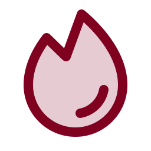

<div align="center">



# Connect Firecrawl

*Let your AI helper read whole websites as clean text, for research and site refreshes.*


 **You are here:** drasticstatic lab › [`my-template`](../README.md) › [`walkthroughs`](README.md) › `CONNECT-FIRECRAWL.md` · public · `main` is the working branch

</div>

##  TL;DR

1.  **Firecrawl lets your AI helper read whole websites as clean text, in one request.**
2.  It handles pages that need JavaScript and strips menus and cookie banners.
3.  It can map every page of a site.
4.  It's how a foundation refreshes its own website copy or researches others.
5.  **Connect it once in the helper you use.** The free tier covers ordinary use.

> **Handing this to your AI helper?** Say: *"Read CONNECT-FIRECRAWL.md and help me connect Firecrawl to
> you. Stop and ask me before anything that needs a login or a key."*

##  Pick your helper

<details open>
<summary><b>ChatGPT and Codex</b></summary>

1. Open Firecrawl's official plugin:
   <https://chatgpt.com/plugins/plugin_asdk_app_6a314a73f8ac819195b0d55e36b9c609?q=firecrawl>
2. Select **Connect** and sign in to Firecrawl (or create a free account).
3. In a chat, mention Firecrawl: *"Use Firecrawl to read https://example.org and summarise it."*

</details>

<details>
<summary><b>Claude (web and desktop)</b></summary>

1. Open the Firecrawl connector: <https://claude.ai/directory/connectors/firecrawl>
2. Select **Connect** and sign in to Firecrawl.
3. Ask: *"Use Firecrawl to map https://example.org and list its pages."*

</details>

<details>
<summary><b>Claude Code, Cursor and other code tools</b></summary>

Add Firecrawl's hosted server. It signs you in through your browser, so no key is stored in a file:

```json
{
  "mcpServers": {
    "firecrawl": {
      "type": "http",
      "url": "https://mcp.firecrawl.dev/v2/mcp-oauth"
    }
  }
}
```

**Claude Code:** user-level servers live in `~/.claude.json` under `"mcpServers"` (not in
`settings.json`). Restart Claude Code afterwards, then check `/mcp`.

**Prefer an API key?** Use `https://mcp.firecrawl.dev/v2/mcp` with your key as a bearer token, set in the
tool's own secure settings or environment. Never put it in a repository.

</details>

##  What to ask once it's connected

-  *"Map https://www.example.org and list every page with its title."*
-  *"Crawl the site and save each page as markdown in `firecrawls/YYYY-MM-DD/`. That folder is private and
  never published."*
-  *"Compare today's crawl with the last one and tell me what changed."*

##  Good to know

-  **Free tier:** ample for a small site's refresh. A whole-site crawl of about 20 pages uses about 20
  credits. Firecrawl also offers limited **keyless** search and scrape for trying it out.
-  **The key, if you use one, only reaches Firecrawl.** It can't touch your email, Drive or GitHub.
-  **Research stays private:** crawls go in the repository's private `firecrawls/` folder. The tripwire
  stops them from ever reaching the published site.
-  **Be a good neighbour:** crawl your own sites freely; for others', keep it occasional and respect their
  terms.

Official setup guide: <https://docs.firecrawl.dev/mcp-server>

##  Suggest a change

Noticed something wrong, or know a better way? Open an [issue](https://github.com/drasticstatic/my-template/issues) or a pull request against `main`; the lab steward reads them, and a person with the role merges with a merge commit so your name stays on it. Not on GitHub? Tell any steward you know, or your helper, in your own words.

<sub>One of the [walkthroughs](README.md) in `my-template`. Icons: Phosphor duotone (MIT).</sub>
