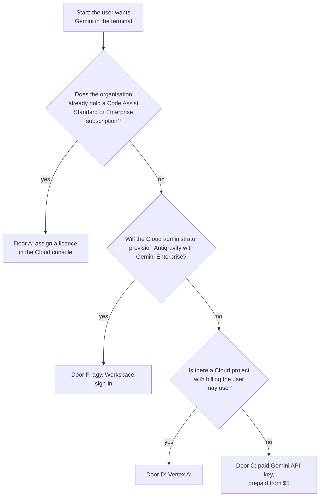

<div align="center">


# Gemini CLI for a Workspace account: which door is yours

*What a Google Workspace administrator does, what the user does, and what it costs, so Gemini runs in the terminal under the right account and nobody is billed by surprise.*


 **You are here:** drasticstatic lab › [`my-template`](../README.md) › [`walkthroughs`](README.md) › `GEMINI-CLI-ACCESS.md` · public · `main` is the working branch

</div>

##  TL;DR

1.  **Signing Gemini CLI in with a Workspace account can no longer be bought.** Google closed Gemini Code Assist Standard and Enterprise to new buyers on 2026-10-09, and Workspace AI Ultra Access is closed too ([Google's words](#-what-changed-in-googles-words)).
2.  **Three doors are still open:** a **paid Gemini API key** (cheapest, prepaid from $5), **Vertex AI** on a Cloud project with billing, or Google's own successor, **Antigravity CLI (`agy`)**, which the administrator provisions.
3.  **Paid Workspace Gemini is not paid Gemini CLI.** A Workspace plan with Gemini in Gmail and Docs does not pay for the terminal. Never fix an entitlement error by quietly turning on API billing.
4.  **Who does what:** the **Workspace administrator** (for THEF, Kenney) checks licences and turns services on in the Admin console. Doors A, D and F also need someone with roles in the **Google Cloud console**, which may be the same person or not ([two consoles](#-who-does-what)). The **user** (Christopher) sets up an isolated wrapper, keeps the key out of his shell profile, and proves the account before anything runs.
5.  **Do this first:** read [Which door is yours](#-which-door-is-yours), agree on one door together, then follow only that door's steps.

> [!IMPORTANT]
> **Asking Gemini (or any assistant) about this?** It may still say a Workspace edition or AI Expanded includes Gemini CLI, recommend buying Code Assist Standard or AI Ultra, or suggest `gws mcp`. All of those are out of date. The dated quotes below are the answer to show it. Code Assist licences live in the **Google Cloud console**, not the Workspace Admin console.
>
> **Paste the text or attach the PDF; do not send a link.** Tested 2026-11-09 with Gemini (Flash) on a Workspace account: it could not open this page from GitHub, by either link, and answered from memory instead. It recommended buying Code Assist, putting the API key in `~/.zshrc`, and a `gemini whoami` command, all wrong. Given the pasted text, it rebuilt the answer correctly and listed seven places its first answer had been wrong. It also questioned the AI Studio privilege below; Google's page confirms it is the **Gmail Settings administrator** privilege, as written.

Throughout, replace:

| Placeholder | Meaning | Example |
|---|---|---|
| `ACCOUNT` | the user's Workspace address | `you@yourorg.org` |
| `NAME` | a short label for this profile | `acme` |
| `PROJECT_ID` | the Cloud project the user works in | `acme-workspace-cli` |
| `LOCATION` | the Cloud region for Vertex AI (door D) | `us-central1` |

##  What changed, in Google's words

| Date | What Google says | Source |
|---|---|---|
| 2026-05-19 | "On June 18, 2026, Gemini CLI and Gemini Code Assist IDE extensions will stop serving requests for Google AI Pro and Ultra." The free individual tier stopped too. Existing Code Assist Standard and Enterprise customers keep access, and "paid Gemini and Gemini Enterprise Agent Platform API keys" keep working. | [Google Developers Blog](https://developers.googleblog.com/an-important-update-transitioning-gemini-cli-to-antigravity-cli/) |
| updated 2026-10-26 | "AI Ultra Access is no longer available for purchase." Only annual or fixed-term purchases made before May 5, 2026 keep it, and after the change "Workspace Business, Enterprise, Education, and legacy customers will no longer have access to … Gemini CLI and Gemini Code Assist" and "Google Antigravity." (It was formerly named "Google AI Ultra for Business.") | [Workspace Admin Help](https://knowledge.workspace.google.com/admin/gemini/ai-ultra-access) |
| updated 2026-10-29 | "Starting October 9, 2026, you can no longer purchase new Gemini Code Assist Standard or Enterprise subscriptions. Additionally, new Gemini Enterprise Standard and Plus subscriptions no longer include an entitlement to Gemini Code Assist." Coding help "will be available through Antigravity." | [Google Cloud docs](https://docs.cloud.google.com/gemini/docs/codeassist/sunset) |

> [!WARNING]
> **One Google page is stale.** The Gemini CLI quota page, last updated Jun 18, 2026, still lists Code Assist Standard (1,500 requests a day), Code Assist Enterprise (2,000) and Workspace AI Ultra (2,000). It is older than both changes above. It is still right that "Workspace AI Standard/Plus and AI Expanded, are not supported" and that Workspace web plans "do not apply to the API usage which powers the Gemini CLI." ([geminicli.com](https://geminicli.com/docs/resources/quota-and-pricing/), [GitHub copy](https://github.com/google-gemini/gemini-cli/blob/main/docs/resources/quota-and-pricing.md))

The AI Ultra page (Oct 26) also points to "Gemini Enterprise Standard or Plus" for Gemini CLI, but the newer Code Assist page (Oct 29) says new Standard and Plus subscriptions no longer carry Code Assist, and Google's Gemini Enterprise developer-tools page lists only Antigravity, Antigravity for IDEs and Android Studio, not Gemini CLI ([source](https://docs.cloud.google.com/gemini/enterprise/docs/ai-developer-tools-overview)). Read the newest page as the answer.

##  Four things that are not one login

| Field | The question it answers | Example of getting it wrong |
|---|---|---|
| **Identity** | Which account is signed in? | the browser's last account, not `ACCOUNT` |
| **Access** | Is that account entitled to the tool? | a Workspace Gemini licence taken to mean Gemini CLI |
| **Billing** | Whose card pays for each request? | an API key in the shell profile, billing a project nobody chose |
| **Beneficiary** | Which organisation is the work for? | one organisation's spend recorded against another's task |

Each door below sets these four separately, on purpose.

##  Which door is yours



| Door | Open to a new buyer on 2026-11-09? | Who acts first | Cost | Pick it when |
|---|---|---|---|---|
| **A** · Code Assist Standard or Enterprise, Google sign-in | **No.** Closed since 2026-10-09; existing subscribers renew until 2027-01-31 (annual) or 2027-12-31 (monthly) | a Cloud billing administrator | Standard $22.80 a user a month (monthly) or $19 (12-month term); Enterprise $54 or $45 | the organisation **already** holds a subscription |
| **B** · Workspace AI Ultra Access | **No.** Closed, and it loses Gemini CLI anyway | — | — | only if bought on an annual plan before 2026-05-05, and only until its renewal |
| **C** · Gemini API key from Google AI Studio | **Yes** | the administrator turns AI Studio on; then the user | free tier exists but is unfit for organisation data; paid tier prepaid from $5, per token | the cheapest paid door, no Cloud project needed |
| **D** · Vertex AI (now Gemini Enterprise Agent Platform), regular mode | **Yes** | the project's owner | per token, the same Flash rates as door C | a Cloud project with billing is already in use |
| **E** · Vertex AI Express mode | **No** for a Workspace account: it is for "a @gmail.com Google Account," new to Google Cloud | — | 90-day free tier | never, for this account |
| **F** · Antigravity CLI (`agy`) | **Yes** | the organisation's Google Cloud administrator assigns a licence or role | a Gemini Enterprise Standard or Plus seat (price not on Google's pages), or Pay-as-you-go at token prices; or a Gemini API key as in door C | the organisation wants Google's supported terminal route, under Workspace sign-in |

Gemini CLI 0.67.0 still works through doors C and D. Google's supported terminal route for Workspace accounts is now door F.

##  Who does what

**Two consoles, maybe two people.** Google splits this work between the **Workspace Admin console** (<https://admin.google.com>: users, licences, AI Studio) and the **Google Cloud console** (<https://console.cloud.google.com>: Code Assist, Gemini Enterprise, projects, billing, IAM roles). Being a Workspace administrator does not by itself give Cloud roles. Where a step below says *Cloud administrator*, it means whoever holds that role in the organisation's Google Cloud; if that is not Kenney, he names who it is.

| Step | The administrator (Workspace: Kenney; Cloud: whoever holds the role) | The user (Christopher) |
|---|---|---|
| Agree on the door | says which door the organisation will pay for, and who is the billing owner | says what the work is for (the beneficiary) |
| Check licences | [Licence check](#-licence-check-for-the-administrator) (Workspace) | — |
| Door A | Cloud: confirms the subscription, enables the API and grants the roles on `PROJECT_ID` ([below](#-licence-check-for-the-administrator)) | sets `GOOGLE_CLOUD_PROJECT` in the default wrapper |
| Door C | Workspace: turns **AI Studio** on for the user. The billing owner links billing | creates the key, stores it outside the shell profile, uses the second wrapper |
| Door D | Cloud: grants the "Vertex AI User" role, or asks the project's owner to | signs in with `gcloud`, uses the second wrapper |
| Door F | Cloud: assigns a Gemini Enterprise licence or IAM role, and turns on AI developer tools | chooses **Business account** at sign-in |
| Prove it | — | runs the [identity check](#-4-prove-the-account-and-fail-closed) before any real work |
| Spend | approves spend before it happens | records each task in the [showback](#-costs) |

A helper (an AI agent) may prepare the wrapper and the settings files. Purchases, sign-ins, passwords, consent screens and turning on billing are always done by a person.

##  Licence check, for the administrator

In the **Workspace Admin console** (<https://admin.google.com>):

1. **One user's licences:** **Menu › Directory › Users**, click the user, scroll to **Licenses**. Each service has an on/off switch in the **Status** column; switch it, then **Save**. This needs the *User management* privilege.
   *You should see:* the user's licences listed with their switches.
2. **Everyone, or automatic assignment:** **Menu › Billing › License settings**. This needs the *License management* privilege.
3. **AI Expanded Access, check only:** if the user already has it, it shows in step 1's list. **Do not assign it for this purpose:** Google's AI Expanded page lists **no developer tools**, so it does not open Gemini CLI. (For other reasons, it is assigned at **Directory › Users**, tick the user, **Assign licenses › AI Expanded Access › Assign**, and can take up to 24 hours.)
4. **Door C only, AI Studio:** **Menu › Apps › Additional Google services › AI Studio › Service status › On** (for everyone, an organisational unit or a group), then **Save**. This needs the *Gmail Settings administrator* privilege and a verified domain. With it off, users "can't set up or manage billing for the Gemini API."
   *You should see:* AI Studio's status **On** for the user's unit or group.

Not in the Workspace Admin console at all:

- **Code Assist licences (door A), for a Cloud billing administrator:** **Google Cloud console › Admin for Gemini ›** pick the billing account **› Manage Gemini Code Assist Subscription › License management**. On `PROJECT_ID`, enable `cloudaicompanion.googleapis.com` (the Gemini for Google Cloud API) and grant the user `roles/cloudaicompanion.user` and `roles/serviceusage.serviceUsageConsumer`. A licence assigns itself when the user has `cloudaicompanion.licenses.selfAssign` on a project tied to that billing account; otherwise assign it on the License management page.
  *You should see:* the user listed on License management. If there is no subscription to manage, door A is closed: choose another door.
- **Gemini Enterprise Standard or Plus seats (door F):** in the Google Cloud console, under Gemini Enterprise ([door F's steps](#-3-the-paid-doors-c-d-or-f)).

 **Unverified:** the **Menu › Billing › Subscriptions** overview, and an Admin console path for "provisioning Antigravity," which no Google page found on 2026-11-09 describes.

 **For the user:** <https://one.google.com/about/plans> shows "You're currently signed in to your Google Workspace Account" for a work account. Consumer Google One plans do not apply to it.

##  Costs

| Door | Price, as Google published it on 2026-11-09 |
|---|---|
| **A** | Standard $22.80 a user a month monthly, $19 on a 12-month term; Enterprise $54 monthly, $45 annual (the monthly figures are Google's hourly rates × 730). Closed to new buyers |
| **C, free tier** | $0: 250 requests a day, Flash only; Gemini 4 Argon is "not available on the Free tier"; Google marks free-tier content "used to improve our products." **Not for organisation data** |
| **C, paid tier** | link a billing account and prepay at least $5; Tier 1 has a $250 cap. Per 1M tokens: **Gemini 3.8 Flash** $0.75 in / $3.75 out through 2026-12-31, then $1.50 / $7.50; **Gemini 4 Argon** $2 / $10 through 2026-11-30, then $4 / $20. Batch and Flex cost half |
| **D** | per token, the same Gemini 3.8 Flash rates as door C |
| **F** | a Gemini Enterprise **Standard** or **Plus** seat, which includes $10 (Standard) or $15 (Plus) of monthly credit; the seat price is not on any Google page we could open (third-party sites say about $30 a seat a month for Standard: *unverified*). Or **Pay-as-you-go**: "no subscription or license fee," billed at Agent Platform token prices from prepaid credits; Google's editions table also says "1 minimum seat requirement to get started." Business edition and free trials do **not** include the developer tools |

 **New-account credits:** Google Cloud offers $300 to new accounts, but they still need a billing account, and whether they cover Gemini on Vertex AI is *unverified*. The Gemini Enterprise 30-day Plus trial does not help: "Free-trial subscriptions don't include access to AI developer tools."

**Keep a showback before anyone settles up.** One row per task, with these columns: `task_id`, `beneficiary_org`, `agent/session`, `provider/model`, `billing_owner`, `actual_cost`, `allocation_basis`, `evidence`, `approval`. A share of a subscription is an estimate; say so in `allocation_basis`.

##  1. Install, carefully

```sh
npm install -g @google/gemini-cli@0.67.0 --ignore-scripts
gemini --version
```

*You should see:* `0.67.0`.

What was checked before this version was installed: the package was published by `google-wombot` and its registry signatures verified; it carries **no npm provenance attestation**. `--ignore-scripts` keeps any install script from running.

##  2. The default wrapper: Google sign-in, no billing

One wrapper per account, so the account is always explicit. This one can **never** bill an API key, because it removes every key from its environment before Gemini starts. It is the right wrapper for door A, and the safe default for everyone else: without a Code Assist licence its sign-in is refused, which is the point. It fails rather than quietly billing someone.

```sh
mkdir -m 700 -p ~/.config/gemini-NAME/.gemini
mkdir -p ~/.local/bin
cat > ~/.local/bin/geminiNAME <<'EOF'
#!/bin/sh
# Gemini CLI for ACCOUNT only: Google sign-in, never an API key, so it cannot bill one.
unset GEMINI_API_KEY GOOGLE_API_KEY GOOGLE_APPLICATION_CREDENTIALS GOOGLE_GENAI_USE_VERTEXAI
export GEMINI_CLI_HOME="$HOME/.config/gemini-NAME"
export GOOGLE_CLOUD_PROJECT="PROJECT_ID"
export GOOGLE_WORKSPACE_CLI_CONFIG_DIR="$HOME/.config/gws-NAME"
exec gemini "$@"
EOF
chmod +x ~/.local/bin/geminiNAME
```

Then its settings, `~/.config/gemini-NAME/.gemini/settings.json`:

```json
{
  "security": { "auth": { "selectedType": "oauth-personal", "enforcedType": "oauth-personal" } },
  "general": { "enableAutoUpdate": false },
  "advanced": { "ignoreLocalEnv": true }
}
```

- `GEMINI_CLI_HOME` gives this wrapper its own settings, sign-in and history; `GOOGLE_WORKSPACE_CLI_CONFIG_DIR` keeps its `gws` calls on the same account ([the `gws` profile walkthrough](GOOGLE-WORKSPACE-CLI-NEW-PROFILE.md)).
- Workspace sign-in needs a Cloud project: the Gemini for Cloud API enabled, IAM set, and `GOOGLE_CLOUD_PROJECT` (or `GOOGLE_CLOUD_PROJECT_ID`) exported.
- Auto-update off means a new version arrives only when you install it on purpose. `ignoreLocalEnv` stops a project's `.env` file from putting a key back.

 **Check against your version:** the setting names above are the ones recorded for 0.67.0 on 2026-11-09. If `gemini` warns about an unknown setting, look it up in the settings reference for your version before changing anything.

 **Untested end to end:** the wrappers on this page were written for it from the recorded settings and Google's documentation, and have not yet been run as printed. Run each command, and correct this page if one does not do what it says.

> [!NOTE]
> Credential separation is not a sandbox. Two wrappers keep two accounts' logins apart; they do not stop a command run by Gemini from reading your files.

##  3. The paid doors: C, D or F

Follow only the door you agreed on. Doors C and D bill through Gemini CLI: keep the default wrapper exactly as it is and add a **second** one, so choosing to pay is always a different command, never a quiet change. Door F is a different program (`agy`), set up mostly by the Cloud administrator.

<details open>
<summary><b>Door C: a paid Gemini API key</b></summary>

1. **The administrator** turns AI Studio on for the user ([licence check, step 4](#-licence-check-for-the-administrator)).
2. **The user** opens <https://aistudio.google.com/app/apikey> as `ACCOUNT` and creates a key. **The billing owner** agreed at the start (often the administrator, who holds the organisation's card) links the billing account and prepays at least $5; until then the key is on the free tier. Creating a key in an organisation's project needs `apikeys.keys.create`, `serviceusage.services.enable` and related permissions (for example *Project Editor*); without them, the administrator creates it.
3. **Store the key in its own file**, never in `~/.zshrc`, `~/.bashrc`, a repository or a chat:

```sh
mkdir -m 700 -p ~/.config/gemini-NAME-paid/.gemini
( umask 077; pbpaste > ~/.config/gemini-NAME-paid/api_key )   # copy the key from AI Studio first; it is never shown on screen
cat > ~/.local/bin/geminiNAME-paid <<'EOF'
#!/bin/sh
# Gemini CLI for ACCOUNT, billed to the organisation's Gemini API key. A separate command on purpose.
unset GOOGLE_API_KEY GOOGLE_APPLICATION_CREDENTIALS GOOGLE_GENAI_USE_VERTEXAI GOOGLE_GENAI_USE_GCA
KEYFILE="$HOME/.config/gemini-NAME-paid/api_key"
[ -s "$KEYFILE" ] || { echo "geminiNAME-paid: no key at $KEYFILE; stopping" >&2; exit 1; }
[ "$(stat -f %Lp "$KEYFILE")" = 600 ] || { echo "geminiNAME-paid: $KEYFILE must be chmod 600; stopping" >&2; exit 1; }
GEMINI_API_KEY="$(cat "$KEYFILE")"; export GEMINI_API_KEY
export GEMINI_CLI_HOME="$HOME/.config/gemini-NAME-paid"
exec gemini "$@"
EOF
chmod +x ~/.local/bin/geminiNAME-paid
```

Its settings, `~/.config/gemini-NAME-paid/.gemini/settings.json`, are the same as the default's with `gemini-api-key` in place of `oauth-personal`. No Cloud project is needed.

`stat -f %Lp` is the macOS form; on Linux it is `stat -c %a`. A Keychain entry is an alternative to the file, but reading it pops a Keychain prompt on screen.

</details>

<details>
<summary><b>Door D: Vertex AI on a Cloud project</b></summary>

1. **The project's owner** enables the Vertex AI API, attaches billing, and grants the user the "Vertex AI User" role.
2. **The user** writes the second wrapper. It sets `GOOGLE_GENAI_USE_VERTEXAI=true`, the project and the region, and gives `gcloud` a folder of its own:

```sh
mkdir -m 700 -p ~/.config/gemini-NAME-paid/.gemini ~/.config/gcloud-NAME
cat > ~/.local/bin/geminiNAME-paid <<'EOF'
#!/bin/sh
# Gemini CLI for ACCOUNT, billed to PROJECT_ID through Vertex AI. A separate command on purpose.
unset GEMINI_API_KEY GOOGLE_API_KEY GOOGLE_GENAI_USE_GCA
export CLOUDSDK_CONFIG="$HOME/.config/gcloud-NAME"
# Gemini CLI ignores CLOUDSDK_CONFIG, so name this profile's login file directly:
export GOOGLE_APPLICATION_CREDENTIALS="$HOME/.config/gcloud-NAME/application_default_credentials.json"
[ -s "$GOOGLE_APPLICATION_CREDENTIALS" ] || { echo "geminiNAME-paid: not signed in (no $GOOGLE_APPLICATION_CREDENTIALS); stopping" >&2; exit 1; }
export GOOGLE_GENAI_USE_VERTEXAI=true GOOGLE_CLOUD_PROJECT="PROJECT_ID" GOOGLE_CLOUD_LOCATION="LOCATION"
export GEMINI_CLI_HOME="$HOME/.config/gemini-NAME-paid"
exec gemini "$@"
EOF
chmod +x ~/.local/bin/geminiNAME-paid
CLOUDSDK_CONFIG=~/.config/gcloud-NAME gcloud auth application-default login   # a browser opens: choose ACCOUNT
```

Its settings use `vertex-ai` in place of `oauth-personal`. Google also allows a service-account key (`GOOGLE_APPLICATION_CREDENTIALS`) or a Cloud API key (`GOOGLE_API_KEY`) here; a person's own sign-in is easier to revoke.

 **Why two variables:** `CLOUDSDK_CONFIG` keeps `gcloud`'s own login in this profile's folder, but the Google sign-in library inside Gemini CLI 0.67.0 does not read it: it looks only in `~/.config/gcloud/`, which every account on the machine shares (read in the 0.67.0 code on 2026-11-09, not run). `GOOGLE_APPLICATION_CREDENTIALS` points it at this profile's file instead. The wrapper as a whole is still untested; the identity check in step 4 is what catches a wrong account.

</details>

<details>
<summary><b>Door F: Antigravity CLI (agy)</b></summary>

This door is not in the Workspace Admin console. Google: "Licenses are assigned by your organization's Google Cloud administrator."

**The Cloud administrator** (with `roles/discoveryengine.agentspaceAdmin`), in the Google Cloud console:

1. Enables the Gemini Enterprise API, `aiplatform.googleapis.com`, **before** buying anything, and waits about five minutes; Google says a purchase can fail otherwise.
2. Turns on **Gemini Enterprise › Settings › AI developer tools** for the region (global, us or eu). Google warns "AI developer tools may be turned off by default."
3. Gives the user access in one of two ways:
   - a **Gemini Enterprise Standard or Plus seat**. It must be an "active non-trial subscription"; Standard, Plus, Standard Emerging Market and Pay-as-you-go qualify, Business and free trials do not; or
   - with no seat, a Cloud project on an **invoiced** billing account, billed per use.
4. Either way, grants the user `roles/discoveryengine.agentspaceUser`, which Google says everyone using Antigravity needs.

*You should see:* the user holding a seat (or the role on the project), and AI developer tools **On** for the region.

The Antigravity FAQ puts it as: "Your Workspace administrator must explicitly provision Antigravity for your account. If it isn't provisioned, sign-in fails." Its enterprise page shows the provisioning is the Cloud steps above.

**The user** chooses **Business account** at sign-in, with the same identity the licence was given to.

Without Workspace provisioning, `agy` can also run on a Gemini API key: set `"modelProvider": "gemini"` in `~/.gemini/antigravity-cli/settings.json` and export `GEMINI_API_KEY`, which brings back door C's billing (and its key rules).

</details>

##  4. Prove the account, and fail closed

Report four things separately, never as one "it works": **installed** (step 1), **authenticated** (signed in), **read-tested** (one read under the right account) and **write-tested** (only when a write is actually needed, and only after the read).

<details open>
<summary><b>Door A: the signed-in Google account</b></summary>

Start the wrapper and run `/about` inside Gemini. Its **Auth Method** line must read `Signed in with Google (ACCOUNT)`, never `gemini-api-key` or `vertex-ai` (taken from the 0.67.0 code on 2026-11-09, not from a run; the address may be hidden if the user-identity display is off).

 **Untested sketch** of an automatic check, to put in the default wrapper above `exec gemini`. The 0.67.0 code keeps the signed-in address under `"active"` in `google_accounts.json`, in the `.gemini/` folder under `GEMINI_CLI_HOME`; the sketch itself has not been run:

```sh
ACTIVE="$(sed -n 's/.*"active"[^"]*"\([^"]*\)".*/\1/p' "$GEMINI_CLI_HOME/.gemini/google_accounts.json" 2>/dev/null)"
if [ "${FIRST_LOGIN:-}" != 1 ] && [ "$ACTIVE" != "ACCOUNT" ]; then
  echo "geminiNAME: signed in as '${ACTIVE:-nobody}', expected ACCOUNT; stopping" >&2; exit 1
fi
```

For the very first sign-in, run `FIRST_LOGIN=1 geminiNAME` once.

</details>

<details>
<summary><b>Door F: the agy sign-in</b></summary>

 **Unverified:** Google's Antigravity pages give no command that prints the signed-in account, and `agy` was not run for this page. Until one is known, the user confirms the account on the browser sign-in screen, and the administrator confirms in the Cloud console that the licence or role was given to `ACCOUNT`. If your address belongs to more than one identity provider, Google says to "sign in with the identity that matches your Gemini Enterprise license."

</details>

<details>
<summary><b>Door D: the gcloud login</b></summary>

 **Untested sketch**, for the second wrapper above `exec gemini`:

```sh
TOKEN="$(gcloud auth application-default print-access-token 2>/dev/null)" || { echo "geminiNAME-paid: not signed in; stopping" >&2; exit 1; }
WHO="$(curl -fsS "https://oauth2.googleapis.com/tokeninfo?access_token=$TOKEN" | sed -n 's/.*"email": *"\([^"]*\)".*/\1/p')"
[ "$WHO" = "ACCOUNT" ] || { echo "geminiNAME-paid: gcloud is signed in as '${WHO:-unknown}', expected ACCOUNT; stopping" >&2; exit 1; }
```

</details>

<details>
<summary><b>Door C: the key's project</b></summary>

A key carries no person's address, so the check is the key's **project**: open <https://aistudio.google.com/app/apikey> as `ACCOUNT` and confirm the key sits in the organisation's project, not a personal one. The wrapper itself already stops if the key file is missing or readable by anyone else.

</details>

Then one read through Workspace data, if the helper will use it: `gwsNAME drive about get --params '{"fields":"user(emailAddress)"}'` must print `ACCOUNT` ([why](GOOGLE-WORKSPACE-CLI-NEW-PROFILE.md#-6-prove-it-is-the-right-account)). Anything else: stop.

##  5. Connect Drive and Docs (MCP)

What a bridge gives: **data access, not Gemini's chats or reasoning.** Whatever a bridge retrieves enters the model's context, so start read-only.

| Bridge | What it is | Status on 2026-11-09 |
|---|---|---|
| **`gwsNAME` as a shell tool** | Gemini runs `gwsNAME drive …` or `gwsNAME docs …` through its shell tool, on the read-only grant the [`gws` profile](GOOGLE-WORKSPACE-CLI-NEW-PROFILE.md) already has | **Start here.** The only route that needs no new grant. Not MCP |
| **Google's remote MCP servers** | Drive at `https://drivemcp.googleapis.com/mcp/v1`, Docs at `https://docsmcp.googleapis.com/mcp/v1` | Developer Preview: needs the Workspace Developer Preview Program, the `drivemcp.googleapis.com` / `docsmcp.googleapis.com` APIs and a Web-application OAuth client. Google documents them for Antigravity and Claude, **not Gemini CLI** (untested with it) |
| **Gemini CLI Workspace extension** | `gemini extensions install https://github.com/gemini-cli-extensions/workspace` (v0.0.8, 2026-05-04) | it can "read, modify, and delete" Workspace data, so it is **not read-only**. Whether the administrator must allow its OAuth app is *unverified* |
| ~~`gws mcp`~~ | — | **Gone.** `gws` removed its `mcp` command in 0.8.0; 0.22.5 answers "Unknown service 'mcp'." Do not use it |

**The shell-tool route.** Nothing to install: ask Gemini to list or read a document, and approve each `gwsNAME` command it proposes. Leave `tools.allowed` unset in settings, so every command still asks first. (An entry such as `"run_shell_command(git)"` there skips the prompt for that command.)

**An MCP server, if you add one later.** Servers go under `mcpServers` in the wrapper's own `settings.json`, each with one of `command` (stdio), `url` (SSE) or `httpUrl` (streamable HTTP), and options `args`, `env`, `cwd`, `headers`, `timeout`, `trust` (default `false`; keep it), `includeTools` / `excludeTools`, and `oauth` for a remote server. `gemini mcp add [-s user|project] [-t stdio|sse|http] <name> <commandOrUrl>` writes the same file. Run it through the wrapper (`geminiNAME mcp add …`) so it lands in that profile.

```json
{
  "mcpServers": {
    "drive": { "httpUrl": "https://drivemcp.googleapis.com/mcp/v1", "oauth": { "enabled": true }, "trust": false }
  }
}
```

 **Untested:** the block above with Gemini CLI. Google's setup pages give the redirect addresses only for Antigravity (`https://antigravity.google/oauth-callback`) and Claude (`https://claude.ai/api/mcp/auth_callback`), and Antigravity's own file is `~/.gemini/config/mcp_config.json` with `serverUrl` and `oauth{clientId,clientSecret}`. Remote-server tokens are kept in `~/.gemini/mcp-oauth-tokens.json`; under a wrapper, presumably in its own home's `.gemini/` (*unverified*).

Gemini CLI strips any variable named like `*KEY*`, `*TOKEN*`, `*SECRET*`, `*AUTH*` or `*CREDENTIAL*` from what an MCP server inherits, unless that server's `env` names it. A server that cannot find its key is usually this.

##  What not to do

-  **No API key in a shell profile** (`~/.zshrc`, `~/.bashrc`, `~/.profile`) or a project's `.env`. Every program you start would carry it, and Gemini picks it up without asking.
-  **No silent billing.** If Google sign-in says the account is not entitled, stop and ask the administrator. Do not switch the default wrapper to a key.
-  **Do not buy what is closed:** Code Assist Standard or Enterprise, Workspace AI Ultra Access, or a Gemini Enterprise trial for developer tools.
-  **No organisation data through the free tier.** Its content may be used to improve Google's products.
-  **No unattended agent loops.** A person reads each result before the next task. A task has a bounded brief and a result that says what was and was not done.
-  **No bare `gemini` or `gws`** once there is more than one account on the machine.
-  **No `gws mcp`.** It no longer exists.

##  If something goes wrong

| What you see | What it means | What to do |
|---|---|---|
| Google sign-in in Gemini CLI is refused as not entitled (exact wording not recorded here) | the account has no Code Assist licence, which a new buyer can no longer get | pick door C, D or F with the administrator. Do not add a key to the default wrapper |
| Gemini CLI asks for `GOOGLE_CLOUD_PROJECT` | Workspace sign-in needs a Cloud project | set `PROJECT_ID` in the wrapper; the Gemini for Cloud API must be on there |
| AI Studio says you "can't set up or manage billing for the Gemini API," or will not open | AI Studio is off for your unit or group | the administrator turns it on ([step 4](#-licence-check-for-the-administrator)) |
| Requests stop after 250 a day, or Gemini 4 Argon is "not available" | the key is on the free tier | link billing and prepay, or stay on Flash |
| `agy` sign-in fails with a Workspace account | Antigravity is not provisioned for it | the Cloud administrator, door F: a seat or `agentspaceUser`, and AI developer tools on |
| A Gemini Enterprise purchase fails | the Gemini Enterprise API was not on yet | enable `aiplatform.googleapis.com`, wait about five minutes, try again |
| The administrator cannot find Code Assist in the Admin console | it is not there | **Google Cloud console › Admin for Gemini** |
| A Vertex AI permission error | role, API or billing missing on `PROJECT_ID` | the project's owner grants "Vertex AI User," enables the Vertex AI API, attaches billing |
| The wrapper stops: "signed in as …, expected ACCOUNT" | the check did its job: wrong account | sign out inside that wrapper and sign in again as `ACCOUNT` |
| `gwsNAME`: "Unknown service 'mcp'" | `gws` removed MCP in 0.8.0 | use the shell-tool route |
| An MCP server says its key is missing | Gemini CLI strips `*KEY*`-style variables | name the variable in that server's `env` |
| Gemini seems to use a key you did not give it | a key in the shell profile or a `.env` file | remove it there; the wrappers unset it, a bare `gemini` does not |
| `gemini` warns about an unknown setting | a setting name changed between versions | look it up for your version before editing |

<details>
<summary><b> Sources, checked 2026-11-09</b></summary>

| Claim | Source | Page date |
|---|---|---|
| Code Assist closed to new buyers; renewals; Antigravity as successor | <https://docs.cloud.google.com/gemini/docs/codeassist/sunset> | 2026-10-29 |
| AI Ultra Access closed, and loses Gemini CLI | <https://knowledge.workspace.google.com/admin/gemini/ai-ultra-access> | 2026-10-26 |
| Consumer sign-in ended 2026-06-18; paid API keys keep working | <https://developers.googleblog.com/an-important-update-transitioning-gemini-cli-to-antigravity-cli/> | 2026-05-19 |
| Quota page (stale on the plans it lists) | <https://geminicli.com/docs/resources/quota-and-pricing/> | 2026-06-18 |
| Workspace sign-in needs a Cloud project; auth types | <https://github.com/google-gemini/gemini-cli/blob/main/docs/get-started/authentication.mdx> | — |
| `/about`'s Auth Method line; `google_accounts.json` under `GEMINI_CLI_HOME`; the sign-in library ignoring `CLOUDSDK_CONFIG` | the installed `@google/gemini-cli` 0.67.0 bundle, read, not run | read 2026-11-09 |
| Gemini Enterprise developer tools list | <https://docs.cloud.google.com/gemini/enterprise/docs/ai-developer-tools-overview> | — |
| Code Assist setup and licences | <https://docs.cloud.google.com/gemini/docs/discover/set-up-gemini>, <https://cloud.google.com/products/gemini/pricing> | 2026-10-27 |
| AI Studio on or off | <https://knowledge.workspace.google.com/admin/users/access/turn-google-ai-studio-on-or-off-for-users> | — |
| API key permissions | <https://ai.google.dev/gemini-api/docs/api-key> | — |
| API billing, tiers, prices | <https://ai.google.dev/gemini-api/docs/billing>, <https://ai.google.dev/gemini-api/docs/pricing> | — |
| Vertex AI prices | <https://cloud.google.com/vertex-ai/generative-ai/pricing> | — |
| Express mode is for @gmail.com accounts | <https://docs.cloud.google.com/vertex-ai/generative-ai/docs/start/express-mode/overview> | 2026-11-09 |
| Antigravity provisioning, enterprise sign-in, API-key mode | <https://antigravity.google/docs/faq>, <https://antigravity.google/docs/enterprise>, <https://antigravity.google/docs/install> | — |
| Gemini Enterprise editions, Pay-as-you-go | <https://docs.cloud.google.com/gemini/enterprise/docs/editions>, <https://docs.cloud.google.com/gemini/enterprise/docs/quotas-and-pay-as-you-go-usage> | — |
| Licence assignment in the Admin console | <https://knowledge.workspace.google.com/admin/billing/assign-remove-and-reassign-licenses>, <https://knowledge.workspace.google.com/admin/generative-ai/workspace-with-gemini/choose-who-can-use-gemini-add-ons> | — |
| AI Expanded lists no developer tools | <https://knowledge.workspace.google.com/admin/getting-started/editions/compare-google-ai-expansion-add-ons> | 2026-10-30 |
| MCP settings in Gemini CLI | <https://github.com/google-gemini/gemini-cli/blob/main/docs/tools/mcp-server.md> | — |
| Google's Drive and Docs MCP servers | <https://developers.google.com/workspace/drive/api/guides/configure-mcp-server>, <https://developers.google.com/workspace/docs/api/guides/configure-mcp-server> | 2026-11-05 |
| Workspace extension | <https://github.com/gemini-cli-extensions/workspace> | release 2026-05-04 |
| `gws` dropped MCP | <https://github.com/googleworkspace/cli> | — |

A dash means the page carried no date we could read. Prices and plans change; check the page before buying.

</details>

##  See also

-  [Give an agent its own Google account profile](GOOGLE-WORKSPACE-CLI-NEW-PROFILE.md): the `gws` profile this page's wrapper and shell-tool route lean on.
-  [Many AI tools, one team](MANY-AI-TOOLS-ONE-TEAM.md): how several helpers share one rulebook and one credit line.

##  Suggest a change

Google changes these plans often. Found a page that has moved, or a door that has opened or closed? Open an [issue](https://github.com/drasticstatic/my-template/issues) or a pull request against `main` with the link and the date you read it; the lab steward reads them, and a person with the role merges with a merge commit so your name stays on it. Not on GitHub? Tell any steward you know, or your helper, in your own words.

<sub>One of the [walkthroughs](README.md) in `my-template`, in the shape of [`walkthroughs-template/`](../walkthroughs-template/). Icons: Phosphor duotone (MIT). Diagram: Mermaid (MIT). The PDF in `pdf/` is rendered from this page; edit the markdown, not the PDF.</sub>
