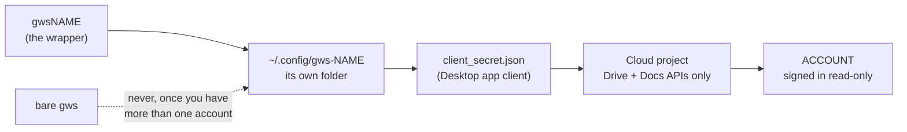

<div align="center">


# Give an agent its own Google account profile

*Connect one Google account to the `gws` command-line tool so an agent can read that account's Drive and Docs, and nothing else.*


 **You are here:** drasticstatic lab › [`my-template`](../README.md) › [`walkthroughs`](README.md) › `GOOGLE-WORKSPACE-CLI-NEW-PROFILE.md` · public · `main` is the working branch

</div>

##  TL;DR

1.  **One account, one profile.** Each account gets its own folder, its own Cloud project and its own login, so a mistake in one can never touch another.
2.  **Read-only first.** The agent can look at Drive and Docs but not change anything, until you widen it on purpose.
3.  **Who does what:** an agent can prepare the folder and the wrapper. Signing in, passwords and consent screens are always done by a person.
4.  **Prove the account before you trust it** (step 6). If the address is not `ACCOUNT`, stop.
5.  **Writing gets its own profile,** `gwsNAME-write`, so the reader can never change anything ([below](#-a-read-profile-and-a-write-profile)).

> **Handing this to your AI helper?** Say: *"Read GOOGLE-WORKSPACE-CLI-NEW-PROFILE.md and prepare steps 1 and 6 for me. I will do the browser steps myself."*

**You need:** about 15 minutes, a browser signed in to the target account, and `gws` already installed (check with `gws --version`).

Throughout, replace:

| Placeholder | Meaning | Example |
|---|---|---|
| `ACCOUNT` | the Google account being connected | `you@yourorg.org` |
| `NAME` | a short label for this profile | `acme` |

##  How the pieces fit



##  1. Make the isolated folder and wrapper

```sh
mkdir -m 700 -p ~/.config/gws-NAME
mkdir -p ~/.local/bin
cat > ~/.local/bin/gwsNAME <<'EOF'
#!/bin/sh
GOOGLE_WORKSPACE_CLI_CONFIG_DIR="$HOME/.config/gws-NAME" exec gws "$@"
EOF
chmod +x ~/.local/bin/gwsNAME
gwsNAME auth status
```

*You should see:* `auth status` report `"auth_method": "none"` and point only at `~/.config/gws-NAME`. That is the smoke test: the profile is isolated and empty. Never use a bare `gws` once you have more than one account.

##  2. Create the Cloud project

1. Open <https://console.cloud.google.com/projectcreate>.
2. Click your picture, top right, and confirm it shows `ACCOUNT`. The console opens on whichever account the browser used last, and this is the easiest step to get wrong.
3. Replace the default "My Project 12345" with a real name, because the project ID comes from it and cannot be changed later. Choose the organization if one is offered, and click **Create**.

*You should see:* the new project's name in the console's project picker, under `ACCOUNT`.

If the page says you lack permission to create projects, a Workspace administrator has to create it for you or grant the Project Creator role. Google may also ask for your password again here. That is normal.

##  3. Turn on only the APIs you need

**APIs & Services → Library.** For a read-only start, enable **Google Drive API** and **Google Docs API**. Add others later if a real need appears.

*You should see:* both APIs listed under **APIs & Services → Enabled APIs & services**.

##  4. Create the desktop login

1. Open **Google Auth Platform** (search for it in the console's top bar) and click **Get started**.
2. **App Information:** give the app a name and choose `ACCOUNT` as the support email.
3. **Audience:** on a Workspace account choose **Internal**, which limits the app to your organization. On a personal account choose **External** and afterward add `ACCOUNT` under **Audience → Test users**, even if you own the project.
4. **Contact Information:** enter `ACCOUNT`.
5. **Finish:** read and tick the Google API Services User Data Policy yourself, then **Continue** and **Create**.
6. **Clients → Create client.** Application type **Desktop app**, name it, leave "Use this client for an AI-powered agent" unticked, and click **Create**.
7. Click **Download JSON** in the dialog that appears. Do this before closing it, and do not screenshot that dialog.
8. Move it into the profile, using the file you just downloaded:

```sh
mv ~/Downloads/client_secret_*.json ~/.config/gws-NAME/client_secret.json
chmod 600 ~/.config/gws-NAME/client_secret.json
```

*You should see:* `ls -l ~/.config/gws-NAME` list `client_secret.json` with `-rw-------`.

> [!WARNING]
> This file is a credential. Never commit it, paste it into a chat, or show it on a screen share.

##  5. Sign in, read-only

```sh
gwsNAME auth login --readonly -s drive,docs
```

A browser opens. Choose `ACCOUNT` and approve. `--readonly` means the agent can look but not change anything, and you can widen it later on purpose.

*You should see:* the terminal confirm the login, and `gwsNAME auth status` no longer report `"auth_method": "none"`.

##  6. Prove it is the right account

```sh
gwsNAME drive about get --params '{"fields":"user(emailAddress)"}'
```

The address must be `ACCOUNT`. If it is anything else, stop and start again at step 2.

Then read one document you are allowed to see:

```sh
gwsNAME docs documents get --params '{"documentId":"DOC_ID","fields":"title"}'
```

*You should see:* that document's title, and nothing else.

##  A read profile and a write profile

Keep `gwsNAME` **read-only, always**. When the account also needs writing, give writing a wrapper of its own,
`gwsNAME-write`, with its own config folder. Two folders mean two logins: the reader's never gains the right to change
anything, whatever the writer is allowed.

**Why:** an agent that runs unattended (a nightly sync, a scheduled read) uses `gwsNAME`. If that login is read-only,
nothing it does by mistake, and nothing that tricks it, can change a document. Writing happens only through the other
wrapper, when a person meant it to.

1. **The agent may create the folder and the wrapper** (the same shape as step 1):

   ```sh
   mkdir -m 700 -p ~/.config/gws-NAME-write
   cat > ~/.local/bin/gwsNAME-write <<'EOF'
   #!/bin/sh
   GOOGLE_WORKSPACE_CLI_CONFIG_DIR="$HOME/.config/gws-NAME-write" exec gws "$@"
   EOF
   chmod +x ~/.local/bin/gwsNAME-write
   gwsNAME-write auth status
   ```

   *You should see:* `"auth_method": "none"`, pointing only at `~/.config/gws-NAME-write`.

2. **The person copies the client file in, themselves.** The agent never opens, copies or moves `client_secret.json`
   or any token file, in either folder:

   ```sh
   cp ~/.config/gws-NAME/client_secret.json ~/.config/gws-NAME-write/client_secret.json
   chmod 600 ~/.config/gws-NAME-write/client_secret.json
   ```

3. **The person signs in, without `--readonly`**, naming only the services the writer needs:

   ```sh
   gwsNAME-write auth login -s drive,docs
   ```

   *You should see:* the browser's consent screen. Read what it asks for, and approve only if that is what you meant.

4. **Prove both, every time you set one up:** run step 6 with `gwsNAME-write` (the address must be `ACCOUNT`), and
   check that `gwsNAME auth status` still points only at `~/.config/gws-NAME`.

Taking writing away later is one wrapper and one folder: revoke the grant at
<https://myaccount.google.com/permissions> and move `~/.config/gws-NAME-write` aside. The reader is untouched.

###  A personal account or a business account

What differs, as far as this page records it (both profiles, read and write, follow the same row):

| | Personal Google account | Business account (Google Workspace) |
|---|---|---|
| **Audience** (step 4) | **External**, and `ACCOUNT` added under **Audience → Test users**, even if you own the project; without that, `Error 403: access_denied` at sign-in | **Internal**: the app is limited to your organization |
| **How long a sign-in lasts** | External apps in Testing expire after about a week; then `invalid_grant` or 401, and step 5 again | this page records no such limit for an Internal app |
| **Creating the project** (step 2) | this page records no restriction | if you lack permission, a Workspace administrator creates it for you or grants the Project Creator role |

##  If something goes wrong

| What you see | What it means |
|---|---|
| `invalid_grant` or 401 | The login expired. Run step 5 again. External apps in Testing expire after about a week. |
| `Error 403: access_denied` at sign-in | `ACCOUNT` is not listed as a test user (step 4). |
| `403` on a Drive or Docs call | That API is not enabled in this project (step 3). |
| A password box when opening the console | Google wants you to confirm it is you. Type it yourself. |
| `Access blocked` naming another app | You are using the wrong wrapper for this account. |

##  Taking it away

Revoke access at <https://myaccount.google.com/permissions>, then move `~/.config/gws-NAME` aside. Deleting the Cloud project removes the login for good.

##  See also

-  [Gemini CLI access](GEMINI-CLI-ACCESS.md): the sibling walkthrough, for when the same kind of account should also run Gemini in the terminal, and for its Workspace administrator.
-  [Connect Google Drive](CONNECT-GOOGLE-DRIVE.md): the simpler built-in connections, when the helper only needs to read.
-  [`pir-devine-news` › GWS_SETUP.md](https://github.com/drasticstatic/pir-devine-news/blob/main/GWS_SETUP.md) (a private repository; the same page is public in [`pir-devine-news-public`](https://github.com/drasticstatic/pir-devine-news-public/blob/main/GWS_SETUP.md)): a committee's profile, with its sync script and several profiles side by side.
-  [GWS_SETUP.md, the first worked profile](https://github.com/drasticstatic/divorce-custody-assistant/blob/main/GWS_SETUP.md) (in a private repository of the lab's): written before this general version, with several profiles in one table.

##  Suggest a change

Noticed something wrong, or know a better way? Open an [issue](https://github.com/drasticstatic/my-template/issues) or a pull request against `main`; the lab steward reads them, and a person with the role merges with a merge commit so your name stays on it. Not on GitHub? Tell any steward you know, or your helper, in your own words.

<sub>One of the [walkthroughs](README.md) in `my-template`, in the shape of [`walkthroughs-template/`](../walkthroughs-template/). Icons: Phosphor duotone (MIT). The PDF in `pdf/` is rendered from this page; edit the markdown, not the PDF.</sub>
