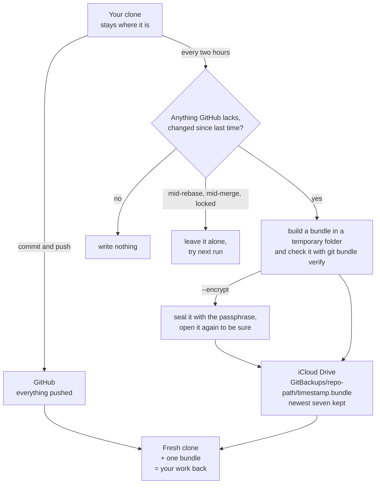

<div align="center">


# iCloud and GitHub, together

*GitHub keeps what is committed and pushed. iCloud only receives finished files holding what GitHub does not yet have. Repositories never live in iCloud.*


</div>

##  TL;DR

1.  **Commit and push is still the backup.** Everything else on this page covers the gap before you push.
2.  **iCloud holds finished files, never a live repository.** One script writes a verified git bundle for each repository that has something GitHub lacks, once per repository however many worktrees it has. A clean, fully pushed repository writes nothing.
3.  **Your staging is not touched.** The script works in a temporary copy of the index and a temporary object folder. It captures staged, unstaged and untracked work without changing your index or your stash list.
4.  **Files named like secrets stay behind.** There is no tar of your folder, so a `.env` ignored by git never travels. Paths named like secrets are dropped and counted, never listed. It goes by name only, so a secret in `notes.txt` would travel: see [what this does not do](#-what-this-does-not-do).
5.  **Noise and big logs stay behind too.** `node_modules` and friends never travel, not even inside a stash, and an [exclude list](#-the-exclude-list) names the paths of your own that should not either.
6.  **Seal the bundles if you want to.** `--encrypt` locks each one with a passphrase that lives in this Mac and your password manager. [Advanced Data Protection](#-sealing-the-bundles) covers them inside iCloud; `--encrypt` covers them the day one leaves.
7.  **Restoring is a fresh clone plus one bundle.** The steps below are run by the self-test every time.
8.  **This does not replace Time Machine.** It saves repository work, not your Mac.

> **Handing this to your AI helper?** Say: *"Read ICLOUD-AND-GITHUB-TOGETHER.md. Run the self-test and a dry run, show me the
> summary, and don't schedule anything until I say so."*

**Tested, not yet scheduled.** The script, its restore steps and a real write to iCloud Drive have been run. The two-hour
schedule has never been loaded on a machine, so [step 6](#-set-it-up) is the untested part.

##  The road



##  Who keeps what

| | Keeps | Does not keep | If you lose your Mac |
|---|---|---|---|
| **GitHub** | commits you pushed | anything not pushed | clone it again |
| **iCloud Drive, through this script** | staged, unstaged and untracked work, in every worktree; stashes; unpushed commits and tags; repositories with no remote | files named like secrets, ignored files, `node_modules` and the paths on your exclude list, anything already on GitHub | restore on top of the clone |
| **Time Machine** | your files, apps and settings, to an external drive | anything since the last backup, or if the drive is lost with the Mac | restore the machine |
| **A password manager** | `.env` values, keys, seed phrases, and the bundle passphrase if you seal them | code | fill your `.env` files in again; open the bundles |

The last row is the gap people forget. **On purpose, nothing here carries your `.env` files.** A clean-slate Mac gets its code
back from GitHub and iCloud, and its secrets back from wherever you keep secrets. If you turned on `--encrypt`, the passphrase
is one of those secrets: without it, the bundles in iCloud are noise.

**A handy side effect:** `--dry-run` is also a list of every repository holding work GitHub lacks.

##  Why not simply put the repository in iCloud, or tar it there?

Three rules follow from one fact: iCloud syncs files one at a time, and a repository only makes sense as a whole.

**Never keep a repository in iCloud Drive.** That includes `~/Desktop` and `~/Documents` if you have turned on iCloud's
"Desktop & Documents Folders": those two then count as iCloud Drive. Keep clones in a folder of their own, such as `~/code`.

The first draft of this plan came from an AI research chat and a brief from Littlebird. It had the principle right. This table
shows what changed, and why:

| The first draft said | This does | Why |
|---|---|---|
| `git add -A` in the repository, then `git stash create` or a hidden branch | A temporary `GIT_INDEX_FILE` and a temporary object folder, then `add -A`, `write-tree` and `commit-tree` there | `git add -A` changes what you had staged. It also writes an unignored `.env` into `.git/objects`. `git stash create` has no option for untracked files. A hidden branch leaves something new in your repository. |
| `tar` the working tree | No tar at all | A tar carries every `.env`, key and wallet file into iCloud, ignored by git or not. It is also much larger. |
| A full bundle of every repository, every run | A thin bundle: only what the remote branches lack. A full one only when there is no remote | iCloud storage is shared with your photos and device backups. History that is already on GitHub need not be stored twice. |
| Always write | Compare a stored hash, and write nothing if nothing changed | Seven identical copies would push out your last seven real ones. |
| Write the archive into place | Build in a temporary folder, run `git bundle verify`, then move it in whole | iCloud should never see, or sync, half a file. |
| "launchd catches up after sleep", hourly with `StartInterval` | `StartCalendarInterval`, twelve times a day | `man launchd.plist` says a `StartInterval` firing is **missed** while the Mac sleeps. Only the calendar form runs on wake. |
| iCloud "corrupts repositories" | The same rule, with softer words | Reports of damage are real, but they come from users, not from Apple. See [what was checked](#-what-was-checked-and-how-far-to-trust-it). |

##  Set it up

You need `git` and `python3`. On a new Mac, `xcode-select --install` provides both. Run the commands from your clone of this repository.

1.  **Prove it on this machine.** This works in a throwaway folder and never touches your clones or your iCloud Drive.
   ```sh
   sh scripts/git-safety-backup.selftest.sh
   ```
   *You should see:* `selftest: all … cases as expected.`

2.  **Decide what never leaves this machine.** The script refuses to run until the skip list exists, so a new Mac cannot send a private repository to iCloud before someone has thought about it. `--init` writes three files and stops: the skip list, the [exclude list](#-the-exclude-list), and a passphrase for [sealing](#-sealing-the-bundles).
   ```sh
   sh scripts/git-safety-backup.sh --init
   open -e ~/.config/git-safety-backup/skip.txt
   ```
   Add one per line: a folder name, or a `~/full/path`. A skipped repository is never opened, and neither is a worktree or a clone of it.
   *You should see:* `Wrote …/skip.txt.`, `Wrote …/exclude.txt.`, and a passphrase set apart on its own line. **Put that line in your password manager now.** It is shown this once and never logged; whether or not you ever pass `--encrypt`, it costs nothing to keep.

3.  **Name the paths that should stay out of every bundle.** Optional, and worth a minute: the first fleet dry run was a tenth bigger than it needed to be because of one desk's logs.
   ```sh
   open -e ~/.config/git-safety-backup/exclude.txt
   ```
   One glob per line, matched inside every repository. The examples in the file are the two this fleet uses ([below](#-the-exclude-list)).

4.  **Look before anything is written.**
   ```sh
   sh scripts/git-safety-backup.sh --dry-run
   ```
   *You should see:* a `WOULD WRITE` line per repository, then a `SUMMARY` line with the total. A `HELD` line means you need to look at that repository ([below](#-what-the-log-words-mean)).

5.  **Run it once for real.** Add `--encrypt` if the bundles should be sealed; once chosen, keep it on every run, including the schedule.
   ```sh
   sh scripts/git-safety-backup.sh
   ```
   *You should see:* `WROTE` lines, and bundles in Finder under iCloud Drive, in `GitBackups`. Sealed ones end in `.bundle.enc`.

6.  **Schedule it. Untested: nobody has loaded this yet.**
   ```sh
   sed -e "s#__HOME__#$HOME#g" -e "s#__SCRIPT__#$PWD/scripts/git-safety-backup.sh#g" \
     scripts/launchd/git-safety-backup.plist.template > ~/Library/LaunchAgents/local.git-safety-backup.plist
   plutil -lint ~/Library/LaunchAgents/local.git-safety-backup.plist
   launchctl bootstrap gui/$(id -u) ~/Library/LaunchAgents/local.git-safety-backup.plist
   ```
   For sealed bundles, add `<string>--encrypt</string>` after the `__SCRIPT__` line in the plist before loading it.
   *You should see:* `OK` from `plutil`. Because the job runs at load, a new `SUMMARY` line should also appear in `~/Library/Logs/git-safety-backup.log`.
   **Not confirmed:** whether a background job may write into iCloud Drive without an extra macOS permission. If the log says `cannot write`, give the job Full Disk Access in System Settings, or tell your helper.
   To stop it: `launchctl bootout gui/$(id -u)/local.git-safety-backup`.

**Roots:** by default it looks in a fixed list of folders under your home, whichever exist. To use your own, write one folder per line in `~/.config/git-safety-backup/roots.txt`.

##  One repository, many worktrees

`git worktree add` gives a repository a second folder with its own branch checked out, sharing one `.git`: one object store, one stash
list, one set of branches. Augment Intent's workspaces are made this way, so `~/intent/workspaces/…/gratitude-token-project-docs`
and `~/dappu/gratitude-token-project_docs` are the same repository twice over. Before 4 November the script counted them twice,
and 87 MB of the first fleet dry run was one stash bundled from each side.

Now a repository is found by its shared `.git` (`git rev-parse --git-common-dir`) and backed up **once, from its main worktree**,
even when only a linked worktree sits under the roots. Nothing is lost by it: the uncommitted work in each linked worktree is
captured as well, under `refs/safety/worktrees/<folder name>/wip` (and `…/wip-staged`), beside the main worktree's
`refs/safety/wip`. The log line names the worktrees that came along: `with 2 linked worktree(s): linked, far`.

A linked worktree in the middle of a merge or rebase is left out of that run with a note, `worktree x left for next run`, and the
rest of the repository still goes. The skip list applies to worktrees too: a skipped folder's work stays home.

##  What stays out of a stash

Uncommitted work never carried `node_modules`, `.venv`, `venv`, `__pycache__` or `.DS_Store`. A stash did: `git stash -u` on a
branch without a `.gitignore` picks up whatever is lying about, and the script used to bundle the stash as it was. It now bundles
**a copy of the stash, rebuilt without those paths** in the temporary object folder. Your real stash is not touched; `git stash
list` shows the same objects before and after, and the self-test checks it.

The copy keeps the stash's message and author, and says what it is in a second paragraph: `git-safety-backup: a copy, rebuilt
without 3 noise or excluded path(s). The original is untouched.` A stash with nothing to drop travels as itself, same object. A
tracked file on the list that you had not touched stays at its committed version in the copy, so restoring never shows it as deleted.

**The base, too, when no branch holds it.** The 87 MB above was not the stash. It was the commit the stash was made on: a
`gh-pages` deploy that a later deploy replaced, with 33,891 `node_modules` files committed inside it, that no branch pointed to
any more. A stash needs its base, so the bundle carried the whole thing. When the base is such an orphan, it travels as a copy
rebuilt the same way, still sitting on the pushed history beneath it. A base that a branch still holds travels with that branch
and is never rewritten.

##  The exclude list

`~/.config/git-safety-backup/exclude.txt`, written by `--init`, one glob per line, matched against paths inside **every**
repository. A glob with a slash is matched against the whole path from the repository's root; one without is matched against each
folder and file name along the way. `*` matches anything, `/` included. Case matters. The fleet's own file:

```
# ~/.config/git-safety-backup/exclude.txt
logs/edge/*.jsonl      # the ARB desk's edge logs: tracked, growing all day, committed by the 23:55 job anyway
server.*.log           # free-claude-code writes a dated server log beside its code
```

What it does: a matching path is left out of the captured work and counted (`left out by the exclude list or as noise: 4 path(s)`),
and set back to its committed version inside a stash copy. What it does not do: it tells git nothing. The files are not ignored,
not deleted, not unstaged in your real index. The log never names them.

Use it for things that are big, regenerated, or already on their way to GitHub by another road. Do not use it for secrets; those
go by [name](#-what-this-does-not-do) and belong in ignored files anyway.

##  Sealing the bundles

**What iCloud does.** Since 4 November 2026 the iCloud account these bundles go to has **Advanced Data Protection** on. With it,
iCloud Drive is end-to-end encrypted at Apple's side: only your trusted devices hold the keys, and Apple cannot read the
files or recover them for you. That is a real improvement over standard protection, where Apple holds the keys. It protects
a bundle while it sits in iCloud.

**What it does not do.** The day a bundle leaves iCloud, it is a plain file again: copied to a USB stick for a restore, AirDropped to
a laptop, dropped into a chat, left in Downloads on a borrowed Mac, exported with the rest of your iCloud data. A git bundle holds
your source, your branch names, your commit messages, and whatever uncommitted notes you had open. That is what `--encrypt` is for.

**How it works.** `--init` writes `~/.config/git-safety-backup/passphrase`: 32 random bytes as base64, mode 600, shown once on
the screen and never again, not in any log. With `--encrypt`, each bundle is sealed after `git bundle verify` with

```
openssl enc -aes-256-cbc -pbkdf2 -salt -pass file:~/.config/git-safety-backup/passphrase
```

opened again at once and compared byte for byte, then placed as `<timestamp>.bundle.enc`. The passphrase is passed as a file
path, never on the command line where `ps` would show it. The script refuses to run `--encrypt` if the passphrase file is
missing, empty, or readable by anyone but you.

**Three things to know before turning it on.**

- The passphrase is now a secret you must keep: on this Mac and in your password manager, nowhere else. Lose both, and every
  sealed bundle is gone with them. GitHub is unaffected, and so is anything you pushed.
- Once on, keep it on, including in the launchd plist. Switching it off writes plain bundles beside the sealed ones; nothing breaks,
  but then you have both kinds.
- Whether to seal at all is your call. This page describes the tool; it is not security advice.

**Opening a sealed bundle.** Copy it out of iCloud first, then from your clone of this repository:

```sh
sh scripts/git-safety-backup.sh --decrypt ~/Desktop/20261104T221700Z.bundle.enc
```

*You should see:* `Opened …/20261104T221700Z.bundle`, in the folder you ran it from, never into iCloud Drive (it refuses).
Then carry on with [step 1 below](#-get-your-work-back). If this repository is gone too, the same without the script:

```sh
openssl enc -d -aes-256-cbc -pbkdf2 -salt -in copy.bundle.enc -out copy.bundle -pass stdin
```

and type the passphrase from your password manager.

##  Get your work back

The self-test runs these same steps, so they stay true. If Finder shows a cloud icon on the bundle, download it first: with "Optimize Mac Storage" on, iCloud may keep only the online copy.

1.  **Clone from GitHub, then check the bundle fits.** Copy the bundle somewhere outside iCloud first.
   ```sh
   git clone <your-repository-url> restored && cd restored
   git bundle verify /path/to/copy.bundle
   ```
   *You should see:* `… is okay`, then `The bundle requires…` with the commits it builds on, or `The bundle records a complete history.` If it says commits are missing, see [the limits](#-what-this-does-not-do).

2.  **Bring everything in, under its own name, so nothing collides.**
   ```sh
   git fetch /path/to/copy.bundle 'refs/*:refs/restored/*'
   git for-each-ref refs/restored
   ```
   *You should see:* `refs/restored/heads/…` for each unpushed branch, `refs/restored/safety/wip` for uncommitted work, and `refs/restored/safety/stash/…` for each stash.

3.  **Recover an unpushed branch.**
   ```sh
   git branch my-branch refs/restored/heads/my-branch
   ```

4.  **Recover your uncommitted work, staged and unstaged as they were.**
   ```sh
   base="$(git log -1 --format='%(trailers:key=Base,valueonly)' refs/restored/safety/wip)"
   git switch --detach "$base"
   git read-tree -u --reset refs/restored/safety/wip
   git read-tree "$(git rev-parse -q --verify refs/restored/safety/wip-staged || echo "$base")"
   git switch -c recovered-work
   ```
   *You should see:* `git status` showing what you had, as you had it.
   **Only want one file?** `git show refs/restored/safety/wip:path/to/file > path/to/file`

5.  **Recover a stash,** using a name from step 2. The numbers may have gaps, because a stash holding a secret-named path stays behind.
   ```sh
   git stash store -m restored "$(git rev-parse refs/restored/safety/stash/<number>)"
   ```

**A repository with no remote:** replace step 1 with `git init restored && cd restored`. Its bundle holds the whole history.

##  What the log words mean

| Word | Meaning | What you do |
|---|---|---|
| `WROTE` · `WOULD WRITE` | a bundle was written, or would be | nothing |
| `DEFER` | a lock file, or a rebase, merge, cherry-pick, revert or bisect under way. Left alone until next run | nothing, unless it repeats. It says so if a lock looks stale |
| `HELD` | commits GitHub lacks touch a path named like a secret. A commit cannot be filtered, so the whole repository waits, uncommitted work included | look at it. Fix the history, or if it is a false alarm, add the repository's path to `history-ok.txt` beside the skip list |
| `TOO BIG` | the bundle is over the cap (1 GB by default), or changed files add up to four times that, which are then not even read. Nothing is written, so **this repository has no backup** | usually unignored logs or build output: add them to `.gitignore` or `.git/info/exclude`. Or push, or raise `--max-bundle-mb` |
| `WARN` | a changed file over the cap (100 MB by default) was left out, or could not be read | commit it, ignore it, or raise `--max-file-mb` |
| `FAIL` | something went wrong; exit code 1 | read the line |

Left-out paths are counted and never named, so the log itself cannot leak a file name.

##  What this does not do

-  **Bundles are plain files unless you pass `--encrypt`.** Under iCloud's standard data protection, iCloud Drive is encrypted but Apple holds the keys. Under Advanced Data Protection, only your trusted devices hold them, and Apple cannot help you recover the data. Neither follows a bundle out of iCloud; [sealing](#-sealing-the-bundles) does. For private repositories, make that choice knowingly, and use the skip list for anything that should never leave at all.
-  **Name matching is broad, and it is only names.** `wallet*` also drops `WalletConnect.jsx`, and a secret in a file called `notes.txt` travels. The list covers forms like `client_secret_*.json`, `my-wallet.json`, `.git-credentials` and `*.gpg`, and it will still miss a name nobody thought of. Keep secrets in ignored files, and keep your [secret scan](SECRET-SCAN.md) on. To the count in the log, a real secret and a false alarm look the same.
-  **iCloud Drive syncs; it is not an archive.** Delete a file on one device and it goes on all of them, recoverable for 30 days. The free tier is 5 GB, shared with photos and device backups. Plan for up to seven bundles per repository, though the seven usually overlap.
-  **"What GitHub lacks" is judged offline,** from your clone's last fetch. If a branch was deleted on GitHub and your clone has not noticed, a bundle may need commits a fresh clone cannot get. `git bundle verify` names them. The same goes for commits from another remote, such as `upstream` in a fork: add that remote and fetch before you restore.
-  **Not carried:** ignored files, `node_modules`, a repository's own hooks and config, and Git LFS objects for commits already made. A changed LFS-tracked file travels whole, within the size cap.
-  **Not covered:** repositories outside the roots, or more than eight folders deep, and a Mac that never reaches iCloud.

##  What was checked, and how far to trust it

**Run on macOS 15.4 with git 2.39, on 2026-11-03.** The self-test, plus a separate check in a throwaway repository:
staged, unstaged, untracked and unpushed work all came back in a fresh clone from a bundle read out of real iCloud Drive; the
index, stash list, refs and object store were unchanged; a planted `.env` and `.pem` were absent from `git ls-tree` on every
ref, and from every object. That test bundle was then removed.

**A second, independent check the same day found three things the first had missed.** It hunted for planted text in every
object each bundle adds, across more repository shapes. The first two are fixed, and the third corrects the sentence above.

- **A stash could carry a secret in its history.** With `.env` committed, a stash made, and that commit then amended away, the
  stash still pointed at it, and the `.env` went into the bundle. Such a stash now stays behind and is counted.
- **Ordinary names got through.** `secret.json`, `client_secret_*.json`, `my-wallet.json`, `.git-credentials` and 12 others all
  travelled. The list is wider now, and the self-test plants these names.
- **"Object store unchanged" was slightly too strong.** No object is added or changed, and the index is the same byte for byte.
  But when captured work matches an object the repository already has, git refreshes that file's modified time, as any
  `git add` does. Time Machine may then copy that file again, packfiles included. How often that matters is **UNVERIFIED**.

**The fleet dry run, before and after (2026-11-04).** The first dry run over every root came to about 101.5 MB. About 87 MB of it
was one repository counted twice, `gratitude-token-project_docs` and its Intent worktree, each carrying the stash on the orphaned
deploy commit above; about 10 MB was the ARB desk's uncommitted `logs/edge/*.jsonl`. After the worktree fold and the stash
rebuild, the same run over 182 repositories came to **42.9 MB across 37 bundles**: the docs repository is 2.7 MB with 101,676 paths
dropped from the stash copy, and the Intent worktree appears only as `with 1 linked worktree(s)` on its line. With the two example
exclude globs in place as well it came to **31.2 MB across 38 bundles**, and `free-claude-code`, which had been `TOO BIG` at 6.8 GB
of untracked `server.*.log` files, became a 2.9 KB bundle. Both runs were dry: no `GitBackups` folder was created and the state
folder stayed empty. The self-test went from 83 cases to 160.

**Confirmed in the source:**

| Fact | Source |
|---|---|
| A bundle made with exclusions needs those commits at the destination; `git bundle verify` checks them and names what is missing | [git-bundle](https://git-scm.com/docs/git-bundle) |
| `git stash create` makes a stash without a ref. `--include-untracked` is listed for `push`, `save` and `show`, not `create` | [git-stash](https://git-scm.com/docs/git-stash) |
| A `StartInterval` firing is missed while the Mac sleeps; a `StartCalendarInterval` one runs on wake, and missed ones fold into one | `man launchd.plist`, macOS 15.4 |
| iCloud Drive: standard protection, Apple holds the keys; Advanced Data Protection, only trusted devices do, and Apple cannot help you recover | [iCloud data security overview](https://support.apple.com/en-us/102651) |
| 5 GB free, shared; deleted files recoverable for 30 days | [Manage your iCloud storage](https://support.apple.com/en-us/108922) |
| Optimize Mac Storage moves documents to iCloud when space is needed; Desktop and Documents can join iCloud Drive | [Store files in iCloud Drive](https://support.apple.com/guide/mac-help/store-files-in-icloud-drive-mchle5a61431/mac) |
| Time Machine backs up to an external storage device, only what changed | [Back up your Mac with Time Machine](https://support.apple.com/en-us/104984) |

**Reports, not documentation:** damage to `.git` inside iCloud Drive. A [2019 Apple Developer Forums thread](https://developer.apple.com/forums/thread/123145)
reports `.git` renamed to a file called `git 2`; no Apple engineer replied there. A [developer's post](https://dev.to/architchandra/a-side-effect-of-storing-a-git-repository-in-icloud-drive-7ed)
reports duplicate refs such as `main 2`. I found nothing from Apple on it, and nothing saying newer macOS versions fixed or kept it.
The rule stands anyway, because the safe path costs nothing.

**Seen once:** after the test bundle and its folder were removed, iCloud Drive brought the folder back, empty, within seconds. Removing it
again worked. Deleting in iCloud Drive is not instant either, and an empty folder does no harm.

**UNVERIFIED:**

- Whether a background job needs Full Disk Access to write into iCloud Drive. Step 6 will show.
- How long iCloud takes to upload a bundle. A bundle written just before a disaster may not have left the Mac.
- Whether a `.nosync` name protects a folder inside iCloud Drive. The first draft said it does not help `.git`. Nothing here relies on it.
- Whether evicted iCloud files still appear as hidden `.name.icloud` placeholders on current macOS. The pruning code handles both forms.
