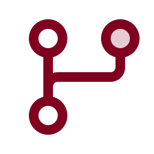

<div align="center">


# Join an organization and build with your AI helpers

*Accept the invitation, turn on two-factor login, connect a helper, and ask in your own words.*


 **You are here:** drasticstatic lab › [`my-template`](../README.md) › [walkthroughs](README.md) › `JOIN-AN-ORGANIZATION.md` · public · `main` is the working branch

</div>

##  TL;DR

You don't need to learn how GitHub works to build here.

1.  **Accept the invitation.**
2.  **Turn on two-factor login.**
3.  **Connect the AI helper you like.**
4.  **Ask for what you want, in your own words.**

The organization's rulebook (`AGENTS.md`) teaches your helper the rest. Every change rehearses before it
goes live, so nothing you try can break anything.

> **Handing this to your AI helper?** Paste the link and say: *"Read this walkthrough and guide me through
> it one step at a time. Wait for me after each step."*

##  1 · Accept the invitation

You'll get an email from GitHub (and a notification on github.com) inviting you to the organization.
Press **Join**. If you don't have a GitHub account yet, the invitation walks you through creating one.
Use the email the organization knows you by.

##  2 · Turn on two-factor login

This protects you, and everyone you build with. Some organizations require it before you can see anything.

On github.com:
1. Select your picture (top right), then **Settings**.
2. Choose **Password and authentication**, then **Enable two-factor authentication**.
3. Pick an authenticator app or a passkey, and **save the recovery codes** somewhere safe and offline.

##  3 · Choose your helpers

You can use one or several. They all read the same rulebook.

| Helper | What it is, in one breath | Best for |
|---|---|---|
| **Claude Code** (Anthropic) | A collaborator that can take the pen inside your project. It reads the files, makes the change, runs the checks, and shows you exactly what it did before anything is saved | Real changes to a site, done carefully, on your computer or the web |
| **Codex** (OpenAI) | OpenAI's collaborator that takes the pen. It works in its own cloud workspace and hands you a pull request to look over | Changes to a site while you're away from your desk |
| **ChatGPT** | A thinking partner for ideas, drafts and explanations. Connected to GitHub it can read your repositories, but for changes, use Codex | Writing, brainstorming, "explain this to me" |
| **Littlebird** | A private memory of your workday on your own computer, so your helpers can pick up context instead of asking you to repeat yourself | Continuity across days and tools |
| **Augment Cosmos** | A shared studio where a team of AI helpers keeps a common memory, works in separate spaces, and can wake up on events (a new pull request, an issue) | Teams of people and helpers working together |

> **Use ChatGPT Plus or Pro?** Use **Codex** for anything that changes a site. Keep **ChatGPT** for
> thinking and writing, inside a **Project** named after the organization, so its conversations and files
> stay together. Paste this into the Project's instructions:
> *"Before helping with anything for this organization, read its AGENTS.md and follow it."*

##  4 · Connect your helper to the organization

<details>
<summary> <b>Codex</b></summary>

1. Open Codex (in ChatGPT, or the Codex app) and choose **connect GitHub**.
2. GitHub asks where to install the **ChatGPT Codex Connector**. Choose **the organization** (not just
   your personal account).
3. Choose **Only select repositories**, and pick the site repositories you'll work on. This is a starting
   point, not a fence. An organization owner can widen it any time: **Organization settings → GitHub
   Apps → ChatGPT Codex Connector → Configure**.
4. Codex reads `AGENTS.md` automatically. Ask your first question:
   *"Read AGENTS.md and tell me, in plain words, how changes go live here."*

Official guides:
- [Custom instructions with AGENTS.md](https://learn.chatgpt.com/docs/agent-configuration/agents-md)
- [Code review on GitHub](https://learn.chatgpt.com/docs/code-review)

</details>

<details>
<summary> <b>Claude Code</b></summary>

1. Install Claude Code (desktop app or terminal) and sign in.
2. Open the repository (`git clone` it, or open the folder). Claude Code reads `CLAUDE.md`, which points
   to `AGENTS.md`.
3. **First time only:** run `sh scripts/install-hooks.sh`. It turns on the secret scan and the friendly
   commit-credit check.
4. Ask: *"Sync this clone, then show me what's waiting in PENDING-TASKS.md."*

</details>

<details>
<summary> <b>ChatGPT (reading your repositories)</b></summary>

In ChatGPT, connect **GitHub** from the plugins (apps) list, and choose the organization's repositories.
ChatGPT can then read and explain them. For changes, switch to Codex.

</details>

<details>
<summary> <b>Augment Cosmos</b></summary>

An organization owner connects the **Augment Code GitHub app** once, at the organization level, and
chooses which repositories Cosmos may touch. You then work in your own **Space**: a safe place to play
that can't step on anyone else's work. See
[why we use Cosmos](https://github.com/drasticstatic/augment-intent-properties-public-preview/blob/main/proposals/WHY-COSMOS.md)
and [how Spaces work for us](https://github.com/drasticstatic/augment-intent-properties-public-preview/blob/main/docs/COSMOS-SPACES.md).

</details>

<details>
<summary> <b>Littlebird</b></summary>

Install Littlebird on your computer and choose what it may remember. Pause it for anything private.
**What it remembers stays with you.** It isn't part of the organization's repositories, and nothing from it
is published unless you choose to share it.

</details>

##  5 · Ask in your own words

You don't need special commands. Describe what you want as you'd tell a friend who's good with
computers:

> *"On the preview branch, change the FAQ answer about what to bring so it mentions a journal. Update the
> Spanish too. Follow AGENTS.md, then open a pull request."*

> *"Explain what this change will do before you make it."*

> *"Show me the rehearsal site, and tell me what's different from the live one."*

Your helper follows the organization's **house rules** in `AGENTS.md`:
-  **Sync first.**
-  **Work on `preview`**, the rehearsal. Live changes only by a Promote pull request.
-  **Never publish what isn't ours to share:** recovery or fellowship details, private messages, personal,
  medical or legal history.
-  **No secrets, ever.**
-  **Both languages**, where the site has two.
-  **Credit the work** with one line at the end of each commit.

##  The credit line (it advises, it never blocks)

When an AI helped write a change, the commit ends with one line naming it:

```
Co-Authored-By: Codex · CodexCloud · OpenAI [<model>]
Co-Authored-By: Alfred · ClaudeCodeCLI · Anthropic [Opus-5.5]
```

- **No AI helped?** Leave it off; the change is recorded as yours.
- The local check only offers a gentle note, and **nobody should ever need `--no-verify`**.
- The one check that does stop a commit is the **secret scan**, and it stops only real secrets.

##  The secret scan (GitGuardian)

- **You don't need your own key to contribute.** Each organization's workshop repository carries one CI
  key, and it checks every change, including those made on GitHub's website or by Codex.
- **Optional, and nice:** a free personal login turns on the earlier check on your own computer.
  Run `brew install ggshield`, then `ggshield auth login`.
- **If it stops a commit,** a secret is in the change. Don't bypass it; your helper knows what to do.
- **Full guide:** [The secret scan](SECRET-SCAN.md). It's written so your AI helper can walk you through
  any message it shows.

##  When you're unsure

- Ask your helper: *"What would this change do? Don't make it yet."*
- Rehearsal can't hurt the live site. Look there first.
- Message the organization's technical steward. Every organization names one in its `ONBOARDING.md`.

<details>
<summary> <b>For the AI helper reading this</b></summary>

Before your first change in a repository of this organization:
1. Read `AGENTS.md` (and `CLAUDE.md` or tool-specific notes if present).
2. Sync: `git pull --rebase --autostash`.
3. Work on `preview`. Never commit to `main`. Never force-push.
4. Never publish what the never-publish rule names. When in doubt, ask your person.
5. Never paste or commit secrets. Never ask your person to paste a password or key into chat. If the
   secret scan stops a commit, or warns that it was skipped, follow [SECRET-SCAN.md](SECRET-SCAN.md).
   Never use `--no-verify`.
6. If the repository has a Spanish twin (`src/i18n/es.ts`, `src/data/es/`), update it with the English.
7. Build before you finish (`npm run build` where there is one).
8. End the commit with the credit line for your tool and model.
9. Explain what you changed, in plain words, and where to see it on the rehearsal site.

</details>

##  Suggest a change

Noticed something wrong, or a step that could be kinder? Open an [issue](https://github.com/drasticstatic/my-template/issues)
or a pull request against `main`, changing this page. A person with the role reads it and merges with a merge commit, so
your name stays on it. An AI helper may do all of that up to the merge. Not on GitHub? Tell any steward you know, or your
helper, in your own words.

*Part of the [walkthroughs](README.md).*
