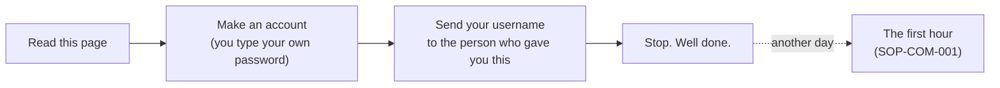

# Opening your gift

### For someone who has just been told "I set you up on GitHub" and has never heard of GitHub

*Read this one first. It takes five minutes, and it asks you for nothing.*

> [!NOTE]
> **For the person giving the gift.** This is the generic copy. Make your own with the person's name, what you actually
> built, and who they should message. Cross out anything that isn't true for them. Send it as a PDF, or read it together.

##  TL;DR

1.  **Someone built something for you and put it somewhere safe, in your name.** That place is called GitHub.
2.  **You owe nothing and you don't have to learn anything.** Your work goes on as it does today. If you ignore this for a year, it waits.
3.  **Your first ten minutes:** make an account, type your own password, send your username to the person who gave you this. Then stop. That's enough for one day.
4.  **Your password is only yours.** Nobody who is really helping you will ever ask for it, or for a code sent to your phone.
5.  **It can grow, if you want it to.** Later on, this can hold more than pages. That part is further down, and it's optional.

##  What GitHub is, in plain words

Picture a filing cabinet that remembers. Every paper in it keeps every earlier version, who changed it, on what day, and
why. Nothing is ever really lost, and a change can be taken back.

**GitHub is that cabinet, on the internet.** It's where people who build websites and software keep their work. Yours
has drawers only you and the people you name can open, and a front window for what you choose to show the world.

You don't need to know how to program to own one, or to read what's in it.

##  What you were given

The person who gave you this will tell you exactly what's yours. It usually looks something like this:

| | What | In plain words |
|---|---|---|
|  | **A home** (GitHub calls it an *organisation*) | a space with your name on the door, and you as one of its owners |
|  | **A reading room** | everything written for you, in one private place, each page with a PDF beside it |
|  | **A front window** | a public page showing only what you've agreed to show |
|  | **Procedures** | how each thing is done, step by step, so nobody has to remember it |
|  | **Proposals** | ideas offered to you. "Not now" is a complete answer, and so is silence |
|  | **A second owner** | someone beside you with a key, so the place never depends on one person, you included |

##  What to expect

**What will happen**
-  An email from GitHub, saying you've been invited to join. It waits for you.
-  Some more emails, when things change. You can turn these down in GitHub's settings, or ignore them.
-  You may see AI helpers named in the history. They do the typing; a person says yes to what they prepare.

**What won't happen**
-  No bill. GitHub's free plan is all this needs. If anything ever costs money, someone asks you first, and "no" is fine.
-  Nothing goes public just because it's written here. A page reaches the public only after a person lists it and a check reads it.
-  Nobody asks for your password, a sign-in code, or the login to anything else you own.

##  Your first ten minutes

1. Go to `https://github.com/signup` and enter **your own** email address. *You should see:* a page asking for a password.
2. **Type a password of your own.** Nobody else types it, sees it or keeps it. *You should see:* a box asking for a username.
3. Choose a username. It's public and it lasts, so your first name and something you like works well. *You should see:* a puzzle, or a code sent to your email.
4. Enter the code and choose the **Free** plan. *You should see:* a nearly empty page, with a little patterned picture at the top right.
5. Send **only your username** to the person who gave you this, wherever you already talk.

That's all for today. When you have an hour, [SOP-COM-001, *New to GitHub: your first hour*](../sop-template/repo/COM/SOP-COM-001-new-to-github-your-first-hour.md)
goes on from here, one step at a time: two-factor sign-in, accepting the invitation, five words, and reading your room in
a browser. Nothing in it asks you to type a command.

##  What you might be wondering

| | Question | Answer |
|---|---|---|
|  | Can I break it? | Reading can't break anything. A change waits for a person to accept it, and an accepted change can be taken back. |
|  | Is it really mine? | You're an owner, so you can see everything and decide who else can. The second owner is a spare key, not a landlord. |
|  | Do I need to learn to code? | No. Most of it is pages you read. To ask for a change, send a message to the person you already talk to. |
|  | What if I ignore it? | It waits. Nothing expires because you didn't look. |
|  | What if the person who set this up disappears? | That's why there are two owners. Everything is ordinary files you can download, and anyone you hire can read them. |
|  | Someone is asking for my password or a code. | The answer is no, whoever they say they are. Tell the person who gave you this. |

##  What it could become

> [!IMPORTANT]
> **This part is a picture of what's possible, not a plan and not advice.** Nothing here is built for you, nothing here is
> needed, and some of it may never arrive. It isn't financial, tax or legal advice. Ask a professional before anything
> involving money or ownership.

You may have heard the word **web3**. Set aside the coins and the noise, and the idea underneath is simple: some records
can live on a shared public ledger instead of inside one company's database, so nobody has to take a single company's
word for who owns what, or who agreed to what.

You may be better placed for that than you'd expect, because the habits are the same ones you're starting here:

| | What you have today | What it's practice for | What it could grow into, if you ever want it |
|---|---|---|---|
|  | A history of every change, and who made it | Records you don't have to take on trust | Proofs and certificates that anyone can check |
|  | Your own sign-in, that only you hold | Holding your own keys | A wallet: a key that only you hold, for things only you own |
|  | Two owners, so nobody is a single point of failure | Shared control | Several people signing off together, before anything moves |
|  | Proposals, decided by the people they affect | Deciding together, on the record | A group that owns something together and votes on it |

**What stays true however far this goes:** you decide, you keep your own keys, and "not now" is always a complete answer.

---

A generic copy from `my-template`. Icons: Phosphor duotone (MIT). The first-hour procedure this page leads to is [SOP-COM-001](../sop-template/repo/COM/SOP-COM-001-new-to-github-your-first-hour.md).
