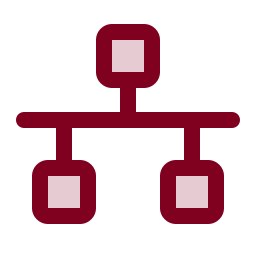
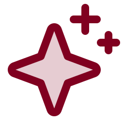

# Walkthroughs

*Plain-language guides for joining one of our GitHub organizations and connecting your AI helpers. Follow one yourself, or hand it to your helper.*

 **You are here:** drasticstatic lab › [`my-template`](../README.md) › `walkthroughs/` · public · `main` is the working branch

##  TL;DR

1.  **Plain-language guides** for joining one of our GitHub organizations and connecting your AI helpers.
2.  Each is written so **you can follow it yourself, or hand it to your AI helper** ("read this and walk me through it").
3.  **Every guide has a PDF beside it** in [`pdf/`](pdf/), rendered from the markdown; the markdown stays the source ([why both](MARKDOWN-BESIDE-PDF.md)).

##  Joining, and connecting your helpers

| | Guide | For when you want to… | PDF |
|---|---|---|---|
|  | [Opening your gift](OPENING-YOUR-GIFT.md) | understand what you were given, if someone set you up on GitHub and you have never heard of it: what to expect, the first ten minutes, what it could become | [PDF](pdf/OPENING-YOUR-GIFT.pdf) |
|  | [Join an organization](JOIN-AN-ORGANIZATION.md) | accept an invitation, turn on two-factor login, connect Claude, Codex, ChatGPT, Littlebird or Cosmos, and start building in plain words | [PDF](pdf/JOIN-AN-ORGANIZATION.pdf) |
|  | [Secure two-factor](SECURE-TWO-FACTOR.md) | move from text-message codes to an authenticator app, a passkey or a security key, before an organisation requires secure methods only | [PDF](pdf/SECURE-TWO-FACTOR.pdf) |
|  | [The secret scan (GitGuardian)](SECRET-SCAN.md) | set up the one check that stops a commit, and **help someone who forgot** (written for AI helpers too) | [PDF](pdf/SECRET-SCAN.pdf) |
|  | [Many AI tools, one team](MANY-AI-TOOLS-ONE-TEAM.md) | understand how several AI helpers share one rulebook, one notebook and one credit line | [PDF](pdf/MANY-AI-TOOLS-ONE-TEAM.pdf) |
|  | [Connect Firecrawl](CONNECT-FIRECRAWL.md) | let your helper read whole websites as clean text, for research and site refreshes | [PDF](pdf/CONNECT-FIRECRAWL.pdf) |
|  | [Connect Wix](CONNECT-WIX.md) | let your helper read and help with a Wix site | [PDF](pdf/CONNECT-WIX.pdf) |
|  | [Connect WordPress](CONNECT-WORDPRESS.md) | let your helper read and draft on a WordPress site *(groundwork)* | [PDF](pdf/CONNECT-WORDPRESS.pdf) |
|  | [Connect Google Drive](CONNECT-GOOGLE-DRIVE.md) | let your helper read the documents you keep in Drive | [PDF](pdf/CONNECT-GOOGLE-DRIVE.pdf) |
|  | [Give an agent its own Google account profile](GOOGLE-WORKSPACE-CLI-NEW-PROFILE.md) | connect one Google account to the `gws` command-line tool, read-only, in its own folder, project and login, and prove it is the right account | [PDF](pdf/GOOGLE-WORKSPACE-CLI-NEW-PROFILE.pdf) |
|  | [Gemini CLI for a Workspace account](GEMINI-CLI-ACCESS.md) | find which door to Gemini in the terminal is still open for a Workspace account, what the administrator does versus the user, what it costs, and how to keep billing from starting by surprise | [PDF](pdf/GEMINI-CLI-ACCESS.pdf) |
|  | [Connect Graphify](CONNECT-GRAPHIFY.md) | give your helper a map of a codebase, so it reads less and understands more | [PDF](pdf/CONNECT-GRAPHIFY.pdf) |
|  | [Connect Littlebird](CONNECT-LITTLEBIRD.md) | let your coding helper read your Littlebird briefs and chats, and write project summaries back to her, without leaking anything private | [PDF](pdf/CONNECT-LITTLEBIRD.pdf) |
|  | [Show hidden files](SHOW-HIDDEN-FILES.md) | see `.git` and friends on a Mac (⌘⇧.), and check where a copied folder pushes before it pushes to the wrong place | [PDF](pdf/SHOW-HIDDEN-FILES.pdf) |
|  | [Session messaging](SESSION-MESSAGING.md) | let your Claude Code sessions tell each other there is a new handoff: git stays the record, a message is only the doorbell, and the token stays alone | [PDF](pdf/SESSION-MESSAGING.pdf) |
|  | [Start Claude in the right folder](CLAUDE-SESSION-ORDER.md) | keep `~/.claude/projects` in order: a log line per session, a word to the agent when it starts in a parent folder, a `claude` guard for zsh, and a manifest of every project folder (you install them) | — |
|  | [A nightly sealed copy of `~/.claude/projects`](CLAUDE-PROJECTS-ARCHIVE.md) | keep every Claude Code transcript and memory file as an encrypted archive each night, in iCloud Drive or any folder, and restore it into a new folder (you set it up) | — |
|  | [iCloud and GitHub, together](ICLOUD-AND-GITHUB-TOGETHER.md) | keep uncommitted and unpushed work safe in iCloud Drive as verified git bundles, without ever putting a repository in iCloud or a secret in a backup, and get it back after losing the machine | [PDF](pdf/ICLOUD-AND-GITHUB-TOGETHER.pdf) |
|  | [Working with the fleet](WORKING-WITH-THE-FLEET.md) | bring an outside helper (ChatGPT, Codex, a Harness Cosmos agent) to work at the fleet's level: read the welcome path, pull first, pull requests into `preview`, never merge, sign every commit | [PDF](pdf/WORKING-WITH-THE-FLEET.pdf) |

##  Keeping an organization healthy

| | Guide | For when you want to… | PDF |
|---|---|---|---|
|  | [Org security settings](ORG-SECURITY-SETTINGS.md) | turn on alerts and security fixes everywhere, apply "GitHub recommended" to public repositories and a free-features configuration to private ones, and see why private ones show "failed" (an owner's clicks) | [PDF](pdf/ORG-SECURITY-SETTINGS.pdf) |
|  | [Dependabot](DEPENDABOT.md) | keep updates a gentle monthly trickle, test every PR against a baseline, merge one at a time while checking the live site, and hold a risky major with a written reason | [PDF](pdf/DEPENDABOT.pdf) |
|  | [The members' edition of a profile](MEMBERS-PROFILE.md) | show signed-in members the full public welcome plus their own section, kept in step by a daily workflow | [PDF](pdf/MEMBERS-PROFILE.pdf) |

##  Patterns worth borrowing

| | Pattern | For when you want to… | PDF |
|---|---|---|---|
|  | [Version lineage](VERSION-LINEAGE.md) | keep old and rehearsal copies of a site up **without** `noindex`, each greeting visitors once and linking forward to newer versions | [PDF](pdf/VERSION-LINEAGE.pdf) |
|  | [Proposals template](../proposals-template/README.md) | give your organization a private `proposals` repo where each idea is a plain-language page and a PDF, decided by the people it affects | — |
|  | [Ultra runs](ULTRA-RUNS.md) | tell ultracode from ultrareview, stage a review so a free run isn't spent on an empty diff, pick what deserves one, and know why publishing runs in the main session | [PDF](pdf/ULTRA-RUNS.pdf) |
|  | [Markdown beside the PDF](MARKDOWN-BESIDE-PDF.md) | one document, two readers; why every PDF we send ships with its markdown, and what we ask partners to send | [PDF](pdf/MARKDOWN-BESIDE-PDF.pdf) |

##  Three promises every guide keeps

1.  **Rehearse first.** Anything your helper changes goes to a rehearsal copy before it goes live.
2.  **Nothing private goes public.** The organization's `AGENTS.md` says what must never be published, and
   the safety checks back it up.
3.  **Keys stay yours.** No guide ever asks you to paste a password or key into a chat. Where a key is
   needed, you put it straight into the tool's own settings.

Writing a new guide? Start from [`walkthroughs-template/`](../walkthroughs-template/). Building your own fleet of helpers? See [BUILD_YOUR_OWN_FLEET.md](../BUILD_YOUR_OWN_FLEET.md).

##  Suggest a change

Noticed something wrong, or know a better way? Open an [issue](https://github.com/drasticstatic/my-template/issues) or a pull request against `main`; the lab steward reads them, and a person with the role merges with a merge commit so your name stays on it. Not on GitHub? Tell any steward you know, or your helper, in your own words.

Part of [`my-template`](../README.md). Icons: Phosphor duotone (MIT). The PDFs in `pdf/` are rendered from these pages; edit the markdown, not the PDF.
