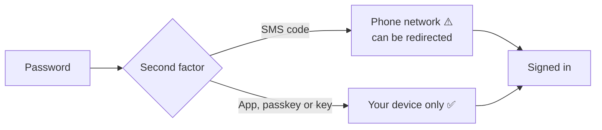

# 🛡️ Secure two-factor: from text messages to an app, a passkey or a key

**To whom it may concern.** This page is written to be handed to any member of an organisation we serve. Read it
on your own, or with the steward on a call. It takes five minutes to read and about ten to act on.

**TL;DR:**
1. **Two-factor** means signing in needs your password *and* something you have, such as your phone or a key.
2. **Text-message (SMS) codes count as two-factor, but they are the weakest kind.** A thief who talks your phone
   company into moving your number to their SIM ("SIM swap") receives your codes.
3. **Secure methods** are an authenticator app, a passkey, or a security key. None of them travel over the phone
   network.
4. An organisation can require secure methods only. Before an owner turns that on, everyone switches. Nobody is
   surprised and nobody is locked out.
5. **You never send anyone your password, a code, or your recovery codes.** Not the steward, not a helper, not
   an AI.

---

## 🔑 Why this matters to *you*

Your GitHub account opens the organisation's private rooms: proposals, procedures, sometimes legal papers. If
someone takes over your account, they walk in as you. The organisation's own records hold the line only if every
door does.

| Method | How the code reaches you | Can a stranger intercept it? | Verdict |
|---|---|---|---|
| Text message (SMS) | over the phone network | yes, by SIM swap or a hijacked number | works today, being retired |
| Authenticator app (Google Authenticator, Microsoft Authenticator, 1Password, Authy…) | generated on your phone, never sent | no | ✅ secure |
| Passkey (your phone's or computer's fingerprint or face unlock) | never leaves your device | no | ✅ secure, and the easiest |
| Security key (YubiKey and similar) | a USB/NFC key you touch | no | ✅ secure |

---

## 🧭 Switching, step by step (about ten minutes)

1. Sign in at **github.com** as yourself.
2. Click your picture (top right) → **Settings** → **Password and authentication**.
3. Under **Two-factor methods**, add a secure one:
   - **Passkey:** *Add a passkey* and follow your phone's or computer's prompt. Easiest.
   - **Authenticator app:** *Add* next to "Authenticator app", scan the square code with the app, type the
     six-digit code it shows.
   - **Security key:** *Add* next to "Security keys" and touch the key.
4. **Save your recovery codes** (download or print them) somewhere only you can reach. They are the way back in
   if you lose your phone.
5. Only now, remove **SMS/Text message** from the list, and set the new method as **preferred**.
6. Tell the steward, in one line, "switched". No codes, no screenshots of codes.

> **No two-factor yet at all?** Same page, **Enable two-factor authentication**. Choose the app or a passkey from
> the start and skip text messages entirely.

---

## 🏛️ For owners: turning the requirement on

In **Organisation settings → Authentication security**:
- **Require two-factor authentication** removes anyone without two-factor.
- **Only allow secure two-factor methods** excludes text messages.

GitHub's settings page says who would be affected. Read the member list first:
`gh api "orgs/<org>/members?filter=2fa_disabled"`. Then ask each person, kindly and by name, before you save. A
member who joined before a rule is "grandfathered" only until the owner saves the stricter setting. Give them this
page, a date, and a call if they want one.

*Related: [JOIN-AN-ORGANIZATION.md](JOIN-AN-ORGANIZATION.md) (two-factor when you join),
[ORG-SECURITY-SETTINGS.md](ORG-SECURITY-SETTINGS.md) (the rest of an owner's security clicks), and SOP-COM-001
*New to GitHub: your first hour* in each organisation's `ops-standard-operating-procedures`.*
