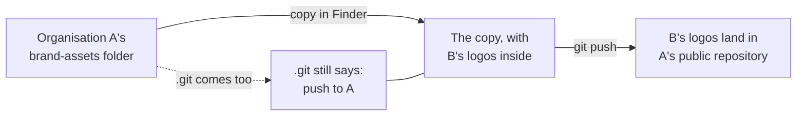

<div align="center">


# Show hidden files, and check where a copy pushes

### For Mac users who copy folders: your copy remembers where it came from

*Press three keys to see what Finder is hiding. Run one command after any copy.*


</div>

##  TL;DR

1.  **In Finder, ⌘⇧. (Command, Shift, full stop) shows hidden files.** Press it again to hide them. Anything whose name starts with a dot is normally hidden.
2.  **`.git` is one of those.** It holds the folder's whole history, and the address it pushes to.
3.  **Copying a folder copies its `.git`, address included.** The copy still pushes to the original, whatever you rename it.
4.  **After any copy, run `git remote -v`** and read the address. It takes five seconds.
5.  **Copying to start something new? Remove the copy's `.git` and start fresh.** Changing only the address would carry the old history along too.

##  See what Finder hides

1. Open the folder in Finder.
2. Press **⌘⇧.** (hold Command and Shift, then tap the full stop). *You should see:* dimmed items appear, such as `.git` and `.gitignore`.
3. Press **⌘⇧.** again whenever you want them hidden. The setting stays as you left it.

The same three keys work in a program's Open and Save windows. In Terminal, `ls -a` lists them.

| | Hidden name | What it is | Why you care when copying |
|---|---|---|---|
|  | `.git` | the folder's history, and where it pushes | **it travels with the copy** |
|  | `.github` | automation and shared settings | a copied workflow keeps running in its new home, once pushed |
|  | `.gitignore` | the list of what git should leave out | usually fine to keep |
|  | `.env` | often holds passwords and keys | **never share or send one.** Look for it before you zip a folder or send it to anyone |
|  | `.DS_Store` | Finder's own notes on how the folder looks | harmless; leave it out of a repository |

On Windows, the same switch is in File Explorer: **View → Show → Hidden items**.

##  A worked example

Say two organisations each keep their logos in a repository called `brand-assets`. Organisation A's is already set up,
and it's public. Organisation B needs the same shape, so you copy A's folder and swap in B's logos.

The folder looks like B's now, but its hidden `.git` still says A. So this happens:



Nothing warns you, because to git this is an ordinary push from someone allowed to push there. Pressing ⌘⇧. shows you
that `.git` is there, and one command tells you where it points.

##  After any copy

**Check it.** In Terminal, go into the copy and ask where it pushes:

```sh
cd path/to/the-copy
git remote -v
```

*You should see:* two lines, ending `(fetch)` and `(push)`, each with an address such as
`https://github.com/<organisation>/<repository>.git`. **Read the organisation's name out loud.** If it isn't where this
copy belongs, don't push.

**Then choose one of these:**

| | What you wanted | What to do | Why |
|---|---|---|---|
|  | A second working copy of the same repository | nothing; the address is right | it should push to the same place |
|  | The start of a **new** repository, for someone else | drag the copy's `.git` to the Trash (⌘⇧. shows it), run `git init`, then add the new address (below) | starts with a clean history, so nothing of the old house comes along |
|  | The same repository, moved to a new address | `git remote set-url origin <new address>` | keeps the history, on purpose |

Starting fresh, after the `.git` is in the Trash:

```sh
git init
git remote add origin https://github.com/<organisation>/<repository>.git
git remote -v
```

*You should see:* the new address, and only that.

> [!WARNING]
> **Changing only the address isn't enough for a new home.** With `set-url`, the old `.git` keeps every earlier commit,
> and a push sends them all to the new repository. If that history is private to someone else, start fresh instead.

##  If it already happened

If a push went to the wrong repository, **stop and tell the repository's steward** before pushing anything else. Note the
branch and the time. Don't try to rewrite history on your own: a repository often has rules that refuse it, and on a public
one the files may already have been read. The steward decides what happens next, and fixes the copy's address first, so
it can't happen twice.

##  Related

- [SOP-COM-001, *New to GitHub: your first hour*](../sop-template/repo/COM/SOP-COM-001-new-to-github-your-first-hour.md), its section *Later, on a Mac*
- [`NESTED-REPOS-GUIDE.md`](../NESTED-REPOS-GUIDE.md): where each clone belongs, so you rarely need to copy one
- [Working with the fleet](WORKING-WITH-THE-FLEET.md): pull first, and pull requests rather than copies
