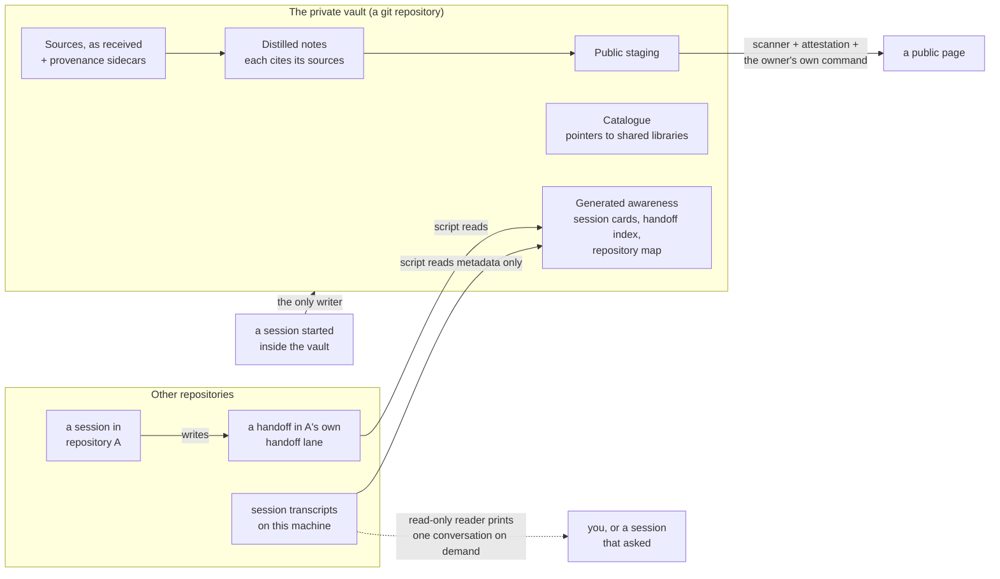

# The second brain

### A private vault that is also a git repository: what it holds, who writes it, and how to start one

*Five parts, pages that scripts write and people never edit by hand, and one road out to the public.*

 **You are here:** drasticstatic lab › [`my-template`](../README.md) › [`walkthroughs/`](README.md) › `THE-SECOND-BRAIN.md` · public · `main` is the working branch

##  TL;DR

1.  **A second brain is a private vault that is also a git repository:** a folder of Markdown notes that a notes app can open, with history, so every change has an author and a date.
2.  **Five parts:** generated awareness, sources as received, distilled notes that cite them, a catalogue of shared libraries by pointer, and a staging area for anything public.
3.  **Generated pages are written by scripts, never by hand.** Change the script and run it again.
4.  **Any session may read it; only a session started inside it writes it.** A session elsewhere leaves a handoff in its own repository's lane, and an index picks it up.
5.  **It is not a backup and not a place for secrets.** A personal vault and an organisation's shared vault are separate repositories, with no path from the shared one into the personal one.

> **Handing this to your AI helper?** Say: *"Read THE-SECOND-BRAIN.md and help me lay out a private vault from it.
> Make the folders and the first README; don't create a GitHub repository or push anything."*

##  The five parts

| | Part | What goes in it | Who writes it | A folder name you could use |
|---|---|---|---|---|
|  | **Generated awareness** | a map of your repositories, one card per session, an index of every handoff, daily check notes | scripts only | `awareness/` |
|  | **Sources, as received** | an export, a report, a retrieved page, each exactly as it came, with a small sidecar file saying where and when it came from | a person or a helper, once; never edited afterwards | `sources/<source>/` |
|  | **Distilled notes** | what you concluded, in your own words, each note listing the sources it rests on | a helper proposes, a person approves | `notes/` |
|  | **A catalogue of shared libraries** | pointers to libraries that live elsewhere (an organisation's procedures, a public library of reviews), never copies of them | a person or a helper | `catalogue/` |
|  | **Public staging** | anything meant for a public page, waiting behind the public-lane scanner and an attestation | a helper prepares; a person publishes | `public-staging/` |

##  How the layer fits together

**The same thing in words.**

- **Sessions do their work in their own repositories.** When one wants the vault to know something, it writes a handoff into its own repository's coordination lane, its `created-by-<you>/` folder ([the lanes are described here](https://github.com/drasticstatic/my-template/blob/main/AGENT-SYNC/README.md)), not into the vault.
- **Scripts read those lanes and the machine's session files** and write the generated pages: a card per session, an index of handoffs, a map of repositories. A **card holds metadata only**: when, where, how long, its title, where its handoffs are. It never holds the conversation.
- **A separate, read-only reader** prints one session's conversation when someone asks for it by ID or title. It writes nothing. So the vault can describe every session without storing what was said in any of them.
- **Sources come in once and stay as they came.** Each sits beside a sidecar (`<file>.source.yml`, for example) that says where it came from, when, and who brought it.
- **Notes are distilled from sources and cite them.** A note starts as *proposed* with its list of sources; the person approves it. A claim from a vendor or a forum is written as theirs.
- **The catalogue points; it does not copy.** An organisation's material stays in the organisation's repositories, and the vault links to it.
- **The only way out is public staging:** the public-lane scanner reads every file ([`scripts/scan-public-lane.sh`](../scripts/README.md#scan-public-lanesh--the-public-lane-tripwire-master-copy)), an attestation records who read what the scanner flagged, and the owner publishes with their own command.
- **Only a session started inside the vault writes to it.** Any session anywhere may read it.

##  A personal vault and a shared one

| | Personal vault | An organisation's shared vault |
|---|---|---|
| Whose | one person's | the organisation's, kept by its stewards |
| Visibility | private, always | private, with a public twin if the organisation wants one |
| Holds | everything above, across every house the person works in | the organisation's own notes, sources and catalogue |
| Path between them | the personal one may **point** at the shared one | **none** into the personal one: nothing in the shared vault links, syncs or copies from the personal vault |

They are separate repositories, so a member of the organisation who can read the shared vault cannot reach the personal one by any link inside it.

##  Start one from this template

The template ships the shape, the scanner and the hooks. It does not ship the vault's own scripts (the card writer, the handoff index, the reader); those are small and yours to write for your own machine. Each step below is one action.

1.  **Make a private repository from the template.** On this template's page on GitHub, **Use this template** › **Create a new repository**, choose the owner and a name, choose private visibility, then **Create repository from template** (GitHub's steps, [Creating a repository from a template](https://docs.github.com/en/repositories/creating-and-managing-repositories/creating-a-repository-from-a-template), read 2026-11-12). Making a repository is the owner's step, not a helper's. *You should see:* a new private repository with this template's files.
2.  **Clone it and turn on the hooks,** in the new clone: `sh scripts/install-hooks.sh`. *You should see:* the hook path set; every commit now needs its attribution footer ([`scripts/README.md`](../scripts/README.md)).
3.  **Lay out the coordination lanes** with the second command of the template's [Stop 1](../README.md#-stop-1--two-commands-every-clone), the scaffold script in `scripts/`. It detects that the repository is private and makes the private coordination folder and `logs/` ([which layout, and why](https://github.com/drasticstatic/my-template/blob/main/AGENT-SYNC/README.md)). *You should see:* the private layout, and no public lane.
4.  **Make the five folders,** each with a short `README.md` saying what goes in it and who writes it (the table above is a start). *You should see:* five folders and five READMEs in one commit.
5.  **Write `START-HERE.md`:** the one page any session reads first, saying what this vault is, that it is private, and where each kind of thing goes. Point the repository's `CLAUDE.md` at it, and write the two rules there: *read from anywhere, write only from a session started here*, and *generated pages are never hand-edited*. *You should see:* a new session started in the vault mention both rules unprompted.
6.  **Write your first generating script,** and make every page it writes begin with a line naming the script, so a reader knows not to edit it. A first one could list the newest handoff in each of your repositories' lanes. *You should see:* the page, and running the script twice gives the same page.
7.  **Open it as a vault in Restricted mode,** with no community plugins: the tutorial [Open your first vault](../tutorials/OPEN-YOUR-FIRST-VAULT.md) shows how, and which of the app's files to commit. *You should see:* your notes in the app, and the community plugins list committed as `[]`.
8.  **Try the road out once,** with a harmless page: put it in `public-staging/`, run `sh scripts/scan-public-lane.sh public-staging`, and read what it says. *You should see:* the scanner pass the page, or name a file and why.

##  What it is not

- **Not a backup.** It holds notes, pointers and generated pages, not copies of your repositories or your transcripts. Backups have their own road ([SOP-IT-010](../sop-template/repo/IT/SOP-IT-010-how-we-keep-our-data.md), [A nightly sealed copy of `~/.claude/projects`](CLAUDE-PROJECTS-ARCHIVE.md)).
- **Not a place for secrets.** No keys, tokens, passphrases, `.env` files, wallets or recovery phrases, ever: a pointer to the password manager item, at most. A secret scan on every commit catches the common shapes ([The secret scan](SECRET-SCAN.md)); it cannot catch everything.
- **Not a public lane.** Nothing leaves except through public staging and the owner's own command.
- **Not an organisation's records.** An organisation's material lives in the organisation's repositories and is linked from here, never copied in.
- **Not a store of conversations.** Cards hold metadata; the reader prints a conversation only when asked, and writes nothing.

##  Limits, honestly

- **"Only a session started inside writes it" is a rule, not a lock.** A helper elsewhere could still write into the folder. The rule is kept by the vault's `CLAUDE.md`, by review, and by the habit of handoffs.
- **Generated pages go stale** between runs. Each says when it was written.
- **A card is only as good as the session files it reads.** A transcript removed by the retention sweep leaves its card describing a session that can no longer be read; [SOP-IT-902](../sop-template/repo/IT/SOP-IT-902-salvaging-a-session-whose-transcript-is-gone.md) is what to do then.

##  Suggest a change

Noticed something wrong, or a part that could be kinder? Open an [issue](https://github.com/drasticstatic/my-template/issues) or a pull request against `main`, changing this page. A person with the role reads it and merges with a merge commit, so your name stays on it. An AI helper may do all of that up to the merge. Not on GitHub? Tell any steward you know, or your helper, in your own words.

##  Change log
| Date | Change |
|---|---|
| 2026-11-12 | First version: the five parts, how they fit (one picture and the same in words), personal and shared vaults, starting one from this template, what it is not. No PDF yet. |

Written 2026-11-12 in the drasticstatic lab. The design is the fleet's own practice; the one vendor step (GitHub's, in step 1) is cited where it is used. Related: [Open your first vault](../tutorials/OPEN-YOUR-FIRST-VAULT.md), [Many AI tools, one team](MANY-AI-TOOLS-ONE-TEAM.md). Part of the [walkthroughs](README.md). Icons: Phosphor duotone (MIT).
